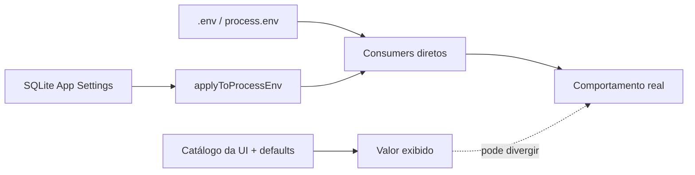

# 01 — Auditoria do estado atual

> Documento histórico anterior à remoção do runtime Rust. Os caminhos e resultados descrevem o checkpoint da época; consulte o [estado atual](../runtime-retirement.md).

> **Natureza:** evidência do baseline, não desenho alvo  
> **Baseline de código:** `c817f13ec0fd4073db7a70e3c07f3714a3a54e4e`  
> **Snapshot vivo:** 2026-08-04; valores vivos são temporais e não são segredos

## 1. Método e limites

A auditoria combinou:

- busca estática em `apps`, `packages` e arquivos de ambiente, excluindo
  testes e artefatos gerados;
- inspeção de `AppSettingsStore`, catálogo administrativo e consumers;
- trace da montagem do `ToolRegistry` até o payload do provider;
- trace de skills, MCP externo e discovery tools;
- leitura read-only do SQLite vivo pelo runtime Electron correto;
- leitura de bundles de sessões globais e telemetria de turnos;
- comparação com a arquitetura normativa do runtime Rust.

Os números vivos são baseline, não SLA. Eles devem ser recapturados de forma
automatizada na Fase 0 antes de qualquer alteração de comportamento.

## 2. Sumário executivo

O problema não é apenas “muitas flags”. Existem três autoridades concorrentes:



Consequências confirmadas:

- a UI pode exibir um default diferente do fallback executado;
- `applyToProcessEnv()` copia apenas rows SQLite, não defaults do catálogo;
- imports ESM podem avaliar constantes antes do bootstrap dentro de
  `createApp()`;
- settings mutados no processo principal não alteram constantes já capturadas
  nem uma attempt/worker já iniciada;
- flags continuam catalogadas depois que o consumer desaparece;
- algumas pipelines ligadas não têm efeito observável no caminho atual.

## 3. Inventário de configuração

### 3.1 Superfície

O scan semântico encontrou **208 identificadores `CODER_*` distintos** usados
como acesso direto/dinâmico de env, chave do catálogo ou chave de ambiente no
escopo de produção. Prefixos sintéticos e ocorrências apenas em testes/gerados
foram excluídos.

O catálogo administrativo contém:

- **179 settings** no total;
- **96 settings `CODER_*`**;
- defaults que não são injetados no runtime quando não há row SQLite.

O `.env` da raiz é ignorado pelo Git e não representa, por si só, o processo
Electron vivo. No snapshot, várias chaves presentes nesse arquivo apareceram
como `source=default` na API administrativa.

### 3.2 Ordem real

`packages/store/src/app-settings-store.ts` reporta:

```text
DB row > process.env > catalog default
```

Mas consumers leem `process.env` e possuem seus próprios fallbacks. Portanto o
default do catálogo não participa da execução, salvo se algum caller o copiar
explicitamente — e o bootstrap atual não faz isso.

O boot de `apps/http-api/server.ts` chama `applyToProcessEnv()` dentro de
`createApp()`, depois de o grafo de imports estáticos já ter sido avaliado. Há
consumers module-scoped em compaction, summarizer, code-exec, MCP bridge,
subagentes, web e watchdog.

### 3.3 Divergências confirmadas

| Chave | Default da UI | Fallback executado | Decisão de baseline |
|---|---:|---:|---|
| `CODER_AUTOCOMPACT_BUFFER` | 20.000 | 50.000 | comportamento executado |
| `CODER_COMPACT_PRESERVE_LAST_N_TURNS` | 4 | 2 | comportamento executado |
| `CODER_GREP_PER_FILE_CAP` | 10 | 8 | comportamento executado |
| `CODER_PRUNE_MINIMUM` | 20.000 | 60.000 | comportamento executado |
| `CODER_PRUNE_PROTECT` | 40.000 | 80.000 | comportamento executado |
| `CODER_DOMINANCE_RATIO` | 0,75 | 0,8 | comportamento executado |
| `CODER_DOMINANCE_WINDOW` | 8 | 15 | comportamento executado |
| `CODER_PARALLEL_AGENT_MAX` | 4 | 5 | comportamento executado |
| `CODER_BUG_WORKFLOW` | desligado | ligado quando ausente | comportamento executado |
| `CODER_SELF_REVIEW` | ligado | desligado quando ausente | override vivo desligado |

Uma migração não pode escolher o número da coluna “UI” automaticamente. Ela
deve materializar o valor efetivo por attempt e sua proveniência.

### 3.4 Rows vivas relevantes

O snapshot read-only encontrou overrides explícitos como `CODER_PROFILE`,
`CODER_SELF_REVIEW` e timeouts de stream, além de uma row obsoleta de
`CODER_MAX_AUTO_CONTINUES`. `applyToProcessEnv()` ignora a row obsoleta porque a
chave já não pertence ao catálogo, mas não a remove.

Isso confirma quatro estados diferentes para uma chave: reconhecida e ativa,
reconhecida mas divergente, desconhecida porém persistida, ou totalmente morta.

## 4. Montagem atual de tools

`runCoder()` cria um `ToolRegistry` mutável e registra, em lotes:

- tools nativas;
- gates de Company/produto;
- `code_exec` sobre o registry;
- MCP interno;
- MCP externo;
- plugins;
- `expand_toolset` e `find_tools`;
- subagentes;
- skills e meta-tools de skills.

`buildTools()` então reaplica filtros por disabled list, tier, pins, hooks,
goal, prioridade e cap. O default observado é 28 tools visíveis. A lista é
ordenada, mas o membership pode mudar por pins, output spill, refresh e outros
efeitos do turno.

### 4.1 Baseline de payload

Em oito bundles de sessão foram encontrados 2.253 registros principais de
turno, deduplicados por ID e excluindo subagentes/trash; eles pertencem a 26
runs e possuem métricas completas de catálogo:

| Métrica | Resultado observado |
|---|---:|
| tools visíveis | 28 em todos os 26 runs |
| chars de schemas visíveis | mediana 20.683; p95 21.821; máximo 22.661 |
| chars elegíveis antes do cap | mediana 117.129; p95 117.150 |
| system prompt | mediana 20.145; p95 21.081 chars |
| history | mediana 561.627; p95 713.282 chars |
| input tokens | mediana 156.247; p95 198.340 |
| runs com mais de um fingerprint de tools | 11 de 26 |

O cap reduziu a superfície visível, mas não eliminou catálogo grande, trabalho
de montagem ou churn de prefixo. Mudança de fingerprint só deveria ocorrer por
uma ativação explícita e auditável.

### 4.2 Tool selection sem efeito de redução

O thin selector usa top-K padrão 32 e retorna cedo quando a entrada tem no
máximo K itens. Ele é chamado depois de `buildTools()`, cujo cap padrão é 28.
Na combinação documentada pelo `.env` local (`MCP_PIPELINES_TOOL_SELECTION=1`)
com o K default, a pipeline não reduz o payload visível, embora mantenha wiring,
shadow/outcome e dependências de embedding. A telemetria viva também não mostra
execução recente suficiente para alegar benefício operacional.

## 5. Skills

O SQLite vivo contém:

- **122 skills habilitadas**;
- **831.911 chars** somados nos prompts;
- maior prompt com **65.521 chars**;
- 117 em modo `auto`, 3 em `both`, 2 em `tool`;
- apenas 5 elegíveis para `invoke_skill`.

Isto não significa que 831 mil chars sejam injetados em todo turno. O modo
normal é lazy para sessões não-Company. O problema é a fragmentação:

- preflight sugere skills sem alterar o estado ativo da sessão;
- ausência de projeção `active_skills` pode carregar todas as habilitadas como
  candidatas;
- há quatro operações de descoberta/consumo separadas;
- conteúdo integral é devolvido e contabilizado quando solicitado;
- skill é tratada parte como prompt, parte como tool, parte como dado de UI.

## 6. MCP externo

No snapshot vivo, dois servidores habilitados expunham:

| Servidor | Tools cacheadas | Chars de descrição |
|---|---:|---:|
| Unity editor | 308 | 57.669 |
| shadcn | 7 | 1.091 |
| **Total** | **315** | **58.760** |

O fluxo atual é:

```text
McpExternalPool (main)
  -> RPC de snapshot/call
  -> RemoteMcpServerManager (worker)
  -> ToolRegistry mutável
  -> tiers/cap/allowlist
  -> provider
```

`getReadySnapshot()` e o refresh seletivo corrigem disponibilidade tardia sem
derrubar conexões saudáveis. Esta propriedade deve ser preservada no host, mas
o snapshot da attempt Rust continua imutável: catálogo que fica pronto depois
é candidato à próxima attempt.

## 7. Preflight

Foram encontrados oito registros de input:

- 7 sucessos e 1 `provider_error`;
- mediana de latência: **5.637 ms**;
- o erro consumiu aproximadamente 20 s;
- tools sugeridas em 7 sucessos, normalmente 3–4 pins;
- skill sugerida em 1 de 8;
- memória sugerida em 3 de 8;
- projeto alvo sugerido em 7 de 8.

Há utilidade para roteamento de projeto e tools, mas custo, falha e baixa
cobertura de skills. Isso não justifica um LLM síncrono antes da primeira
request sem benchmark causal.

## 8. Pipelines e caches sem valor operacional comprovado

### 8.1 Context relevance

`MCP_PIPELINES_CONTEXT_RELEVANCE` é lida no boot, porém:

- o runner atual apenas importa os helpers e não chama a compactação global;
- a pipeline é construída com `getMessages: () => []`;
- o helper recebe mensagens para o precheck, mas a source do pipeline continua
  sendo a closure vazia;
- a última telemetria viva de `context_relevance` é de 2026-05-26.

No baseline, a flag é no-op.

### 8.2 Cache de subagente

`MCP_PIPELINES_SUB_AGENT_CACHE` envolve somente o spawn efêmero unitário. A
chave chamada pelo agente inclui prompt, tipo, lista declarada de arquivos,
profile e research policy, mas não inclui `projectIds` nem digest real do
conteúdo/commit/worktree.

O armazenamento vivo tinha 180 rows e zero hits; todas pertenciam a
`doc_search.rewriter`, nenhuma a `spawn_agent`. Tornar esse cache default seria
um risco de resposta obsoleta entre projetos/worktrees. Ele deve ser removido
ou redesenhado como cache content-addressed com isolamento correto.

## 9. Resíduos confirmados

Sem consumer de produção atual ou apenas comentário/row residual:

- `CODER_MAX_AUTO_CONTINUES`;
- `CODER_PROFILE_AUTO` como setting independente;
- `CODER_BT_ENABLED`;
- `CODER_LEGACY_RUNNER`;
- `MCP_PIPELINES_HOT_CACHE`;
- `MCP_PIPELINES_INDEXER_SEARCH_V2`;
- `MCP_PIPELINES_POLICY_HARD_BLOCK`;
- `MCP_PIPELINES_POLICY_HARD_BLOCK_LLM`;
- `MCP_PIPELINES_QUALITY_CLASSIFIERS`;
- `MCP_PIPELINES_TODO_PRIORITY`;
- `MCP_PIPELINES_RECENT_FILES_SOURCE` no caminho documentado;
- `MCP_QUALITY_ALERT_*`;
- `MCP_QUALITY_NUDGE_WAIT_TIMEOUT_MS`;
- `MCP_QUALITY_WATCHDOG_ENABLED`.

`MCP_PIPELINES_GRAPH_EXPANSION`, `MCP_SUPERVISOR_ENABLED` e configuração de
memory ainda possuem consumers, mas pertencem aos domínios indexer, Company e
memory; não devem sobreviver como flags genéricas do code-run.

## 10. Alinhamento com o runtime Rust

O corpus `rust-agent-runtime` já determina:

- tentativa single-tenant;
- control plane TypeScript;
- ToolHost para MCP/plugins/browser/LSP e integrações;
- tools nativas iniciais em Rust;
- capability descriptor separado do executor;
- capability-set hashado na attempt spec;
- Policy Engine sempre aplicado;
- snapshot imutável durante a attempt;
- accepted/started/terminal e `outcome_unknown`;
- legado somente como oracle/fallback temporário.

Logo, uma “grande refatoração” do `ToolRegistry` TypeScript seria investimento
no destino errado. As specs seguintes detalham o delta que falta no alvo Rust e
os bridges mínimos necessários para comparação e retirada do legado.
