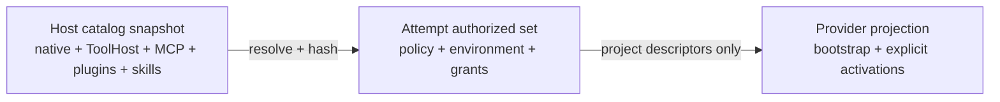

# 03 — Spec do sistema unificado de capabilities

> Documento histórico anterior à remoção do runtime Rust. Os caminhos e resultados descrevem o checkpoint da época; consulte o [estado atual](../runtime-retirement.md).

> **Status:** proposta normativa para aprovação  
> **Requisitos:** `CAT-*`  
> **Complementa:** `../rust-agent-runtime/04-capabilities-tools-and-provider-gateway.md`

## 1. Modelo em três camadas



### CAT-001 — Host catalog

O host mantém descriptors sanitizados, content-addressed e indexados. Executors
ficam separados. O catálogo completo nunca é serializado para o provider.

### CAT-002 — Attempt authorized set

Policy, environment, secrets disponíveis, resource grants e product mode
resolvem um conjunto imutável de capability refs na attempt spec. Search e
visibility não adicionam permissão.

### CAT-003 — Provider projection

O provider recebe somente os schemas necessários ao bootstrap e capabilities
explicitamente ativadas. A projeção pode revelar refs que já pertencem ao
authorized set, em boundary de turno, com evento e novo `projectionDigest`.

Alterar projeção não altera o `capabilitySetDigest`.

Para fins do requisito `CAP-046` da arquitetura superior, “snapshot imutável”
é o catálogo/conjunto de descriptors autorizado. A projeção é uma view
explicitamente versionada sobre esse conjunto. Se a implementação atual de
`CAP-046` tratar a projeção como parte do snapshot imutável, a ativação em
boundary de turno exige ADR antes de código; não se resolve a divergência com
mutação implícita.

## 2. Descriptor canônico

Além dos campos já exigidos pela spec Rust, o descriptor precisa suportar:

```text
capabilityId / descriptorVersion / executorVersion
canonicalName / aliases / namespace / displayName
sourceKind / sourceId / catalogRevision
summary / searchTextRef
inputSchemaRef / outputSchemaRef
instructionBundleRef
visibilityHints / activationCost
executionClass / mutates / parallelSafe / repeatPolicy
requirements / risk / outputPolicy / lifecycle
metadataTrust / enabled / deprecation
descriptorDigest
```

Schemas e instruções grandes são refs content-addressed. A busca opera sobre
summary/search text bounded; hydration integral ocorre somente na projeção.

### CAT-004 — Identidade

Nome amigável não é identidade. Colisão entre MCP/plugin/native não sobrescreve
descriptor. O provider pode receber alias curto determinístico, mapeado no
ledger para `capabilityId + version`.

### CAT-005 — Metadata externa

Description, schema e annotations de MCP/plugin são untrusted, têm limites de
tamanho/profundidade e nunca alteram risk, permission ou execution class sem
regra local assinada/versionada.

## 3. Descoberta e ativação

### CAT-006 — Um contrato

Uma capability bootstrap `capability_catalog` substitui as superfícies atuais.
Operações:

```ts
type CapabilityCatalogInput =
  | { op: 'search'; query: string; namespace?: string; limit?: number }
  | { op: 'describe'; capabilityIds: string[] }
  | { op: 'activate'; capabilityIds: string[] }
  | { op: 'list'; namespace?: string; cursor?: string; limit?: number };
```

`activate` só aceita refs do authorized set e só muda a próxima projeção. O
resultado informa `projectionDigest`, itens ativados/rejeitados e motivo.

### CAT-007 — Busca local e bounded

Search usa índice local com:

- match exato de nome/alias antes de ranking;
- lexical/FTS e metadata estruturada;
- semantic opcional pré-computado, nunca embed de todo catálogo por turno;
- filtros de namespace, source, environment e policy;
- tie-break determinístico por identidade;
- limite rígido de candidatos e bytes.

LLM não participa da seleção padrão.

### CAT-008 — Sem “expand all”

Não existe operação que despeje todo o tier/catálogo no provider. Listagem é
paginada e retorna summaries; ativação é explícita e limitada pelo schema
budget.

### CAT-009 — Estabilidade

Sem ativação explícita, a projeção e sua ordem permanecem byte-idênticas entre
turnos. Output spill, first-use de tool ou telemetry não podem inserir schema.

## 4. Tools nativas e ToolHost

### CAT-010

Tools nativas Rust e host capabilities usam o mesmo descriptor/lifecycle. A
diferença é o executor, não o contrato visto pelo modelo.

### CAT-011

ToolHost possui registry bounded por attempt com accepted/started/terminal,
deadline, cancel handle, fence e probe. Ele não recebe instância de runner nem
callback in-memory.

### CAT-012

Result preview é bounded. Conteúdo integral grande vira artifact/spool ref.
`get_tool_output` pode ser uma operação nativa estável do artifact store; sua
existência não pode depender de o primeiro spill já ter ocorrido.

## 5. Skills

### CAT-013 — Instruction bundle

Skill é um bundle versionado, content-addressed e com metadata de aplicação:

```text
skillId / version / namespace
summary / triggers / compatibility
instructionBundleRef / assets
requiredCapabilities
risk and provenance
```

Ela não cria uma classe paralela de registry.

### CAT-014 — Aplicação

- skills escolhidas antes do launch entram como refs na attempt spec;
- conteúdo só é hidratado quando ativado;
- ativação é registrada no `projectionDigest`/prompt manifest;
- skill não concede capabilities ausentes do authorized set;
- variáveis são interpoladas por schema, com escaping e limites;
- conteúdo repetido usa digest/cache e não é reinjetado sem mudança.

### CAT-015 — Compatibilidade

Durante a migração, chamadas antigas de namespace/list/get/invoke são adaptadas
para `capability_catalog`, com deprecation event. Novos callers não podem usar
as APIs antigas.

## 6. MCP e plugins

### CAT-016 — Revisão de catálogo

Cada fonte publica `sourceId + sourceRevision + health`. Mudança gera novo host
catalog snapshot. Snapshot da attempt existente não é alterado.

### CAT-017 — Readiness

Launch possui um deadline bounded para fontes requeridas. Servidor opcional que
não ficou ready é omitido e aparece no diagnóstico. Servidor requerido falha o
launch de forma tipada; não produz catálogo parcialmente autorizado.

### CAT-018 — Late readiness

Quando um MCP fica ready depois do launch:

1. o pool reconcilia somente a fonte afetada;
2. connections saudáveis permanecem;
3. o host publica nova revisão;
4. a próxima attempt pode resolvê-la;
5. a attempt atual não recebe descriptor novo.

Se a attempt atual pedir uma capability presente apenas na nova revisão, a
ativação retorna `not_in_attempt_snapshot` e a revisão disponível. O control
plane pode criar uma successor attempt com checkpoint explícito somente quando
isso não duplicar efeitos já aceitos; a antiga é terminada/fenced antes do novo
launch. Caso contrário, a capability fica disponível no próximo request do
usuário. Nunca há duas attempts executando o mesmo passo.

### CAT-019 — Execução e retry

MCP mutante após `accepted` nunca é repetido cegamente. Perda de transporte
produz `outcome_unknown` quando não há probe/idempotency suficiente.

### CAT-020 — Plugins

Manifest do plugin declara descriptors e executors; código do plugin não pode
mutar o catálogo diretamente. Install/enable/update publica uma nova revisão
assinada/fingerprinted.

## 7. Preflight

### CAT-021

O resolver inicial determinístico usa prompt, project bindings, product mode e
metadata das capabilities para montar o bootstrap projection.

### CAT-022

Preflight por LLM não bloqueia a primeira request no produto padrão. Ele pode
existir em shadow para comparar:

- recall de capability obrigatória;
- primeira tool correta;
- skill correta;
- tempo até primeiro provider byte;
- tokens/custo;
- sucesso da tarefa.

Só pode voltar ao caminho crítico por ADR e evidência causal.

## 8. Cache

### CAT-023

Cache de catalog/search usa digest de descriptor e é seguro entre sessions.

### CAT-024

Cache de resultado de agente só é permitido quando a chave inclui, no mínimo:

- tenant/user boundary;
- project/environment binding e revision;
- commit/worktree content digest pertinente;
- prompt/policy/model/skill/capability digests;
- validade e side-effect class.

Na ausência desses dados, a operação executa de novo. Resultado de agente
mutante nunca é reutilizado como se a mutação tivesse ocorrido.

## 9. Observabilidade

Eventos mínimos:

```text
catalog_snapshot_published
attempt_capability_set_resolved
provider_projection_created
capability_search_completed
provider_projection_changed
capability_activation_rejected
source_readiness_changed
legacy_capability_alias_used
```

Métricas incluem bytes/schema, catalog candidates, search latency/recall,
activation count, projection churn, policy rejects e MCP readiness. Prompt,
schema sensível e secret não entram em labels/logs.

## 10. Provas obrigatórias

| Área | Prova |
|---|---|
| hash | golden Rust/TS para catalog, set e projection |
| search | corpus determinístico incluindo Unity, skills, plugins e colisões |
| policy | search/visibility nunca concede autorização |
| stability | projeção idêntica sem ativação |
| activation | capability aparece no turno seguinte e ledger registra digest |
| MCP | ready, late, disconnect, mutation unknown e selective reconnect |
| skills | seleção, hidratação, cache, interpolação e capability requirements |
| output | preview/artifact/refetch sem schema churn |
| providers | limites de tools/schema e nomes em cada wire suportado |
