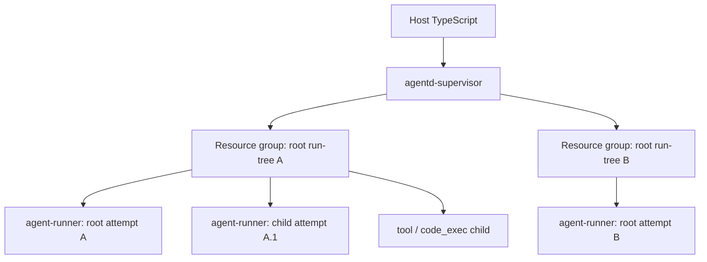

# 01 — Supervisor, lifecycle e isolamento

> **Status:** normativo  
> **Requisitos:** `RUN-*`  
> **Owner futuro:** `agentd-supervisor`, `agent-runner`, `agent-platform`

## 1. Topologia



O supervisor é o único processo Rust duradouro. Cada `AgentRunAttempt` recebe
um runner exclusivo. Child attempts pertencem ao orçamento agregado do root,
mas continuam com processo, lease, fencing e terminal próprios.

## 2. Responsabilidades

### Supervisor

- negociar protocolo com o host;
- reservar orçamento global;
- criar resource group;
- iniciar o runner já contido;
- manter handles de processo, pipe e resource group;
- coletar heartbeat e métricas;
- aplicar deadline, cancelamento, fencing e hard kill;
- reaper subprocessos e scratch;
- classificar causa física de saída;
- lançar child attempts somente após autorização do host.

### Runner

- validar spec, checkpoint e capability snapshot;
- executar exatamente uma attempt;
- manter hot context limitado;
- coordenar provider, tools, subagentes e interações;
- produzir checkpoints, artifacts e eventos;
- nunca criar uma nova authority;
- sair depois de `TerminalCommitted` ou ordem fatal do supervisor.

### Host

- criar command, run, attempt, lease e fencing;
- resolver provider, environment, capabilities e policy;
- persistir journal/checkpoint/terminal;
- cancelar operações host-owned;
- decidir recovery/resume/fallback;
- projetar o estado para UI.

## 3. Estado físico do runner

```text
allocated
  -> spawning
  -> handshaking
  -> hydrating
  -> prepared
  -> active
  -> checkpointing | cancelling | terminalizing
  -> exiting
  -> reaped
```

Transições proibidas falham fechado e geram `protocol_violation`.

| Estado físico | Estado persistido da attempt |
|---|---|
| `allocated`–`prepared` | `starting` |
| `active`–`terminalizing` | `running` |
| `exiting`–`reaped` | `terminal` após commit do host |

`prepared` não pode chamar provider nem capability. A execução começa somente
após `ActivateAttempt` válido.

## 4. Sequência de lançamento

1. Host aceita `SessionCommand` de modo idempotente.
2. Host cria/resgata o `AgentRun`.
3. Host cria attempt, owner, epoch e lease.
4. Host resolve deadline e `ResolvedAttemptSpec`.
5. Supervisor reserva orçamento global.
6. Supervisor cria resource group com limites.
7. Supervisor cria runner contido desde a primeira instrução.
8. Runner envia `AgentHello`.
9. Host/supervisor negociam versão e limites.
10. Host envia `PrepareAttempt`.
11. Runner valida hashes, refs e platform guarantees.
12. Runner envia `AttemptPrepared`.
13. Host persiste `agent_run.started` e estado running.
14. Host envia `ActivateAttempt`.
15. Runner inicia o loop.

Qualquer falha antes do passo 14 é `start_failed`; nenhum provider/tool pode ter
sido chamado. O host PODE retry com nova attempt.

## 5. Identidade física

### RUN-001

O supervisor DEVE indexar cada processo por:

```text
sessionId
commandId
agentRunId
attemptId
executorOwnerId
fencingEpoch
rootAgentRunId
pid
resourceGroupId
runtimeInstanceId
```

### RUN-002

Um runner atribuído NÃO DEVE receber outra attempt, mesmo após sucesso.

### RUN-003

Recovery, resume e provider fallback DEVEM criar attempt nova e epoch maior.

### RUN-004

PID não é identity durável. Mensagem stale com PID reutilizado falha por
`runtimeInstanceId + attemptId + fencingEpoch`.

## 6. Liveness, progresso e lease

Heartbeat DEVE separar:

- `lastAliveAt`: event loop do executor respondeu;
- `lastProgressAt`: ocorreu avanço semântico;
- `lastEventSeq`;
- provider operations ativas;
- capability operations ativas;
- child attempts ativas;
- fase física;
- métricas de recurso.

### RUN-005

Timer cego do host NÃO DEVE renovar lease sem heartbeat recente do executor.

### RUN-006

Heartbeat não estende `deadlineAt` nem `maxWallMs`.

### RUN-007

Silêncio legítimo de provider não é hang se:

- heartbeat continua;
- deadline não expirou;
- provider operation permanece registrada;
- budget não foi excedido.

### RUN-008

Uma operation sem progresso PODE ter deadline próprio menor que o run.

## 7. Reaper e cancelamento

O reaper pertence ao novo supervisor. Ele não depende do watchdog legado.

### Fluxo normal

1. Host ou supervisor detecta abort, fence, deadline ou shutdown.
2. Authority é fechada no control plane.
3. Supervisor bloqueia novas operations.
4. Host cancela providers/capabilities por `operationId`.
5. Runner recebe `CancelAttempt` com grace deadline.
6. Runner cancela tasks cooperativas e drena eventos críticos.
7. Se possível, runner propõe checkpoint/terminal.
8. No fim da graça, supervisor encerra o resource group.
9. Host persiste um único terminal.
10. Supervisor reaps handles, pipes, processos e scratch.

### RUN-009

Perda de fencing cancela imediatamente qualquer nova admissão. Cleanup não
autoriza side effects adicionais.

### RUN-010

Hard kill DEVE atingir apenas a attempt/run-tree alvo.

### RUN-011

Operações host-owned continuam sendo responsabilidade do host. Matar o runner
sem cancelar provider/MCP/plugin NÃO conclui o reaper.

### RUN-012

`outcome_unknown` é obrigatório quando uma mutação passou por `accepted` ou
`dispatch_started` e o resultado não pode ser provado.

## 8. Waiting, detach e retomada

### RUN-013

Espera por humano não mantém processo residente:

1. runner emite `InteractionRequest`;
2. host persiste interação;
3. runner cria checkpoint;
4. host confirma checkpoint;
5. attempt terminaliza como `checkpointed_waiting`;
6. processo é reaped;
7. resposta humana cria command/resume e attempt nova.

### RUN-014

Background/detached usa a mesma máquina de estados. `waitMode` afeta o caller,
não cria um executor alternativo.

### RUN-015

Checkpoint nunca contém authority reutilizável, secret material ou handles.

## 9. Child attempts e run-tree

### RUN-016

Todo subagente visível, retomável ou persistido é child `AgentRun` e recebe
processo próprio.

### RUN-017

O runner pai solicita `SpawnChildRun`; somente o host cria run/attempt e somente
o supervisor lança processo.

### RUN-018

O filho recebe budget delegado que não pode exceder o saldo do root.

### RUN-019

O pai recebe somente status, preview limitado, usage e artifact refs. Transcript
integral do filho não entra no heap do pai.

### RUN-020

Cancelar root cancela filhos, salvo child explicitamente transferido para outro
owner por protocolo durável. Transferência implícita é proibida.

## 10. Resource budget

`ResolvedAttemptSpec` DEVE declarar:

```text
softMemoryBytes
hardMemoryBytes
cpuTimeMs
maxWallMs
maxProcesses
maxThreads
maxOpenHandles
maxHotTranscriptBytes
maxIpcFrames
maxIpcBytes
maxSpoolBytes
maxArtifactBytes
maxConcurrentTools
maxBlockingTasks
cancelGraceMs
```

### RUN-021

Valores `0`, ausentes ou ilimitados só são aceitos quando o schema declarar
explicitamente `unlimited` e a policy permitir. Defaults implícitos são
proibidos.

### RUN-022

O supervisor reserva `hardMemoryBytes`, process slots e spool antes do spawn. A
soma das reservas não pode exceder o orçamento global configurado.

### RUN-023

Soft watermark:

- impede novas tools/subagentes;
- reduz/coalesce streaming;
- tenta checkpoint;
- emite observação crítica.

Hard watermark:

- fecha authority;
- classifica `hard_memory`;
- termina o resource group.

## 11. Windows

### RUN-024

Cada root run-tree DEVE possuir Job Object agregado. Child attempts PODEM usar
Jobs aninhados mais restritivos.

Configuração mínima:

- `JOB_OBJECT_LIMIT_JOB_MEMORY`;
- `JOB_OBJECT_LIMIT_PROCESS_MEMORY` quando houver cap individual;
- `JOB_OBJECT_LIMIT_ACTIVE_PROCESS`;
- `JOB_OBJECT_LIMIT_KILL_ON_JOB_CLOSE`;
- completion port ou mecanismo equivalente de notificação.

### RUN-025

O supervisor DEVE ser o único owner do último handle `KILL_ON_JOB_CLOSE`; o
handle não é herdado pelo runner.

### RUN-026

O processo nasce contido por `PROC_THREAD_ATTRIBUTE_JOB_LIST` ou é criado
suspenso, associado e só então retomado. Spawn livre seguido de attach é
proibido.

### RUN-027

Como Electron/launchers podem já estar dentro de Job, dev, packaged e tests
DEVEM executar capability probe de nested Jobs. Falha de containment falha
fechado para cohorts que exigem hard isolation.

### RUN-028

Limite de commit não implica kill automático. O supervisor reage a soft/hard
notification e usa `TerminateJobObject` quando necessário.

## 12. Linux e macOS

### RUN-029

O adapter Linux DEVE usar cgroup v2 quando disponível e declarar os limites
efetivamente aplicados. Fallback com garantia menor deve ser visível ao host.

### RUN-030

O adapter macOS DEVE combinar process group, limits disponíveis e watchdog.
Não pode anunciar hard aggregate isolation sem prova.

### RUN-031

Cada plataforma retorna:

```text
containmentLevel = hard_aggregate | hard_process | monitored | unavailable
enforcedLimits[]
unsupportedLimits[]
```

Canário de mutação requer `hard_aggregate` ou aprovação explícita de risco.

## 13. Tokio e threads

### RUN-032

Defaults de Tokio são proibidos. O runner usa:

- runtime `current_thread` ou 1–2 async workers explicitamente;
- `max_blocking_threads` pequeno e explícito;
- stack size explícito;
- semaphore antes de blocking/CPU work;
- channels bounded.

### RUN-033

`spawn_blocking` só aceita operação curta e garantidamente finita. Trabalho
longo, não cancelável ou que executa código externo vai para subprocesso.

### RUN-034

Toda task pertence a `RunTaskGroup`. `tokio::spawn` fora desse grupo falha em
lint/review.

### RUN-035

Terminal aguarda `RunTaskGroup` vazio ou hard-kill documentado.

## 14. Prewarm

O supervisor PODE manter de zero a dois runners vazios:

- cada um já nasce em resource group próprio;
- não recebe session data antes da atribuição;
- é atribuído uma única vez;
- morre depois da attempt;
- reposição ocorre fora do caminho crítico.

### RUN-036

Prewarm só é habilitado se reduzir TTFT sem violar memória idle e isolamento.

### RUN-037

Processo prewarmed incompatível com protocol/build/catalog hash é descartado.

## 15. Causas físicas de saída

```text
completed
checkpointed_waiting
checkpointed_detached
user_abort
deadline
budget_exhausted
lease_lost
soft_memory
hard_memory
provider_fallback
host_shutdown
protocol_violation
crash
internal_error
```

Exit code isolado nunca é a classificação final. Supervisor combina:

- terminal ACKado;
- Job/cgroup notification;
- signal/exception;
- deadline/fence vigente;
- último heartbeat;
- estado de operação.

## 16. Verificação obrigatória

| Requisito | Prova mínima |
|---|---|
| RUN-001–004 | Contract test de identidade e PID reuse |
| RUN-005–012 | Chaos de hang, fence, ACK perdido e hard kill |
| RUN-013–015 | E2E wait/resume com processo ausente durante espera |
| RUN-016–020 | Fan-out/fan-in, abort root e child recovery |
| RUN-021–023 | Admission e memory pressure tests |
| RUN-024–028 | Testes Windows dev, packaged e runner isolado |
| RUN-029–031 | Matriz real Linux/macOS |
| RUN-032–035 | Teste de thread/task leak e configuração inspecionável |
| RUN-036–037 | Benchmark A/B cold versus prewarm |

