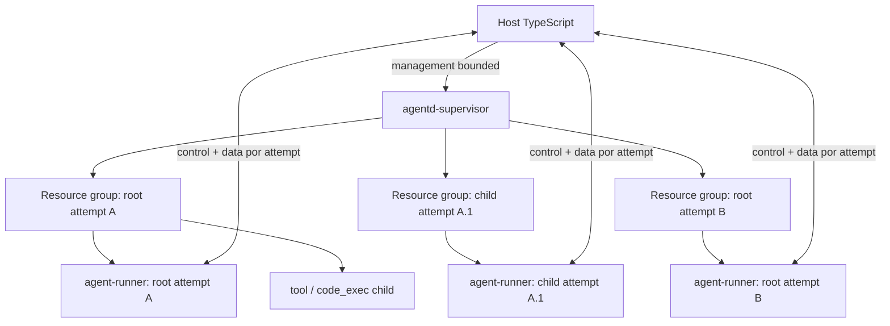

# 01 — Supervisor, lifecycle e isolamento

> **Status:** normativo  
> **Requisitos:** `RUN-*`  
> **Owner futuro:** `agentd-supervisor`, `agent-runner`, `agent-platform`

## 1. Topologia



O supervisor é o único processo Rust duradouro. Cada `AgentRunAttempt` recebe
um runner exclusivo. Child attempts pertencem ao orçamento agregado do root,
mas continuam com processo, lease, fencing e terminal próprios.

O supervisor não é proxy de provider, tool, transcript ou live delta. O host
mantém um canal de management pequeno com o supervisor e dois canais
per-attempt diretamente com cada runner. Isso impede que o processo duradouro
se torne uma segunda fila de payloads. Um pulse channel privado e bounded entre
runner e supervisor carrega apenas liveness/progress físico.

## 2. Responsabilidades

### Supervisor

- negociar protocolo com o host;
- reservar orçamento global;
- criar resource group;
- iniciar o runner já contido;
- manter handles de processo, pipe e resource group;
- coletar pulse físico e métricas;
- aplicar deadline, cancelamento, fencing e hard kill;
- reaper subprocessos e scratch;
- classificar causa física de saída;
- lançar child attempts somente após autorização do host.

### Runner

- validar spec, checkpoint e capability snapshot;
- executar exatamente uma attempt;
- manter hot context limitado;
- coordenar provider, tools, subagentes e interações;
- produzir checkpoints, artifacts e eventos;
- nunca criar uma nova authority;
- sair depois de `TerminalCommitted`, de um `AttemptExitCommitted`
  não-terminal, ou de ordem fatal do supervisor.

### Host

- criar command, run, attempt, lease e fencing;
- resolver provider, environment, capabilities e policy;
- solicitar commits de journal/checkpoint/terminal ao Rust session store e
  aguardar o receipt durável;
- cancelar operações host-owned;
- decidir recovery/resume/fallback;
- projetar o estado para UI.

### Rust session store

- possuir writer queue, storage generation e lease epoch por sessão;
- atribuir sequência global e confirmar journal/artifacts/checkpoints/métricas;
- recuperar tail incompleta e rejeitar divergência;
- servir queries/projeções sem expor paths mutáveis ao Host ou runner;
- permanecer independente do supervisor e do lifetime de uma attempt.

## 3. Estado físico do runner

```text
allocated
  -> spawning
  -> handshaking
  -> hydrating
  -> prepared
  -> active
  -> checkpointing | cancelling | terminalizing
  -> exiting
  -> reaped
```

Transições proibidas falham fechado e geram `protocol_violation`.

| Estado físico | Estado persistido da attempt |
|---|---|
| `allocated`–`prepared` | `starting` |
| `active`–`terminalizing` | `running` |
| `exiting`–`reaped` | `terminal` após commit do host |

`prepared` não pode chamar provider nem capability. A execução começa somente
após `ActivateAttempt` válido.

## 4. Sequência de lançamento

1. Host aceita `SessionCommand` de modo idempotente.
2. Host cria/resgata o `AgentRun`.
3. Host cria attempt, owner, epoch e lease.
4. Host resolve deadline/`ResolvedAttemptSpec`, gera o activation nonce e sela
   versões mais `SHA-256(nonce)` no launch.
5. Supervisor valida o seal e reserva orçamento global.
6. Supervisor cria resource group com limites.
7. Supervisor cria runner contido desde a primeira instrução.
8. Runner envia `AgentHello`.
9. Host/supervisor negociam versão e limites.
10. Host envia `PrepareAttempt`.
11. Runner valida hashes, refs e platform guarantees.
12. Runner envia `AttemptPrepared`.
13. Host persiste `agent_run.started` e estado running.
14. Host envia `ActivateAttempt` coerente com o seal durável.
15. Runner commita o ACK, instala `ActiveAuthority` e só então inicia o loop.

Qualquer falha antes do passo 14 é `start_failed`; nenhum provider/tool pode ter
sido chamado. O host PODE retry com nova attempt.

## 5. Identidade física

### RUN-001

O supervisor DEVE indexar cada processo por:

```text
sessionId
commandId
agentRunId
attemptId
executorOwnerId
fencingEpoch
rootAgentRunId
pid
resourceGroupId
runtimeInstanceId
```

### RUN-002

Um runner atribuído NÃO DEVE receber outra attempt, mesmo após sucesso.

### RUN-003

Recovery, resume e fallback lógico que troca provider/model DEVEM criar attempt
nova e epoch maior. Retry físico interno do mesmo Provider Gateway operation
não é fallback lógico e permanece na attempt corrente.

### RUN-004

PID não é identity durável. Mensagem stale com PID reutilizado falha por
`runtimeInstanceId + attemptId + fencingEpoch`.

## 6. Liveness, progresso e lease

Heartbeat DEVE separar:

- `lastAliveAt`: event loop do executor respondeu;
- `lastProgressAt`: ocorreu avanço semântico;
- `lastEventSeq`;
- provider operations ativas;
- capability operations ativas;
- child attempts ativas;
- fase física;
- métricas de recurso.

O `Heartbeat` semântico segue ao host pelo control channel e os rollups
duráveis são submetidos ao Rust session store. Em paralelo, o runner envia
`RunnerPulse` mínimo ao supervisor. Pulse não renova lease, não entra no
journal e não carrega conteúdo de domínio.

### RUN-005

Timer cego do host NÃO DEVE renovar lease sem heartbeat recente do executor.

### RUN-006

Heartbeat não estende `deadlineAt` nem `maxWallMs`.

### RUN-007

Silêncio legítimo de provider não é hang se:

- heartbeat continua;
- deadline não expirou;
- provider operation permanece registrada;
- budget não foi excedido.

### RUN-008

Uma operation sem progresso PODE ter deadline próprio menor que o run.

## 7. Reaper e cancelamento

O reaper pertence ao novo supervisor. Ele não depende do watchdog legado.

### Watchdog e bridge físico por attempt

Depois que o launch protegido conclui, o supervisor DEVE instalar para a
`OwnershipKey` exata um watchdog inicial em:

```text
min(hard_deadline_at, authority_lease_expires_at)
```

Esse watchdog nasce junto do ownership físico e não fecha a admissão global.
Assim, uma attempt sem tráfego posterior continua coberta por hard kill sem
afetar launches independentes.

`CancelAttemptProcess`, `FenceAttemptProcess` e `ReapAttemptProcess` são
comandos target-specific. Antes de alterar qualquer schedule ou chamar o
adapter físico, o supervisor DEVE:

1. ligar a identity completa à `OwnershipKey` vigente;
2. em `ReapAttemptProcess`, validar também o `runtimeInstanceId` exato;
3. classificar `idempotencyKey + digest + causa` em ledger bounded;
4. reservar a intenção nova no mesmo registro físico da attempt;
5. instalar o schedule monotônico;
6. marcar a intenção como scheduled;
7. somente então gravar o `ManagementAck`.

Replay físico reutiliza o ACK sem repetir intenção. Retry semântico idêntico
recebe ACK novo sem reagendar, inclusive enquanto a tombstone bounded do launch
continua retida depois do reap físico. A mesma idempotency key não pode nomear
outro tipo de termination nem outra attempt enquanto sua tombstone bounded
estiver retida. Chave, digest, causa, identity ou runtime divergente não
selecionam um target nem invocam o adapter por esse comando. A rejeição
envenena o management channel e arma o cleanup global fail-closed pela causa de
channel failure.

Validação estrutural acontece antes de criar o pending inbound, mas expiração
de `graceDeadline`/`reapDeadline` pertence ao planner depois da classificação
do ledger. Assim, uma intenção nova já expirada falha fechado, enquanto o retry
idêntico de uma intenção scheduled pode ser ACKado depois da grace/reap sem
reabrir ownership. Qualquer cleanup imediato derivado de reject/ACK failure usa
somente a `OwnershipKey` ainda comprovadamente viva; tombstone nunca cria uma
cleanup schedule fantasma.

A precedência física é:

```text
Cancel < Fence < Reap
```

Uma ordem mais forte PODE encurtar a transição existente; a ordem inversa não
reabre nem enfraquece cleanup. Nenhum comando pode alongar o menor deadline já
instalado:

- **Cancel:** termina no `graceDeadline` solicitado, desde que seja futuro e
  não ultrapasse
  `min(hardDeadline, observedAt + sealedResourceBudget.cancelGraceMs)`;
- **Fence:** registra imediatamente a ordem física mais forte e impede qualquer
  schedule posterior de enfraquecê-la, mas conserva a oportunidade bounded de
  saída cooperativa até
  `min(hardDeadline, observedAt + sealedResourceBudget.cancelGraceMs)`;
- **Reap:** torna imediatamente due a fase física ainda pendente, inclusive
  retry de termination ou reap, e usa `reapDeadline` como ceiling absoluto para
  concluir cleanup.

O ceiling de Reap DEVE ser verificado com uma nova amostra do owner clock antes
e depois de qualquer operação potencialmente bloqueante. Expiração, retry
esgotado ou invariante quebrada preservam o owner e a reservation para
`HardRestartRequired`; não convertem ausência de prova em reap.

Depois de termination e cleanup de bootstrap, o reap aceita tanto uma attempt
`Cancelling` quanto uma saída física já observada. Neste segundo caso, a causa,
exit code e instante cooperativos DEVEM sobreviver ao cleanup de descendants;
o reaper não pode substituí-los pelo exit code usado no hard kill. Job,
reservation e registro só são liberados depois da evidência física atribuída à
mesma `OwnershipKey`.

Queda do management channel fecha novas admissões e aplica a grace de
disconnect, porém sempre por `min(existingDeadline, disconnectDeadline)`.
Disconnect nunca renova nem alonga o watchdog de hard deadline/lease já
instalado.

O Host faz fan-out da mesma intenção durável: `Cancel/Fence` segue pelo control
channel ao runner, o comando físico correspondente segue pelo management
channel ao supervisor e operações host-owned são canceladas no control plane.
`ActiveRunnerCleanup` é um owner local e não atravessa processos: o runner o
consome ao fechar seus canais e sair; o supervisor converge separadamente pela
ordem management, pelo registro físico e pela evidência do SO.

> **Estado parcial:** o core físico compartilhado já conduz Launch,
> Cancel/Fence/Reap e reamostra o owner clock antes e depois dos efeitos
> bloqueantes. `SupervisorAsyncService` compõe esse core com o
> `AsyncEstablishedManagementActor`: um único owner serializa frames, shutdown,
> ticks bounded e a cadeia de fatos/ACK de Launch. Cancelar `advance()` não perde
> write, receipt, tracking, cleanup owner nem reservation, e o watchdog continua
> avançando mesmo sob backpressure do peer.
>
> Launch possui replay físico byte-identical e retry semântico sem novo efeito,
> inclusive depois do reap enquanto o snapshot aceito redigido e bounded estiver
> retido. Divergência de digest falha fechado, e tombstone sem owner vivo não
> agenda cleanup fantasma.
>
> `ShutdownSupervisor` já fecha admission antes do ACK. `Drain` preserva os
> schedules das attempts sob um ceiling global; `TerminateAfterGrace` agenda
> todos os owners por mínimo e pode escalar um drain, nunca ser enfraquecido por
> ele. Replay, retry semântico, conflito, cancelamento e write failure preservam
> ledger, schedules e owners bounded.
>
> `prepare`, o spawn contido e `complete_after_spawn` já executam fora do loop
> Tokio de management/lifecycle, em um worker OS dedicado, owned e joinable por
> launch pendente. Stack e canais são explicitamente bounded; cancelamento de
> `advance()` preserva worker e ownership, enquanto watchdog e shutdown seguem
> avançando. `Launching` e `BootstrapPending` permanecem estados distintos, sem
> reap prematuro nem spin de cleanup.
>
> O `agent-runner` Windows process-real já consome o handoff herdado, valida a
> identidade do supervisor, materializa os três endpoints e entra no
> accept/pump control. A proveniência previamente comparada com o binário
> confiável é ligada ao runtime/PID pelo handoff; `AgentHello ↔ HostHello` foi
> comprovado com Host, supervisor e runner em processos distintos, peer PID
> bilateral e reap a zero. A attempt permanece `Reserved`: hidratação em disco,
> `AttemptPrepared`, Activate, ownership pós-Active,
> `UpdateAttemptAuthority`, `QuerySupervisorState`, outbox durável e o
> `agentd-supervisor` process-real ainda faltam. Launch direto ou malformado
> continua fail-closed com exit `78`.

### Fluxo normal

1. Host ou supervisor detecta abort, fence, deadline ou shutdown.
2. Authority é fechada no control plane.
3. Supervisor bloqueia novas operations.
4. Host cancela providers/capabilities por `operationId`.
5. Runner recebe `CancelAttempt` com grace deadline.
6. Runner cancela tasks cooperativas e drena eventos críticos.
7. Se possível, runner propõe checkpoint/terminal.
8. No fim da graça, supervisor encerra o resource group.
9. Host persiste um único terminal.
10. Supervisor reaps handles, pipes, processos e scratch.

### RUN-009

Perda de fencing cancela imediatamente qualquer nova admissão. Cleanup não
autoriza side effects adicionais.

### RUN-010

Hard kill de uma attempt DEVE atingir apenas seu resource group. Cancelamento do
run-tree enumera e fenceia cada child attempt pelo registro durável; não depende
de todos compartilharem um Job/cgroup.

### RUN-011

Operações host-owned continuam sendo responsabilidade do host. Matar o runner
sem cancelar provider/MCP/plugin NÃO conclui o reaper.

### RUN-012

`outcome_unknown` é obrigatório quando uma mutação passou por `accepted` ou
`dispatch_started` e o resultado não pode ser provado.

## 8. Waiting, detach e retomada

### RUN-013

Espera por humano não mantém processo residente:

1. runner emite `InteractionRequest`;
2. host persiste interação;
3. runner cria checkpoint;
4. host confirma checkpoint;
5. host confirma a transição lógica do `AgentRun` para `waiting`;
6. runner propõe e recebe `AttemptExitCommitted`;
7. attempt física encerra com exit cause `checkpointed_waiting`, sem emitir
   terminal lógico do `AgentRun`;
8. processo é reaped;
9. resposta humana cria command/resume e attempt nova.

### RUN-014

Background/detached usa a mesma máquina de estados. `waitMode` afeta o caller,
não cria um executor alternativo. Uma execução background ativa continua
`running`; `detached` é uma projeção host-owned de run previamente `waiting`,
sem attempt residente.

### RUN-015

Checkpoint nunca contém authority reutilizável, secret material ou handles.

## 9. Child attempts e run-tree

### RUN-016

Todo subagente visível, retomável ou persistido é child `AgentRun` e recebe
processo próprio.

### RUN-017

O runner pai solicita `SpawnChildRun`; somente o host cria run/attempt e somente
o supervisor lança processo.

### RUN-018

O filho recebe budget delegado que não pode exceder o saldo do root.

### RUN-019

O pai recebe somente status, preview limitado, usage e artifact refs. Transcript
integral do filho não entra no heap do pai.

### RUN-020

Cancelar root cancela todos os filhos. Transferência de ownership de child não
é suportada na V1; adicioná-la exige ADR, protocolo atômico e nova attempt.

## 10. Resource budget

`ResolvedAttemptSpec` DEVE declarar:

```text
softMemoryBytes
hardMemoryBytes
cpuTimeMs
maxWallMs
maxProcesses
maxThreads
maxOpenHandles
maxHotTranscriptBytes
maxIpcFrames
maxIpcBytes
maxSpoolBytes
maxArtifactBytes
maxConcurrentTools
maxBlockingTasks
cancelGraceMs
```

### RUN-021

Valores `0`, ausentes ou ilimitados só são aceitos quando o schema declarar
explicitamente `unlimited` e a policy permitir. Defaults implícitos são
proibidos.

### RUN-022

O supervisor reserva `hardMemoryBytes`, process slots e spool antes do spawn. A
soma das reservas não pode exceder o orçamento global configurado.

Prepare, spawn e completion do bootstrap são efeitos potencialmente
bloqueantes. O supervisor executa `prepare → reamostra → spawn contido →
reamostra → completion/Ready/EOF → reamostra`. Se hard deadline ou authority
lease expirou após prepare, não spawna; se expirou durante spawn ou completion,
fecha admission da attempt e inicia terminate/reap sem produzir receipt nem
publicar `LaunchAccepted`. Timestamps de fatos físicos nunca reutilizam a
leitura anterior ao efeito.

### RUN-023

Soft watermark:

- impede novas tools/subagentes;
- reduz/coalesce streaming;
- tenta checkpoint;
- emite observação crítica.

Hard watermark:

- fecha authority;
- classifica `hard_memory`;
- termina o resource group.

## 11. Windows

### RUN-024

Cada attempt DEVE possuir Job Object próprio. O Job contém o runner e somente
seus subprocessos de tool, shell, PTY e `code_exec`; um child `AgentRun` recebe
outro Job, lançado pelo supervisor. O orçamento agregado do run-tree é aplicado
pelo admission/reservation ledger. Um Job agregado adicional PODE ser usado
somente quando nested Jobs forem suportados e testados, mas não substitui o Job
por attempt.

Configuração mínima:

- `JOB_OBJECT_LIMIT_JOB_MEMORY`;
- `JOB_OBJECT_LIMIT_PROCESS_MEMORY` quando houver cap individual;
- `JOB_OBJECT_LIMIT_ACTIVE_PROCESS`;
- `JOB_OBJECT_LIMIT_KILL_ON_JOB_CLOSE`;
- completion port ou mecanismo equivalente de notificação.

### RUN-025

O supervisor DEVE ser o único owner do último handle `KILL_ON_JOB_CLOSE`; o
handle não é herdado pelo runner.

### RUN-026

Em Windows 10/Server 2016 ou superior, runner e descendants nascem no Job por
`STARTUPINFOEXW + PROC_THREAD_ATTRIBUTE_JOB_LIST`, com
`EXTENDED_STARTUPINFO_PRESENT`. A criação ainda usa `CREATE_SUSPENDED`; antes
de `ResumeThread`, o supervisor prova membership com `IsProcessInJob`.
`AssignProcessToJobObject` pós-criação e qualquer fallback para attach posterior
são proibidos, pois deixam uma janela de processo vivo fora do resource group.

Os handles de bootstrap permitidos são instalados pela `HANDLE_LIST` antes da
primeira instrução do runner; isso não significa escrever o frame antes de
`ResumeThread`. Depois do resume, a primeira ação do runner é bloquear
exclusivamente no receiver de bootstrap. Só então o supervisor grava o
`RunnerLaunchHandoff`; task, snapshot, capabilities e demais canais continuam
inacessíveis até o bootstrap e as provas físicas terminarem.

Falha depois de `CreateProcessW` só pode retornar de duas formas:

- cleanup explícito terminou o Job, provou `ActiveProcesses == 0` e confirmou
  que todo I/O overlapped do bootstrap concluiu ou foi cancelado; ou
- o grupo linear, seu process handle, a reserva de admission e todo owner
  pendente de `OVERLAPPED`, evento, buffer e handles retornam ao supervisor sob
  a mesma `OwnershipKey`, permanecendo retidos até reap.

Fechar handles como cleanup “best effort” não é prova de reap.

### RUN-027

Como Electron/launchers podem já estar dentro de Job, dev, packaged e tests
DEVEM executar capability probe de nested Jobs. Falha de containment falha
fechado para cohorts que exigem hard isolation.

### RUN-028

No adapter Windows V1:

- `JOB_OBJECT_LIMIT_JOB_MEMORY` limita o commit agregado do Job, não RSS;
- `JOB_OBJECT_LIMIT_JOB_TIME` mede tempo de CPU em user mode agregado, não
  wall-clock, e usa `JOB_OBJECT_TERMINATE_AT_END_OF_JOB`;
- `JOB_OBJECT_LIMIT_ACTIVE_PROCESS` limita processos simultâneos;
- soft memory, wall-clock, threads, handles e scratch NÃO são anunciados como
  limites aplicados por Job Object nesta fatia.

`TerminateJobObject` confirma apenas que o pedido de término foi aceito.
Somente a prova posterior de `ActiveProcesses == 0`, atribuída ao
`resourceGroupId + PID` corretos, autoriza liberar handles e reservation.

## 12. Linux e macOS

### RUN-029

O adapter Linux DEVE usar cgroup v2 quando disponível e declarar os limites
efetivamente aplicados. Fallback com garantia menor deve ser visível ao host.

### RUN-030

O adapter macOS DEVE combinar process group, limits disponíveis e watchdog.
Não pode anunciar hard aggregate isolation sem prova.

### RUN-031

Cada plataforma retorna:

```text
containmentLevel = hard_aggregate | hard_process | monitored | unavailable
enforcedLimits[]
unsupportedLimits[]
```

`hard_aggregate` e `hard_process` exigem ownership físico da árvore inteira da
attempt. A diferença é a forma de contabilizar/aplicar os limites, não o escopo
de ownership. `process_tree` e as demais capabilities vêm do receipt físico do
adapter; supervisor ou codec não podem inferi-las a partir do nome do nível.

Canário de mutação requer `hard_aggregate` ou aprovação explícita de risco.

## 13. Tokio e threads

### RUN-032

Defaults de Tokio são proibidos. O runner usa:

- runtime `current_thread` ou 1–2 async workers explicitamente;
- `max_blocking_threads` pequeno e explícito;
- stack size explícito;
- semaphore antes de blocking/CPU work;
- channels bounded.

### RUN-033

`spawn_blocking` só aceita operação curta e garantidamente finita. Trabalho
longo, não cancelável ou que executa código externo vai para subprocesso.

### RUN-034

Toda task pertence a `RunTaskGroup`. `tokio::spawn` fora desse grupo falha em
lint/review.

### RUN-035

Terminal aguarda `RunTaskGroup` vazio ou hard-kill documentado.

## 14. Prewarm

O supervisor PODE manter de zero a dois runners vazios:

- cada um já nasce em resource group próprio;
- cada um consome previamente uma reserva global `prewarm` de memória/processo;
- não recebe session data antes da atribuição;
- é atribuído uma única vez;
- morre depois da attempt;
- reposição ocorre fora do caminho crítico.

### RUN-036

Prewarm só é habilitado se reduzir TTFT sem violar memória idle e isolamento.

### RUN-037

Processo prewarmed incompatível com protocol/build/catalog hash é descartado.

### RUN-038

O envelope `prewarmHardMemoryBytes + processSlot` é reservado antes do spawn.
Uma attempt só pode ocupar o processo se seus limites couberem integralmente
nesse envelope; caso contrário, o prewarm é preservado ou descartado e a
attempt segue pelo spawn normal. Spool e tool slots só são reservados na
atribuição atômica.

## 15. Causas físicas de saída

```text
completed
checkpointed_waiting
user_abort
deadline
budget_exhausted
lease_lost
soft_memory
hard_memory
superseded_provider_fallback
host_shutdown
protocol_violation
crash
internal_error
```

Exit code isolado nunca é a classificação final. Supervisor combina:

- terminal ACKado;
- Job/cgroup notification;
- signal/exception;
- deadline/fence vigente;
- último heartbeat;
- estado de operação.

## 16. Verificação obrigatória

| Requisito | Prova mínima |
|---|---|
| RUN-001–004 | Contract test de identidade e PID reuse |
| RUN-005–012 | Chaos de hang, fence, ACK perdido e hard kill |
| RUN-013–015 | E2E wait/resume com processo ausente durante espera |
| RUN-016–020 | Fan-out/fan-in, abort root e child recovery |
| RUN-021–023 | Admission e memory pressure tests |
| RUN-024–028 | Testes Windows dev, packaged e runner isolado |
| RUN-029–031 | Matriz real Linux/macOS |
| RUN-032–035 | Teste de thread/task leak e configuração inspecionável |
| RUN-036–038 | Benchmark A/B cold versus prewarm e accounting de reserva |
