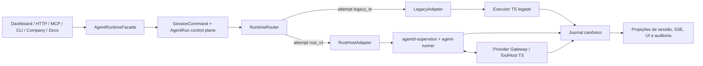

# Migração de superfícies e limpeza pós-cutover

> **Status:** normativo  
> **Escopo:** migração de todas as superfícies de produto, compatibilidade,
> drenagem e remoção segura do runtime legado  
> **Relacionados:** [06-rollout-gates-and-retirement.md](./06-rollout-gates-and-retirement.md)
> e [IMPLEMENTATION-CHECKLIST.md](./IMPLEMENTATION-CHECKLIST.md)  
> **Regra:** este documento não autoriza remendos arquiteturais no
> `packages/code-agent`

## 1. Objetivo

Este documento define como cada área que hoje depende direta ou indiretamente
do `code-agent` passa a usar o novo runtime Rust sem big bang, dual-write,
transferência de uma tentativa ativa ou quebra dos contratos públicos.

Ele também define a limpeza posterior. “Limpar” significa:

- remover o executor, workers, pools, shims e bundles que ficaram mortos;
- extrair antes da deleção os contratos e serviços que não pertencem ao
  executor;
- retirar imports, dependências, flags, métricas e runbooks legados;
- preservar sessões, mensagens, artifacts, auditoria e migrations históricas;
- contrair schema somente em uma release posterior, com prova de
  backup/restore e leitura de bancos implantados.

O alvo não é portar todo TypeScript para Rust. O alvo é fazer todo caminho de
agente usar o engine Rust, mantendo no host TypeScript as integrações,
credenciais, policy, projeções e persistência que já pertencem ao control plane.

## 2. Baseline do grafo atual

O grafo principal observado antes da implementação é:

```text
HTTP /coder
  -> CoderWorkerPool
  -> coder-worker
  -> runCoder()
  -> CoderRunner

runCoder()
  -> spawn_agent / execute_tasks / workflow
  -> runSubagent()
  -> outro CoderRunner no mesmo worker

DocsAgent
  -> runDocsAgent()
  -> CoderRunner

HTTP /company e App Studio
  -> WorkerOrchestratorPool
  -> company-worker
  -> CompanyOrchestrator
  -> MasterLifecycle / SubordinateLifecycle
  -> runCoder()
  -> CoderRunner

CLI
  -> runCoder()
  -> CoderRunner
```

Os construtores diretos do runner estão concentrados em:

- `packages/code-agent/src/index.ts`;
- `packages/code-agent/src/tools/implement-subagent.ts`;
- `packages/docs-agent/src/index.ts`.

Entretanto, a superfície de deleção é muito maior que esses três pontos. No
snapshot lexical de 2026-07-24, 367 arquivos fora de
`packages/code-agent` referenciavam `@mcp/code-agent` ou seu path-fonte. O
número é apenas um localizador inicial: deve ser regenerado no commit de
baseline. Há dependências de package declaradas em `packages/company`,
`packages/docs-agent`, `packages/plugin-host`, `packages/provider-engine` e
`packages/provider-runtime`, além de consumidores em HTTP API, dashboard,
services, store, indexer, API handlers, CLI, MCP server e Electron.

Os principais entry points físicos atuais são:

- `apps/http-api/sse/CoderWorkerPool.ts`;
- `apps/http-api/sse/coderWorkerPoolSingleton.ts`;
- `apps/http-api/workers/coder-worker.ts`;
- `apps/http-api/sse/coder-watchdog.ts`;
- `apps/http-api/sse/runnerWiring.ts`;
- `apps/http-api/sse/WorkerOrchestratorPool.ts`;
- `apps/http-api/sse/workerPoolSingleton.ts`;
- `apps/http-api/workers/company-worker.ts`;
- `apps/http-api/server/routes/coder/stream.ts`;
- `apps/http-api/server/routes/company/stream.ts`;
- `apps/mcp-server/agent-run-manager.ts`;
- `apps/cli/commands/agent.ts`.

Esta lista não é uma allowlist para deleção. O manifest exigido abaixo é a
autoridade viva.

## 3. Termos

Inventário do checkout em 2026-10-03: Sprite e Design Systems foram retirados
das superfícies do produto (migração `267_retire_sprite_and_design_system`).
Não são alvos de paridade nem devem ser recriados pela migração Rust. Leitores,
fixtures e migrações de bundles históricos podem conservar seus nomes.
App Studio e seus papéis de design/QA continuam no manifest A15; são distintos
do módulo Design Systems retirado.

| Termo | Definição |
|---|---|
| Superfície | Fluxo de produto que cria, retoma, observa, controla ou recebe resultado de um agente |
| Unidade de migração | Uma superfície com contrato, owner, cohort e gate próprios |
| `AgentRuntimeFacade` | API host-owned, neutra de runtime, usada por todos os entry points |
| `AgentRunHandle` | Handle neutro para eventos, cancelamento, interação, snapshot e dispose |
| Adapter legado | Único consumidor permitido do executor TS durante a transição |
| Adapter Rust | Cliente host do protocolo `agentd` |
| Projeção | Visão HTTP/SSE/UI derivada do journal canônico |
| Resíduo legado | Código, import, dependência, bundle, flag, métrica ou schema usado somente pelo executor TS |
| Prova de deleção | Evidência de que um resíduo não é necessário por runtime, build, rollback, histórico ou suporte |
| Geração de runtime | `legacy_ts` ou `rust_v1`, persistida antes do launch |
| Retirada de código | Remoção do executor e de seus caminhos de build |
| Retirada de dados | Remoção posterior e independente de bridges/schema sem valor de produto |

## 4. Invariantes da migração

- **CUT-001 — Manifest completo.** Antes do primeiro canário, o programa DEVE
  produzir um manifest versionado de superfícies, entry points, imports,
  package dependencies, workers, scripts, assets, flags, eventos, métricas,
  tabelas/colunas, migrations e fixtures ligados ao legado. Cada item possui
  owner, destino e critério de retirada.
- **CUT-002 — Congelamento da fronteira.** Depois do manifest inicial, CI NÃO
  DEVE aceitar novo import externo de `@mcp/code-agent`, path-fonte do pacote,
  `CoderRunner`, `ToolRegistry`, `RunCoderHandle` ou tipos equivalentes. Uma
  allowlist versionada só pode encolher.
- **CUT-003 — Fachada única.** Todo entry point de agente DEVE depender de
  `AgentRuntimeFacade`, nunca de `runCoder`, `CoderRunner`, worker pool ou
  protocolo Rust diretamente.
- **CUT-004 — Bordas estáveis.** HTTP, SSE, API bus, MCP, CLI e shapes
  consumidos pelo dashboard DEVEM permanecer compatíveis durante a migração.
  Uma quebra pública exige versionamento próprio; não pode ser escondida no
  cutover do runtime.
- **CUT-005 — Roteamento durável.** A geração de runtime DEVE ser selecionada e
  persistida antes do launch de cada `AgentRunAttempt`, com razão, cohort,
  versão do catálogo e versão do engine.
- **CUT-006 — Attempt indivisível.** Uma attempt ativa pertence a exatamente
  uma geração. Ela NÃO PODE trocar de Rust para legado ou de legado para Rust.
- **CUT-007 — Um owner de efeito.** Provider faturável e capability mutante
  possuem exatamente um executor físico por invocation. Comparação shadow não
  pode duplicar efeito.
- **CUT-008 — Journal único.** Legado e Rust DEVEM ser adaptados ao mesmo
  journal canônico. SSE, histórico, status e UI são projeções dessa autoridade,
  não writers paralelos. Tabelas paralelas `rust_sessions`, `rust_messages` ou
  equivalentes são proibidas.
- **CUT-009 — Storage Rust single-writer.** `agent-session-store` é o único
  processo/componente que abre bundles `rust_fs_v1`. Runner, supervisor,
  `code_exec` e Host TypeScript não abrem arquivos mutáveis do bundle. Rust não
  abre SQLite; policy e credenciais continuam no host TypeScript.
- **CUT-010 — Histórico é dado de produto.** Sessões, mensagens, transcripts,
  attachments, tasks, goals, specs, artifacts, Company e App Studio NÃO PODEM
  ser apagados por terem prefixo ou origem histórica ligada a `coder`.
- **CUT-011 — Company é uma unidade de árvore.** Durante rollout, uma árvore
  Company/App Studio DEVE herdar uma única geração a partir do root. Master,
  subordinates, verifier e especialistas da mesma árvore não podem misturar
  engine legado e Rust.
- **CUT-012 — Rollback só cria novas attempts.** Flags e kill switches afetam
  novas admissões. Attempts ativos terminam, cancelam ou são fenced/reaped no
  runtime que os iniciou.
- **CUT-013 — Evidência por superfície.** Nenhuma superfície é declarada
  migrada por inferência. Owner, testes de contrato, E2E, replay, restart,
  cancelamento e resultado de canário precisam estar registrados.
- **CUT-014 — Código removido não é fallback.** Depois da retirada do executor
  legado, rollback significa bloquear novas admissões ou reinstalar a última
  build Rust estável. O produto não pode manter um bundle TS dormente como
  fallback indefinido.

## 5. Arquitetura de estrangulamento



Não há uma seta Rust → legado. Falha no Rust terminaliza a attempt segundo o
contrato normal. Se policy autorizar recovery, o control plane cria uma nova
attempt somente depois de fence/reaping e de reconciliar outcomes incertos.

### 5.1 Pacote host-alvo

- **CUT-015 — Ownership da fachada.** A fachada, o router, os dois adapters e
  os projectors DEVEM viver em um package host-owned independente do
  `code-agent`, com nome-alvo `packages/agent-runtime-host`.
- **CUT-016 — Contrato mínimo.** `AgentRuntimeFacade` DEVE expor operações
  equivalentes a `start`, `resume`, `cancel`, `resolveInteraction`,
  `getSnapshot` e `subscribeEvents`. O retorno é `AgentRunHandle`; nenhuma
  classe ou closure concreta de runner atravessa a fronteira.
- **CUT-017 — Catálogo por attempt.** O host resolve uma vez o catálogo de
  capabilities, ordem, schemas, tiers, modelo, allowlist, tools desabilitadas,
  modo de produto, plugins e MCPs. O snapshot é canônico, imutável e hashado;
  Rust não reconstrói registries TypeScript.
- **CUT-018 — Projector compatível.** Eventos Rust e eventos do adapter legado
  DEVEM produzir os mesmos estados públicos, ordering e terminal barrier. O
  projector não pode consultar o runner para completar estado ausente.
- **CUT-019 — IDs estáveis.** `SessionId`, `SessionCommandId`, `AgentRunId`,
  `AttemptId`, `operation_id` e IDs de interação DEVEM possuir mapping estável.
  Rotas antigas com ID legado usam uma tabela/adapter de resolução até o
  backfill ser comprovado.
- **CUT-020 — Eligibility fail-closed.** O router só admite Rust quando
  superfície, plataforma, environment, provider, catálogo e capability profile
  são suportados pela mesma build. Capability não suportada depois do launch
  falha de modo tipado; não aciona executor legado.
- **CUT-021 — Shadow sem autoridade.** Shadow pode comparar canonicalização,
  policy, catálogo, decisão e leitura comprovadamente pura. Ele não publica
  resposta, não grava projeção pública e não executa provider faturável ou
  mutação pela segunda vez.

O shape semântico esperado é:

```ts
interface AgentRuntimeFacade {
  start(command: StartAgentCommand): Promise<AgentRunHandle>;
  resume(command: ResumeAgentCommand): Promise<AgentRunHandle>;
  cancel(attemptId: AttemptId, reason: CancelReason): Promise<void>;
  resolveInteraction(
    interactionId: InteractionId,
    response: InteractionResponse,
  ): Promise<void>;
  getSnapshot(runId: AgentRunId): Promise<AgentRunSnapshot>;
  subscribeEvents(runId: AgentRunId, cursor?: EventCursor):
    AsyncIterable<CanonicalAgentEvent>;
}
```

Esse exemplo fixa responsabilidades, não sintaxe de wire. O `.proto` continua
a autoridade cross-language.

## 6. Extração de dependências antes da migração

Apagar `packages/code-agent` antes de extrair seus sobreviventes quebraria
áreas que não são o executor. A extração é preparação do novo runtime, não
refatoração do runner antigo.

| Responsabilidade hoje no legado | Destino obrigatório | Regra de saída |
|---|---|---|
| DTOs de run, eventos, tools, policy e lifecycle | `packages/agent-runtime-contracts` gerado/adapters | nenhum consumidor público usa tipos de `core/runner` ou `core/tool` |
| Providers e capability metadata | `provider-sdk`, `provider-engine`, `provider-runtime` e Provider Gateway | nenhum wire/provider importa `@mcp/code-agent/providers` |
| `SessionStore`, capítulos, goals e persistence helpers | `store`/serviço host-owned | histórico funciona sem carregar o executor |
| Tool descriptors e helpers de resposta | runtime contracts e SDK host de capability | Company/plugins/docs não importam `CoderTool`/`ToolContext` |
| Skills e parsers MCP | `plugin-host` ou shared package próprio | plugin discovery não depende do runner |
| Serviços/ports LSP e workspace | `api-handlers`/serviço de linguagem | handlers não importam implementação do agente |
| Pipeline kernel e tipos de estágio | `candidate-pipeline`/Company | pipelines agendam `AgentRun`, não `runSubagent` |
| Classificadores de erro/telemetria | `store`/services/observability | indexer e store não dependem do executor |
| Prompts e assets de prompt | `packages/agent-prompts` | build não copia assets de `packages/code-agent/src/prompts` |
| Interfaces de preview/browser/vision | package do ToolHost | Electron e HTTP API não importam tool concreta; Sprite retirado do produto |

- **CUT-022 — Manifest de símbolos.** Cada export externo do legado DEVE ser
  classificado como `move`, `replace`, `fixture-only` ou `delete`, com
  consumidor, destino e PR de remoção.
- **CUT-023 — Providers desacoplados.** Provider Gateway, OAuth, plugin
  providers, aliases, pricing, reasoning, vision e usage DEVEM funcionar sem
  carregar qualquer módulo de `code-agent`.
- **CUT-024 — Contratos de capability desacoplados.** Company, DocsAgent,
  plugins e integrações DEVEM consumir descriptors/handlers neutros, não
  `CoderTool`, `ToolContext`, `ToolRegistry` ou callbacks do runner.
- **CUT-025 — Persistência desacoplada.** Stores de sessão, task, goal,
  transcript, artifact e control plane DEVEM permanecer acessíveis sem importar
  o executor.
- **CUT-026 — Helpers de produto desacoplados.** LSP, workspace, skills, MCP,
  preview, browser, memory, DB, API client, design, QA, App Studio e Sprite
  DEVEM pertencer ao ToolHost ou ao serviço de domínio que já os possui.
- **CUT-027 — Assets desacoplados.** Prompts, schemas, fixtures e scripts
  necessários ao Rust ou ao host DEVEM sair do diretório legado antes de sua
  deleção.
- **CUT-028 — Legado vira folha.** Antes de C5, somente `LegacyAdapter` e testes
  de oracle podem depender do package legado. O package não pode continuar
  sendo uma biblioteca shared disfarçada.
- **CUT-029 — Grafo zero.** Antes de apagar o package, busca por import/path
  externo e o resolved dependency graph DEVEM retornar zero consumidores, com
  exceção apenas de fixtures copiadas para diretório independente.

`packages/orchestrator-host` não é resíduo do `code-agent`: ele atende outros
workers e serviços. Ele só pode ser removido por uma decisão independente,
nunca por associação nominal com o runtime antigo.

## 7. Ondas de migração

As ondas são verticais e ortogonais aos gates G0–G7. Uma onda só avança quando
seu gate funcional estiver verde; não é necessário esperar terminar todas as
features Rust para começar a extrair uma borda já conhecida.

| Onda | Entrega | Gate de saída |
|---|---|---|
| W0 — manifest e borda | manifest, CI de imports, `AgentRuntimeFacade`, router e `LegacyAdapter` sem mudança de comportamento | 100% dos entry points conhecidos passam pela fachada |
| W1 — contratos e survivors | IDL, contracts, providers, stores, tool SDK, prompts e helpers deixam o package legado | `code-agent` caminha para folha; testes dos consumidores passam |
| W2 — canário sem mutação | DocsAgent, plugin assistant, CLI Explore e workspace read-only no Rust | eventos/resultado/restart equivalentes; nenhum efeito duplicado |
| W3 — coder interativo | sessões novas locais/globais, attach, replay, interação, approval, resume, provider fallback e depois tools mutantes | E2E e gates G3/G4 para `/api/coder` |
| W4 — filhos e workflows | foreground, paralelo, background, collect/wait/resume, `execute_tasks`, workflow e ChatPipeline | todo child é `AgentRunAttempt` Rust isolado |
| W5 — Company subordinates | lifecycle manual, scheduler, pipeline e fanout apontam para o port neutro | todos os subordinates de uma árvore canário são Rust |
| W6 — Company master | plan/question/tasks, inbox, wait, resurrect, abort, provider switch e supervisor | root e filhos compartilham `rust_v1`; sem handle de runner |
| W7 — App Studio | equipe inteira, especialistas, work items, QA/design, pause/resume/abort | uma sessão App Studio completa passa restart e recovery |
| W8 — MCP/CLI/remote/ops | APIs externas, ambientes remotos, admin, perf, shutdown, dashboard e suporte | nenhuma borda pública consulta o legado |
| W9 — default e drain | Rust default, bloqueio de novas attempts legadas, drain e C5 | zero admission/fallback legado por no mínimo 14 dias |
| W10 — limpeza | source, packages, build, flags, telemetry e depois data bridges | todos os checks `G7-*` e `CUT-063` aprovados |

- **CUT-030 — Ordem vinculante.** W9 não pode anteceder a cobertura das
  superfícies A01–A20 abaixo. W10 não pode apagar uma dependência enquanto o
  manifest ainda a classificar como `move` ou `replace`.

## 8. Matriz de superfícies

Esta matriz é o esqueleto mínimo do manifest. Descobertas novas criam linhas;
elas não são absorvidas silenciosamente por “outros”.

| ID | Superfície e anchors atuais | Destino | Prova para habilitar Rust | Condição de retirada do legado |
|---|---|---|---|---|
| A01 | Coder interativo: `routes/coder/stream.ts`, `CoderWorkerPool`, `coder-worker`, `runCoder` | fachada → Rust adapter | nova sessão, attach, continue, cancel, restart e terminal E2E | zero chamadas ao pool/worker |
| A02 | Eventos: `coder-bus.ts`, `runnerWiring.ts`, SSE/replay | journal → projector estável | paridade de todas as classes duráveis e cursor/reconnect | wiring concreto do runner sem consumidores |
| A03 | Sessões/histórico: `code-agent/src/sessions/*`, routes de state/interaction/spec e writer do indexer | stores/projector host + stable IDs | sessões antigas e novas legíveis antes/depois de restart | `SessionStore` movido, writer único e bridge ID backfilled |
| A04 | Providers: `services/providers`, `provider-engine`, `provider-runtime`, plugin providers | Provider Gateway TS | golden matrix de OAuth, retry, reasoning, vision, usage e fallback | zero import de provider do legado |
| A05 | Tools nativas: fs, glob, patch, Git, worktree, shell, exec, HTTP, imagem/output | `agent-tools` Rust | functional, policy, path, quota, cancel e mutation receipt | implementação TS sem route ativa |
| A06 | ToolHost: MCP, plugins, browser, preview, LSP, docs/RAG, memory, DB/API e product tools | capability host TS | catálogo/hash/lifecycle/output equivalentes | shims de worker removidos; serviços reais preservados |
| A07 | `code_exec.ts` e helpers | child descartável com proxy de capabilities | sandbox, nested operation IDs, cancel/reap, stash bounded | nenhuma VM in-process no executor/daemon |
| A08 | Subagentes: `implement-subagent`, `spawn-agent*`, `collect-agents` | child AgentRuns Rust | foreground/paralelo/background/restart | nenhum `new CoderRunner`; nenhum registry process-local |
| A09 | Tasks/goals/interactions/spec/workflow | engine Rust + stores/interações host | ask/decision/approval/submit/resume/idempotência | nenhum `runner.waitForUserInput` ou callback concreto |
| A10 | DocsAgent: `packages/docs-agent/src/index.ts` | role/catalog Rust read-only | corpus real, cancel, citations e terminal | zero `CoderRunner`/`ToolRegistry` no package |
| A11 | Chat/candidate pipelines e verifier | stages como child AgentRuns | DAG/waves/lease/checkpoint/verifier E2E | nenhum `runSubagent` como executor |
| A12 | Company hosting: `WorkerOrchestratorPool`, `company-worker`, orchestrator | control plane host + fachada | restart, scheduler e metaBus sem runner local | worker pode ser removido quando coordenação estiver no host |
| A13 | Company subordinate lifecycle | port neutro → child AgentRun Rust | manual, scheduler, pipeline, fanout, abort/resume | nenhum handle concreto guardado |
| A14 | Company master/supervisor | root AgentRun Rust + eventos protocolares | plan, question, inbox, idle, resurrect e fallback | nenhum `RunCoderHandle`/`CoderRunner` |
| A15 | App Studio, design e QA | árvore Company inteiramente Rust | equipe completa, work item, approval, pause/resume/recovery | nenhuma geração mista na sessão |
| A16 | MCP externo e server: `McpExternalPool`, `agent-run-manager`, `tools/agents.ts` | ToolHost + fachada | start/list/get/result/cancel e outcome incerto | manager não chama pool/runner |
| A17 | CLI: `apps/cli/commands/agent.ts` | fachada/client neutro | output, exit, cancel e profile matrix | zero import do package legado |
| A18 | Remote/environment/worktree | routing imutável por binding | container/E2B/remote partition e no-local-fallback | nenhum adapter depende de `ToolContext` |
| A19 | Admin/perf/shutdown/build | métricas e lifecycle Rust; packaging novo | build instalada, shutdown/reap e diagnostics | nenhum worker/bundle/flag/process label legado |
| A20 | Plugin assistant: `api-handlers/src/plugins/assistant.ts`, `services/src/mini-agent/loop.ts` | AgentRun Rust restrito por role/catalog | prompt, toolset, cancel, output e permission E2E | nenhum mini-loop de agente paralelo ao runtime |

Para A01, a fachada deve cobrir a semântica hoje observada pelas rotas, ainda
que não preserve os nomes da classe: iniciar, enviar mensagem, resolver input,
interromper espera, abortar root/child, ler transcript, trocar provider, assinar
bus, consultar presença/execução/snapshot, obter métricas/perfil, evict e
dispose.

### 8.1 Requisitos de compatibilidade por família

- **CUT-031 — Coder interativo.** A01 DEVE preservar idempotência do command,
  attach/reconnect, interação humana, cancelamento, provider fallback,
  transcript e terminal público.
- **CUT-032 — Eventos e UI.** A02 DEVE preservar semântica, ordenação, cursor,
  deduplicação e terminal barrier. O dashboard não pode montar uma mensagem
  diferente conforme a geração do runtime.
- **CUT-033 — Sessões e histórico.** A03 DEVE provar leitura de sessões criadas
  antes da migração, durante coexistência e depois da retirada do código
  legado. Resume só ocorre quando o checkpoint é compatível.
- **CUT-034 — Provider Gateway.** A04 DEVE cobrir adapters, OAuth refresh,
  aliases, model capabilities, partial tool JSON, reasoning/thinking, vision,
  cache/usage/cost e retry físico separado de fallback lógico.
- **CUT-035 — Tools nativas.** A05 DEVE manter roots, symlink/junction safety,
  ignores, dirty worktree, index isolation, exit codes, PTY, HTTP/SSRF,
  output/artifact cursor e limpeza de descendentes. O host não reaplica uma
  mutação para gerar snapshots.
- **CUT-036 — ToolHost.** A06 DEVE preservar nomes, ordem, schema público,
  injection de contexto, permissions e lifecycle. Depois de
  `accepted/started`, MCP externo mutante não pode ser reconectado e repetido
  cegamente.
- **CUT-037 — `code_exec`.** A07 DEVE sair de `node:vm` in-process, receber
  apenas proxy protocolado e morrer com a attempt. SQLite, secrets, imports,
  filesystem e `process` implícitos são proibidos.
- **CUT-038 — Filhos e background.** A08/A09 DEVEM usar AgentRuns duráveis,
  budget/admission hierárquicos e processos próprios. Espera/background não
  autorizam runner residente sem deadline.
- **CUT-039 — Docs e pipelines.** A10/A11 DEVEM expressar especialização como
  role, prompt, catálogo e completion policy; não como runner alternativo.
- **CUT-040 — Company e App Studio.** A12–A15 DEVEM migrar por árvore,
  preservar metaBus/status/work items e reconciliar restart, pause, abort,
  resurrect e `outcome_unknown` sem referência a runner em memória.
- **CUT-041 — MCP e CLI.** A16/A17 DEVEM preservar contratos externos e IDs.
  Clientes externos não podem ser obrigados a conhecer `AttemptId` físico ou
  protocolo do daemon.
- **CUT-042 — Remote.** A18 DEVE vincular execução a
  `environmentId + environmentVersion`; perda do binding falha fechado e nunca
  cai para filesystem/processo local.
- **CUT-043 — Operação.** A19 DEVE separar métricas do Electron, host,
  supervisor e árvores de attempts; shutdown deve fenceiar e reapear toda
  árvore antes de concluir. Rollups duráveis de sessão são committed pelo Rust
  session store sob quota/rotação.
- **CUT-044 — Build.** Scripts como `copy-prompts`, checks de capability/import,
  `tsconfig.base.json`, Vite, Vitest, lockfile e Electron packaging DEVEM deixar
  de apontar ao legado sem remover cobertura equivalente. Binários Rust ficam
  fora do ASAR, com manifest/hash e smoke de launch/handshake/kill/reap.
- **CUT-045 — Dados.** O corte de sessões é big-bang e não oferece N/N-1,
  dual-write ou leitura SQLite legada. O migrador offline valida e publica os
  bundles antes do swap do DB mínimo. Migrations históricas são imutáveis;
  correções são novas migrations.
- **CUT-064 — Transferência do writer.** Cada bundle migra uma única vez de
  `typescript_fs_v1` para `rust_fs_v1` por drain, verificação, avanço fenced de
  `leaseEpoch` e activation receipt. O runtime legado pode continuar executando
  através da fachada Rust, mas nenhum commit volta ao writer TypeScript.

## 9. Protocolo de cutover por superfície

Cada A01–A20 segue a mesma sequência:

1. Registrar owner, input/output/event contracts, dependencies e SLO no
   manifest.
2. Congelar fixtures e E2E do comportamento público atual.
3. Fazer o entry point usar `AgentRuntimeFacade` ainda roteado ao adapter
   legado; o diff público esperado é zero.
4. Implementar eligibility explícita e adapter Rust.
5. Executar contract replay e shadow sem efeito.
6. Habilitar cohorts internos somente para novas attempts.
7. Exercitar cancel, restart, crash, resume e rollback.
8. Promover a superfície para default Rust.
9. Bloquear novas attempts legadas daquela superfície.
10. Drenar/fence/reap attempts antigos e observar zero dependência.
11. Congelar o oracle em fixtures e retirar o caminho legado da superfície.

- **CUT-046 — Protocolo obrigatório.** Nenhuma superfície pode saltar a etapa
  de fachada, fixtures, canário ou drain, mesmo que seu chamador direto pareça
  simples.
- **CUT-047 — Seleção coerente.** O root fixa geração para a árvore quando a
  surface policy exigir atomicidade, em especial Company/App Studio. Uma
  capability host-owned não altera a geração: ela continua sendo operação da
  attempt Rust.
- **CUT-048 — Drain observável.** Bloquear admissão não basta. O gate exige
  zero attempts legadas não terminais, zero PID/worker legado, zero operation
  host-owned órfã e reconciliação de terminais incertos.
- **CUT-049 — Janela estável.** Antes de remover fallback vivo, C5 precisa
  manter 100% do tráfego elegível no Rust por no mínimo 14 dias, sem fallback
  provocado por regressão e sem stop condition aberta.
- **CUT-050 — Rollback ensaiado.** Antes da retirada, um drill DEVE demonstrar
  rollback de novas attempts sem mover attempt ativo, repetir mutação ou perder
  histórico. Depois da retirada, outro drill prova rollback para a última build
  Rust estável sem reativar o executor TS.

## 10. Limpeza pós-cutover

### 10.1 Ordem de remoção de código

A ordem obrigatória é:

1. desabilitar novas attempts legadas e concluir o drain;
2. copiar golden traces/fixtures necessários para diretório independente;
3. remover fallback vivo e o `LegacyAdapter`;
4. remover `CoderWorkerPool`, singleton, `coder-worker`, watchdog,
   `runnerWiring` e RPC shims exclusivos;
5. remover o caminho Company que hospeda runners, preservando scheduler,
   stores e serviços host que ainda tenham função;
6. remover `CoderRunner`, `runCoder`, `runSubagent`, registries e tools TS já
   substituídas;
7. remover `code_exec` in-process e helpers sem consumidores;
8. zerar imports e package dependencies externas;
9. apagar `packages/code-agent`;
10. limpar scripts, tsconfig, aliases, lockfile, bundles, assets e packaging;
11. remover flags, labels, dashboards e runbooks de coexistência;
12. executar a disposição de dados em release separada.

- **CUT-051 — Ordem auditável.** Os passos acima DEVEM ser mudanças pequenas e
  auditáveis. Um único PR não pode combinar bloqueio de admissão, deleção do
  package e contração de banco.
- **CUT-052 — Prova antes de delete.** Cada arquivo/export removido precisa
  apontar para manifest `delete`, grafo sem consumidor, teste substituto e
  estratégia de rollback.
- **CUT-053 — Oracle congelado.** Testes de compatibilidade necessários
  sobrevivem como fixtures neutras. Eles não podem importar, transpilar ou
  executar o package removido.
- **CUT-054 — Auditoria da build instalada.** O manifest do artefato empacotado
  DEVE provar ausência de `coder-worker`, executor Company legado,
  `packages/code-agent`, prompt path antigo e mecanismo de launch legado.
- **CUT-055 — Auditoria de processo.** Start, cancel, crash, update, quit e
  restart da build final DEVEM deixar zero worker V8, PID, Job, pipe, handle,
  child ou scratch dir pertencente ao runtime antigo.

### 10.2 Classificação de dados

Nenhum objeto é removido por nome. O `DataDispositionManifest` classifica cada
tabela, coluna, índice e artifact em:

| Classe | Tratamento |
|---|---|
| Produto | manter: sessões, mensagens, transcript, attachments, tasks, goals, specs, Company, App Studio e artifacts necessários |
| Audit/segurança | manter segundo retention e compliance |
| Projeção reconstruível | preservar até rebuild e comparação integral serem provados |
| Bridge de migração | backfill, dual-read temporário sem dual-write e remoção posterior |
| Runtime-only | remover somente após zero leitores/writers e janela de rollback |
| Desconhecido | bloquear contração até owner e semântica serem identificados |

O campo `legacy_session_id` e equivalentes são bridges, não autorização para
apagar a linha referenciada. O backfill cria stable IDs, valida cardinalidade,
foreign keys e leitura histórica antes de retirar o bridge.

Pelo inventário inicial, `coder_sessions`, `coder_messages`,
`coder_tool_calls`, `coder_plans`, `coder_tasks_state`, grupos, inputs,
projetos, filesystem roots, memória, investigações, capítulos,
snapshots/reviews, `coder_turn_telemetry` e `coder_provider_attempts` devem ser
tratados como produto/histórico até prova contrária. `session_events` e
`coder_orchestration_checkpoints` são apenas candidatos a retirada posterior;
esta menção não pré-aprova o `DROP`.

- **CUT-056 — Disposição explícita.** Toda estrutura de dados tocada pela
  limpeza DEVE estar no `DataDispositionManifest`; `unknown` bloqueia a
  migration destrutiva.
- **CUT-057 — Contração atrasada.** `DROP TABLE`, `DROP COLUMN`, remoção de
  reader N-1 ou descarte de artifact só pode ocorrer depois de pelo menos 30
  dias e uma release estável completa sem o executor legado, valendo o período
  mais longo.
- **CUT-058 — Prova com bancos implantados.** Antes da contração, a migration
  DEVE passar em cópias redigidas representativas de schemas implantados,
  inclusive versões antigas e estados parcialmente migrados. O pacote de
  evidência inclui backup, restore, integrity check, contagens, orphan scan,
  leitura de histórico e rollback/forward-fix ensaiado.

Migrations históricas já publicadas NÃO são apagadas nem reescritas. Uma
migration corretiva nova preserva a cadeia de bootstrap e upgrade.

## 11. Gates de conclusão

A promoção também depende destes requisitos transversais descobertos no
inventário de cutover:

- **CUT-059 — Provenance estruturada.** `AgentRunAttempt` e sua persistência
  DEVEM registrar `runtime_kind`, `runtime_version`, `protocol_version`,
  `binary_digest` e `catalog_digest`. `executor_owner_id` ou nome de worker não
  substituem provenance.
- **CUT-060 — Cohort estável.** A atribuição percentual DEVE usar chave estável
  de sessão/superfície durante a coexistência. A decisão final continua
  persistida por attempt; mudança de geração só pode ocorrer em boundary
  explícito e quiescente, nunca no meio de uma attempt ou run-tree.
- **CUT-061 — Plugin assistant.** A20 DEVE deixar de usar mini-loop próprio e
  tornar-se um AgentRun Rust com catálogo restrito. Exceção permanente exigiria
  ADR e provaria que o fluxo não é um agente; silêncio não o retira do escopo.
- **CUT-062 — Um projector por attempt.** Durante coexistência, attempt legada
  pode usar o writer legado adaptado e attempt Rust usa o projector host, mas
  nunca ambos escrevem as mesmas projeções. `SessionStore` deve sair do package
  e a transação duplicada do indexer deve convergir para um único owner antes
  da deleção.

A limpeza só está concluída quando todas as condições abaixo forem verdadeiras:

| Gate | Evidência mínima |
|---|---|
| Cobertura | A01–A20 com owner, cohort, contract/E2E e estado `rust_default` |
| Autoridade | 100% das novas attempts em `rust_v1`; zero geração mista ou dual mutation |
| Estabilidade | C5 por no mínimo 14 dias, todos os gates G0–G7 e nenhuma stop condition |
| Drain | zero attempt/PID/worker/operação legada ativa |
| Grafo | busca estática e dependency graph com zero consumidor do package |
| Código | `CoderRunner`, `runCoder`, `runSubagent`, pools e workers ausentes |
| Package | build instalada sem package, bundle, prompt path ou launcher legado |
| Contratos | HTTP/SSE/UI/MCP/CLI, histórico e restart compatíveis |
| Dados | `DataDispositionManifest` completo; dados de produto preservados |
| Recovery | rollback para build Rust estável e restore de DB ensaiados |
| Operação | métricas, alertas, suporte e runbooks sem dependência do legado |

- **CUT-063 — Gate final de limpeza.** `packages/code-agent` só pode ser
  removido quando todos os gates desta seção passarem no mesmo commit/build
  candidato. A retirada de bridges de dados pode ocorrer depois, mas sua
  disposição, owner, prazo e teste já precisam estar aprovados.

## 12. Pacote obrigatório de evidências

Para cada build candidata, a pasta de evidência DEVE conter:

```text
artifacts/rust-agent-migration/<build-id>/
  surface-manifest.json
  symbol-disposition.json
  dependency-graph.txt
  runtime-routing-report.json
  event-parity-report.json
  mutation-reconciliation-report.json
  historical-session-report.json
  process-and-orphan-report.json
  packaged-contents.txt
  rollback-drill.md
  data-disposition.json
  database-backup-restore-report.md
```

Os relatórios contêm commit, build, plataforma, data, owner e comando/harness
que os produziu. Artefato mutável ou resultado apenas local não fecha checkbox.
