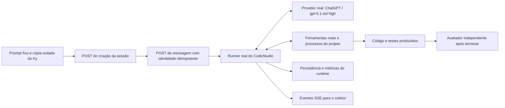

# CodeStudio — relatório consolidado de otimizações e guia dos benchmarks

**Data:** 11/11/2026. **Período das evidências:** 04 a 11/11/2026. **Último pacote desta investigação:** 3.16.24.

Este documento reúne situações encontradas, correções, comparações e pendências, com um guia de como o harness foi testado e como os números foram calculados. É uma consolidação dos artefatos existentes; a elaboração deste relatório não iniciou outra rodada com modelo.

Para consultar diretamente o procedimento: a **seção 8** descreve o benchmark com modelo, os scripts, endpoints, fórmulas, validação e limpeza. A **seção 9** explica as medições de CPU, React, I/O, ONNX e memória. A **seção 7** reúne os gargalos e as próximas provas necessárias.

As medições pertencem às versões e aos cenários identificados. Um teste antigo aprovado não equivale a uma nova homologação de toda a aplicação na 3.16.24. Os relatórios individuais e os resultados intermediários permanecem preservados.

## 1. Resultado principal

O excesso de tempo e consumo tinha várias causas: mais rodadas de inferência, catálogo mal selecionado, mudanças no catálogo que interrompiam a continuação, retrabalho em ferramentas, espera de persistência e comandos de validação caros. Não foi comprovada uma única causa nem uma inferioridade de velocidade do provedor quando acessado pelo CodeStudio.

As correções mais relevantes foram:

- Isolar recuperação de sessões, para uma pasta ilegível não impedir outras sessões de começar.
- Reutilizar clientes dos providers e preservar suas capacidades; implementar continuidade apropriada no adaptador ChatGPT/Responses.
- Sobrepor persistência e inferência quando o adaptador declara que a inferência não executa efeitos, mantendo confirmação durável antes das novas ferramentas.
- Reduzir gravações redundantes, agrupar diagnósticos e medir fila, escrita, sincronização e espera separadamente.
- Corrigir aplicação de patches, aspas de comandos no Windows, acompanhamento de processos e reconhecimento de validações.
- Reconstruir o catálogo de produção com um núcleo estável, fluxos completos e contratos compactos escritos explicitamente.
- Reduzir trabalho de interface e manutenção: virtualização, parsing em worker, descarte de streams, pausa de superfícies ocultas, memória incremental e orçamento de inferência local.

A candidata 3.16.24 terminou o exercício mais recente em **7min26,4s**, com **35 chamadas ao modelo**, **1.927.139 tokens de entrada** e **45/45 critérios externos aprovados**. A referência imediata, mediana de três execuções da 3.16.23, era 9min08,9s, 44 chamadas e 2.714.664 tokens.

Isso é uma melhora observada nesta amostra. A 3.16.24 tem somente uma execução nova, sem ordem intercalada. Além disso, parte da melhora recupera uma regressão da 3.16.23: comparada à 3.16.22, a entrada total ficou praticamente igual e foram 35 chamadas contra mediana de 34. Não há demonstração de superioridade universal, ausência de travamentos ou menor custo financeiro em qualquer tarefa.

## 2. Como o CodeStudio foi exercitado de verdade

O benchmark com modelo utilizou o **backend e o runner reais do CodeStudio**, carregados de uma cópia congelada do build. Não foi um simulador que reproduzia respostas do modelo.

O servidor isolado foi iniciado pelo executável `C:/Program Files/CodeStudio/CodeStudio.exe`, em modo `ELECTRON_RUN_AS_NODE=1`, importando os módulos compilados da candidata. Esse executável forneceu Electron 42.5.0 / Node 24.17.0; os comandos e testes do projeto Ky usaram Node 22.20.0 disponível no ambiente. São dois runtimes distintos, registrados separadamente.

O servidor escutou em `127.0.0.1:7442`, com banco e diretório de dados descartáveis. A sessão foi criada pela API do produto. A tarefa foi enviada pelo mesmo endpoint de mensagens usado pelo chat, e o monitor acompanhou o canal SSE de anexação à execução.



**Cobertura e limites por modalidade:**

| Modalidade | O que realmente executou | O que permite concluir |
|---|---|---|
| Benchmark Ky com modelo | API, admissão, runner, provider remoto, ferramentas, processos, persistência e recuperação | Tempo e consumo daquela tarefa; resultado funcional avaliado externamente |
| Regressões automatizadas do harness | Código real com fixtures e, conforme a suíte, HTTP/SSE local, SDKs e SQLite | Contratos específicos, inclusive falhas e concorrência; não latência de todos os providers reais |
| A/B React de 04/11 | Componentes reais em Chromium, dados sintéticos, build de produção com profiling | Custo de renderização, DOM, heap do renderer e interação dos cenários descritos |
| Provas do aplicativo empacotado | Electron em perfil isolado, recursos da ASAR e workers reais | Carregamento e funcionamento das rotas exercitadas; não todos os fluxos do produto |
| Microbenchmarks de I/O/ONNX | Cargas pequenas e controladas, separadas da tarefa do agente | Custo daquele componente; não aceleração equivalente da tarefa inteira |
| Comparação com outros harnesses por fonte | Leitura de commits fixados de Codex, OpenCode e pi | Diferenças de implementação; não benchmark de velocidade de OpenCode/pi |

O benchmark Ky **não passou pelo composer, clique de envio, React, preview ou fluxo visual do Company**. Portanto, não prova que esses caminhos estejam livres de gargalos. Eles tiveram testes próprios em outras etapas, com evidências e limites diferentes.

## 3. Evolução dos resultados: o que melhorou e o que piorou

### 3.1 Primeiras rodadas, com limitações de isolamento

| Etapa | Tempo total | Chamadas/ciclos observados | Situação relevante |
|---|---:|---:|---|
| Codex histórico | 3min54,779s | 25 atualizações públicas de uso | 45/45 casos; avaliação externa encontrou três erros de lint |
| CodeStudio instalado 3.16.18 | 9min31,841s | 36 | Cerca de 69% do tempo observado nas chamadas ao modelo |
| Conjunto de admissão/descoberta/persistência | 10min48,362s | 42 | Menor espera de persistência que o controle daquela etapa; não superou a rodada histórica |
| Entrega de transporte 3.16.21 | 9min20,688s | 37 | Clientes reutilizados, replay e transporte; ainda houve retrabalho e revalidação |
| Rodada `release-2` da investigação de throughput | 17min00,489s | 35 | 291,8s de espera adicional pela persistência; geração ONNX concorrente descoberta posteriormente |

Esses tempos não formam um A/B limpo. Parte das primeiras preparações alterava campos antigos do projeto, mas **não desativava os perfis semânticos efetivos**. A indexação local ocorreu em segundo plano. Os números foram mantidos e os relatórios retificados; não foram apagadas as rodadas ruins.

Em `release-2`, um job indexou 106 arquivos / 3.015 itens durante 409 segundos, sobrepostos à tarefa. Isso prova que o isolamento estava incompleto. Não prova que o ONNX causou toda a pausa de persistência e não permite subtrair 409 segundos do resultado.

### 3.2 Coortes posteriores com isolamento semântico corrigido

| Medida | 3.16.22: mediana de 3 | 3.16.23: mediana de 3 | 3.16.24: 1 execução | Codex contemporâneo: 1 execução |
|---|---:|---:|---:|---:|
| Tempo total | 8min51,8s | 9min08,9s | **7min26,4s** | 7min57,6s |
| Chamadas/ciclos | 34 | 44 | **35** | 26 ciclos públicos |
| Entrada total | 1.921.926 | 2.714.664 | **1.927.139** | 2.030.610 |
| Entrada sem cache | 100.656 | 78.790 | **72.803** | 94.994 |
| Saída | 12.046 | 13.740 | **12.054** | 16.009 |

As medianas são calculadas separadamente por métrica. No Codex, os ciclos vêm de atualizações públicas de uso; não são um trace HTTP que prove a quantidade de tentativas físicas no serviço. Na execução contemporânea, o Codex passou nos 45 critérios e em 1.530 testes Node, mas deixou dois erros de lint nos fontes.

**3.16.23 contra 3.16.22:** entrada sem cache caiu 21,7%, mas entrada total subiu 41,2%, chamadas subiram 29,4% e tempo mediano aumentou 3,2%. Preservar cache ajudou, porém não resolveu o número de rodadas. Essa etapa não demonstrou economia ou aceleração geral.

**3.16.24 contra a mediana da 3.16.23:** tempo −18,7%, chamadas −20,5%, entrada total −29,0%, entrada sem cache −7,6% e saída −12,3%. Contra a mediana da 3.16.22, a entrada total varia apenas aproximadamente +0,27%; as chamadas continuam 35 contra 34. A arquitetura ficou mais coerente, mas ainda precisamos de repetições para atribuir o ganho de tempo com confiança.

A dispersão anterior é relevante: as três rodadas finais da 3.16.23 duraram **10min38,5s, 9min08,9s e 7min28,2s**. A nova rodada de 7min26,4s está próxima da melhor dessas três, embora use menos chamadas. Não cabe declarar uma vitória estatística a partir dela.

### 3.3 Qualidade da rodada mais recente

- Avaliação independente: **45/45 critérios**, distribuídos em T1 9/9, T2 8/8, T3 9/9, T4 9/9 e T5 10/10.
- Suíte Node: **1.555 testes aprovados**; o participante acrescentou 28 casos de regressão.
- Build, typecheck indicado, lint dos quatro fontes alterados e `git diff --check`: saída zero.
- Lint dos fontes: seis avisos. O lint dos testes não passou porque a configuração TypeScript original não inclui `test/*.ts`; ela não foi afrouxada.
- Testes de navegador estavam explicitamente fora do protocolo, para ambos os participantes.
- Quantidade de testes adicionados não é, sozinha, uma nota de qualidade. Casos parametrizados e estilos distintos produzem contagens diferentes.

## 4. Problemas confirmados e correções

### 4.1 Admissão e recuperação de sessões

Uma pasta de eventos ilegível fazia a recuperação global rejeitar admissões de sessões saudáveis. A promessa rejeitada permanecia em cache, prolongando o bloqueio até reiniciar. As tentativas afetadas recebiam HTTP 503 antes de executar o modelo.

A recuperação passou a ser isolada por sessão, com reavaliação das falhas e erro específico `SESSION_RECOVERY_UNAVAILABLE`. Uma rejeição anterior à execução não consome incorretamente a identidade idempotente do pedido. Isso corrige a disponibilidade do controle; não repara corrupção física no sistema de arquivos nem recupera sozinho o histórico ilegível.

### 4.2 Catálogo: seleção, estabilidade e instruções

O limite de 28 ferramentas estava sendo usado como uma competição entre registros. Em uma rodada, promover `mcp__prepare_edit` retirou `get_tool_output`; promover a recuperação depois retirou `invoke_skill`. As duas chamadas seguintes perderam continuação incremental e vieram com cache zero: **98.759 tokens sem cache**, 56,4% da entrada sem cache daquela execução. Não são 98.759 tokens de economia garantida; o servidor decide seu próprio cache e parte da entrada era nova.

Na 3.16.23, novas proteções aumentaram a lista para **27 ferramentas protegidas em 28 vagas**. Busca exata e funções úteis de navegação ficaram de fora. Além disso, a descrição de `code_exec` foi reduzida de 5.556 para **57 caracteres**, perdendo o exemplo de agrupamento e instruções essenciais.

O caminho estável de produção foi refeito:

1. Núcleo explícito de descoberta, navegação, busca, edição, execução persistente, recuperação e memória.
2. Alternativas canônicas: leitura/listagem e execução não ocupam vagas com variantes equivalentes sem necessidade.
3. Fluxos completos: iniciar, acompanhar e recolher trabalho permanecem disponíveis juntos. Company e papéis especializados conservam suas capacidades necessárias.
4. Descoberta entrega schemas completos; ferramentas autorizadas não interativas podem ser chamadas via `code_exec`, sem trocar o catálogo público a cada descoberta.
5. Contratos compactos escritos manualmente substituem o corte arbitrário na primeira frase. Descrições externas são preservadas, salvo contrato compacto fornecido pelo autor.
6. Filtros não podem inserir ferramentas não autorizadas nem expulsar dependências do fluxo. Revogação, schema alterado e mudança real de modo continuam invalidando a projeção quando necessário.
7. Gates de Plan/Spec não aparecem indevidamente em Build. O par `exec_command`/`write_stdin` fica disponível quando registrado.

Na candidata medida, houve **um único fingerprint de ferramentas nas 35 chamadas**. Os sete scripts `code_exec` agrupavam 5, 8, 6, 3, 6, 4 e 5 chamadas explícitas, todos com `Promise.all`. Nas três rodadas anteriores, oito de onze scripts faziam uma única chamada explícita.

O catálogo real passou de 26.213 para **26.913 caracteres**, aumento de 2,67%, com 28 ferramentas. Portanto, o benefício observado não veio de um prefixo muito menor, e sim de uma superfície mais útil e melhor agrupamento. Um probe controlado sem o registro adicional de skill teve 27 ferramentas / 25.778 caracteres; esse probe não deve ser confundido com o catálogo da execução real.

Código principal: [workflow-catalog.ts](D:/MCP/packages/code-agent/src/tools/workflow-catalog.ts), [catalog-contracts.ts](D:/MCP/packages/code-agent/src/tools/catalog-contracts.ts) e [montagem do catálogo](D:/MCP/packages/code-agent/src/core/runner/assembly/tools.ts).

### 4.3 Persistência: RAM, JSON, fila e durabilidade

A conversa já ficava em memória e as operações de arquivo já eram assíncronas. A diferença importante é **qual operação ainda bloqueia a próxima etapa**, não simplesmente usar JSON ou RAM.

Foram encontrados e tratados:

- Renovação atômica de `writer.lease` em cada mutação, apesar de existir validade e heartbeat. Agora a posse/fence é conferida, com renovação quando necessária.
- Escritas duplicadas de metadados e regravação de resumos sem mudança dos totais.
- Diagnósticos opcionais gravados antes de cada ferramenta, mesmo sem autoridade de execução. Passaram a depender de ativação explícita.
- Telemetria derivada disputando o escritor da conversa. Há fila limitada e encaminhamento ao proprietário da sessão.
- Espera de persistência antes de iniciar a inferência. O núcleo permite sobreposição quando a capacidade do adaptador foi verificada, mas confirma o registro durável antes de novos efeitos.
- Expiração do escritor por atraso local. A renovação atrasada exige o mesmo proprietário, token e fence; não permite tomar a sessão de outro escritor.

| Experimento isolado | Antes | Depois | Interpretação |
|---|---:|---:|---|
| Oito turnos: duração de gravação | 10.618 ms | 6.751 ms | −36,4% nesse trecho, sem extrapolar para a tarefa inteira |
| Oito turnos: `JSON.stringify` acumulado | 3,46 ms | 3,01 ms | Serialização não explica segundos de espera |
| Oito turnos: renovações atômicas da posse | 73 | 0 na janela curta | Heartbeat preservado; a janela ficou abaixo do intervalo de renovação |
| Prova distinta de seis turnos: gravações atômicas | 44 | 33 | −25% de gravações; mesmos seis commits, 12 mensagens e tokens preservados |
| Mesma prova de seis turnos: duração | 2.561,1 ms | 2.552,8 ms | Tempo praticamente igual; não é aceleração de 25% |

A pausa de **172,73 segundos** foi observada numa rodada antiga, mas sua causa abaixo da fila/API de arquivos não foi isolada. Nas repetições posteriores, pausas menores foram associadas a `fsync`, abertura, escrita, rename e espera pelo repositório de tentativas do provider. Isso identifica operações caras, sem provar que antivírus, driver ou disco específico seja o culpado.

Na 3.16.24 medida, a persistência somou **26,4 segundos de trabalho sobreposto**, mas somente **0,054 ms de espera adicional contabilizada na barreira do provider**. Não se deve somar os 26,4s ao tempo da tarefa. Também não se deve transformar uma execução sem espera material em garantia para sessões longas e múltiplas sessões.

### 4.4 Providers e transporte

O host de plugins recriava o cliente a cada chamada; guardar o módulo do plugin não preservava o cliente/conexão. Ele passou a manter cliente por instância/modelo, compartilhar inicializações concorrentes e preservar capacidades pelos wrappers. Contas e credenciais diferentes continuam isoladas.

No adaptador compatível ChatGPT/Responses foram implementados preservação de itens opacos de continuação, IDs e ordem dos itens, reutilização WebSocket e envio incremental quando o prefixo/configuração são compatíveis. Compactação, edição, mudança de conta, endpoint ou modelo invalidam replay incompatível. Conteúdo opaco não é convertido em texto para outro provider.

Também foi corrigida a configuração que restringia `parallel_tool_calls` a uma lista antiga de modelos, deixando GPT 6.1 Sol de fora. Isso habilita a solicitação de múltiplas ferramentas; o dispatcher ainda decide quais operações podem executar em paralelo com segurança.

As melhorias de persistência, catálogo, comandos, prompts e ciclo de vida são compartilhadas. O transporte Responses/WebSocket permanece específico dos adaptadores compatíveis. Os demais providers foram exercitados por testes de contrato/regressão; **não houve benchmark real completo de cada família de modelo**.

Na rodada 3.16.24: 35 chamadas por WebSocket, 30 incrementais e 31 com replay de raciocínio. O primeiro evento chegou com mediana próxima de 190 ms; o primeiro conteúdo útil, cerca de 5,68s. Esse intervalo inclui processamento/fila/raciocínio remoto que o cliente não consegue separar. Não comprova inferioridade de rede ou prioridade de serviço.

### 4.5 Comandos, patches e verificações repetidas

Havia problemas independentes do modelo:

- Um hunk com fragmentos separados por contexto podia ser aplicado em lugares errados. O agrupamento foi preservado e regressões LF/CRLF reproduziram o defeito antes da correção. Em uma rodada antiga, o build detectou a corrupção e o agente gastou quatro chamadas para recuperar.
- O lançamento de `cmd.exe` aplicava escape de argv inadequado ao script, fazendo filtros de testes chegarem com aspas literais. Pipe/PTY foram corrigidos e validados junto de argv e PowerShell.
- Esperas curtas devolviam processos ainda ativos e provocavam rodadas só para consultar. Foram ajustadas as esperas de início/poll no Windows, preservando zero explícito, cancelamento e entrada interativa.
- Leituras por caminhos presumidos e um caminho inexistente para o CLI de lint provocaram recuperação desnecessária. Descoberta e contratos passaram a orientar caminhos confirmados, leituras menores e reaproveitamento de resultados.
- Escrever apenas um relatório de prosa invalidava checagens de código. Esse caso foi separado sem excluir documentos executáveis, prompts, configurações ou checks que validam documentação.

**Achados posteriores à rodada 3.16.24:** inspeções como `git diff`, versão do Node e leitura literal de logs em PowerShell ainda eram classificadas como possíveis escritas para a validade dos testes; comandos estruturados `argv`/`shell` também não eram reconhecidos como checagens. A sequência real foi reproduzida em testes que falharam antes do ajuste e passaram depois.

O pacote final corrige essa contabilização e explica corretamente `status=running` versus `status=exited`/`exit=0`. O identificador `session_id` aparece também em comandos encerrados; sua presença isolada não exige polling. Permissões e classificação de mutação não foram relaxadas. Comandos desconhecidos e entrada interativa continuam conservadores.

Os **7min26,4s ainda incluem duas chamadas finais extras**. Não foi subtraído um ganho hipotético nem executado outro benchmark com modelo após essas correções finais.

## 5. Interface, CPU, índice e memória

Estas são frentes anteriores da investigação, com medições próprias. Os resultados não são somados ao ganho do benchmark Ky.

### 5.1 CPU ociosa e responsividade

O logo permanente da barra superior continha animação SVG infinita com filtros. No mesmo processo, a sequência logo animado → imagem vazia → logo restaurado fez a CPU cair e voltar a subir. A correção manteve o desenho estático. Também foram tratados carregamento indevido de configuração TypeScript da pasta pai, início de Git na thread principal, polling sobreposto e trabalho em janelas ocultas.

No ensaio final de 04/11, com 15s de acomodação e 30s de medição por cenário, em máquina de 32 processadores lógicos:

| Cenário | CPU Electron/máquina antes | Depois | Limite |
|---|---:|---:|---|
| Tela inicial | 0,548% | 0,068% | Perfil pequeno e isolado |
| Projeto/editor | 0,750% | 0,192% | Projeto sintético aninhado |
| Chat parado | 0,550% | 0,036% | Sem inferência remota |

Em outra rodada, já com essas correções como base, a 3.15.8 não demonstrou uma nova redução importante de CPU ociosa: tela inicial 0,078% → 0,080%, editor 0,091% → 0,078%, chat vazio 0,044% → 0,042%. Não há ganho acumulável em toda versão.

### 5.2 Os onze grupos de correções React

Foram tratados: encerramento de streams Electron; agrupamento/virtualização de histórico; cache da análise de patches; descarte de streams de plugins; polling SSH serial; cache de requests limitado; pausa de superfícies ocultas; paginação de capítulos; preview limitado por agente no Company; parsing/virtualização de Markdown; e prevenção de regressões com regras React/Hooks e baseline explícita.

| Fixture A/B de 04/11 | Antes | Depois |
|---|---:|---:|
| Histórico de 2.000 mensagens: elementos DOM | 22.031 | 245 |
| Maior render React desse histórico | 379–385 ms | 6,5–8,5 ms |
| Heap do renderer após GC | 25,23 MiB | 9,14 MiB |
| Markdown de 100 mil caracteres: elementos DOM | 5.322 | 62 |
| Tarefas longas em 24 atualizações de Markdown | 25–28 | 0 |
| Maior interação automatizada de input nesse caso | 364–392 ms | 16–22 ms |

Método: duas passagens por versão, componentes reais, React 19.2.5 com profiling, Chromium 149, viewport 1280×800 e dados sintéticos iguais. Input automatizado **não é INP**. Heap do renderer não inclui heap do worker. Mover trabalho para worker não elimina as alocações desse trabalho.

O smoke do aplicativo completo ainda observou uma tarefa longa de 91ms. O gate React registrava 478 diagnósticos legados naquela data. Esses fatos não foram apagados por os cenários A/B terem melhorado; não foi feita nova contagem de todos os diagnósticos na consolidação atual.

### 5.3 Índice, memória e snapshots

Foram corrigidos referências estruturais que sobreviviam à remoção da última ocorrência, reconciliação manual que respondia antes da passagem solicitada, roteamento do frescor da memória para o banco proprietário, fronteira de aprendizado avançada antes de confirmação e contagem de recuperação como se tudo tivesse sido injetado.

As estatísticas passaram a usar projeção incremental. Em uma fixture, a consulta fria leu cerca de 12,1 MiB / 240 commits em 52,58ms; a consulta quente leu zero bytes de journal em 0,254ms; após dois commits novos, a atualização levou 0,333ms. É uma medição dessa projeção, não da CPU geral.

Na evolução da memória, a busca passou a usar FTS + embeddings + reranker, retirando chamadas LLM redundantes de reescrita/filtro. Aprendizado/revisão usa o destilador, com versões, histórico e arquivamento de substituições; memórias manuais/fixadas e escopos são protegidos. O painel deixou de consultar históricos inteiros a cada oito segundos e passou a usar resumo agregado a cada 30 segundos enquanto visível.

O backfill sintético de 40 memórias curtas passou de 40 chamadas a duas, em lotes de 32 e 8, **com provider simulado**. Isso não mede a latência nem a disponibilidade do serviço gratuito real. HTTP 429 conhecido passou a gerar espera e retomada, preservando diagnóstico e fallback textual.

Não foi demonstrado que o agente obedeça melhor às memórias ao longo de semanas. Recuperar, injetar e ler explicitamente são eventos diferentes de usar corretamente. Os estoques reais com cobertura incompleta não foram declarados reparados por testes sintéticos.

Snapshots legados de conhecimento foram separados da memória ativa e receberam caminho de preservação/importação das notas. Snapshots de alterações, ferramentas e rodadas têm outra finalidade: revisão, desfazer e recuperação. Removê-los para reduzir I/O exige medir seu custo e preservar essas garantias.

### 5.4 Outras correções que afetam continuidade

- A fila de mensagens separou “enviar agora” de “enfileirar”, com recibos idempotentes, entrega serial, persistência local e tratamento de erro. O benchmark usa envio direto pela API; não certifica novamente os atalhos e a UI dessa fila.
- A integração MCP separou autenticação de conexão/listagem, passou a reutilizar o resolvedor OAuth, preservar credenciais em falhas transitórias e reconciliar conexões individualmente. Testes de MCP não significam que cada ferramenta de cada servidor externo foi homologada.
- Falha anterior ao envio e operação com resultado desconhecido precisam de tratamentos diferentes. Uma falha local não deve bloquear o chat como se tivesse ocorrido um efeito externo; um efeito realmente incerto não deve ser repetido às cegas.

Company multisessão, QA pelo preview, MCPs externos durante recompilação e sessões de muitas horas continuam exigindo ensaios completos próprios. O exercício Ky não exercita esses fluxos.

## 6. Comparação com outros harnesses por código-fonte

Foram examinados commits fixos, não apenas descrições comerciais:

| Projeto | Commit examinado | Observação aplicável |
|---|---|---|
| Codex | `e58bf8f5233b51e7cd1679d947e3028c1ed91b06` | Escolha coerente entre execução persistente e shell simples; instruções explícitas de code mode; despacho de ferramenta após item completo; escritor assíncrono de rollout |
| OpenCode | `72616be4dbe772dc645640b5623cb3d6f4453bd3` | Prompt de agrupamento, contrato próprio de code mode e início de ferramenta quando a chamada completa chega |
| pi | `b22e525b325ff1934b4110f7fc60426fd6f0a8f3` | Núcleo pequeno de ferramentas e instruções condicionais; histórico em memória, mas também `appendFileSync` |

As lições adotadas foram reduzir alternativas redundantes, expor fluxos completos, escrever contratos úteis, reaproveitar contexto e evitar descoberta que reorganiza o prefixo público. Não foi copiada uma configuração exclusiva da OpenAI para todos os modelos.

O CodeStudio ainda espera consumir a resposta antes de despachar as ferramentas. Iniciar uma chamada já completa durante o stream é uma oportunidade separada. Comandos também permanecem barreiras conservadoras no dispatcher; marcar todo shell como leitura para imitar paralelismo seria incorreto.

Não se pode afirmar que todo concorrente usa I/O não bloqueante, nem inferir toda a infraestrutura privada do aplicativo Codex a partir do repositório público. OpenCode e pi não foram executados com o modelo neste comparativo.

Fontes primárias consultadas:

- [Codex: seleção de ferramentas](https://github.com/openai/codex/blob/e58bf8f5233b51e7cd1679d947e3028c1ed91b06/codex-rs/core/src/tools/spec_plan.rs), [code mode](https://github.com/openai/codex/blob/e58bf8f5233b51e7cd1679d947e3028c1ed91b06/codex-rs/code-mode-protocol/src/description.rs), [turno e despacho](https://github.com/openai/codex/blob/e58bf8f5233b51e7cd1679d947e3028c1ed91b06/codex-rs/core/src/session/turn.rs), [persistência](https://github.com/openai/codex/blob/e58bf8f5233b51e7cd1679d947e3028c1ed91b06/codex-rs/rollout/src/recorder.rs).
- [OpenCode: runner](https://github.com/anomalyco/opencode/blob/72616be4dbe772dc645640b5623cb3d6f4453bd3/packages/core/src/session/runner/step.ts), [prompt](https://github.com/anomalyco/opencode/blob/72616be4dbe772dc645640b5623cb3d6f4453bd3/packages/core/src/session/runner/prompt/system.txt), [code mode](https://github.com/anomalyco/opencode/blob/72616be4dbe772dc645640b5623cb3d6f4453bd3/packages/core/src/codemode/instructions.ts).
- [pi: prompt](https://github.com/earendil-works/pi/blob/b22e525b325ff1934b4110f7fc60426fd6f0a8f3/packages/coding-agent/src/core/system-prompt.ts), [sessões](https://github.com/earendil-works/pi/blob/b22e525b325ff1934b4110f7fc60426fd6f0a8f3/packages/coding-agent/src/core/session-manager.ts).

## 7. Onde ainda pode haver problema

| Prioridade | Situação | Estado da evidência | Próxima prova / critério de conclusão |
|---|---|---|---|
| P1 | Rodadas excessivas e leitura/validação repetida | Confirmadas em várias rodadas; nova seleção melhorou agrupamento | Repetir em ordem alternada, mesma qualidade, comparar chamadas por etapa e entrada acumulada |
| P1 | Polling custa inferência | Na 3.16.24, quatro rodadas só de poll somaram cerca de 19s no modelo | Experimentar espera orientada à conclusão e sobreposição útil; medir redução sem atrasar cancelamento |
| P1 | Caudas de persistência | Pausas de 5,7s/6,8s tiveram operação identificada; pausa antiga de 172,7s sem causa inferior isolada | Trace correlacionado de fila/lease/fsync/rename, carga do host e concorrência; preservar recuperação após falha |
| P1 | Revalidação indevida no fechamento | Dois defeitos reproduzidos e corrigidos após o benchmark | Nova rodada real deve confirmar desaparecimento das chamadas extras; não deduzir tempo por simulação |
| P1 | Company, múltiplas sessões e ferramentas externas | Fora da cobertura do benchmark Ky | Matriz com sessões simultâneas, MCP reconectando, cancelamento, preview e retomada após interrupção |
| P1 | Fluidez em projetos grandes e sessões longas | Ganhos em fixtures; ainda houve tarefa longa em smoke do app | Medir digitação, scroll, troca de chat e abertura de projeto durante streaming/indexação, incluindo processos auxiliares |
| P2 | Inferência local disputa CPU | Trabalho de fundo foi confirmado; orçamento reduzido em teste próprio | Comparar cenário índice preparado/inativo e cenário manutenção ativa; avaliar qualidade de busca e latência interativa |
| P2 | Despacho só depois do stream | Confirmado por fonte | Protótipo com chamadas completas, cancelamento e ordenação; comparar tempo até começar a ferramenta |
| P2 | Comandos conservadoramente serializados | Confirmado por fonte/linha do tempo | Separar espera de processo de seções críticas sem liberar mutações conflitantes |
| P2 | Eficácia da memória | Persistência/recall/evolução testados; aprendizado útil longitudinal não medido | Tarefas repetidas com e sem memória, fatos desatualizados, conflito e restauração; medir acerto, não só recall |
| P2 | Latência e diferenças entre providers | Só Sol teve tarefa real completa nessa bateria | Repetir com outros adaptadores mantendo configurações explícitas; não presumir protocolos ou cache equivalentes |
| P2 | Custo de snapshots | Função de recuperação necessária; custo específico não isolado | Medir preparação/pós-processamento e bytes, testar undo e recuperação antes de reduzir trabalho |
| P2 | Lint configurado fora do escopo TypeScript | Confirmado no projeto de teste | Descobrir comando/escopo válidos antes de executá-lo; não esconder falhas nem desabilitar regras |

Suspeitas de antivírus, disco, driver, prioridade do provider ou vazamento global de React permanecem hipóteses quando não há atribuição específica. Não foram promovidas a causas confirmadas.

## 8. Guia reproduzível do benchmark do harness

### 8.1 Pergunta, unidade de comparação e tarefa

A pergunta foi: com o mesmo modelo/esforço e a mesma árvore inicial, como o harness influencia tempo, consumo e qualidade em cinco correções de uma biblioteca TypeScript?

A unidade é uma execução completa das cinco tarefas por **um agente**, em sua própria pasta. Não foram cinco subagentes simultâneos: isso mudaria custos, contexto e coordenação. CodeStudio e Codex receberam cópias independentes. Cada repetição do CodeStudio também recebeu pasta e perfil novos.

Projeto: Ky 2.2.0, seed do commit `8baf0cadd8ca66659d6e86b2ebf4583e2f15bcb4`, com defeitos preparados. O commit sozinho não basta: compare também o manifesto dos arquivos iniciais e o lockfile/dependências para impedir diferença no working tree.

| Tarefa | Contrato avaliado |
|---|---|
| T1 | `Retry-After`, segundos inteiros, HTTP-date, precedência e reset |
| T2 | Timeout, cancelamento, liberação de timers/corpo e preservação de erro/request |
| T3 | Separação entre opções do Ky e dados JSON aninhados |
| T4 | Clonagem de defaults/hooks, ciclos, aliases, símbolos, protótipo nulo e `__proto__` como dado |
| T5 | Limite de resposta em bytes, múltiplos chunks, UTF-8 e metadados do erro |

O [prompt integral usado](D:/MCP/.tmp/harness-catalog-20261111/prompt.txt) tem SHA-256 `561f9eacf7b571f25ccbfc8173c5cd7dbec999772f75afdf990af0035489cecb`. Ele proíbe consultar a outra solução, avaliação externa, internet e memória; exige preservar API pública, dependências e testes. O prazo declarado foi 30 minutos, com até quatro processos de testes. Progresso JSONL e relatório final eram requisitos do exercício, não trabalho inventado pelo harness.

Na referência Codex contemporânea, mudou apenas o caminho de fallback da cópia. Contadores públicos do Codex foram coletados separadamente; não tivemos o mesmo nível de telemetria interna dos dois lados.

### 8.2 Preparação e isolamento

Procedimento utilizado, que deve ser repetido em um diretório novo:

1. Compilar o runtime, registrar versão/hashes e congelá-lo. A candidata medida está em `D:/MCP/.tmp/harness-catalog-20261111/runtime-catalog`; a versão com ajustes finais está em `runtime-catalog-final`. Não substituir um runtime no meio da coorte.
2. Copiar o seed para uma pasta por participante/repetição, excluindo saídas anteriores, `.mcp-indexer` e dependências inicialmente; provisionar depois as mesmas dependências instaladas. Não copiar uma solução já executada como novo seed.
3. Conferir commit, manifesto de fontes, prompt, lockfile, versão do Node e marcador `.benchmark-workspace`. O avaliador fica fora das pastas acessíveis ao agente.
4. Criar banco/perfil descartáveis por rodada e vincular somente o projeto daquela cópia. Registrar a versão efetivamente carregada, não apenas a versão do executável usado para hospedar Electron.
5. Configurar `openai-chatgpt`, `gpt-6.1-sol`, esforço `high`, modo Build, `max_turns=120`, `max_auto_continues=2` e permissão de ferramentas `unrestricted` para as operações locais autorizadas do exercício.
6. Desativar memória do projeto e os alvos reais de embedding/reranker dos três `semantic_profiles`: `code`, `docs`, `memory`. Verificar que não há jobs semânticos pendentes/ativos antes e depois. O índice estrutural normal do produto não foi eliminado.
7. Usar porta isolada, conferindo que está livre. Não encerrar um processo que apenas ocupa a porta.
8. Registrar PID, horário de criação, caminho do executável, script, perfil e porta. Iniciar o processo com janela oculta.
9. Usar a autorização já existente sem imprimir tokens. A origem foi aberta somente em leitura; a cópia temporária não incluiu refresh token. O script recusa autorização próxima de expirar. Apagar credenciais temporárias ao encerrar.
10. Não executar builds, avaliadores ou outro benchmark nosso durante o intervalo medido. A máquina continuou disponível ao usuário; amostras do host ajudam a identificar interferência, mas não controlam toda a carga externa.

As rodadas antigas que só configuraram `embeddings_enabled=0` e `search_mode=fts` **não cumpriram o item 6**. Para um novo teste, conferir o estado efetivo no banco é obrigatório; confiar apenas no nome de uma opção repetiria o erro.

### 8.3 Scripts reais e responsabilidades

Base do ensaio novo: `D:/MCP/.tmp/harness-catalog-20261111/`.

| Arquivo | Responsabilidade |
|---|---|
| `start-benchmark-server.ps1` | Confere porta, inicia Electron em modo Node, registra processo |
| `start-benchmark-server.mjs` | Prepara perfil, provider, isolamento semântico e projeto; carrega runtime congelado |
| `create-benchmark-session.mjs` | Cria sessão pela API e aplica a permissão local do exercício |
| `run-codestudio.mjs` | Envia uma mensagem, guarda recibo, consome SSE e amostra o host |
| `run-one.ps1` | Coordena início, prontidão, criação, monitoramento, análise e encerramento |
| `analyze-run.mjs` | Calcula tempo total, admissão, operações, ferramentas, tokens e intervalos |
| `transport-summary.mjs` | Agrega métricas nativas por turno, transporte e persistência |
| `verify-participant.ps1` | Executa build, tipos, lint dos fontes, Node e diff-check fora do agente |
| `stop-benchmark-server.ps1` | Confere identidade/estado, encerra apenas o servidor próprio e solicita limpeza |
| `clear-benchmark-auth.mjs` | Remove credenciais temporárias e produz recibos de limpeza/isolamento |

Esses helpers são artefatos locais do experimento, **não uma CLI genérica pronta para qualquer máquina**. Há caminhos, variantes aceitas, porta e pré-requisitos explícitos. Para repetir, copie os helpers para uma nova raiz, adapte os caminhos absolutos dos `.ps1`, a associação de runtime, a origem do seed/dependências, o caminho do Electron e a porta em todos os lugares correspondentes. Os `.mjs` principais derivam sua raiz de `import.meta.url`.

Não executar novamente sobre `candidate-1` histórica. Os guards de perfil inicializado, sessão criada e despacho registrado existem para impedir sobrescrever evidência ou duplicar uma tarefa após um recibo perdido. Se a preparação falhar, investigar o estado antes de repetir o envio.

### 8.4 Envio e observação: endpoints e relógio

O fluxo efetivamente utilizado foi:

```text
POST  /api/coder/sessions
PATCH /api/coder/sessions/:id/tool-permission-mode
POST  /api/coder/sessions/:id/messages
GET   /api/coder/sessions/:id/attach
GET   /api/coder/sessions/:id/status   (encerramento/diagnóstico)
```

A mensagem inclui `agent: build`, `thinking: true`, `plan_mode: false`, `response_mode: json`, `only_when_idle: true` e `client_msg_id` único. O recibo de admissão e a observação SSE ficam separados. Isso usa o contrato real do produto, evitando substituir o stream ativo ou enviar outra mensagem porque a observação falhou.

O monitor registra:

- `requestedAt`: imediatamente antes do POST de mensagem.
- `admittedAt`: recebimento da resposta de admissão, com status HTTP.
- Cada frame SSE: `receivedAt`, nome do evento e dados públicos.
- `terminalAt`: evento `done`. Ele indica encerramento; a razão terminal e a avaliação externa determinam sucesso. Fechamento sem `done` é registrado como falha/interrupção, conforme os eventos recebidos.
- `streamClosedAt`: fechamento do canal, separado da conclusão.

Eventos relevantes: `provider_call`, `operation_started`, `operation_finished`, `tool_call_start`, `tool_call_result`, `message_complete`, `error` e `done`.

O total divulgado começa no POST de mensagem. **Não inclui copiar repositório, instalar dependências, compilar o CodeStudio ou iniciar o servidor antes da prontidão.** O trabalho de testes/revisão executado pelo próprio agente entra no tempo. A avaliação externa posterior não entra.

Os registros usam ISO UTC; diferenças de timestamps são calculadas em milissegundos. Exibir horários em São Paulo não altera as durações.

Comando usado na execução histórica, mostrado apenas para documentar o procedimento:

```powershell
& 'D:/MCP/.tmp/harness-catalog-20261111/run-one.ps1' -Variant candidate-1
```

Para uma repetição, o comando deve apontar à **nova raiz preparada**, e não ao diretório histórico acima. Iniciar esse fluxo faz chamadas reais ao provider e consome a franquia/créditos da conta configurada.

### 8.5 Métricas: definição e cálculo

| Métrica | Cálculo / origem | Cuidado |
|---|---|---|
| Tempo total | `terminalAt - requestedAt` | Não usar somente o último texto do agente |
| Admissão | `admittedAt - requestedAt` | HTTP aceito não significa tarefa concluída |
| Chamadas ao modelo | Operações `kind=provider` com início e fim pareados | Não equiparar automaticamente a requests físicos/retries internos ou ciclos públicos do Codex |
| Tempo observado no modelo | Soma dos intervalos dessas operações recebidos por SSE | Pode incluir atraso de entrega/consumo; não é tempo de GPU remoto |
| Tempo nativo do stream | `response_meta.timing.total_ms` por turno | É outra fonte de relógio; diferenças devem ser preservadas |
| Primeiro evento/conteúdo | `first_event_ms` / `first_content_ms` | Evento de protocolo pode chegar muito antes de texto/argumentos úteis |
| Ferramentas | Início/fim por ID de chamada | Um `code_exec` pode conter várias chamadas internas |
| Ocupação de ferramentas | União dos intervalos, `toolBusyMs` | Não somar intervalos paralelos como trabalho serial; processo pode continuar após yield |
| Entrada total/cache | Uso retornado pelo provider por turno | Manter métricas separadas e conferir a semântica do adaptador |
| Entrada sem cache | Nesta integração: `input_tokens - cache_read_input_tokens` | Não implica preço de fatura; criação de cache é registrada à parte quando fornecida |
| Saída/raciocínio | `output_tokens` e parcela `thinking_tokens` | Não somar raciocínio novamente quando já integra a saída |
| Persistência sobreposta | Soma de `persistence_duration_ms` | Trabalho pode ocorrer enquanto o modelo responde |
| Espera adicional | Soma de `persistence_wait_ms` nativo | Mede a barreira que atrasou o avanço, não todo o I/O |
| Estabilidade do catálogo | Número de `tools_fingerprint` distintos | Mudanças por autorização/schema podem ser necessárias |
| Parte não atribuída | Total menos união dos intervalos conhecidos, incluindo admissão/preparação | Resíduo de instrumentação não deve ser chamado automaticamente de disco ou rede |

O arquivo de turnos está no projeto isolado, sob `.mcp-indexer/session/<sessionId>/metrics/turns/`. Ele complementa os eventos SSE e contém contagens, tamanhos, hashes e tempos. O relatório público não exporta credenciais nem conteúdo opaco de raciocínio.

Na 3.16.24 medida, a decomposição observada fecha os **446.356ms**:

| Parcela | Milissegundos |
|---|---:|
| Modelo observado por eventos | 376.435 |
| Ferramentas | 57.246 |
| Admissão | 7.781 |
| Preparação | 985 |
| Não atribuído | 3.909 |
| **Total** | **446.356** |

Essa soma é válida para a decomposição registrada dessa execução. Em geral, use a união dos intervalos; não some livremente tempos nativos, SSE e durações de trabalho de fundo. O stream nativo somou aproximadamente 377.666ms, diferente dos 376.435ms observados pelo coletor. Os 26,4s de persistência sobreposta não são uma sexta parcela do total.

A amostragem do host foi feita a cada cinco segundos com CPU total e memória livre. O processo do servidor teve CPU acumulada, working set, private bytes e threads amostrados separadamente. Não somar memória do sistema à do processo nem chamar essas amostras de benchmark de frames do renderer.

### 8.6 Recalcular os resultados existentes sem chamar o modelo

Os comandos abaixo apenas analisam arquivos existentes e regravam resumos derivados. Não iniciam o agente nem o servidor:

```powershell
Set-Location 'D:/MCP'
node .tmp/harness-catalog-20261111/analyze-run.mjs candidate-1
node .tmp/harness-catalog-20261111/transport-summary.mjs candidate-1
node .tmp/harness-source-audit-20261111/summarize-catalog-run.mjs
```

Saídas principais: `metrics-candidate-1.json`, `transport-candidate-1.json` e `D:/MCP/.tmp/harness-source-audit-20261111/catalog-result-summary.json`. O último cruza a nova execução com as três amostras anteriores (`candidate-5`, `candidate-6`, `candidate-7` da pasta `harness-performance-20261111`), calcula medianas/deltas e inclui qualidade/limpeza.

Fórmula dos percentuais da tabela: `(valor_novo / mediana_anterior - 1) * 100`. As medianas por métrica podem vir de execuções diferentes; não inventar uma “execução mediana” única juntando todos os campos.

### 8.7 Validação independente do participante

Depois que o agente terminou, o avaliador executou os checks na mesma pasta entregue, sem corrigir o código do participante:

```powershell
npm run build
node node_modules/typescript/bin/tsc --project tsconfig.test.json
node node_modules/xo/dist/cli.js source/core/retry-timing.ts source/utils/body.ts source/utils/merge.ts source/utils/timeout.ts
node node_modules/ava/entrypoints/cli.mjs --concurrency=4 --timeout=2m 'test/*.ts' '!test/browser.ts'
git diff --check
```

O helper [verify-participant.ps1](D:/MCP/.tmp/harness-catalog-20261111/verify-participant.ps1) registra saída, erro, duração e código de saída de cada comando. Ele chama o avaliador externo [acceptance.mjs](D:/MCP/.tmp/harness-comparison-20261110/acceptance.mjs), que carrega o código compilado e executa 45 critérios independentes com assertions. Esse avaliador fica fora da cópia do participante.

Para reavaliar a entrega existente, há custo de CPU/build/testes, mas não chamada a modelo:

```powershell
& 'D:/MCP/.tmp/harness-catalog-20261111/verify-participant.ps1' -Variant candidate-1
```

O helper recria arquivos derivados do build e sobrescreve os próprios logs de avaliação; copie esses logs antes de uma reavaliação se precisar conservar cada passagem. Não executar essa avaliação durante uma nova rodada cronometrada. A declaração de conclusão em `.benchmark-progress.jsonl` ou `BENCHMARK_RESULT.md` é evidência do que o agente declarou, não substituto desses checks.

### 8.8 Encerramento e comprovação de limpeza

O procedimento consulta se a execução ainda está ativa, confere PID, data de criação, executável e script do servidor próprio, verifica filhos e encerra somente esse processo. Não usa encerramento global por nome. A limpeza do perfil temporário roda depois da saída do proprietário e registra zero credenciais OAuth/API, sem refresh token copiado, e ausência de jobs semânticos.

Se o monitor falhar, não presumir que o runner terminou: consultar estado e arquivos de recibo antes de reenviar ou encerrar. Se houver processo filho, inspecioná-lo antes da limpeza. Os helpers se recusam a continuar quando não conseguem demonstrar a identidade/estado esperado.

Recibos da rodada: `auth-cleanup-candidate-1.json`, `process-cleanup-candidate-1.json` e `isolation-after-candidate-1.json`. O perfil instalado permaneceu preservado. Em rodadas antigas, houve `SQLITE_IOERR_TRUNCATE` na limpeza após o benchmark; a repetição após conferir saída do proprietário concluiu e os erros foram registrados, sem alterar o tempo medido.

### 8.9 Como repetir com melhor força comparativa

O próximo protocolo proposto é diferente do que já foi medido:

1. Congelar baseline/candidata e rodar pelo menos cinco amostras por braço, alternando a ordem; não misturar candidatas que mudaram durante a coorte.
2. Comparar mediana, faixa/dispersão, falhas e qualidade. Não apresentar p95 de tarefa com três amostras como estimativa confiável.
3. Manter modelo, esforço, conta, modos, ferramentas externas, dependências e critérios iguais; registrar prioridade/tier somente quando observável.
4. Medir um cenário com manutenção semântica inativa/preparada e outro com carga de fundo ativa. O primeiro isola melhor o runner; o segundo se aproxima mais do uso completo.
5. Acrescentar tarefas React, API/banco, preview/QA, MCP externo, Company e conversa longa. Ky mede somente um recorte de correções TypeScript.
6. Fazer ablações: catálogo, espera de processos, despacho durante stream e I/O separadamente. Alterar tudo junto impede atribuição individual.
7. Preservar erros, retries, recusas de patch e interrupções. Uma rodada falha não deve desaparecer da taxa de sucesso por não ter um tempo de conclusão.
8. Repetir a avaliação independente sem consertar um participante para igualar os resultados. Tempo só deve ser comparado junto com qualidade e trabalho efetivamente realizado.

Esse plano não foi executado na elaboração deste relatório.

## 9. Como foram medidos os outros tipos de otimização

**I/O:** executar a mesma sequência sintética de turnos antes/depois, medir serialização, operações atômicas e duração, fechar/reabrir e conferir mensagens, commits, ferramentas e tokens. Os ensaios de oito e seis turnos são diferentes; não combinar suas porcentagens. A pausa de 173s não foi reproduzida pela prova sintética.

**CPU ociosa:** somar variações de tempo de CPU dos processos relevantes durante uma janela estável. `CPU de um núcleo = 100 * deltaCPU / deltaTempo`; `CPU da máquina = CPU de um núcleo / processadores_lógicos`. Conferir foco, visibilidade, tamanho da janela e carga concorrente. CPU do processo GPU não é utilização do hardware gráfico. O ensaio causal do logo usou o mesmo processo, 10s de acomodação e 20s de medição em cada estado.

**React/Markdown:** mesma fixture/viewport/fontes de dados, versões congeladas, build de produção com profiling, contagem DOM, tarefas longas, commits/renders e heap após GC. Conferir funcionalidade: copiar conteúdo integral, chegar ao fim, seleção, atualização após esconder/revelar e encerramento de workers. Os tempos de interação automatizada não foram chamados de INP.

**ONNX:** três repetições alternadas, offline, 64 documentos, modelo `Xenova/multilingual-e5-small` q8 já local, processos descartáveis, carregamento separado da inferência aquecida. Medianas: CPU acumulada 3.703→1.094ms, CPU média normalizada 41,4%→7,4%, tempo de inferência 286,5→461,2ms. Foi uma redução de orçamento de CPU com maior duração. O ocioso de cinco segundos ficou próximo de 0,1% em ambos. Similaridade mínima dos vetores 0,9967; um conjunto sintético de 12 consultas acertou 12/12 nos dois. Isso não certifica qualidade ampla de recuperação nem frames do Electron.

**Memória:** testes de persistência, escopo, histórico, rollback, quota e providers simulados; Chromium para a tela. Medir recall/injeção separadamente e não tratar popularidade ou repetição como verdade. Ainda falta o experimento longitudinal de aprendizado útil.

## 10. Validação e pacote final

Para o catálogo e seus ajustes finais, passaram **408 testes em 23 arquivos**, TypeScript e build do dashboard. A matriz de famílias de providers usa fixtures locais. Os 1.555 testes Node e 45 critérios externos pertencem ao projeto Ky, não à suíte interna do CodeStudio; os números não devem ser somados como uma única suíte do produto.

As baterias históricas se sobrepõem. Por exemplo, a rodada React registrou 1.578 casos distintos naquela seleção; a rodada de memória, 332; e a 3.16.23 teve várias seleções parcialmente comuns. Este documento não inventa um total único somando todas elas.

**Instalador final:** [CodeStudio Setup 3.16.24.exe](<D:/MCP/dist/electron-workflow-catalog-3.16.24-final-20261111/CodeStudio Setup 3.16.24.exe>).

- Tamanho: 341.112.122 bytes.
- SHA-256: `9ab00082507ec54703ad16bb773467ebb2bbdb510aa46b17938e2874d613579c`.
- Assinatura Authenticode registrada: `NotSigned`.
- 4.208 arquivos empacotados comparados com o runtime final congelado, sem divergências; nenhum perfil/temporário do benchmark incluído na ASAR.
- Sete checks do pacote aprovados: módulos/dependências, renderer/recursos, deep link, indexer em worker, QuickJS, conversão HTML e imagem/vídeo.
- Foi gerado e verificado; não foi instalado sobre o perfil habitual nem publicado nesta etapa.

O pacote contém as correções de contabilização/contrato de processo posteriores à execução real. A medição de 7min26,4s é da candidata congelada anterior a esses últimos ajustes. Teste de regressão comprova o comportamento exercitado; um segundo benchmark seria necessário para medir o impacto deles no tempo.

## 11. Mapa das evidências

| Assunto | Relatório ou artefato principal |
|---|---|
| Admissão, primeiro perfil e lease | [Admissão e desempenho](D:/MCP/docs/audits/2026-11-10-harness-admission-performance.md) |
| Clientes, transporte e atribuição por etapa | [Latência de providers](D:/MCP/docs/audits/2026-11-10-provider-latency.md) |
| Patches, validação e reduções de gravação | [Throughput 3.16.22](D:/MCP/docs/audits/2026-11-11-harness-throughput.md) |
| Rodada de 17 minutos e erro de isolamento | [Causas de custo e latência](D:/MCP/docs/audits/2026-11-11-harness-cost-latency-causes.md) |
| Coortes 3.16.22/23 e ONNX | [Resultados 3.16.23](D:/MCP/docs/audits/2026-11-11-harness-performance-results.md) |
| Catálogo refeito e fontes dos harnesses | [Catálogo 3.16.24](D:/MCP/docs/audits/2026-11-11-workflow-catalog.md) |
| Resumo recalculável da candidata | [catalog-result-summary.json](D:/MCP/.tmp/harness-source-audit-20261111/catalog-result-summary.json) |
| Eventos públicos da execução | [codestudio-events-candidate-1.jsonl](D:/MCP/.tmp/harness-catalog-20261111/codestudio-events-candidate-1.jsonl) |
| Contadores e intervalos | [metrics-candidate-1.json](D:/MCP/.tmp/harness-catalog-20261111/metrics-candidate-1.json) |
| Relógios e transporte nativos | [transport-candidate-1.json](D:/MCP/.tmp/harness-catalog-20261111/transport-candidate-1.json) |
| Aceitação externa | [acceptance-candidate-1.json](D:/MCP/.tmp/harness-catalog-20261111/acceptance-candidate-1.json) |
| Resultados dos comandos independentes | [independent-verification.json](D:/MCP/.tmp/harness-catalog-20261111/candidate-1-independent-verification.json) |
| Testes finais do harness | [release-tests.json](D:/MCP/.tmp/harness-source-audit-20261111/release-tests.json) |
| Conferência do instalador | [installer-verification.json](D:/MCP/.tmp/harness-catalog-release-20261111/installer-verification.json) |
| Identidade/checksum do artefato | [artifact-final.json](D:/MCP/.tmp/harness-catalog-release-20261111/artifact-final.json) |
| CPU, logo e travamentos | [Reteste CPU](D:/MCP/docs/audits/2026-11-04-reteste-harness-cpu.md) |
| Onze correções React e A/B | [Front-end](D:/MCP/docs/audits/2026-11-04-correcoes-front-end-desempenho.md) |
| Índice, memória, snapshots e contadores | [Correções de conhecimento](D:/MCP/docs/audits/2026-11-04-correcoes-indice-memoria-snapshots.md) |
| Evolução e backfill da memória | [Memória 3.16.18](D:/MCP/docs/audits/2026-11-09-memory-evolution.md) |
| Envio e fila do composer | [Fila de mensagens](D:/MCP/docs/audits/2026-11-09-message-queue.md) |
| Conexões MCP | [MCP 3.15.11](D:/MCP/docs/audits/2026-11-04-mcp-connections-3.15.11.md) |

Os links locais refletem este workspace. `.tmp` contém evidências de experimentos e pode não ser versionada/publicada; preserve as pastas e os manifestos se for mover o relatório para outra máquina. Logs completos podem conter código e saída de ferramentas do projeto. Para compartilhar externamente, prefira os resumos de métricas e revise o material antes de distribuir registros brutos.
