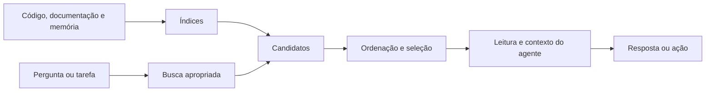

# RAG no CodeStudio

RAG (*Retrieval-Augmented Generation*) é a prática de recuperar informação de uma fonte consultável e fornecer essa informação ao modelo como contexto para a tarefa. No CodeStudio, o agente pode combinar evidências do repositório, de documentação indexada e da memória persistente. [Artigo de Lewis et al. sobre RAG](https://arxiv.org/abs/2005.11401)

| Fonte | O que recuperamos | Ponto de entrada do agente |
| --- | --- | --- |
| Código | Arquivos, símbolos, assinaturas e trechos do projeto | `mcp__search`, `mcp__grep_code` e ferramentas de leitura |
| Documentação | Trechos de coleções cadastradas, com título, fonte e seção | `rag_search_docs`, `rag_read_doc` e `rag_doc_outline` |
| Memória | Decisões, convenções e aprendizados de outras sessões | `recall_memory` e recuperação automática de memória do projeto |

Se alguém pergunta “Como o CodeStudio escolhe o tipo de busca?”, `mcp__search` pode localizar o módulo `planner.ts`. A leitura de `planQuery` revela as regras que o agente pode citar na resposta. Se a pergunta mencionar uma decisão anterior sobre a busca, o agente também pode consultar a memória. [Planejador de busca](../../packages/indexer/src/search/planner.ts#L65)

## Técnicas e conceitos

| Etapa | Arquivos |
| --- | --- |
| Preparar as fontes | [Ingestão e indexação](ingestao-e-indexacao.md), [chunking](chunking.md), [embeddings](embeddings.md) |
| Recuperar candidatos | [Busca lexical](busca-lexical.md), [busca vetorial](busca-vetorial.md), [busca híbrida](busca-hibrida.md), [roteamento](roteamento-de-consultas.md) |
| Ampliar a recuperação | [HyDE](hyde.md), [reescrita de consulta](reescrita-de-consulta.md), [expansão por grafo](expansao-por-grafo.md) |
| Combinar e selecionar | [RRF](rrf.md), [reranking](reranking.md) |
| Usar as evidências | [Grounding e proveniência](grounding-e-proveniencia.md), [RAG por ferramentas](rag-agentico.md), [recuperação de memória](recuperacao-de-memoria.md) |
| Operar e medir | [Recuperação local](recuperacao-local.md), [avaliação da recuperação](avaliacao-da-recuperacao.md) |

Os guias descrevem o CodeStudio 3.16.55 com as alterações de RAG na branch `codex/remove-rust-runtime`, a partir de `b7a7184d`. A execução das etapas opcionais depende do perfil e dos modelos configurados.

O plano de aprimoramento reúne as falhas reproduzidas, as remoções propostas e os experimentos para decidir mudanças no indexador, na busca e no agente. [Plano de aprimoramento do RAG](plano-de-aprimoramento.md)

O relatório registra as correções implementadas, a medição do Granite na GPU e na CPU, os resultados por conjunto e os critérios de liberação ainda abertos. [Resultados da implementação](resultados-da-implementacao.md)

A geração piloto do CodeStudio usa os dois modelos Nemotron gratuitos. O estudo registra o motivo das três perdas, os pesos testados e as posições por pergunta no índice instalado. [Nemotron no CodeStudio](nemotron-no-codestudio.md)
