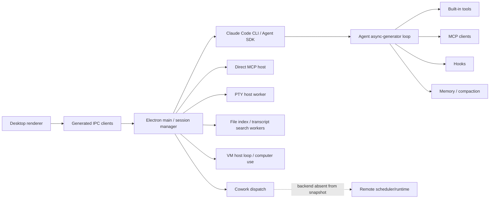
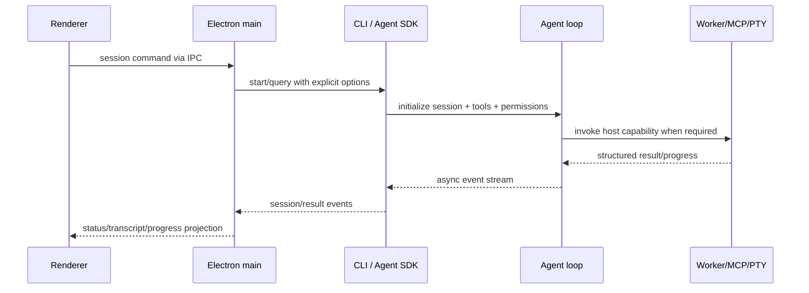

# 01 — ClaudeOpen: topologia de runtime

## Pergunta respondida

Quais processos, workers e fronteiras de sessão aparecem no snapshot ClaudeOpen, e quais partes da arquitetura permanecem fora da evidência disponível?

## Resumo executivo

O snapshot mostra uma divisão clara entre:

- Desktop/Electron como host de sessão, configuração, trust, OAuth, IPC e integrações nativas;
- Claude Code CLI/Agent SDK como loop local de agente, tools, MCP, hooks, memória e compactação;
- workers especializados para PTY, MCP runtime, indexação e tarefas pesadas;
- VM/computer use e um dispatch de Cowork cuja implementação remota não está no corpus.

O padrão transferível não é a quantidade de processos, mas a combinação de **host-owned capabilities**, **contratos estreitos de sessão** e **workers especializados**. O CodeStudio deve preservar seu BT runner e adotar uma fronteira uniforme de `ExecutionEnvironment`/`AgentRun`, sem presumir detalhes do scheduler remoto ausente.

## Baseline e confiança

- Claude Code CLI: 2.1.215, corpus conservado e desminificado: `claudeopen/claude-code-src/README.md:1-10`.
- Desktop: 108 arquivos de `app.asar`, versão do aplicativo não declarada: `claudeopen/asar-src/README.md:1-9`.
- Confiança alta para componentes enumerados nos READMEs e contratos locais; média para o fluxo composto; baixa para Cowork remoto.

## Topologia observável

### Inventário do Desktop

**VERIFIED.** O próprio corpus divide o Desktop em:

- `sessions/`: session manager, permissões e spawn do CLI;
- `cowork/`: dispatch tools para orquestração remota;
- `vm/`: host loop e Computer Use;
- `mcp/`: runtime MCP direct com SSE/HTTP e OAuth;
- `workers/`: `pty-host`, MCP runtime Node, file index, transcript search, shell path e heavy work;
- domínios adicionais de plugins, telemetry, auth, Git, SSH, PTY e IPC.

Fonte: `claudeopen/asar-src/README.md:11-27`.

Essa taxonomia prova a presença das fronteiras locais. Não prova qual processo é autoridade durável da sessão nem como o scheduler remoto distribui trabalho.

### Inventário do CLI

**VERIFIED.** O corpus do CLI separa entrada/daemon/config/auth/updater do cluster `agent`, que contém session state, loop, tools, permissions, workflow, teams, MCP, memory, prompts, compaction, hooks e telemetry events: `claudeopen/claude-code-src/README.md:12-18`.

O entrypoint também contém dispatch para modos dedicados, incluindo MCP/native host/computer use: `claudeopen/claude-code-src/cli/runtime.js:399-475`.

## Fronteiras de responsabilidade

### 1. Desktop como host de capabilities

**INFERRED com confiança alta.** A combinação dos domínios `sessions`, `mcp`, `vm`, `workers`, `pty` e `ipc` indica que o Desktop mantém recursos que não devem pertencer ao renderer nem ao modelo. Isso inclui:

- credenciais e OAuth;
- trust de pasta;
- processo do CLI;
- PTY e shell path;
- MCP direct;
- VM/computer use;
- eventos e status de sessão.

A evidência não autoriza chamar Electron de “security boundary”: host ownership e isolamento de segurança são conceitos diferentes.

### 2. CLI como executor do loop local

**VERIFIED.** O cluster `agent` reúne o loop, as tools, a policy, a memória e os hooks: `claudeopen/claude-code-src/README.md:16-18`.

**INFERRED.** O CLI funciona como executor local de turnos e subagentes, enquanto o Desktop fornece lifecycle e integrações do host. A inferência é reforçada pelo wrapper Desktop que chama `query()` do Agent SDK com configuração explícita de tools, MCP e persistência: `claudeopen/asar-src/sessions/claude-code-cli/index.chunk-DWoenSWm.js:105-139`.

### 3. Workers especializados

**VERIFIED.** O Desktop possui workers separados para PTY, MCP runtime, file index, transcript search, shell path e heavy work: `claudeopen/asar-src/README.md:20-25`.

O benefício arquitetural provável é contenção de falha e especialização de lifecycle. Porém, o README não prova:

- restart/backoff;
- heartbeat;
- memory caps;
- crash-loop protection;
- garantia de entrega do IPC.

Esses itens permanecem `UNKNOWN`: as fontes citadas não os estabelecem, e afirmar ausência exigiria auditoria específica dos workers ou trace runtime.

### 4. MCP direct como runtime próprio

**VERIFIED.** O Desktop possui um runtime MCP direct com SSE/HTTP e OAuth: `claudeopen/asar-src/README.md:20-25`.

No CLI, a conexão retorna um objeto com client, tipo, capabilities, server info, instructions, config, cleanup e transport error state: `claudeopen/claude-code-src/agent/mcp.js:7731-7767`.

Essa combinação mostra que MCP é tratado como capability com lifecycle, não como uma lista estática de funções.

### 5. VM/computer use

**VERIFIED quanto à presença.** O corpus enumera host loop de bash para VM e Computer Use: `claudeopen/asar-src/README.md:17-18`.

**UNKNOWN quanto às garantias completas.** A enumeração não demonstra níveis de grant, proteção de clipboard, allowlist por aplicação ou invalidação por mudança de foreground. Esses requisitos não devem ser atribuídos nem negados ao ClaudeOpen sem evidência adicional.

### 6. Cowork remoto

**VERIFIED quanto ao dispatch local.** O README classifica `cowork/dispatch` como dispatch tools/orquestrador remoto: `claudeopen/asar-src/README.md:16-18`.

**ABSENT_FROM_SNAPSHOT.** Não estão disponíveis:

- scheduler server-side;
- storage autoritativo;
- lease remota;
- protocolo de idempotência;
- distribuição de secrets;
- failover;
- critérios de placement;
- implementação de attach/resume cloud.

A arquitetura-alvo do CodeStudio não deve alegar paridade ou inferioridade nesses pontos.

## Trace local inferido

**Status: INFERRED.** Cada fronteira possui evidência local, mas o snapshot não contém um único contrato público que nomeie esse fluxo inteiro.

## O que torna a topologia eficaz

### Host ownership

Recursos sensíveis ficam associados ao host/session manager, não dispersos em componentes de UI. Isso favorece:

- revogação central;
- reconexão;
- status consistente;
- isolamento de credenciais;
- uma superfície estreita para o renderer.

**HYPOTHESIS:** host ownership reduz inconsistência e vazamento de estado. Deve ser medido no CodeStudio por testes de crash/reconnect e auditoria de secrets.

### Separação de workers por domínio

Workers específicos evitam colocar PTY, MCP, indexação e trabalho pesado no mesmo event loop. O padrão é útil, mas deve ser implementado com supervisor observável; mover para worker sem heartbeat apenas desloca a falha.

### Session manager como fachada

O Desktop sugere uma fachada única para lifecycle, permissões e integrações. Essa ideia converge com um `SessionControlPlane`, desde que o CodeStudio preserve stores e runner existentes como implementações internas.

## Padrões transferíveis

| Padrão | Decisão | Adaptação no CodeStudio |
|---|---|---|
| Host-owned capabilities | adapt ClaudeOpen | `ExecutionEnvironment` e brokers pertencem ao control plane |
| CLI/runner separado do renderer | preserve CodeStudio | manter worker runner; estreitar contracts entre API e dashboard |
| MCP com lifecycle próprio | merge | enriquecer capability catalog com auth, transport, cleanup e status |
| Workers especializados | benchmark first | supervisionar processos sensíveis; manter workers computacionais onde adequados |
| Session facade | adapt ClaudeOpen | commands idempotentes `start/attach/resume/fork/stop` |
| Cowork dispatch remoto | unknown | não implementar por inferência; começar pelos drivers já existentes |
| VM/computer use | unknown | somente avaliar após policy, secrets, environment e supervisor |

## Forças do CodeStudio a preservar

- BT runner declarativo e instrumentado: `codestudio_mcp-codebase/packages/code-agent/src/core/runner/orchestrator.ts:78-194`.
- Reconciliation de background/task state no encerramento: `codestudio_mcp-codebase/packages/code-agent/src/core/runner/orchestrator.ts:196-260`.
- Sandboxes abstraídos por `ISandboxDriver`: `codestudio_mcp-codebase/packages/services/src/sandbox/ports/sandbox-driver.ts:128-307`.
- Worker pool já distingue `coder`, `lsp`, `index` e `plugin`: `codestudio_mcp-codebase/packages/worker-pool/src/pool.ts:34-68`.
- Company Mode oferece ownership e coordenação persistente que não deve ser achatada numa abstração de subagente efêmero.

## Lacunas para o roadmap

1. **UX_GAP:** o usuário não vê uma entidade unificada de session target, cwd, lease, branch, owner e runtime health.
2. **RISK:** processos sensíveis não estão documentados sob um supervisor comum com heartbeat/backoff/crash-loop policy.
3. **RISK:** host/worktree/container/remote não são ainda destinos uniformes do mesmo contrato.
4. **ABSENT_FROM_SNAPSHOT:** não é possível copiar o scheduler remoto de Cowork; o CodeStudio deve projetar seu próprio protocolo.
5. **HYPOTHESIS:** a separação de processos melhora resiliência; requer chaos tests, não apenas refactor.

## Gates futuros

- Matar runner/PTY/plugin host não perde command aceito nem turno durável.
- Renderer pode reanexar usando identidade estável sem reexecutar side effects.
- Tools, terminal e Git observam o mesmo `ExecutionEnvironmentRef` e cwd.
- Credenciais reais permanecem no host/control plane.
- Processos têm PID, heartbeat, memory telemetry, restart/backoff e shutdown ordenado.
- Runtime remoto destruído pode ser retomado por Git/snapshot/journal, não por disco efêmero.

## Questões abertas

- Qual build exato do Desktop originou o corpus?
- Quais workers são processos e quais são worker threads no produto observado?
- Qual componente é autoridade do transcript no caminho Cowork?
- Como o remote dispatch trata idempotência, secrets e retries?
- Quais capabilities de computer use são separadamente autorizáveis?
