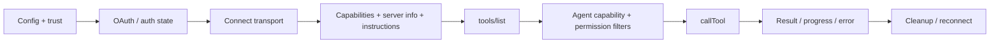
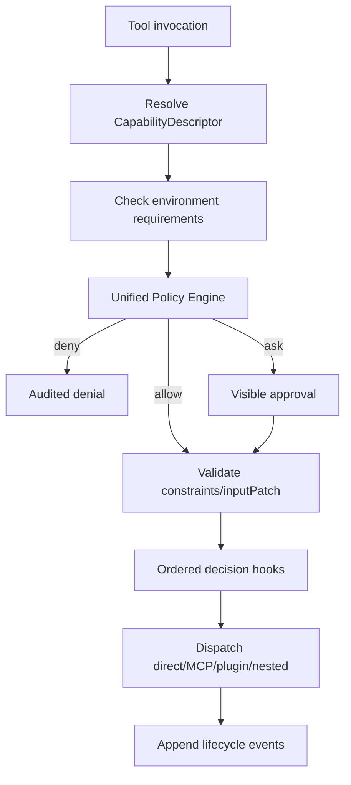

# 02 — ClaudeOpen: tools, MCP e permissões

## Pergunta respondida

Como ClaudeOpen representa tools e servidores MCP ao longo do lifecycle de descoberta, autenticação, filtragem, execução e cleanup, e quais padrões devem ser adaptados pelo CodeStudio?

## Resumo executivo

ClaudeOpen trata tool metadata, runtime composition, MCP lifecycle e permission decisions como camadas relacionadas, mas distintas. O mecanismo eficaz não é uma lista maior de tools: é a possibilidade de responder, para cada invocação, **qual capability existe, de onde veio, em que estado está, quem pode vê-la, quem pode executá-la e como ela termina**.

O CodeStudio já tem uma superfície mais ampla, ToolRegistry, MCP bridge, tiers dinâmicos e `code_exec`. A convergência recomendada é enriquecer essas peças com um `CapabilityDescriptor` e um Policy Engine uniforme — sem confundir tier visibility com autorização e sem importar `bypassPermissions` como default de autonomia.

## Baseline e confiança

- CLI 2.1.215: `claudeopen/claude-code-src/README.md:1-18`.
- Desktop snapshot, versão não determinada: `claudeopen/asar-src/README.md:1-27`.
- Confiança alta para configuração, conexão, discovery, modos e execução citados; média para o trace completo por ser composto.

## 1. Tool descriptor como contrato

### Descriptor unificado

**VERIFIED.** A Agent tool participa da mesma abstração de descriptor das demais tools. O contrato inclui nome canônico, aliases, hint de busca, schema de entrada/saída, limite de resultado, descrição dinâmica e implementação assíncrona: `claudeopen/claude-code-src/agent/tools.js:17285-17323`.

O descriptor usa nome canônico e alias legado `Task`, além de `searchHint` para delegação: `claudeopen/claude-code-src/agent/tools.js:17301-17312`.

Esse padrão permite separar:

- identidade estável;
- nomes compatíveis/legados;
- descoberta pelo modelo;
- validação de argumentos;
- limite de contexto;
- execução;
- renderização/telemetria.

### Runtime composition

**VERIFIED.** O loop recebe tools, filtra-as e compõe MCP e restrições de agente em runtime: `claudeopen/claude-code-src/agent/loop.js:709-780`.

**INFERRED.** A tool visível ao modelo é uma projeção do capability catalog para aquela sessão/agente, não necessariamente o catálogo completo do host.

### Higiene de contexto

**VERIFIED.** A Read tool possui mensagens específicas para arquivo inalterado e leitura redundante: `claudeopen/claude-code-src/agent/tools.js:4424-4429`.

O princípio transferível é devolver resultados semanticamente econômicos. Isso não autoriza copiar wording; o CodeStudio já possui dedupe de output, store de resultados truncados e ferramentas de leitura simbólica.

## 2. Lifecycle MCP

**Status do fluxo: INFERRED.** Cada etapa é `VERIFIED`; o encadeamento completo é uma reconstrução, não uma API pública única.

### 2.1 Configuração e trust

**VERIFIED.** O estado Desktop mantém `allowedTools`, `mcpContextUris`, servidores habilitados/desabilitados, aceite de confiança e aprovação para includes externos de `CLAUDE.md`: `claudeopen/asar-src/mcp/index.chunk-CCzZqRut.js:489-498`.

Isso separa pelo menos quatro preocupações:

1. servidor configurado;
2. servidor habilitado;
3. pasta/contexto confiável;
4. tool permitida.

A transferência correta é manter essas dimensões explícitas, não condensá-las em um booleano “MCP on”.

### 2.2 OAuth e reconexão

**VERIFIED.** A configuração da sessão consulta registry builtin, estado OAuth pendente e `directMcpServers`; depois de `authorizeDirectMcp`, reconecta o servidor: `claudeopen/asar-src/config/settings/index.chunk-BAm06TaJ.js:48-69`.

Padrão útil:

- auth pending é estado de capability;
- callback não encerra o lifecycle;
- conexão deve ser refeita e seu status projetado;
- falha de auth não é timeout genérico.

### 2.3 Objeto de conexão

**VERIFIED.** Após conectar, o CLI retorna:

- `name`;
- `client`;
- `type`;
- `capabilities`;
- `serverInfo`;
- `instructions`;
- `config`;
- `cleanup`;
- `transportErrorState`.

Fonte: `claudeopen/claude-code-src/agent/mcp.js:7731-7767`.

Esse contrato é uma referência forte para o `CapabilityCatalog` futuro. A conexão não deve ser reduzida a “lista de tools”.

### 2.4 Transportes

**VERIFIED.** A telemetria distingue `stdio`, SSE e HTTP: `claudeopen/claude-code-src/agent/mcp.js:7740-7751`.

O README do Desktop também classifica MCP direct como SSE/HTTP com OAuth e registra um worker MCP Node: `claudeopen/asar-src/README.md:20-25`.

A presença de transportes não prova equivalência de retry, backpressure ou durability entre eles.

### 2.5 Discovery e taxonomy de erro

**VERIFIED.** A listagem chama `tools/list` e extrai `tools`: `claudeopen/claude-code-src/agent/mcp.js:7850`.

**VERIFIED.** Respostas 401/403 são classificadas como `needs-auth`, separadas de timeout e outros erros: `claudeopen/claude-code-src/agent/mcp.js:8236-8254`.

Padrão transferível: o status de um servidor deve distinguir, no mínimo:

- disconnected;
- connecting;
- connected;
- needs-auth;
- degraded;
- timed-out;
- failed;
- disabled by policy.

### 2.6 Execução e término

**VERIFIED.** A chamada chega a `client.callTool(...)` e é protegida por uma corrida com controle de término/timeout: `claudeopen/claude-code-src/agent/mcp.js:17409`.

**VERIFIED.** O bundle também registra handler para `CallToolRequestSchema`: `claudeopen/claude-code-src/agent/mcp.js:11158-11192`.

A segunda evidência prova presença de um papel server, não que todo fluxo client passe por ele.

### 2.7 Proteção de namespace

**VERIFIED.** Servidores cujo nome/UUID colide com prefixos internos confiáveis são descartados e registrados: `claudeopen/asar-src/telemetry/events/index.chunk-C6YaFt7_.js:31-47`.

Padrão transferível: `source`, namespace e identidade de capability precisam ser não ambíguos. Alias de apresentação não pode alterar a autoridade do emissor.

## 3. Permission modes e decisões

### Modos observados

**VERIFIED.** O conjunto aceito inclui:

- `acceptEdits`;
- `auto`;
- `bypassPermissions`;
- `default`;
- `dontAsk`;
- `plan`.

Fonte: `claudeopen/claude-code-src/agent/permissions.js:790`.

Há tratamento específico de `bypassPermissions`, `plan` e `dontAsk`: `claudeopen/claude-code-src/agent/permissions.js:836-870`.

### Resolução de postura

**VERIFIED.** A resolução observada transforma modos em posturas como classify, allow, deny ou ask: `claudeopen/claude-code-src/agent/permissions.js:836-873`.

O aprendizado é separar:

- preset escolhido pelo usuário;
- decisão sobre a invocação concreta;
- razão da decisão;
- constraints e patches;
- duração/escopo de um grant.

### Capabilities mínimas por operação

**VERIFIED.** O `OneShotSampler` do Desktop chama `query()` com `allowedTools: []`, `mcpServers: {}`, `strictMcpConfig: true`, `persistSession: false` e um `canUseTool` que recusa execução: `claudeopen/asar-src/sessions/claude-code-cli/index.chunk-DWoenSWm.js:105-125`.

Esse é um exemplo forte de least capability: uma chamada auxiliar não herda automaticamente as tools da sessão principal.

### Tools exatas por agente

**VERIFIED.** Na retomada de agentes, tools são filtradas por MCP, skill, definição do agente e permission mode; fork e observer podem exigir `useExactTools`: `claudeopen/claude-code-src/agent/loop.js:736-780`.

O recorte de tools é parte do `AgentRunSpec`, não apenas prompt guidance.

## 4. Fluxo de decisão recomendado para o CodeStudio

A ordem exata será especificada em `14-target-control-plane-contracts.md`; o princípio é que todo caminho chegue ao mesmo chokepoint.

## 5. Comparação com o CodeStudio

### Forças internas

- ToolRegistry reúne nativas, MCP, LSP, RAG, skills, preview, DB e outros domínios.
- `ToolTier` aceita tiers dinâmicos, necessário para plugins/MCP: `codestudio_mcp-codebase/packages/code-agent/src/tools/tiers.ts:29-72`.
- `find_tools` e `expand_toolset` permitem lazy discovery.
- `code_exec` compõe chamadas e ainda aplica policy/permission a cada nested invocation: `codestudio_mcp-codebase/packages/code-agent/src/tools/code-exec.ts:600-719`.
- O `ToolOutputStore` preserva o conteúdo completo truncado sob ID determinístico e permite recuperação sob demanda: `codestudio_mcp-codebase/packages/code-agent/src/overlay/tool-output-store.ts:5-22`, `codestudio_mcp-codebase/packages/code-agent/src/overlay/tool-output-store.ts:46-88`. Um mecanismo equivalente não foi avaliado nas fontes ClaudeOpen citadas; não se infere ausência no produto.

### Lacunas e riscos

1. **UX_GAP:** visibility tier e authorization não são explicadas como dimensões diferentes.
2. **RISK:** múltiplos pontos de policy/permission podem divergir se evoluírem separadamente.
3. **RISK:** metadata de MCP/plugin não forma ainda um `CapabilityDescriptor` único com transport, auth state, requirements e cleanup.
4. **RISK:** aliases/namespaces dinâmicos exigem identidade estável independente do nome exibido.
5. **HYPOTHESIS:** tool results mais context-aware reduzem desperdício; precisa de benchmark de tokens e retrabalho.

## 6. Decisões de transferência

| Mecanismo ClaudeOpen | Decisão | Justificativa |
|---|---|---|
| Descriptor unificado | merge | ToolRegistry existe; enriquecer metadata sem reescrever handlers |
| Runtime composition por agente | merge | manter tiers e profiles, adicionar exact capabilities |
| MCP connection lifecycle | adapt ClaudeOpen | auth/status/cleanup devem ser first-class |
| Taxonomy `needs-auth` | adapt ClaudeOpen | melhora recovery e dashboard |
| Namespace protection | adapt ClaudeOpen | necessário para sources dinâmicas confiáveis |
| One-shot sem tools | adapt ClaudeOpen | capability minimum por operação auxiliar |
| `bypassPermissions` como autonomia | reject | autonomia não substitui policy e audit |
| Copiar aliases/símbolos minificados | reject | não são contratos estáveis |
| Tool-result hygiene | benchmark first | medir tokens, repeat reads e completion rate |

## 7. Invariantes futuros

1. Toda capability possui identidade estável, source, schema, risk e environment requirements.
2. Toda invocação direta, nested, MCP ou plugin produz a mesma policy decision para o mesmo input/contexto.
3. Tier oculto não implica deny; tier visível não implica allow.
4. `deny` de política superior prevalece sobre grants inferiores.
5. `inputPatch` é validado pelo schema antes do dispatch.
6. Background agent nunca fica aguardando uma aprovação que nenhum usuário consegue ver.
7. Auth pending é estado recuperável, não erro genérico.
8. Cleanup/reconnect são explícitos e auditáveis.
9. Tools auxiliares recebem capability mínima, não herança irrestrita.

## 8. Gates de validação futuros

- Matriz cross-product: direct/nested/MCP/plugin × visible/hidden × allowed/denied/ask.
- Testes de alias e colisão de namespace.
- OAuth pending → callback → reconnect → `tools/list` sem duplicar tool IDs.
- Timeout/cancelamento chama cleanup uma única vez.
- Tool schema rejeita patch incompatível antes do handler.
- Approval UI mostra regra, recurso exato, duração e origem.
- Replay não reexecuta `callTool` já confirmado.

## Questões abertas

- Como ClaudeOpen persiste grants de diferentes escopos no backend ausente?
- Qual precedência completa existe entre managed config, local config, hooks e prompt tool?
- Quais transport errors são retryable e com que budget?
- O server MCP embutido é usado em quais modos reais?
- Como capabilities remotas são revogadas durante uma sessão ativa?
