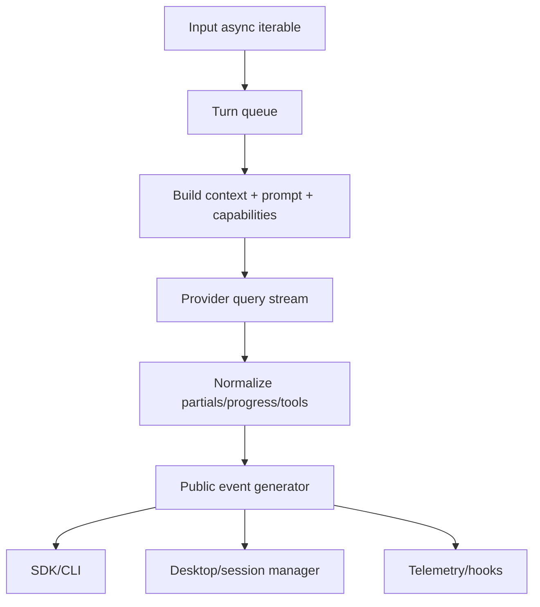

# 03 — ClaudeOpen: loop do agente, prompts, hooks e streaming

## Pergunta respondida

Como ClaudeOpen transforma uma entrada de usuário em contexto, chamada de modelo, tool lifecycle e eventos consumíveis, e por que essa coesão pode contribuir para uma experiência mais eficaz?

## Resumo executivo

O loop observado funciona como um **event pump assíncrono**, não como um simples `while` em torno do provider. Prompt composition, hooks, tools, progress, retries, subagentes, compactação e término entram em uma gramática comum de eventos. Isso permite que CLI, SDK, Desktop e telemetria acompanhem a mesma execução sem depender apenas de texto final.

O CodeStudio já possui BT runner, eventos de tool/task/agent e um transporte SSE robusto. A convergência recomendada é formalizar um journal e um catálogo versionado de eventos, preservar o runner e tornar hooks de decisão/observação parte de uma ordem única. Não há evidência para copiar literalmente o loop desminificado.

## Baseline e confiança

- Claude Code CLI 2.1.215: `claudeopen/claude-code-src/README.md:1-18`.
- Confiança alta para eventos e hook stages citados; média para a composição ponta a ponta, reconstruída a partir de várias faixas.

## 1. Entrada e composição de contexto

### User input não é apenas uma string

**VERIFIED.** O processamento de input carrega modo, histórico, contexto, callback de permissão, origem e controles da query: `claudeopen/claude-code-src/agent/loop.js:4260-4301`.

Isso cria um ponto explícito para distinguir:

- mensagem original;
- contexto acumulado;
- origem humana, hook ou agente;
- permission callback;
- controles de execução;
- sessão e identidade.

### Hooks antes da query

**VERIFIED.** `UserPromptSubmit` hooks são executados antes da chamada ao modelo e podem bloquear continuação, suprimir o prompt original, alterar título ou acrescentar contexto: `claudeopen/claude-code-src/agent/loop.js:4302-4344`.

Esse comportamento mostra que alguns hooks são **decisores de lifecycle**, não meros listeners. A adaptação no CodeStudio precisa separar:

- observation hook: registra, mede, notifica;
- decision hook: retorna allow/deny/ask ou patch validado;
- prompt augmentation: adiciona contexto em ponto determinístico;
- presentation hook: altera somente projeção/UI.

## 2. System prompt composto

### Camadas observadas

**VERIFIED.** Ao retomar subagente, o loop escolhe definição do agente e reconstrói prompt com `customSystemPrompt`, prompt padrão e `appendSystemPrompt`: `claudeopen/claude-code-src/agent/loop.js:698-735`.

**VERIFIED.** Tools, MCP, skill tools, agent definition e permission mode participam da configuração efetiva do agente: `claudeopen/claude-code-src/agent/loop.js:736-780`.

**INFERRED.** Prompt e capability set são duas projeções do mesmo `AgentRunSpec`: o texto deve explicar apenas capabilities que o executor realmente entrega.

### Reminders e contexto operacional

O bundle contém prompts e reminders dinâmicos em `agent/prompts.js`. A auditoria direta localizou a lógica de streaming e composição em `claudeopen/claude-code-src/agent/prompts.js:771-1387`.

**RISK:** prompts desminificados misturam conteúdo estável, feature flags e branches internos. Copiar wording sem seu contract/context pode piorar cache e tool choice.

### Lição para o CodeStudio

O CodeStudio já possui uma fronteira explícita estática/dinâmica no prompt e injeta estado volátil na mensagem do usuário: `codestudio_mcp-codebase/docs/PROMPTS.md:27-38`, `codestudio_mcp-codebase/docs/PROMPTS.md:42-74`.

A convergência não deve reconstruir isso. Deve:

1. congelar ordering entre system prompt, dynamic suffix, memory recall, active context e hooks;
2. derivar a descrição de capabilities do catálogo efetivo;
3. testar byte stability e tool-choice;
4. versionar contratos de output funcional.

## 3. O loop como gerador assíncrono

### Event pump

**VERIFIED.** O engine é um async generator: inicializa, emite setup/system events, consome turnos enfileirados, constrói parâmetros e transforma erros de setup em eventos estruturados: `claudeopen/claude-code-src/agent/loop.js:4804-4863`.

**VERIFIED.** Inputs de consumidores SDK também chegam como async iterable e são convertidos em eventos de turno: `claudeopen/claude-code-src/agent/loop.js:5719-5734`.

**Status: INFERRED.** As etapas são observadas, mas a topologia completa é uma síntese.

### Gramática de eventos parciais

**VERIFIED.** O loop processa e transforma eventos parciais, tool use/result e deltas em `claudeopen/claude-code-src/agent/loop.js:5017-5158`.

**VERIFIED.** Progresso interno de Bash/PowerShell, nested REPL, heartbeat de tool e retry de subagente é normalizado em eventos públicos: `claudeopen/claude-code-src/agent/loop.js:5195-5252`.

Benefícios possíveis:

- UI não precisa interpretar texto para descobrir estado;
- hooks podem observar fronteiras sem monkey patch;
- cancellation pode atingir uma operação identificada;
- telemetry mede latency por estágio;
- background e foreground compartilham envelope.

Esses benefícios são `HYPOTHESIS` até comparação controlada no CodeStudio.

## 4. Tool lifecycle

### Fronteiras estruturadas

O loop observado distingue:

1. tool request produzido pelo modelo;
2. validação/capability filtering;
3. permission decision;
4. hook antes da execução;
5. progress/heartbeat;
6. result/error;
7. hook pós-execução;
8. continuação da query/turno.

As decisões de permission/hook que bloqueiam a execução aparecem em `claudeopen/claude-code-src/agent/loop.js:1212-1222`.

**INFERRED:** esse ordering é a base para um único dispatcher. A linha citada prova gates no fluxo, mas não documenta todos os hooks possíveis em uma interface pública.

### Identidade e correlação

Eventos de tool carregam IDs de uso e, para progresso, podem carregar parent tool-use ID: `claudeopen/claude-code-src/agent/loop.js:5195-5252`.

Padrão transferível: correlação não deve depender de posição visual. `toolUseId`, `parentToolUseId`, `agentRunId`, `causationId` e `correlationId` precisam sobreviver às projeções.

## 5. Hooks tipados por estágio

### Eventos observados

**VERIFIED.** O módulo de hooks enumera e manipula eventos dedicados para estágios de tool, prompt, sessão, stop e subagente: `claudeopen/claude-code-src/agent/hooks.js:1-218`.

A auditoria identificou, entre outros, estágios equivalentes a:

- pre/post tool use;
- falha de tool;
- notification;
- user prompt submit;
- session start/end;
- stop;
- subagent start/stop;
- pre/post compaction.

O nome exato e a disponibilidade podem depender de branches do bundle. O atlas usa o papel sem promover nomes minificados a contrato.

### Ordem e falha

A presença de hooks por estágio demonstra intenção de ordering, mas não prova por si só:

- isolamento de processo;
- idempotência;
- política de retry;
- entrega exactly-once;
- proteção contra reentrância;
- redaction completa.

Esses itens permanecem requisitos da arquitetura-alvo, não claims sobre ClaudeOpen.

## 6. Término e resultado

**VERIFIED.** O loop produz um resultado final rico com duração, tempo de API, número de turnos, stop reason, custo, usage, model usage, permission denials, session ID e terminal reason: `claudeopen/claude-code-src/agent/loop.js:5282-5320`.

A importância é distinguir:

- provider terminou uma message;
- loop terminou um turno;
- sessão entrou em estado terminal;
- output foi persistido;
- caller recebeu result;
- transport encerrou.

A UI do CodeStudio hoje representa parte dessas fronteiras, mas não todas com linguagem visível.

## 7. Cancelamento, recovery e compactação

### Cancelamento

Subagentes registram abort controllers junto de identidade e metadata: `claudeopen/claude-code-src/agent/loop.js:793-809`.

**INFERRED:** cancellation é um aspecto de `AgentRun`, não um efeito colateral global. O CodeStudio deve manter cancel token/request ID em cada command e evento.

### Compactação no fluxo

**VERIFIED.** O módulo de compactação usa chamadas streaming em seus caminhos: `claudeopen/claude-code-src/agent/compaction.js:95-141`.

**VERIFIED.** `compaction_delta` pode ser normalizado em evento de compactação: `claudeopen/claude-code-src/agent/compaction.js:361-364`.

A compactação deve ser observável e resumable; não deve aparecer ao dashboard como silêncio inexplicado.

## 8. Comparação com o CodeStudio

### Forças internas a preservar

- BT runner modela explicitamente Planning, Executing, Compacting, Reviewing e Recovering: `codestudio_mcp-codebase/packages/code-agent/src/core/runner/orchestrator.ts:78-87`.
- Transições inválidas abortam de modo estruturado e dwell time é emitido: `codestudio_mcp-codebase/packages/code-agent/src/core/runner/orchestrator.ts:118-194`.
- O dashboard já possui handlers especializados para tools, approvals, tasks, workflows e agents.
- O system prompt já possui cache boundary e documentação de ordering: `codestudio_mcp-codebase/docs/PROMPTS.md:10-74`.
- Runtime hooks já têm timeout/failure isolation: `codestudio_mcp-codebase/packages/code-agent/src/core/hook-registry.ts:64-139`.

### Lacunas e riscos

1. **RISK:** hooks runtime e project hooks usam contratos e sandboxes diferentes: `codestudio_mcp-codebase/packages/code-agent/src/core/hook-registry.ts:1-13`, `codestudio_mcp-codebase/packages/code-agent/src/core/hooks.ts:5-20`.
2. **RISK:** não há journal canônico versionado que preserve todas as fronteiras para replay determinístico.
3. **UX_GAP:** provider-complete, persisting, durable e terminal não são estados claramente distintos.
4. **RISK:** ordering entre hooks de decisão, policy e dispatch precisa de uma especificação única.
5. **LEGACY_DOC:** gaps de prompt cache já resolvidos não devem voltar ao roadmap.

## 9. Decisões de transferência

| Mecanismo | Decisão | Adaptação |
|---|---|---|
| Async-generator event pump | merge | preservar BT como engine e projetar eventos canônicos ao redor dele |
| Public progress normalization | adapt ClaudeOpen | catálogo versionado, parent/causation IDs |
| Hook stages | merge | unificar registries e separar observation/decision |
| Prompt + exact capability alignment | adapt ClaudeOpen | gerar hints a partir do capability set efetivo |
| Rich final result | adapt ClaudeOpen | separar provider, turn, persistence e terminal boundaries |
| Copiar prompt wording/bundle loop | reject | contratos internos e cache seriam frágeis |
| Mais eventos = melhor UX | benchmark first | medir overhead, rendering e compreensão do usuário |

## 10. Invariantes futuros

1. Todo command aceito recebe `requestId` e produz início/terminal correlacionados.
2. Todo tool call possui lifecycle completo ou terminal sintético após crash/recovery.
3. Hooks observacionais não bloqueiam; hooks decisórios retornam schema fechado.
4. Hook não contorna policy nem modifica input após validação final.
5. A ordem de prompt augmentation é determinística e testada por snapshot.
6. Compactação emite estado visível e checkpoint antes de substituir contexto.
7. Um transport EOF não é confundido com terminal de sessão.
8. Resultado final diferencia model completion, turn durability e session completion.

## 11. Gates futuros

- Fixture de turno reproduz a mesma sequência de eventos em live e replay.
- Hook timeout/falha não congela o runner.
- `inputPatch` inválido é recusado antes do handler.
- Compaction crash retoma do último checkpoint sem duplicar tool result.
- Prompt cache prefix permanece byte-identical sob mudanças apenas voláteis.
- Dashboard renderiza todas as fases sem parsear texto livre.
- Event overhead e first-token latency permanecem dentro do budget definido em `16-evaluation-benchmark-plan.md`.

## Questões abertas

- Quais eventos são públicos no SDK e quais são somente internos?
- Há backpressure explícita entre o async generator e consumidores Desktop/remotos?
- Qual ordering exato existe entre permission hooks e managed policy?
- Como eventos são persistidos no caminho Cowork remoto?
- Quais branches dependem de feature flags ou entitlement?
