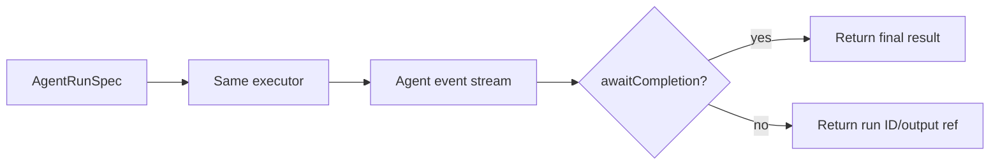

# 04 — ClaudeOpen: subagentes, teams e workflows

## Pergunta respondida

Como ClaudeOpen representa identidade, capability, execução, background, resume e coordenação de agentes, e quais mecanismos parecem sustentar uma orquestração eficaz?

## Resumo executivo

ClaudeOpen não reduz um subagente a “uma nova chamada de modelo”. O snapshot associa a execução a identidade hierárquica, definição de role, modelo resolvido, capability set, transcript, metadata, cwd/worktree, abort controller, output e estado de resume. Foreground e background compartilham o mesmo executor; workflows acrescentam decomposição e persistência de scripts; teams introduzem contexto e comunicação próprios.

O padrão mais importante não é fan-out indiscriminado. É **decompor somente trabalho independente, limitar capabilities por role, persistir o estado necessário para resume e usar verificação independente sobre resultados concretos**.

## Baseline e confiança

- Claude Code CLI 2.1.215: `claudeopen/claude-code-src/README.md:1-18`.
- Confiança alta para launch/resume e metadata; média para a relação completa entre Agent tool, teams e workflows; baixa para remote agents e Cowork backend ausente.

## 1. Agent como contrato de execução

### Resultados distintos

**VERIFIED.** O schema da Agent tool distingue conclusão síncrona, launch assíncrono e launch remoto. Resultados podem carregar agent/task ID, output file, models used e session URL: `claudeopen/claude-code-src/agent/tools.js:17265-17283`.

Essa distinção separa:

- resultado já disponível;
- execução local destacada;
- execução remota destacada;
- localização de output;
- identidade para acompanhamento;
- modelos efetivamente usados.

**ABSENT_FROM_SNAPSHOT:** o contrato local prova que existe um estado `remote_launched`; não prova o scheduler, a durabilidade ou a segurança do serviço remoto.

### Input de launch

**VERIFIED.** A definição da Agent tool aceita prompt, subtype, model, background, isolation e cwd e limita nesting depth: `claudeopen/claude-code-src/agent/tools.js:17314-17329`.

Padrão transferível: launch deve ser uma especificação fechada, não um prompt mais flags soltas espalhadas pelo host.

## 2. Resolução de modelo

**VERIFIED.** Os símbolos `aue`/`pRu` resolvem o modelo do subagente com precedência observável entre:

1. `CLAUDE_CODE_SUBAGENT_MODEL`;
2. argumento da tool;
3. frontmatter/definição do agente;
4. herança do modelo principal.

Modelos fora da allowlist retornam ao herdado e geram telemetria: `claudeopen/claude-code-src/agent/loop.js:40-136`.

O benefício é tornar downgrade uma decisão explícita e observável. O CodeStudio deve representar `requestedModel`, `resolvedModel` e `resolutionReason`, não apenas um campo final.

## 3. Resume como lifecycle

### Exclusão de resume concorrente

**VERIFIED.** `Q_e` consulta `taskRegistry`, marca `resuming` e recusa agente já running ou em resume: `claudeopen/claude-code-src/agent/loop.js:580-617`.

Invariante transferível: uma identidade de AgentRun não pode ter dois executores ativos por acidente.

### Transcript e metadata

**VERIFIED.** Transcript e metadata são lidos em paralelo. Falha de setup é classificada, e o marcador `resuming` é limpo: `claudeopen/claude-code-src/agent/loop.js:618-628`.

**VERIFIED.** Se o usuário parou o agente, resume automático é recusado; um resume explicitamente iniciado pelo usuário pode remover o stop marker: `claudeopen/claude-code-src/agent/loop.js:629-649`.

**VERIFIED.** Se o transcript em disco não existe, o registry pode fornecer mensagens espelhadas em memória; sem nenhuma fonte, o resume falha com erro explícito: `claudeopen/claude-code-src/agent/loop.js:650-669`.

Esse fallback melhora continuidade no processo atual, mas não prova durabilidade após restart.

### Completed versus resumable

**VERIFIED.** O loop detecta transcript já completo e retorna `alreadyCompleted` em vez de reexecutar: `claudeopen/claude-code-src/agent/loop.js:671-686`.

Padrão transferível: resume deve ser idempotente e distinguir “retornar resultado existente” de “executar novamente”.

## 4. Reconstrução do contexto do agente

### Worktree e cwd

**VERIFIED.** O resume valida se o worktree ainda existe; se não existir, registra fallback para cwd pai: `claudeopen/claude-code-src/agent/loop.js:688-697`.

**RISK no padrão de referência:** fallback silencioso de um agente mutante para o cwd pai pode violar isolamento. O CodeStudio não deve copiar essa semântica; quando uma lease obrigatória desaparece, deve falhar fechado ou exigir decisão explícita.

### Definição e prompt

**VERIFIED.** O runtime escolhe definição de agente/fork, usa prompt renderizado quando disponível e recompõe o system prompt de acordo com o contexto: `claudeopen/claude-code-src/agent/loop.js:698-735`.

### Capability set

**VERIFIED.** Tools são filtradas por MCP, skill, definição de agente e permission mode; fork e observer podem exigir `useExactTools`: `claudeopen/claude-code-src/agent/loop.js:736-780`.

Isso sustenta um princípio de least capability por role. O prompt não deve ser a única barreira.

## 5. Identidade hierárquica e execução

### Metadata do run

**VERIFIED.** O launch registra `ownerAgentId`, `parentAgentId`, `spawnDepth`, modelo, definição, diretório e abort controller: `claudeopen/claude-code-src/agent/loop.js:793-809`.

Esses campos permitem:

- ownership;
- árvore de causalidade;
- limite de profundidade;
- cancelamento localizado;
- dashboard por agente;
- atribuição de custo e output.

### Observer sidecar

**VERIFIED.** Um resume de observer é recusado se metadata não confirma `isObserver`; observer recebe modo e tools próprios: `claudeopen/claude-code-src/agent/loop.js:724-744`, `claudeopen/claude-code-src/agent/loop.js:806-823`.

A adaptação útil é um role `observer/verifier` com capability mínima e proibição de mutação, não um “agente completo que promete não editar”.

### Stream compartilhado

**VERIFIED.** O subagente executa por um stream cuja `makeStream` chama o gerador principal, carregando profundidade, tipo, nome e origem: `claudeopen/claude-code-src/agent/loop.js:840-886`.

Foreground e background não precisam de loops diferentes.

### Foreground versus background

**VERIFIED.** Quando `awaitCompletion` é verdadeiro, o caller aguarda e recebe `finalText`; caso contrário, recebe imediatamente `agentId`, descrição e output file: `claudeopen/claude-code-src/agent/loop.js:887-910`.

**Decisão de transferência:** adaptar. Foreground/background devem compartilhar estado, policy, journal e resume.

## 6. Comunicação e teams

### Comms como capability

**VERIFIED.** Helpers reconhecem servidores/tools MCP com `role: "comms"` e podem retirá-los do conjunto comum: `claudeopen/claude-code-src/agent/loop.js:1-17`.

Padrão transferível: comunicação entre agentes é uma capability auditável, não acesso implícito ao estado global.

### Teams como camada distinta

**VERIFIED.** O módulo `teams` exporta espera por teammates ociosos, detecção de teammate, contexto, cor e estado de teammates em processo: `claudeopen/claude-code-src/agent/teams.js:3-18`.

**VERIFIED.** O mesmo módulo define primitivas `TaskList` e `TaskStop`: `claudeopen/claude-code-src/agent/teams.js:295-296`.

**VERIFIED.** A orientação de teams enfatiza que agentes recebem prompts autocontidos e que conclusões background aparecem em turno posterior: `claudeopen/claude-code-src/agent/teams.js:3560-3605`.

O CodeStudio já possui Company Mode, board e subordinate agents. A decisão não é copiar teams, mas mapear ambos para identidade, mailbox, ownership, blockers e status comuns.

## 7. Workflows

### Persistência de scripts

**VERIFIED.** Workflows geram caminhos sob `workflows/scripts`, registram falha de persistência, rejeitam UNC, impõem tamanho máximo e tratam arquivos existentes: `claudeopen/claude-code-src/agent/workflow.js:426-481`.

A existência de script persistido sugere que a decomposição pode ser um artefato retomável. Não prova que o runtime inteiro seja durable após crash.

### Feature gates

**VERIFIED.** O loop consulta separadamente `disableWorkflows` e `enableWorkflows`, derivando a disponibilidade/toggle: `claudeopen/claude-code-src/agent/loop.js:2487-2510`.

Presença no bundle não significa disponibilidade para toda organização, modelo ou sessão.

### Fan-out/fan-in verificável

**VERIFIED.** Um workflow de code review usa finders por ângulos diferentes e um verifier independente para cada localização distinta `(arquivo, linha)`: `claudeopen/claude-code-src/agent/memory.js:4314-4315`.

Esse padrão é mais específico do que “use vários agentes”:

1. os ângulos são independentes;
2. resultados são normalizados por localização;
3. duplicatas convergem;
4. verificação é feita sobre uma claim concreta;
5. synthesis ocorre depois do verifier.

## 8. O que não está comprovado

- **ABSENT_FROM_SNAPSHOT:** algoritmo server-side de scheduling remoto.
- **ABSENT_FROM_SNAPSHOT:** durabilidade cloud do agent registry.
- **ABSENT_FROM_SNAPSHOT:** exatamente como dois agentes mutantes evitam o mesmo checkout.
- **ABSENT_FROM_SNAPSHOT:** garantia de delivery da comms capability.
- **ABSENT_FROM_SNAPSHOT:** política causal que escolhe quantidade de agentes.
- **HYPOTHESIS:** fan-out melhora qualidade média; pode aumentar custo, conflito e synthesis loss.

## 9. Comparação com o CodeStudio

### Forças internas

- `spawn_agent` suporta até oito agentes, profiles especializados, foreground/background e subordinate persistente: `codestudio_mcp-codebase/packages/code-agent/src/tools/spawn-agent.ts:106-159`, `codestudio_mcp-codebase/packages/code-agent/src/tools/spawn-agent.ts:758-817`.
- `workflow` já modela DAG, dependências, waves, profiles e scopes: `codestudio_mcp-codebase/packages/code-agent/src/tools/workflow/workflow-tool.ts:37-78`.
- Digests de dependência são limitados para conter contexto: `codestudio_mcp-codebase/packages/code-agent/src/tools/workflow/workflow-run.ts:26-47`.
- Company Mode oferece coordenação persistente e board, além de agentes efêmeros.
- O BT runner aguarda background agents antes de encerrar: `codestudio_mcp-codebase/packages/code-agent/src/core/runner/orchestrator.ts:196-229`.

### Gaps comprovados

1. **RISK:** resume de workflow é process-scoped: `codestudio_mcp-codebase/packages/code-agent/src/tools/workflow/workflow-tool.ts:1-8`.
2. **RISK:** scope de implement agents bloqueia apenas write tools diretas; `run_command` pode escrever fora do scope: `codestudio_mcp-codebase/packages/code-agent/src/tools/implement-subagent.ts:1287-1345`.
3. **UX_GAP:** AgentRun, lease, branch, owner, capability set e resume não são apresentados como uma entidade única.
4. **HYPOTHESIS:** verifier seletivo pode melhorar precisão; precisa medir falsos positivos, custo e latência.
5. **RISK:** foreground/background podem divergir se lifecycle e persistência não forem centralizados.

## 10. Decisões de transferência

| Mecanismo | Decisão | Adaptação |
|---|---|---|
| `AgentRunSpec` rico | adapt ClaudeOpen | identidade, role, model resolution, capabilities, isolation e resume |
| Foreground/background no mesmo executor | adapt ClaudeOpen | wait/detach como opção do caller |
| Exact tools por role | merge | profiles atuais + capability set fechado |
| Observer/verifier mínimo | adapt ClaudeOpen | profile sem mutação e evidência concreta |
| Transcript + metadata no resume | merge | usar stores internos e journal |
| Worktree fallback para cwd pai | reject | fail closed quando isolamento for obrigatório |
| Teams substituindo Company | reject | mapear para contratos comuns, preservar Company |
| Scripts/workflows retomáveis | adapt ClaudeOpen | persistir DAG/steps/result/idempotency no store |
| Fan-out automático amplo | benchmark first | somente decomposição independente e budgeted |

## 11. Invariantes futuros

1. Um `AgentRunId` possui no máximo um executor ativo.
2. Resume nunca repete step/tool confirmado sem idempotency decision explícita.
3. Stop pelo usuário não é revertido por background automation.
4. Requested/resolved model e downgrade reason são persistidos.
5. Capability set é derivado do role e policy, não apenas do prompt.
6. Agente mutante usa lease exclusiva; desaparecimento da lease falha fechado.
7. Foreground/background produzem o mesmo lifecycle.
8. Verifier não herda write capabilities.
9. Profundidade, parent e owner são obrigatórios em toda árvore.
10. Comms é capability auditável com source/destination.

## 12. Gates futuros

- Interromper processo durante workflow e retomar sem repetir passos concluídos.
- Lançar duas tentativas de resume concorrentes e aceitar exatamente uma.
- Remover worktree durante AgentRun mutante e confirmar fail closed.
- Comparar foreground/background do mesmo fixture e obter eventos equivalentes.
- Demonstrar que shell não escapa do scope.
- Medir fan-out de 1/2/4/8 agentes em qualidade, custo e synthesis loss.
- Verifier recebe claim + evidência, não transcript completo sem necessidade.

## Questões abertas

- Qual store persiste task registry após restart no produto real?
- Quais tipos de Agent aceitam isolation/worktree em cada feature flag?
- Como remote agents recebem capabilities e secrets?
- O output file é autoridade ou apenas uma projeção de conveniência?
- Quais critérios escolhem observer e verifier automaticamente?
