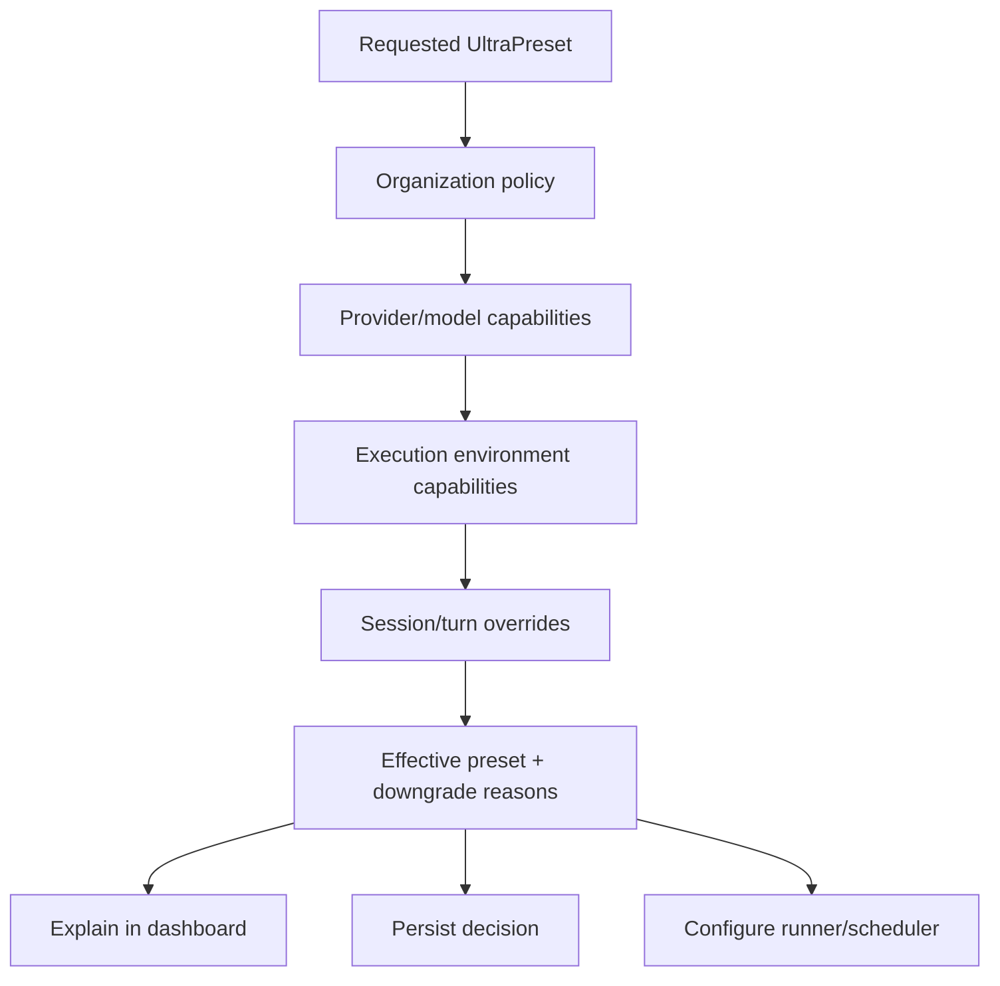

# 05 — ClaudeOpen: `ultracode`, effort e extended thinking

## Pergunta respondida

O que o modo `ultracode` realmente ativa no ClaudeOpen, quais precondições e downgrades existem, e como o CodeStudio deve modelar seu próprio Ultra sem criar um modo opaco?

## Resumo executivo

No snapshot Claude Code 2.1.215, `ultracode` não é um modelo nem sinônimo de extended thinking. É um preset de sessão que combina:

- effort `xhigh`;
- `ultracode: true`;
- dynamic workflow orchestration;
- gates por modelo, organização, feature availability, launch pin e transporte remoto.

A eficácia percebida não pode ser atribuída apenas a `xhigh`: effort, workflow, paralelismo, prompts, modelo e verifier variam juntos. O CodeStudio deve representar essas dimensões separadamente em um `UltraPreset`, aplicar downgrade explícito por provider/model e medir cada fator.

## Baseline e confiança

- Claude Code CLI 2.1.215: `claudeopen/claude-code-src/README.md:1-18`.
- Confiança alta para parsing, gates e estado de sessão; baixa para o algoritmo de dynamic workflow orchestration, parcialmente dependente de feature flags e componentes remotos.

## 1. Vocabulário observado

### Effort levels

**VERIFIED.** Os níveis observados incluem `low`, `medium`, `high`, `xhigh` e `max`; o alias `ultracode` é relacionado a `xhigh`: `claudeopen/claude-code-src/vendor/misc.js:54687-54693`.

A existência de `max` e `xhigh` não significa que todo modelo aceite ambos. Funções de normalização aplicam limites por modelo e organização.

### Descrição pública do comando

**VERIFIED.** A ajuda de `/effort` declara:

> `ultracode: xhigh + dynamic workflow orchestration (this session only)`

Fonte: `claudeopen/claude-code-src/agent/workflow.js:8823-8837`.

Essa frase é o contrato mais direto encontrado no snapshot. Ela separa três aspectos:

1. nível de effort;
2. orquestração dinâmica;
3. duração de sessão.

### Parsing

**VERIFIED.** O parser converte `ultracode` em `value: "xhigh"` quando o recurso é suportado: `claudeopen/claude-code-src/agent/workflow.js:8839-8858`.

Isso, isoladamente, não ativa toda a semântica. O handler dedicado também grava a flag de orquestração.

## 2. Gates de ativação

O símbolo `NVy` aplica uma sequência verificável de checks: `claudeopen/claude-code-src/agent/workflow.js:9005-9025`.

### 2.1 Dynamic workflows habilitados

**VERIFIED.** Sem dynamic workflows, a ativação retorna uma mensagem explicando o requisito e as opções válidas: `claudeopen/claude-code-src/agent/workflow.js:9005-9010`.

### 2.2 Limite organizacional

**VERIFIED.** Se `xhigh` é restrito pela organização para o modelo corrente, a ativação é recusada: `claudeopen/claude-code-src/agent/workflow.js:9011-9015`.

Isso prova que feature availability e policy organizacional são camadas diferentes.

### 2.3 Compatibilidade do modelo

**VERIFIED.** Se o modelo não suporta `xhigh`, o handler solicita troca para um modelo compatível: `claudeopen/claude-code-src/agent/workflow.js:9016-9020`.

Um produto multi-provider precisa registrar requested versus effective effort e o motivo do downgrade/deny.

### 2.4 Launch-effort pin

**VERIFIED.** Um pin de effort definido no launch pode impedir a troca, a menos que a ação seja explicitamente liberada no contexto permitido: `claudeopen/claude-code-src/agent/workflow.js:9021-9025`.

Esse check evita que um comando local altere silenciosamente uma decisão de bootstrap/host.

## 3. Estado efetivo

### Duas dimensões persistidas juntas

**VERIFIED.** A ativação atualiza:

```text
value: "xhigh"
ultracode: true
```

Fonte: `claudeopen/claude-code-src/agent/workflow.js:9027-9030`.

O transporte remoto recebe `effortLevel` e `ultracode` como campos separados quando consegue aplicar settings: `claudeopen/claude-code-src/agent/workflow.js:8860-8873`, `claudeopen/claude-code-src/agent/workflow.js:9031-9038`.

Esse é o principal fundamento para não modelar Ultra como um único enum interno.

### Escopo de sessão

**VERIFIED.** A mensagem de sucesso reforça `this session only`: `claudeopen/claude-code-src/agent/workflow.js:9049-9054`.

O escopo observado difere do keyword efêmero por turno existente no CodeStudio. A UX futura precisa distinguir:

- default de usuário/projeto;
- preset da sessão;
- override do turno;
- pin do launch;
- limite organizacional;
- capability efetiva do modelo/provider.

### Override por environment

**VERIFIED.** `CLAUDE_CODE_EFFORT_LEVEL` pode sobrepor o valor escolhido e gerar mensagem explícita: `claudeopen/claude-code-src/agent/workflow.js:9039-9047`.

O estado exibido deve representar o valor efetivo, não apenas a preferência solicitada.

## 4. Downgrade e normalização

**VERIFIED.** O código limita níveis acima do permitido e converte `max`/`xhigh` para `high` quando o modelo não suporta o valor: `claudeopen/claude-code-src/agent/workflow.js:88-125`, `claudeopen/claude-code-src/agent/workflow.js:266-286`.

O padrão transferível é uma resolução declarativa:

```text
requested preset
→ organization constraints
→ provider/model capabilities
→ launch/session/turn overrides
→ effective configuration + reasons
```

O CodeStudio não deve enviar um sentinel `ultra` genérico para todos os providers e depender de comportamento implícito.

## 5. Extended thinking é outro controle

**VERIFIED.** O Desktop expõe `setEffort` e `setExtendedThinking` como operações separadas: `claudeopen/asar-src/config/settings/index.chunk-BAm06TaJ.js:546-552`.

Portanto:

- effort não é thinking toggle;
- thinking budget/adaptive mode não é workflow orchestration;
- workflow orchestration não garante paralelismo;
- paralelismo não garante verifier;
- nenhuma dessas dimensões, isoladamente, prova qualidade superior.

### `ultrathink`

**VERIFIED.** O corpus detecta literalmente o keyword `ultrathink` e enumera suas ocorrências no texto: `claudeopen/claude-code-src/vendor/misc.js:54737-54752`.

**VERIFIED, feature-gated.** Quando o gate `tengu_turtle_carbon` está ativo, a presença do keyword gera telemetry `tengu_ultrathink` e um attachment `ultrathink_effort`: `claudeopen/claude-code-src/agent/tools.js:48778-48785`.

**VERIFIED.** Esse attachment vira um reminder meta para “reasoning mais profundo” apenas naquele turno: `claudeopen/claude-code-src/agent/workflow.js:10215-10218`. Isso prova um mecanismo contextual por keyword; não prova um toggle provider-level de extended thinking, um valor de effort como `xhigh`, nem orquestração. A habilitação efetiva do gate em contas reais permanece `UNKNOWN`.

## 6. Relação com workflows

**VERIFIED.** Workflows podem ser habilitados/desabilitados por gates próprios: `claudeopen/claude-code-src/agent/loop.js:2487-2510`.

**VERIFIED.** O exemplo de code review utiliza fan-out por ângulos e verifier por localização: `claudeopen/claude-code-src/agent/memory.js:4314-4315`.

**INFERRED.** `ultracode` habilita o agente a usar orquestração dinâmica disponível, mas o snapshot não fornece um único scheduler público que determine quando, quantos ou quais agentes lançar.

**ABSENT_FROM_SNAPSHOT:** critérios internos do modelo e backend remoto de workflow.

## 7. O Ultra atual do CodeStudio

### Contrato observado

**VERIFIED.** No CodeStudio, Ultra é um perfil de execução do host separado do effort nativo do provider; o literal legado `reasoningEffort=ultra` é normalizado: `codestudio_mcp-codebase/packages/code-agent/src/sessions/execution-mode.ts:15-25`.

**VERIFIED.** O keyword `ultracode` ativa Ultra somente no turno corrente, sem mudar o modo sticky, e pode ser desativado por `CODER_ULTRA_KEYWORD=0`: `codestudio_mcp-codebase/packages/code-agent/src/sessions/execution-mode.ts:28-45`.

**VERIFIED.** O workflow DAG é registrado apenas em Ultra e seu resume é process-scoped: `codestudio_mcp-codebase/packages/code-agent/src/tools/workflow/workflow-tool.ts:1-8`.

### Forças

- Ultra pode ativar ferramentas de orquestração sem inflar todos os turnos.
- Workflow possui DAG explícito, dependências, waves e profiles.
- O host já separa execution mode de effort do provider.
- A ativação por turno é reversível e reduz persistência acidental.

### Lacunas

1. **UX_GAP:** o usuário vê “Ultra”, mas não todas as dimensões efetivas.
2. **RISK:** o sentinel interno pode mascarar downgrade diferente por provider.
3. **RISK:** workflow resume não sobrevive ao processo.
4. **HYPOTHESIS:** perfil Ultra melhora task success; não há benchmark causal que isole effort de fan-out.
5. **RISK:** paralelismo sem workspace lease pode ampliar conflitos em agentes mutantes.

## 8. `UltraPreset` recomendado

```ts
interface UltraPreset {
  id: string;
  scope: 'turn' | 'session';
  reasoning: {
    requested: 'auto' | 'low' | 'medium' | 'high' | 'xhigh' | 'max';
    fallback: 'deny' | 'downshift';
  };
  orchestration: {
    policy: 'manual' | 'suggest' | 'dynamic';
    maxParallelism: number;
    maxDepth: number;
    tokenBudget?: number;
  };
  verification: {
    policy: 'none' | 'selective' | 'required';
    independentModel?: boolean;
  };
  execution: {
    background: 'deny' | 'allow';
    durability: 'process' | 'session';
    isolation: 'inherit' | 'worktree' | 'container' | 'remote';
  };
}
```

Esse pseudotipo é uma proposta do CodeStudio, não um contrato ClaudeOpen.

## 9. Resolução efetiva proposta



A resolução precisa ser determinística e persistida junto do run.

## 10. Decisões de transferência

| Mecanismo | Decisão | Razão |
|---|---|---|
| Effort e workflow como campos separados | adapt ClaudeOpen | elimina modo opaco |
| Gates por organização/modelo | merge | integrar provider capability registry e policy |
| Estado de sessão explícito | merge | suportar session preset e turn override |
| Downgrade com mensagem | adapt ClaudeOpen | requested/effective/reason devem ser visíveis |
| Extended thinking separado | preserve CodeStudio | manter como capability própria e explicitar sua independência de effort/orchestration |
| Literal `ultracode` como contrato interno | reject | usar apenas compatibilidade/UX |
| Reminder contextual por keyword `ultrathink` | benchmark first | mecanismo verificado e feature-gated; benefício e rollout efetivo são desconhecidos, sem confundi-lo com thinking/effort |
| `xhigh` obrigatório em todo Ultra | benchmark first | alguns providers podem oferecer outra relação custo/qualidade |
| Fan-out automático | benchmark first | depende de independência, budget e isolamento |

## 11. Invariantes futuros

1. Requested e effective preset são ambos armazenados.
2. Todo downgrade possui código de razão e aparece na UI.
3. Effort, thinking, orchestration, verification e isolation são independentes.
4. Ultra não concede permissão adicional; Policy Engine continua soberano.
5. Ultra não enfraquece Plan/Spec/task scope.
6. Agente mutante em paralelo exige lease compatível.
7. Verifier não recebe write capabilities por herança.
8. Session preset e turn override possuem precedência documentada.
9. Restart preserva configuração efetiva e estado de workflow durável.
10. Ausência de capability obrigatória falha fechado ou pede escolha; nunca degrada silenciosamente.

## 12. Benchmarks obrigatórios

A decisão de defaults exige um desenho fatorial:

- effort: high versus xhigh;
- orchestration: off versus dynamic;
- verifier: off versus selective;
- parallelism: 1 versus 2 versus 4;
- model/provider: capability-equivalent cohorts;
- isolation: shared read-only versus worktree.

Métricas mínimas:

- task success;
- regressions introduzidas;
- tool-selection error;
- useful subagent result rate;
- synthesis loss;
- wall time;
- tokens/custo;
- conflicts de workspace;
- resume após crash.

O plano detalhado está em `16-evaluation-benchmark-plan.md`.

## Questões abertas

- Qual algoritmo de dynamic workflow orchestration estava habilitado na build observada?
- O transporte remoto aplica `ultracode` integralmente ou somente settings suportados?
- Como `max` se relaciona com `xhigh` por modelo na versão auditada?
- Quais limits organizacionais são configuráveis versus fixos?
- Qual combinação de effort e verifier maximiza qualidade por custo no CodeStudio?
