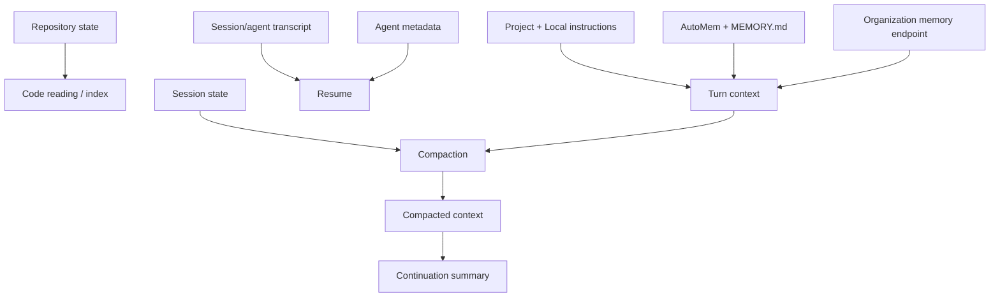

# 06 — ClaudeOpen: memória, contexto e compactação

## Pergunta respondida

Quais camadas de informação o ClaudeOpen usa para instruções, memória, transcript, retomada e compactação, e quais princípios devem complementar — sem substituir — a arquitetura de memória do CodeStudio?

## Resumo executivo

O snapshot não mostra uma única “memória”. Ele mostra camadas com propósitos diferentes:

- instruções de projeto e locais (`CLAUDE.md`);
- memória automática indexada por `MEMORY.md`;
- memória organizacional remota;
- transcript e metadata de sessão/agente;
- session state;
- compaction;
- continuation summary para handoff.

A principal lição transferível é a **higiene entre camadas**. Memória automática não deve duplicar fatos deriváveis do repositório; uma entrada existente deve ser atualizada em vez de acumulada; transcript e run metadata continuam sendo a base de retomada operacional. O CodeStudio já é mais forte em FTS/vector, staleness, scopes e distillation. A convergência correta adapta as regras anti-entropia e melhora observabilidade/handoff, sem trocar o store interno por uma pasta de Markdown.

## Baseline e confiança

- Claude Code CLI 2.1.215: `claudeopen/claude-code-src/README.md:1-18`.
- Confiança alta para arquivos candidatos, labels, policy de memória e session state; média para a integração ponta a ponta; baixa para memória organizacional server-side além do cliente local.

## 1. Camadas observadas



As setas são uma síntese `INFERRED`; cada camada citada abaixo é `VERIFIED`.

## 2. Instruções de projeto e locais

### Candidatos de arquivo

**VERIFIED.** O carregador constrói candidatos para `CLAUDE.md` e `.claude/CLAUDE.md`: `claudeopen/claude-code-src/agent/memory.js:3081-3083`, `claudeopen/claude-code-src/agent/memory.js:3313-3315`.

### Labels semânticos

**VERIFIED.** As fontes são classificadas como `Project`, `Local` ou `AutoMem`, com descrições diferentes de escopo e versionamento: `claudeopen/claude-code-src/agent/memory.js:3194`.

Essa separação evita tratar:

- instrução versionada pela equipe;
- preferência privada/local;
- memória produzida pelo agente;

como o mesmo tipo de dado.

### Includes externos e trust

**VERIFIED.** O estado Desktop registra aprovação para includes externos de `CLAUDE.md`: `claudeopen/asar-src/mcp/index.chunk-CCzZqRut.js:489-498`.

Padrão transferível: incluir contexto fora da raiz é uma operação de trust/policy, não uma simples resolução de path.

## 3. Memória automática

### Índice

**VERIFIED.** Configurações de memória usam `MEMORY.md` como `promptIndex`: `claudeopen/claude-code-src/agent/memory.js:239`, `claudeopen/claude-code-src/agent/memory.js:357`.

O índice oferece uma entrada textual estável, mas o snapshot não prova sozinho ranking semântico equivalente a FTS/vector.

### Política anti-entropia

**VERIFIED.** A policy instrui a não salvar padrões de código, arquitetura, paths ou estrutura que possam ser derivados do repositório atual: `claudeopen/claude-code-src/agent/memory.js:413`.

Essa regra é valiosa porque memória durável deve guardar fatos difíceis de redescobrir, por exemplo:

- decisão e motivação;
- preferência do usuário;
- gotcha não óbvio;
- procedimento validado;
- pointer externo.

Código e estrutura devem vir da fonte atual para reduzir staleness.

### Update-before-create

**VERIFIED.** Antes de salvar, o agente deve procurar arquivo existente, atualizar em vez de duplicar e excluir memórias incorretas: `claudeopen/claude-code-src/agent/memory.js:457`.

Padrão transferível: identidade lógica e supersession são parte do write contract.

### Manutenção explícita

**VERIFIED.** O prompt de memória informa o diretório, manda listar seu conteúdo e escrever/atualizar arquivos no topo do diretório: `claudeopen/claude-code-src/agent/memory.js:4465-4494`.

**RISK:** manutenção orientada somente por prompt pode falhar silenciosamente ou variar por modelo. O CodeStudio deve manter constraints no store e tooling, usando prompt como orientação adicional.

## 4. Memória organizacional

**VERIFIED quanto ao cliente.** Existe discovery com cache e validação de endpoint `/v1/code/memory/`, incluindo tratamento de resposta inválida e falha: `claudeopen/claude-code-src/agent/memory.js:65-171`.

**ABSENT_FROM_SNAPSHOT:** não estão presentes:

- schema e ranking server-side completos;
- authorization multi-tenant;
- retention;
- conflict resolution;
- sync semantics;
- auditoria administrativa.

Não se pode afirmar superioridade da memória organizacional apenas pela existência do endpoint.

## 5. Transcript e metadata

### Resume de agente

**VERIFIED.** O resume lê transcript e metadata em paralelo, usa transcript espelhado em memória quando o arquivo desaparece e falha explicitamente sem fonte: `claudeopen/claude-code-src/agent/loop.js:624-669`.

### Contexto operacional

**VERIFIED.** Metadata preserva spawn depth, cwd/worktree, agent type, description e stop marker, enquanto o registry contém status/result: `claudeopen/claude-code-src/agent/loop.js:629-701`.

Essa camada não deve ser condensada em memória textual. Resume confiável precisa de estado estruturado.

## 6. Session state

**VERIFIED.** O estado da sessão diferencia `memoryToggledOff` e `pendingPostCompaction`: `claudeopen/claude-code-src/agent/session-state.js:452`, `claudeopen/claude-code-src/agent/session-state.js:587`.

A separação mostra que:

- habilitar/desabilitar memória é uma preferência/estado;
- compactação possui trabalho pendente próprio;
- uma não é proxy da outra.

## 7. Compactação

### Streaming

**VERIFIED.** O módulo de compactação usa `stream: true` nos caminhos auditados: `claudeopen/claude-code-src/agent/compaction.js:95-141`.

### Evento de compactação

**VERIFIED.** Um `compaction_delta` pode ser normalizado em evento `compaction` com conteúdo compactado: `claudeopen/claude-code-src/agent/compaction.js:361-364`.

### Controle legado versus direção nova

**VERIFIED.** O código reconhece controle de compactação legado e edições de compactação mais novas, marcando o parâmetro anterior como deprecated: `claudeopen/claude-code-src/agent/compaction.js:638-643`.

Isso alerta contra copiar um protocolo específico: a própria referência está em evolução.

### Invariante de pares atômicos

A compactação e reconstrução de histórico devem preservar relações `tool_use`/`tool_result`; o loop de resume normaliza mensagens antes de continuar: `claudeopen/claude-code-src/agent/loop.js:671-688`.

**INFERRED:** pares atômicos são requisito de continuidade, embora a faixa citada não exponha todo o algoritmo de corte.

## 8. Handoff

**VERIFIED.** Há um prompt específico de continuation summary para permitir que outra instância retome a tarefa: `claudeopen/claude-code-src/agent/tools.js:262-283`.

Um handoff eficaz deve conter:

- objetivo atual;
- estado verificável;
- decisões e por quê;
- ações concluídas;
- pendências concretas;
- blockers;
- arquivos/identidades relevantes;
- comandos/testes já executados;
- próxima ação segura.

**HYPOTHESIS:** um artifact explícito reduz goal drift em resume/compaction. Deve ser medido por fidelidade de objetivo e pending tasks.

## 9. O que não deve ser confundido

| Camada | Serve para | Não deve virar |
|---|---|---|
| `CLAUDE.md` Project | instrução versionada | preferência privada |
| Local instructions | customização da máquina/usuário | regra corporativa compartilhada |
| AutoMem | fatos duráveis não óbvios | cópia do repositório |
| Code index | estado derivável atual | decisão histórica |
| Transcript | histórico da execução | memória global ilimitada |
| Agent metadata | resume operacional | prosa de handoff |
| Compaction summary | reduzir contexto preservando estado | source of truth de tools/tasks |
| Journal | lifecycle/idempotência | prompt completo sem redaction |
| Handoff | transição entre instâncias | substituto de stores estruturados |

## 10. Comparação com a memória do CodeStudio

### Forças internas

**VERIFIED.** O CodeStudio separa:

- session notes em `coder_session_memory`;
- memória durável em `agent_memory`;
- snapshots curados/indexados.

Fonte: `codestudio_mcp-codebase/docs/memory-system.md:1-15`.

**VERIFIED.** `agent_memory` possui types fechados, scopes, supersession lógica e staleness por hash de arquivo: `codestudio_mcp-codebase/docs/memory-system.md:17-25`.

**VERIFIED.** Recall usa candidatos FTS + vector RRF e rescore por relevance/importance/recency/frequency/staleness: `codestudio_mcp-codebase/docs/memory-system.md:27-37`.

**VERIFIED.** Há distillation, idle sweeper, telemetry e sync entitlement-gated: `codestudio_mcp-codebase/docs/memory-system.md:31-56`.

Esses são mecanismos internos verificáveis e um contrato mais explícito no corpus auditado; devem ser preservados. Superioridade de eficácia ou do produto completo permanece `UNKNOWN` até benchmark e evidência equivalente do outro lado.

### Lacunas e oportunidades

1. **UX_GAP:** memória lembrada, notas de sessão, contexto recuperado e compactação não são apresentados como layers no fluxo ao vivo.
2. **RISK:** memória pode acumular fatos deriváveis se write guidance/tool contract não reforçar anti-entropia.
3. **HYPOTHESIS:** update-before-create e remoção de incorretas reduzem duplicata/staleness além do sweeper.
4. **RISK:** resume de AgentRun/workflow ainda depende de estados process-scoped em partes da orquestração.
5. **UX_GAP:** handoff e post-compaction state não possuem uma superfície operacional única no dashboard.

## 11. Decisões de transferência

| Mecanismo | Decisão | Adaptação |
|---|---|---|
| Project/Local/AutoMem separados | merge | mapear para scopes/instruction sources internos |
| Anti-derivable-facts | adapt ClaudeOpen | reforçar prompt, tool validation e review do write |
| Update-before-create | merge | usar identidade/supersession do store atual |
| `MEMORY.md` como store principal | reject | FTS/vector/staleness internos são mais fortes |
| Memória organizacional remota | unknown | backend ausente; avaliar só quando houver requisito enterprise |
| Transcript + metadata para resume | adapt ClaudeOpen | persistir `AgentRun` e workflow no store/journal |
| Compaction como evento | adapt ClaudeOpen | tornar lifecycle visível e checkpointed |
| Continuation summary | merge | integrar ao active context/session handoff |
| Memória automática via prompt apenas | reject | manter enforcement no domínio/store |

## 12. Contrato de layers proposto

```ts
interface MemoryLayerDescriptor {
  kind:
    | 'project_instructions'
    | 'local_instructions'
    | 'active_context'
    | 'session_notes'
    | 'durable_memory'
    | 'code_index'
    | 'transcript'
    | 'compaction_summary'
    | 'handoff';
  scope: 'turn' | 'session' | 'project' | 'user' | 'organization';
  sourceOfTruth: string;
  writableBy: string[];
  freshness: 'live' | 'hash_checked' | 'historical';
  visibility: 'prompt' | 'tool' | 'dashboard' | 'internal';
}
```

Esse pseudotipo é proposta do CodeStudio, não contrato ClaudeOpen.

## 13. Invariantes futuros

1. Fato derivável do repositório é relido; não vira memória durável por default.
2. Memória possui identidade lógica e supersession auditável.
3. Staleness é calculada contra fontes referenciadas.
4. Transcript e AgentRun metadata são stores estruturados.
5. Compactação não altera task/tool source of truth.
6. Handoff referencia IDs/arquivos, não duplica payloads extensos.
7. “Ignore memory” impede recall e injeção naquele turno sem apagar dados.
8. Secrets e payloads sensíveis são redigidos antes de journal/sync.
9. Sync organizacional não reduz policies de escopo inferior/superior.
10. Resume após crash usa checkpoint + journal + stores, não somente resumo textual.

## 14. Gates e benchmarks futuros

- Três compactações sequenciais preservam objetivo e pending tasks sem hallucination.
- Recall relevante melhora task success sem aumentar stale-memory errors.
- Write evaluator rejeita fatos claramente deriváveis do repo.
- Atualização de memória substitui a identidade viva e mantém histórico superseded.
- AgentRun interrompido retoma com transcript e metadata após restart.
- Dashboard mostra origem, scope, freshness e uso de cada memória recuperada.
- Handoff entre duas instâncias mantém goal fidelity ≥ meta definida no plano de avaliação.

## Questões abertas

- Como a memória organizacional ordena conflitos e escopos no backend ausente?
- Quais partes de AutoMem são sempre carregadas versus recuperadas sob demanda?
- Qual trigger executa manutenção e com qual budget?
- Como ClaudeOpen mede qualidade de continuation summaries?
- Que dados de memória são enviados ao remote runtime versus mantidos no host?
