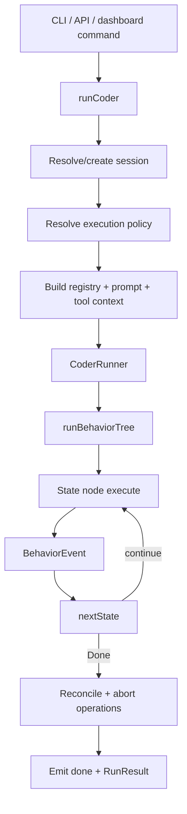
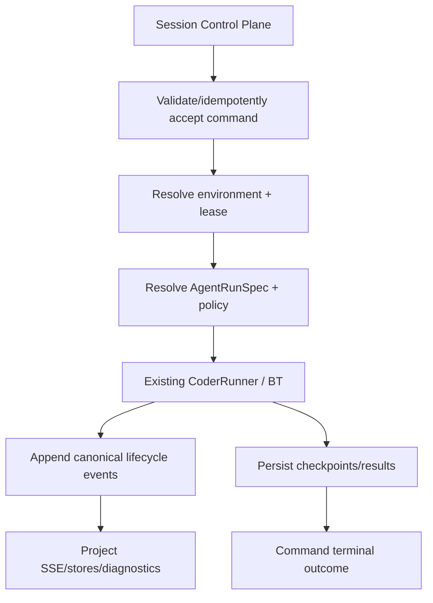

# 07 — CodeStudio: runner e orquestração

## Pergunta respondida

Como o CodeStudio inicia e conduz uma sessão de agente hoje, quais invariantes o BT runner já garante e onde um Session Control Plane deve se conectar sem reescrever a engine?

## Resumo executivo

O runner atual não é uma fraqueza a ser substituída. O CodeStudio possui uma máquina de estados declarativa, nodes especializados, recovery, compactação, circuit breakers, telemetry de dwell, espera de background agents e reconciliation de tarefas no shutdown. O problema de convergência está ao redor da engine: identidade de commands/runs, durabilidade cross-process, capability/policy uniforme, ambientes e projeções observáveis.

A arquitetura-alvo preserva `runCoder → CoderRunner → runBehaviorTree` e adiciona contratos do control plane nos boundaries de bootstrap, dispatch, event append e terminal persistence.

## Baseline e confiança

- CodeStudio 3.15.1: `codestudio_mcp-codebase/package.json:1-18`.
- Commit observado na execução: `61e5769cbe2ac2530a32ae547576d5d70f7bc693`.
- Confiança alta para o fluxo e invariantes citados; riscos de crash/replay continuam análise estática até testes E2E.

## 1. Entrypoint e assembly

### Sessão e policy de execução

**VERIFIED.** `runCoder` resolve ou cria a sessão, persiste a seleção de execution mode e separa o Ultra host-owned do reasoning effort do provider: `codestudio_mcp-codebase/packages/code-agent/src/index.ts:340-440`.

**VERIFIED.** O keyword `ultracode` pode elevar somente o run atual, enquanto o modo sticky da sessão permanece intacto: `codestudio_mcp-codebase/packages/code-agent/src/index.ts:441-457`.

### Construção do host runner

**VERIFIED.** O entrypoint monta `CoderRunner` com provider, compaction provider, context window, registry, system prompt, tool context, mensagens, session store, telemetry assíncrona e sinais de self-review: `codestudio_mcp-codebase/packages/code-agent/src/index.ts:2459-2515`.

Esse assembly já funciona como composition root. O Session Control Plane deve entrar antes/depois desse ponto para padronizar `SessionCommand`, `AgentRunSpec`, `ExecutionEnvironmentRef` e journal, não duplicar a montagem dentro de outra engine.

## 2. Fluxo principal

**Status: VERIFIED/INFERRED.** As chamadas e contratos individuais são verificados; o diagrama é uma representação composta.

### Delegação ao BT

**VERIFIED.** `CoderRunner` chama `runBehaviorTree`: `codestudio_mcp-codebase/packages/code-agent/src/core/runner.ts:1568`.

### Nodes explícitos

**VERIFIED.** A tabela default contém:

- `Bootstrap`;
- `Planning`;
- `Executing`;
- `Compacting`;
- `Reviewing`;
- `Recovering`;
- `Done`.

Fonte: `codestudio_mcp-codebase/packages/code-agent/src/core/runner/orchestrator.ts:73-87`.

### Transições declarativas

**VERIFIED.** O mapa de transições fica em um único arquivo e cobre success, token threshold, tool loop, max turns, provider error, compaction, clean finish e abort: `codestudio_mcp-codebase/packages/code-agent/src/core/runner/machine/transitions.ts:1-58`.

`nextState` é puro e torna fallthrough visível ao enviar evento não mapeado para `Done`: `codestudio_mcp-codebase/packages/code-agent/src/core/runner/machine/transitions.ts:60-78`.

## 3. Invariantes atuais

### O BT sempre termina por contrato

**VERIFIED.** Exceção de node é convertida em `Aborted`, com `stopReason` e error capturados, para que o terminal `done` ainda seja emitido: `codestudio_mcp-codebase/packages/code-agent/src/core/runner/orchestrator.ts:135-168`.

Isso é uma força importante: consumidores não deveriam ficar presos em “streaming” por uma exception não normalizada.

### Eventos inválidos falham de modo explícito

**VERIFIED.** A engine valida o conjunto de `BehaviorEvent.kind`; retorno inválido é transformado em abort com erro claro: `codestudio_mcp-codebase/packages/code-agent/src/core/runner/orchestrator.ts:118-168`.

### Dwell telemetry não quebra o run

**VERIFIED.** Cada transição mede `dwellMs`, emite `bt_state_dwell` e trata falha do listener como não fatal: `codestudio_mcp-codebase/packages/code-agent/src/core/runner/orchestrator.ts:129-191`.

### Mensagem injetada reabre execução

**VERIFIED.** Uma mensagem aceita enquanto o turno terminava faz `CleanFinish` voltar a `Executing`, evitando strand da mensagem: `codestudio_mcp-codebase/packages/code-agent/src/core/runner/orchestrator.ts:196-208`.

### Background agents impedem término prematuro

**VERIFIED.** Se um clean finish encontra jobs ativos, o runner estaciona até trabalho/mensagem, abort ou timeout e pode reentrar em `Executing`: `codestudio_mcp-codebase/packages/code-agent/src/core/runner/orchestrator.ts:210-230`.

### Shutdown reconcilia estado

**VERIFIED.** O `finally` recupera tasks stale, marca task runs interrompidos pelo worker e aborta operações restantes: `codestudio_mcp-codebase/packages/code-agent/src/core/runner/orchestrator.ts:232-261`.

### Terminal único

**VERIFIED.** Ao sair, o runner emite `done` com reason/error/transition e retorna `RunResult`: `codestudio_mcp-codebase/packages/code-agent/src/core/runner/orchestrator.ts:263-282`.

## 4. Recovery e compactação

### Recovery explícito

**VERIFIED.** `ProviderError` leva a `Recovering`; context overflow pode emitir `TokenThresholdHit` e levar a `Compacting`: `codestudio_mcp-codebase/packages/code-agent/src/core/runner/machine/transitions.ts:49-55`.

### Compactação como node próprio

**VERIFIED.** `Compacting` termina em `Reviewing`, pode ir a `Recovering` em provider error e aborta explicitamente: `codestudio_mcp-codebase/packages/code-agent/src/core/runner/machine/transitions.ts:39-47`.

### Guard rails

A suíte do runner possui testes dedicados para:

- doom loop;
- failure streak;
- max turns;
- no progress;
- task-mode gate;
- nested observer/dedup;
- compaction thresholds/checkpoints/precompute;
- tool dispatch timeout;
- transitions.

As referências estão sob `codestudio_mcp-codebase/packages/code-agent/src/core/runner/**/__tests__/`; a tabela de transições descreve as invariantes combinatórias em `codestudio_mcp-codebase/packages/code-agent/src/core/runner/machine/transitions.ts:1-12`.

Essa cobertura é uma vantagem interna. O roadmap deve adicionar testes de contrato/journal e crash, não substituir a suíte existente.

## 5. Boundaries compartilhados por referência

**VERIFIED.** `OrchestratorArgs` recebe:

- tiers por referência, promovíveis durante o run;
- pins de tools ocultas;
- array vivo de mensagens;
- bridge para estado legado.

Fonte: `codestudio_mcp-codebase/packages/code-agent/src/core/runner/orchestrator.ts:41-65`.

Essa escolha mantém host e BT sincronizados, mas cria uma fronteira process-local. Para resume pós-crash, os valores relevantes devem possuir projeções duráveis e IDs, não depender apenas de referências em memória.

## 6. Comparação com ClaudeOpen

| Aspecto | ClaudeOpen | CodeStudio | Decisão | Ação/nota |
|---|---|---|---|---|
| Loop | async-generator event pump | BT/state machine | preserve CodeStudio | adaptar envelope/eventos ao redor do BT |
| Estados | eventos e terminal reasons | nodes/transições explícitos | preserve CodeStudio | manter transitions/recovery atuais |
| Background | mesmo executor + detach | bridge + parking de jobs | merge | materializar `AgentRun` comum |
| Resume | transcript/metadata/registry | sessão + stores; workflow parcialmente process-local | merge | adicionar durability sem descartar repair/caps |
| Tool progress | normalização pública | eventos por handlers/bus | merge | projetar catálogo canônico |
| Recovery | stream/lifecycle integrado | nodes/guards dedicados | preserve CodeStudio | manter nodes/guards e adicionar journal refs |
| Prompt/capabilities | reconstruídos por agent | assembly host + registry/tiers | merge | alinhar projections via `AgentRunSpec`/resolved set |

## 7. Forças que não podem regredir

1. Máquina de estados explícita e testável.
2. Falha de node converge para terminal observável.
3. Compactação e recovery são estados, não branches ocultos.
4. Background liveness impede conclusão falsa.
5. Pending user input é reconciliado no boundary terminal.
6. Task state é recuperado no shutdown.
7. Dwell telemetry mede gargalos por node.
8. Registry/prompt/provider são montados num composition root único.
9. Active operations recebem abort no shutdown.
10. Plan/Spec/task gates continuam host-enforced.

## 8. Lacunas, riscos e gaps de UX

### 8.1 Sem rollback de engine

**VERIFIED.** O runner legado foi removido e `CODER_LEGACY_RUNNER` é no-op: `codestudio_mcp-codebase/packages/code-agent/src/core/runner/orchestrator.ts:67-71`.

**RISK:** rollout de mudanças profundas no BT não pode depender de “voltar ao runner legado”. Mitigação: feature flags por contrato/projeção, shadow mode e rollback de schema/adapter, não dual engine fictícia.

### 8.2 Identidade de command versus run

**RISK.** Há `runId` no contexto, session ID e IDs de transport/task, mas o atlas não encontrou um `SessionCommand` idempotente comum a start/attach/resume/fork/background/handoff/stop.

Mitigação: introduzir command envelope antes do runner, mantendo `runBehaviorTree` interno.

### 8.3 Durabilidade de estado vivo

**RISK.** Tiers, pins, messages e bridges são compartilhados por referência no processo: `codestudio_mcp-codebase/packages/code-agent/src/core/runner/orchestrator.ts:41-65`. Nem todos são necessários para resume, mas os que forem devem ser projetados para store/journal.

### 8.4 Event source ausente

**RISK.** `emit` alimenta consumidores e diagnóstico, porém o journal canônico lossless ainda não existe. Recovery de stores não equivale a replay completo da execução.

### 8.5 Provider-complete versus durable-turn

**UX_GAP/RISK.** O runner produz terminal de run, enquanto persistência e transport possuem boundaries próprios. A UI deve mostrar quando output do provider terminou, quando o turno foi persistido e quando a sessão terminou.

## 9. Boundary recomendado

O control plane é uma fachada e coordenador. Não decide internamente como `ExecutingNode` chama o provider nem substitui guards.

## 10. Contratos futuros relacionados

### `SessionCommand`

- command ID/idempotency key;
- session ID;
- kind;
- expected session/run version;
- requested target;
- actor/source;
- cancel token;
- payload validado.

### `AgentRun`

- run ID, parent/owner/depth;
- requested/effective model e preset;
- capability set;
- environment/lease;
- status e terminal reason;
- transcript/checkpoint refs;
- policy snapshot;
- timestamps.

### `RunnerAdapter`

- traduz `AgentRunSpec` para `RunnerOptions`;
- traduz `ctx.emit` para journal envelopes;
- aplica abort/cancel;
- expõe checkpoint/result;
- não reimplementa nodes.

## 11. Invariantes futuros

1. Command duplicado retorna o run/result existente.
2. Todo run aceito possui terminal persistido, inclusive após crash.
3. BT continua sendo a única engine local até evidência contrária.
4. Journal append não pode quebrar o runner sem política explícita de fail closed/open por classe de evento.
5. Projection failure não muda resultado do run.
6. Background job pertence a um AgentRun persistido.
7. Resume recompõe somente estado necessário e verifica versões.
8. Stop é monotônico até ação humana explícita de resume.
9. `done` live e terminal durable não são confundidos.
10. Mudanças de contrato entram em shadow mode e são comparadas com o caminho atual.

## 12. Gates futuros

- Contract tests de `SessionCommand` para retry e concorrência.
- Replay de fixture reconstrói run/task/tool status determinístico.
- Crash em cada node gera terminal sintético/recovery coerente.
- Mensagem injetada no boundary de `CleanFinish` continua coberta.
- Background agent ativo impede terminal falso após migração.
- Benchmark não regressa dwell/first-token além do budget.
- Sessões antigas continuam carregáveis.
- Feature flag desliga journal/projections novas sem trocar a engine.

## Questões abertas

- Qual é o menor checkpoint suficiente para retomar em cada node?
- Quais eventos precisam ser lossless versus projeções reconstruíveis?
- Em quais falhas o journal deve bloquear o run?
- Como versionar `RunnerOptions` e `AgentRunSpec` sem duplicar campos?
- Qual boundary exato define “turn durable” no store atual?
