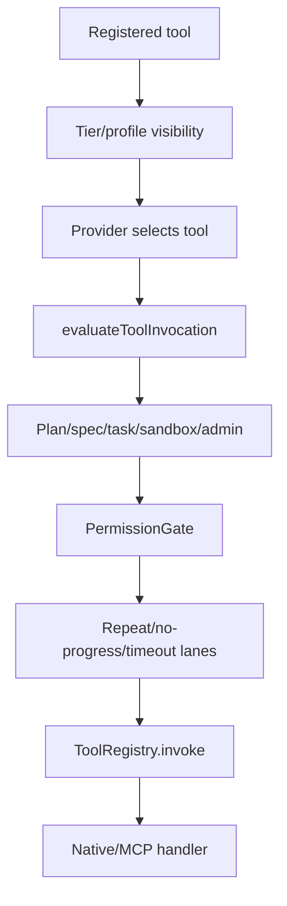

# 08 — CodeStudio: tools, MCP, tiers e policy

## Pergunta respondida

Como o CodeStudio registra, apresenta, filtra e executa capabilities hoje; onde tiers, policy, permission e guards se sobrepõem; e qual convergência preserva a riqueza da plataforma sem manter ambiguidades de segurança?

## Resumo executivo

O CodeStudio já possui um runtime de tools amplo e sofisticado:

- `ToolRegistry` unifica tools nativas, MCP interno e MCP externo;
- `CoderTool` declara schema, source, mutabilidade, paralelismo, risco, sandbox, scope, timeout, repetição e output policy;
- tiers reduzem o catálogo enviado ao modelo e preservam cache/context budget;
- tools externas recebem namespace e tier dinâmico;
- `code_exec` faz batching, introspecção, stash e nested calls sob os mesmos gates;
- plan/spec/task scope, permission, timeout e invocation guards são host-enforced.

A fraqueza não é falta de mecanismos, mas a existência de **vários contratos parciais**. `PolicyDecision` hoje só permite allow/deny; `PermissionGate` acrescenta ask/grants; tiers filtram visibilidade; profiles aplicam allowlists; guards bloqueiam repetição; MCP adiciona metadata e lifecycle. A arquitetura-alvo deve preservar as peças e fazê-las convergir num `CapabilityCatalog` e num Policy Engine único, com tiers explicitamente limitados a visibilidade.

## Baseline e confiança

- CodeStudio 3.15.1: `codestudio_mcp-codebase/package.json:1-18`.
- Confiança alta para registry, descriptors, tier filtering, policy e nested dispatch; média para a cobertura de todos os loaders/plugins dinâmicos, que possuem bounded contexts próprios.

## 1. `CoderTool`: contrato atual

### Campos centrais

**VERIFIED.** `CoderTool` contém:

- `name`, `description`, `parameters` e `handler`;
- `source: 'native' | 'mcp' | 'mcp_external'`;
- `runtimeTier` e `outputPolicy`;
- `mutates`, `parallelSafe`, `riskLevel` e `riskOf`;
- `requiresSandbox` e `scopeAware`;
- `interactive`;
- `repeatable`, `repeatPolicy`, `stopOnRepeatedUnchangedResult`;
- `executionClass`;
- `timeoutMs` e `resolveTimeoutMs`.

Fonte: `codestudio_mcp-codebase/packages/code-agent/src/core/tool.ts:59-180`.

Essa superfície é mais rica do que um descriptor mínimo. Ela já contém grande parte do futuro `CapabilityDescriptor`; a convergência deve normalizar e completar metadata, não criar outro tipo desconectado.

### Defaults conservadores

**VERIFIED.** Tools `mcp_external` sem `mutates` explícito são tratadas conservadoramente como mutantes, e mutating tools não são paralelizáveis por default: `codestudio_mcp-codebase/packages/code-agent/src/core/tool.ts:77-93`.

**VERIFIED.** `riskOf(input)` permite risco dependente do argumento e deve ser puro; em falha, o gate assume write: `codestudio_mcp-codebase/packages/code-agent/src/core/tool.ts:95-108`.

Isso é uma força interna: policy pode decidir sobre a operação concreta, não só o nome da tool.

## 2. `ToolRegistry`: união e chokepoint de handler

**VERIFIED.** O registry é a união em memória das tools nativas e MCP usadas para construir a lista enviada ao provider e para dispatch: `codestudio_mcp-codebase/packages/code-agent/src/core/registry.ts:5-18`.

### Identidade única

`register` recusa nomes duplicados: `codestudio_mcp-codebase/packages/code-agent/src/core/registry.ts:13-18`.

### Discovery orientada a erro

Invocação desconhecida retorna erro estruturado, sugestão de nome e orientação para `find_tools`: `codestudio_mcp-codebase/packages/code-agent/src/core/registry.ts:48-68`.

### Normalização de argumentos

**VERIFIED.** O registry normaliza aliases de argumentos contra o schema e é descrito como chokepoint compartilhado por runner, subagentes e nested calls: `codestudio_mcp-codebase/packages/code-agent/src/core/registry.ts:70-83`.

### Exception containment

Handler que lança vira `TOOL_HANDLER_EXCEPTION` estruturado e não propaga exception bruta ao loop: `codestudio_mcp-codebase/packages/code-agent/src/core/registry.ts:82-95`.

### Limite do chokepoint

O registry é o chokepoint final de handler, mas não é sozinho o chokepoint de policy: decisões de plan/task/permission/guards acontecem antes do `invoke`. A arquitetura-alvo deve preservar essa ordem e evitar que um loader invoque `handler` diretamente.

## 3. Tiers como progressive disclosure

### Tipo extensível

**VERIFIED.** O conjunto core contém `bootstrap`, `navigate`, `admin`, `master`, `preview`, `browser`, `api`, `diagram`, `db`, `company`, `sandbox`, `qa`, `app`, design systems e sprite; `ToolTier` é `string` para aceitar tiers dinâmicos: `codestudio_mcp-codebase/packages/code-agent/src/tools/tiers.ts:55-92`.

### Resolução

**VERIFIED.** `getToolTier` aplica overrides de runtime antes dos sets estáticos. Um strict mode acusa tool sem tier; o fallback legado é `bootstrap`, ou `navigate` com `CODER_STRICT_TIERS=1`: `codestudio_mcp-codebase/packages/code-agent/src/tools/tiers.ts:518-575`.

### Contexto de runtime

**VERIFIED.** Tiers contextuais são derivados de Company, sandbox, QA, app, design system, master, preview, browser e agent role: `codestudio_mcp-codebase/packages/code-agent/src/tools/tiers.ts:611-658`.

O próprio contrato declara:

> A tier controls visibility, not authority.

Fonte: `codestudio_mcp-codebase/packages/code-agent/src/tools/tiers.ts:627-633`.

Essa linha confirma a decisão D-005: tiers não devem ser promovidos a fronteira de segurança.

### Filtragem estável

**VERIFIED.** `filterByTiers` preserva a ordem de entrada, importante para prefix-cache stability: `codestudio_mcp-codebase/packages/code-agent/src/tools/tiers.ts:661-675`.

### Retomada econômica

**VERIFIED.** `inferProfileFromHistory` seleciona o menor profile que cobre as tools já usadas na sessão: `codestudio_mcp-codebase/packages/code-agent/src/tools/tiers.ts:678-700`.

### Budget de catálogo

**VERIFIED.** A prioridade de sobrevivência remove primeiro tiers custom/external MCP, depois preview/admin/sandbox, preservando tools hot de bootstrap/navigate por mais tempo: `codestudio_mcp-codebase/packages/code-agent/src/tools/tool-priority.ts:177-230`.

Isso mostra que tiering serve a token/cache budget e ergonomia, não apenas organização visual.

## 4. MCP externo

### Namespace e tier

**VERIFIED.** O manager lista somente connections `connected`, ordena tools, prefixa cada nome como `ext_<serverId>__<tool>`, registra o `default_tier` do servidor e cria `CoderTool` com source `mcp_external`: `codestudio_mcp-codebase/packages/code-agent/src/tools/mcp-server-manager.ts:220-257`.

### Repetição compatível

**VERIFIED.** Para servidores antigos sem metadata, nomes `wait_for`, `await`, `poll`, `tail` e `monitor` recebem `repeatPolicy: 'pollable'`: `codestudio_mcp-codebase/packages/code-agent/src/tools/mcp-server-manager.ts:241-257`.

Esse fallback é pragmático, mas é heurístico. O catálogo futuro deve preferir metadata declarada e registrar quando uma convenção foi inferida.

### Prefix-cache stability

**VERIFIED.** A lista agregada de tools externas é ordenada por nome antes de retornar: `codestudio_mcp-codebase/packages/code-agent/src/tools/mcp-server-manager.ts:268-271`.

### Lifecycle parcial no descriptor

O manager mantém connection state e lazy reconnect, mas `CoderTool` expõe principalmente a tool, não a conexão completa. ClaudeOpen preserva capabilities, server info, instructions, config, cleanup e transport error state no objeto de conexão: `claudeopen/claude-code-src/agent/mcp.js:7731-7767`.

**Gap de contrato:** o CodeStudio precisa de um descriptor de servidor/capability paralelo ao `CoderTool`, sem misturar transport lifecycle no handler.

## 5. Policy estática do runner

### Contexto

**VERIFIED.** `PolicyContext` inclui plan/spec approval, inline task scope, strict/admin override e sandbox bound: `codestudio_mcp-codebase/packages/code-agent/src/core/policy.ts:205-228`.

### Decisão atual

**VERIFIED.** `PolicyDecision` é uma união binária:

- `{ allowed: true; metadata }`;
- `{ allowed: false; reason; detail; metadata }`.

Fonte: `codestudio_mcp-codebase/packages/code-agent/src/core/policy.ts:230-248`.

### Precedência observada

**VERIFIED.** `evaluateToolInvocation` começa por `requiresSandbox`; depois bloqueia mutação em plan mode sem approval e trata spec mode de modo paralelo: `codestudio_mcp-codebase/packages/code-agent/src/core/policy.ts:426-470`.

O restante do módulo cobre task scope/admin e metadata resolution. A decisão atual resolve regras estáticas do runtime; não modela `ask`, duration, resource constraint ou policy provenance.

## 6. `PermissionGate`

### Presets

**VERIFIED.** Os modos são `ask`, `auto` e `unrestricted`; classes de risco de aprovação são `write`, `execute` e `admin`: `codestudio_mcp-codebase/packages/code-agent/src/core/permission-gate.ts:25-29`.

### Grants e DB

**VERIFIED.** Um grant explícito por nome pode autorizar, mas `auto/unrestricted` não autorizam silenciosamente database writes: `codestudio_mcp-codebase/packages/code-agent/src/core/permission-gate.ts:199-210`.

### Approval observável

**VERIFIED.** O gate cria o wait slot antes de emitir `tool_approval_request`, inclui tool/parent IDs, argumentos resumidos, risco, kind, turn e flag nested; DB recebe input completo para decisão informada: `codestudio_mcp-codebase/packages/code-agent/src/core/permission-gate.ts:212-234`.

### Fail-safe deny

**VERIFIED.** Payload inválido ou estrangeiro é negado; abort e interruption possuem semânticas distintas: `codestudio_mcp-codebase/packages/code-agent/src/core/permission-gate.ts:240-270`.

### Background

**VERIFIED.** `forBackground()` mantém regras e grants, mas transforma qualquer prompt humano em deny, pois um job detached não possui runner/SSE confiável para resolver approval: `codestudio_mcp-codebase/packages/code-agent/src/core/permission-gate.ts:178-197`.

Essa é uma força importante e deve virar invariante do Policy Engine.

## 7. Dispatch direto

**VERIFIED.** No `ExecutingNode`, o task-mode gate trata MCP externo sem declaração como mutante, antes do invocation guard: `codestudio_mcp-codebase/packages/code-agent/src/core/runner/nodes/executing-dispatch.ts:464-483`.

**VERIFIED.** O permission gate roda depois do evento de tool start e antes do relógio/timeout/guard, de forma que tempo de decisão humana não conta como execução e denial não polui dedupe: `codestudio_mcp-codebase/packages/code-agent/src/core/runner/nodes/executing-dispatch.ts:485-510`.

Essa ordem é deliberada e deve ser preservada no contrato unificado.

## 8. `code_exec`: nested invocation

### Capability e sandbox de JS

**VERIFIED.** `code_exec` permite chamar toda tool registrada e callable, inclusive fora do tier visível, mas cada chamada continua sujeita a plan/task policy. O VM não expõe Node `fs`, `process`, `require` ou `import`: `codestudio_mcp-codebase/packages/code-agent/src/tools/code-exec.ts:90-106`.

Isso prova duas coisas:

1. tier não é security boundary;
2. `code_exec` não é bypass de handler/policy, embora amplie discovery interna.

### Gates aninhados

**VERIFIED.** Cada nested call reconstrói `PolicyContext`, chama `evaluateToolInvocation`, replica unlock de inline task scope e recusa violação antes do handler: `codestudio_mcp-codebase/packages/code-agent/src/tools/code-exec.ts:611-655`.

**VERIFIED.** Depois aplica `PermissionGate` com `nested: true` e parent tool-use ID: `codestudio_mcp-codebase/packages/code-agent/src/tools/code-exec.ts:657-688`.

### Guards e lanes

**VERIFIED.** Nested calls passam por repetition observer/guard: `codestudio_mcp-codebase/packages/code-agent/src/tools/code-exec.ts:690-719`.

**VERIFIED.** Calls mutantes ou não paralelizáveis reservam lane serializada, com timeout incluindo espera da fila; cada call recebe AbortController: `codestudio_mcp-codebase/packages/code-agent/src/tools/code-exec.ts:780-830`.

Esses são mecanismos superiores a um `eval` simples e devem ser preservados.

## 9. Perfis e allowlists

Profiles de microagente aplicam filtros adicionais de capability. Por exemplo:

- verifier recebe read + shell + diagnostics e somente MCP externo explicitamente não mutante: `codestudio_mcp-codebase/packages/code-agent/src/tools/implement-subagent.ts:993-1005`;
- implementer recebe writes nativos, shell, diagnostics e diff, mas não interação, recursion ou task lifecycle: `codestudio_mcp-codebase/packages/code-agent/src/tools/implement-subagent.ts:1008-1050`.

Essas allowlists são policy estrutural por role. O futuro catálogo deve representar a razão da exclusão e evitar duplicação manual de nomes quando metadata puder expressá-la.

## 10. Modelo atual de decisão

O caminho é funcional, mas razões e constraints estão distribuídas. O futuro Policy Engine deve unificar **decisão**, sem apagar os componentes especializados que fornecem fatos.

## 11. Lacunas e riscos de arquitetura

### 11.1 `allow/deny` versus `ask`

**Gap:** `PolicyDecision` é binário enquanto `PermissionGate` modela prompt humano. Consequência: não existe um único result type com effect, rule source, exact resource, expiry e patch.

### 11.2 Grant por tool name

**Risk:** `alwaysAllow` adiciona somente `toolName` ao set: `codestudio_mcp-codebase/packages/code-agent/src/core/permission-gate.ts:247-250`. Isso é mais amplo que um grant por path/command/domain/operation.

### 11.3 Metadata parcial de dynamic capabilities

**Risk:** external MCP sem `mutates` é corretamente conservador, porém a ausência de metadata reduz paralelismo e explicabilidade. Capabilities precisam declarar risk, transport, auth, network e secret requirements.

### 11.4 Fallback de tier

**Risk mitigado, não eliminado:** tool não listada ainda pode cair em bootstrap fora de strict mode: `codestudio_mcp-codebase/packages/code-agent/src/tools/tiers.ts:536-574`. O contract test e kill switch reduzem risco; a meta é tornar tier obrigatório no registration pipeline.

### 11.5 Múltiplos filters

**Risk:** tier, profile allowlist, disabled tools, policy, permission e guards são válidos, mas o usuário não recebe uma explicação composta de “registrada → não visível → não elegível → denied”.

### 11.6 Node VM não é fronteira de segurança

`code_exec` limita globals, mas ferramentas expostas continuam sendo a fronteira real. Project hooks também usam `node:vm`. A arquitetura não deve chamar isolamento de linguagem de sandbox de segurança do host.

## 12. Arquitetura de convergência

### `CapabilityCatalog`

Cada capability deve combinar ou referenciar:

- stable ID e display aliases;
- source/provider/server/plugin;
- input/output schema;
- visibility tier;
- role compatibility;
- risk classifier;
- mutation/parallel/repeat semantics;
- timeout/cancellation;
- environment/network/secret requirements;
- auth/connection status;
- lifecycle cleanup;
- output/context policy;
- provenance/version.

### Policy Engine

O engine recebe invocação + capability + actor + session + environment + resource e retorna:

- `allow | deny | ask`;
- reason code e texto;
- policy source/precedence;
- exact constraints;
- validated input patch;
- grant scope/expiry quando aplicável;
- audit metadata.

### Adapters, não substituições imediatas

- `core/policy.ts` fornece as regras de plan/spec/task/sandbox/admin.
- `PermissionGate` fornece interação e presets.
- profile/tier resolvers fornecem visibility/eligibility.
- MCP manager fornece connection/auth metadata.
- dispatcher/guards continuam controlando execução e liveness.

O Policy Engine agrega decisões e precedência; não transforma tudo em uma classe monolítica.

## 13. Decisões de transferência

| Mecanismo | Decisão | Ação/nota |
|---|---|---|
| `CoderTool` rico | preserve CodeStudio | adaptar sua metadata ao catálogo comum |
| Registry único e arg normalization | preserve CodeStudio | manter como invocation adapter |
| Tiers dinâmicos e lazy discovery | preserve CodeStudio | declarar visibility-only |
| Tier como segurança | reject | Policy Engine é a autoridade |
| Exact capability set por role | merge | combinar profiles atuais com resolved set persistido |
| MCP lifecycle rico | adapt ClaudeOpen | adicionar auth/status/capabilities/cleanup first-class |
| `code_exec` nested gates/lanes | preserve CodeStudio | emitir audit/journal por nested call |
| Policy effect `allow/deny/ask` | merge | unificar regras atuais e princípio observado em um result contract |
| Grants por recurso/escopo | merge | substituir grant amplo por constraints locais versionadas |
| Namespace estável de source | merge | usar capability ID estável e provenance |
| Heurística de pollable por nome | preserve CodeStudio | manter como compatibilidade e migrar para metadata |
| `bypassPermissions` geral | reject | não transformar autonomia em bypass de authority |

## 14. Invariantes futuros

1. Toda execução, direta ou nested, passa por um Policy Engine efetivo.
2. Tiers alteram apenas visibilidade/context budget.
3. O mesmo input/contexto produz a mesma decisão em direct, MCP, plugin e `code_exec`.
4. Deny de política superior prevalece.
5. Background nunca aguarda aprovação invisível.
6. Grant inclui recurso, scope, actor, expiry e rule provenance.
7. Dynamic capability sem metadata assume postura conservadora e mostra por quê.
8. Handler só é alcançado após decisão, patch validation, guards e environment binding.
9. Alias e display name não mudam stable capability ID.
10. Tool registration duplicado ou sem tier/schema válido falha em CI/boot conforme source.

## 15. Gates futuros

- Shadow Policy Engine registra divergências sem aplicar resultado.
- Matriz direct/nested/MCP/plugin produz 100% de decisões equivalentes.
- Traversal, symlink, destructive command, domain e secret tests.
- Approval exibe regra, exact resource e duração.
- Background transforma `ask` em deny estruturado.
- MCP `needs-auth` pode ser resolvido e reconnectado sem reabrir sessão.
- Tier contract não possui fallback silencioso em builds de release.
- Prompt tool array mantém estabilidade sob mesma capability projection.
- `inputPatch` incompatível é rejeitado antes do registry.
- Nenhuma regression em guard/dedupe/timeout de `code_exec`.

## Questões abertas

- Qual bounded context deve persistir grants e policy snapshots?
- Como policies de organização, usuário, projeto, sessão e one-shot serão assinadas/versionadas?
- Quais metadata MCP podem vir do server versus administração local?
- Plugins usarão o mesmo namespace de capability que MCP?
- Como comunicar no dashboard a diferença entre registered, visible, eligible e authorized sem sobrecarregar a UI?
