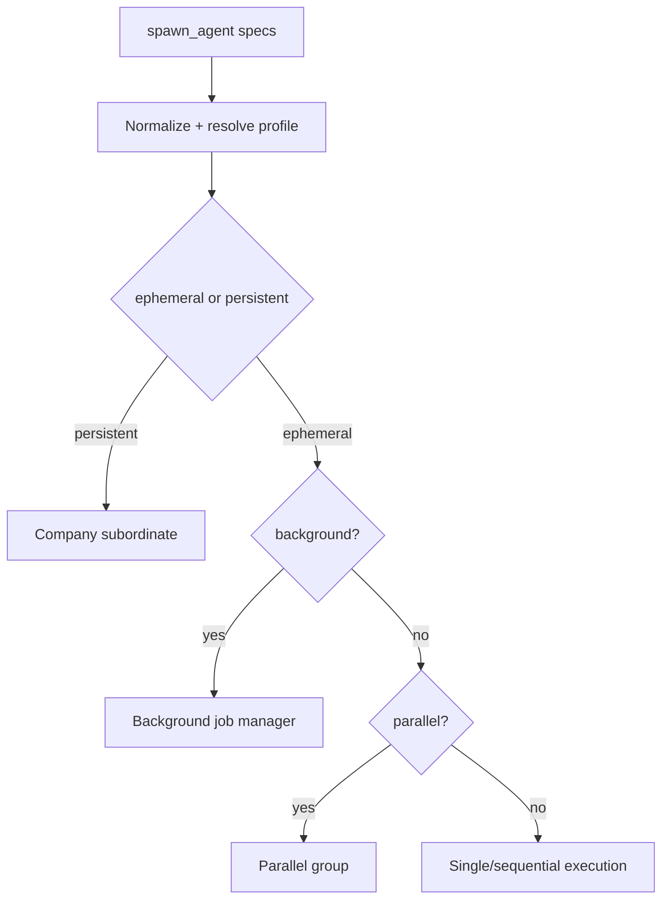
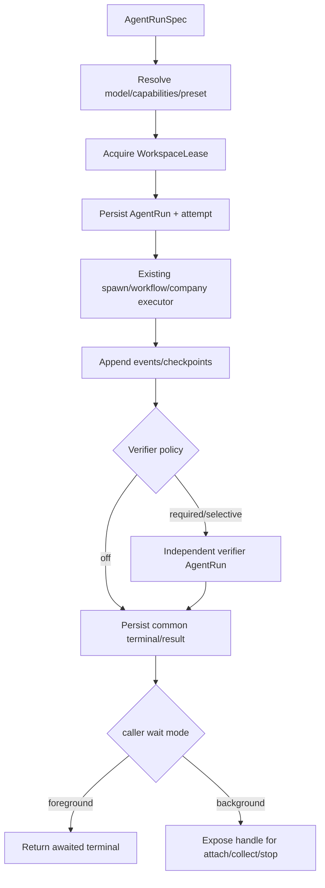

# 09 — CodeStudio: subagentes, workflows, isolamento e Ultra

## Pergunta respondida

Como o CodeStudio lança, limita, acompanha e retoma subagentes hoje; como o workflow DAG e Company Mode se relacionam; onde o isolamento ainda é incompleto; e por que Ultra precisa virar um preset ortogonal?

## Resumo executivo

O CodeStudio já possui uma plataforma multiagente mais ampla do que uma simples Agent tool:

- `spawn_agent` executa até oito microagentes em paralelo ou sequência;
- profiles separam investigação, implementação, verificação, review e full access;
- background jobs podem continuar enquanto o parent trabalha;
- `resume_agent` preserva transcript dentro do processo;
- `workflow` modela DAG, waves, dependências, digests e estados por step;
- Company Mode oferece subordinados persistentes, ownership e board;
- worktree tools alteram cwd da sessão de forma explícita.

As lacunas principais são três:

1. resume de microagente/workflow é deliberadamente process-local;
2. `files` limita write tools nativas, mas `run_command` continua warning-only e pode escrever fora do scope;
3. Ultra agrupa controles sem expor claramente effort, scheduler, paralelismo, verifier, durability e isolation.

A convergência deve preservar os executores e o DAG, persistir um `AgentRun` comum, introduzir `WorkspaceLease` fail-closed e transformar Ultra em preset explicável.

## Baseline e confiança

- CodeStudio 3.15.1: `codestudio_mcp-codebase/package.json:1-18`.
- Arquivos de `spawn-agent.ts` e `implement-subagent.ts` estavam modificados por trabalho concorrente e foram relidos antes deste documento.
- Confiança alta para profiles, resume process-local, workflow e path scope; riscos de shell escape são derivados diretamente do contrato, ainda sem teste adversarial nesta rodada.

## 1. `spawn_agent`

### Superfície

**VERIFIED.** A descrição pública informa:

- uma ou várias specs;
- execução paralela automática até oito agentes;
- somente summary final no contexto do parent;
- profiles `explore/investigator`, `implement/implementer`, `verify/verifier`, `review/reviewer` e `full`;
- background fire-and-forget;
- persistent subordinate em Company;
- resume de agente falho com estado preservado.

Fonte: `codestudio_mcp-codebase/packages/code-agent/src/tools/spawn-agent.ts:106-128`.

### Normalização e limites

**VERIFIED.** `normalizeAgents` aceita a forma `agents[]`, mantém compatibilidade com `task` singular, exige task não vazia, limita a oito itens e resolve aliases de profile: `codestudio_mcp-codebase/packages/code-agent/src/tools/spawn-agent.ts:130-175`.

### Dispatch

**VERIFIED.** O handler:

1. normaliza specs;
2. distingue `ephemeral` e `persistent`;
3. limita persistent a um subordinate por chamada;
4. encaminha background ephemeral ao job manager;
5. executa múltiplos em paralelo por default;
6. permite sequência forçada.

Fonte: `codestudio_mcp-codebase/packages/code-agent/src/tools/spawn-agent.ts:789-830`.

## 2. Profiles e capabilities

### Contrato de profile

**VERIFIED.** `MicroAgentProfile` contém ID, aliases, capability, descrição, system prompt, allowlist, path-scope mode e label default: `codestudio_mcp-codebase/packages/code-agent/src/tools/micro-agent-profiles.ts:59-92`.

### Read-only e verifier

**VERIFIED.** Explore usa allowlist read-only e `pathScopeMode: 'warn'`; implement usa read/write e `enforce-writes`: `codestudio_mcp-codebase/packages/code-agent/src/tools/micro-agent-profiles.ts:99-118`.

**VERIFIED.** Verifier possui read + shell + diagnostics, sem write tools; MCP externo só entra quando declara `mutates: false`: `codestudio_mcp-codebase/packages/code-agent/src/tools/implement-subagent.ts:993-1005`.

### Implementer

**VERIFIED.** Implementer recebe read, cinco write tools nativas, shell, diagnostics e Git diff/status. Interação, recursion e task lifecycle ficam fora: `codestudio_mcp-codebase/packages/code-agent/src/tools/implement-subagent.ts:1008-1050`.

Essa divisão é uma força. O futuro `AgentRunSpec` deve materializar o capability set efetivo e sua origem, não substituir profiles por prompts genéricos.

### Full access

**VERIFIED.** `FULL_ACCESS_FILTER = null` significa herdar o registry do parent sem filtragem: `codestudio_mcp-codebase/packages/code-agent/src/tools/implement-subagent.ts:985-991`.

**RISK:** full access é útil para delegação explícita, mas amplia blast radius. Deve exigir policy/role/actor visível e nunca ser escolhido automaticamente apenas por dificuldade percebida.

## 3. Background

### Mesmo domínio de execução

Background usa os mesmos agents normalizados e profiles; o handler apenas escolhe `runBackgroundEphemeral`: `codestudio_mcp-codebase/packages/code-agent/src/tools/spawn-agent.ts:809-817`.

**INFERRED:** esse desenho já aproxima o princípio “mesmo executor, wait/detach diferente”. A arquitetura-alvo deve formalizá-lo em `AgentRun`, não criar outro executor.

### Approval em detached context

**VERIFIED.** O `PermissionGate.forBackground()` transforma qualquer decisão que exigiria prompt humano em deny, preservando grants já concedidos: `codestudio_mcp-codebase/packages/code-agent/src/core/permission-gate.ts:178-197`.

Essa regra é correta e deve permanecer invariável.

### Liveness do parent

**VERIFIED.** O BT não encerra cleanly enquanto background jobs estão ativos; ele estaciona e reentra em `Executing` quando há trabalho/mensagem: `codestudio_mcp-codebase/packages/code-agent/src/core/runner/orchestrator.ts:210-230`.

### Gap de durabilidade

O job manager e o resume registry vivem no processo. O sistema permite continuar trabalho dentro de uma sessão viva, mas não oferece ainda um `AgentRun` durável independente do worker.

## 4. Resume de microagentes

### Propósito explícito

**VERIFIED.** O `subagent-resume-registry` é in-memory e session-keyed; ele preserva transcript de agentes efêmeros falhos para relançar de onde pararam: `codestudio_mcp-codebase/packages/code-agent/src/tools/subagent-resume-registry.ts:1-5`.

### Limite explícito

**VERIFIED.** O comentário afirma que resume só é considerado significativo enquanto o processo da sessão parent vive; após app restart, o caminho é fresh spawn informado pelo investigation ledger: `codestudio_mcp-codebase/packages/code-agent/src/tools/subagent-resume-registry.ts:6-15`.

Esse é o gap central de convergência com o Agent registry observado no ClaudeOpen. Não é um bug: é uma decisão atual deliberada que não atende ao objetivo futuro de crash-resume.

### Estado retido

**VERIFIED.** O registry preserva profile, files, research policy, limits, transcript reparado, reason, failure note, final text, tool count, usage, attempt e timestamps: `codestudio_mcp-codebase/packages/code-agent/src/tools/subagent-resume-registry.ts:24-64`.

### Caps e higiene

**VERIFIED.** Há limites por agente e sessão, TTL, LRU e proteção de tail; transcripts são reparados e resultados grandes podem ser elididos: `codestudio_mcp-codebase/packages/code-agent/src/tools/subagent-resume-registry.ts:66-102`.

Esses mecanismos devem ser preservados como políticas de projeção/contexto mesmo quando o source of truth se tornar durável.

## 5. Workflow DAG

### Contrato atual

**VERIFIED.** `workflow` recebe steps tipados, valida a DAG, executa independentes em waves paralelas, emite eventos e permite `resume_workflow_id`/`retry_failed` enquanto o processo vive. É registrado apenas em Ultra: `codestudio_mcp-codebase/packages/code-agent/src/tools/workflow/workflow-tool.ts:1-8`.

### Steps e dependências

**VERIFIED.** O executor transforma cada step em um agente normalizado, resolve profile e injeta resultados de dependências como digests limitados a 3.500 caracteres por dependência e 10.500 no total: `codestudio_mcp-codebase/packages/code-agent/src/tools/workflow/workflow-run.ts:26-64`.

Esse bounded digest é uma vantagem interna: evita jogar transcripts completos no contexto do dependente.

### Readiness e skip

**VERIFIED.** Steps bloqueados por dependência failed/skipped são marcados `skipped`; uma wave contém apenas pending steps cujas dependências são completed/partial: `codestudio_mcp-codebase/packages/code-agent/src/tools/workflow/workflow-run.ts:85-125`.

### Resume e exclusão concorrente

**VERIFIED.** Ao resumir, steps `running` retornam a `pending`; `retry_failed` reabre failed/skipped; o registry recusa workflow já running na sessão: `codestudio_mcp-codebase/packages/code-agent/src/tools/workflow/workflow-tool.ts:153-209`.

### Eventos

**VERIFIED.** O tool emite `workflow_run_started`, `workflow_step_update` e `workflow_run_finished` com IDs, waves, profiles, status, uso e contagens: `codestudio_mcp-codebase/packages/code-agent/src/tools/workflow/workflow-tool.ts:211-243`, `codestudio_mcp-codebase/packages/code-agent/src/tools/workflow/workflow-run.ts:67-83`.

### Gap de store

`saveWorkflow` é um registry process-local neste baseline. Para crash-resume, DAG, step attempts, outputs, idempotency keys e terminal states precisam de store/journal.

## 6. Company Mode

`spawn_agent(kind: 'persistent')` delega ao caminho Company e aceita role, project, provider, model, tier, skills e kanban card quando o parent é master: `codestudio_mcp-codebase/packages/code-agent/src/tools/spawn-agent.ts:768-806`.

A existência de Company Mode é uma superioridade que o atlas preserva. A convergência deve unificar contratos de identidade e eventos entre:

- microagente efêmero;
- background job;
- workflow step;
- Company subordinate;
- futuro remote agent.

Isso não significa que todos terão a mesma política de retenção ou UX.

## 7. Isolamento por path scope

### Fence nativa

**VERIFIED.** `checkPathScopeForTool` extrai paths e, em `enforce-writes`, bloqueia somente estas tools diretas:

- `write_file`;
- `edit_file`;
- `multi_edit`;
- `create_file`;
- `manage_path`.

Fonte: `codestudio_mcp-codebase/packages/code-agent/src/tools/implement-subagent.ts:1287-1312`.

### Shell warning-only

**VERIFIED.** O wrapper observa filesystem/read/shell tools, mas só retorna erro quando `blockedMessage` existe; `run_command` entra no conjunto observado, não no conjunto `directWriteTools`: `codestudio_mcp-codebase/packages/code-agent/src/tools/implement-subagent.ts:1315-1345`.

O próprio allowlist documenta que shell scope continua warning-only até hardening: `codestudio_mcp-codebase/packages/code-agent/src/tools/implement-subagent.ts:1035-1038`.

**RISK de segurança/isolamento:** um implementer pode escrever fora de `files` usando shell. Isso não é prova de exploit remoto, mas invalida a interpretação de `files` como sandbox completa.

## 8. Worktrees atuais

### Criação

**VERIFIED.** Worktrees são criados sob `.mcp-indexer/worktrees/<name>`, com validação de nome, branch dedicada e `git worktree add`: `codestudio_mcp-codebase/packages/code-agent/src/tools/worktree.ts:21-100`.

### Entrada

**VERIFIED.** `enter_worktree` exige runner compatível, impede nested worktree, usa o project root original, cria worktree e altera o scope para que file/shell/Git subsequentes usem o novo cwd: `codestudio_mcp-codebase/packages/code-agent/src/tools/worktree.ts:128-154`.

### Saída segura

**VERIFIED.** `exit_worktree` pode manter ou remover; remoção recusa mudanças não commitadas sem `discard_changes: true`; cwd é restaurado antes da remoção: `codestudio_mcp-codebase/packages/code-agent/src/tools/worktree.ts:160-238`.

### Lacuna

Worktree é uma ação de sessão, não ainda uma `WorkspaceLease` persistida e possuída por AgentRun. Dois implementers não recebem automaticamente checkouts exclusivos; o dashboard não mostra uma autoridade única de ownership/branch/base SHA/status.

## 9. Ultra atual

### Separação parcial já existente

**VERIFIED.** `resolveSessionExecutionPolicy` separa o execution mode do requested provider effort, mas quando Ultra está ativo retorna o marcador interno `reasoningEffort: 'ultra'`: `codestudio_mcp-codebase/packages/code-agent/src/sessions/execution-mode.ts:3-25`.

### Keyword por turno

**VERIFIED.** `ultracode` ativa “full Ultra posture” para o run atual, sem mudar o modo sticky; há kill switch: `codestudio_mcp-codebase/packages/code-agent/src/sessions/execution-mode.ts:28-45`.

### Registration do workflow

**VERIFIED.** Workflow só entra quando a sessão é Ultra ou o keyword disparou: `codestudio_mcp-codebase/packages/code-agent/src/tools/workflow/workflow-tool.ts:1-8`.

### Problema de contrato

O usuário não vê, como campos separados:

- requested/effective effort;
- provider/model downgrade;
- orchestration policy;
- max parallelism/depth;
- verifier policy;
- background policy;
- workflow durability;
- isolation/lease policy.

**UX_GAP:** “Ultra” explica intenção, mas não configuração efetiva.

**HYPOTHESIS:** o modo aumenta sucesso em tarefas complexas. Sem desenho fatorial, não sabemos se o ganho vem de effort, tools adicionais, paralelismo, verifier ou modelo.

## 10. Comparação com ClaudeOpen

| Mecanismo | ClaudeOpen | CodeStudio | Decisão | Ação/nota |
|---|---|---|---|---|
| Agent identity | owner/parent/depth/metadata | group/index/session, Company ownership | merge | materializar `AgentRun` comum |
| Resume | registry + transcript/metadata | rich in-memory resume | merge | persistir sem perder caps/repair |
| Foreground/background | mesmo executor | mesmo profile/engine, job manager separado | merge | wait/detach é opção do caller |
| Exact tools | agent/fork/observer | profiles/allowlists | merge | preservar profiles e persistir resolved set |
| Workflow | scripts + dynamic orchestration | DAG explícito + bounded digests | preserve CodeStudio | adicionar durability sem trocar a DAG |
| Verifier | padrão por claim/localização | verifier/reviewer profiles | benchmark first | selecionar independentemente só quando medido |
| Worktree | agent isolation/fallback | tool manual de sessão | preserve CodeStudio | evoluir para `WorkspaceLease` e fail closed |
| Teams | teammate/task context | Company Mode | preserve CodeStudio | compartilhar identidade/eventos sem substituir Company |
| Ultra | xhigh + workflow flag | host profile + keyword | merge | representar como preset ortogonal |

## 11. Arquitetura de convergência

## 12. `AgentRun` mínimo

O contrato futuro deve incluir:

- `agentRunId`, `attemptId`, `sessionId`;
- `ownerAgentRunId`, `parentAgentRunId`, `spawnDepth`;
- role/profile/definition version;
- requested/effective provider, model e effort;
- referência versionada a `PresetResolution`, cobrindo orchestration, parallelism, depth, verifier, background, durability e isolation, com downgrade reasons;
- capability set hash;
- execution environment e workspace lease;
- foreground/background apenas como caller wait mode;
- status/terminal reason/stop marker;
- transcript/checkpoint/result refs;
- usage/tool count;
- policy snapshot;
- idempotency key;
- created/started/updated/finished timestamps.

## 13. `WorkspaceLease` mínimo

- lease ID e owner AgentRun;
- target `host | worktree | container | remote`;
- root/cwd/branch/base SHA;
- access `read-only | exclusive-write`;
- status e expiry;
- sandbox/remote ref;
- dirty state;
- cleanup policy;
- recovery metadata.

## 14. Decisões de transferência

| Mecanismo | Decisão | Ação/nota |
|---|---|---|
| Profiles e allowlists | preserve CodeStudio | projetar resolved set sem reduzir especialização |
| DAG e bounded digests | preserve CodeStudio | adicionar durable step store |
| Company Mode | preserve CodeStudio | compartilhar contracts, não substituir |
| Same executor foreground/background | merge | formalizar wait/detach |
| Durable AgentRun registry | merge | combinar resume metadata com store próprio |
| Resume process-only como destino final | reject | manter apenas como cache/adapter transitório |
| `files` como sandbox completa | reject | é fence parcial, não boundary de shell |
| Worktree manual | preserve CodeStudio | evoluir para lease por run |
| Fallback de lease desaparecida ao parent cwd | reject | mutation falha fechado |
| Verifier independente seletivo | benchmark first | profile existe; seleção causal precisa de avaliação |
| Ultra monolítico | reject | decompor requested/effective dimensions |
| UltraPreset ortogonal | merge | decisão de arquitetura aceita |
| Fan-out amplo por default | benchmark first | exigir independência e budget |

## 15. Invariantes futuros

1. Um AgentRun tem no máximo um attempt executor ativo.
2. Retry/resume não repete side effect confirmado.
3. Foreground/background compartilham lifecycle, policy e store.
4. Stop do usuário é monotônico até resume explícito.
5. Implementer mutante recebe lease exclusiva.
6. Shell, filesystem, Git e terminal usam a mesma lease/cwd.
7. Scope obrigatório falha fechado; não volta ao checkout principal.
8. Verifier não recebe write capabilities.
9. Capability set é persistido/hashado por attempt.
10. Workflow steps completed não são relançados após restart.
11. Company e ephemeral usam IDs/event envelope compatíveis.
12. Ultra não amplia autorização.

## 16. Gates futuros

- Crash/restart retoma AgentRun e workflow sem duplicar side effects.
- Duas requisições de resume concorrentes: exatamente uma adquire execução.
- Dois implementers nunca escrevem no mesmo checkout.
- Shell escape por path, traversal, symlink, PowerShell e subprocess é bloqueado.
- Worktree sujo nunca é removido sem ação explícita e snapshot recuperável.
- Foreground/background do mesmo fixture geram lifecycle equivalente.
- Provider não compatível gera downgrade visível ou deny conforme preset.
- Verifier melhora precision sem taxa de falso positivo acima do limite.
- Fan-out é acionado somente para dependências independentes e respeita budget.
- Company subordinate continua funcional após adoção do contrato comum.

## Questões abertas

- Qual store existente é melhor para `AgentRun` e attempts?
- Como reconciliar transcript durable com caps/repair do registry atual?
- Quem adquire e renova leases de runtime remoto?
- Como integrar diff de worktree sem exigir commit automático?
- Qual policy seleciona verifier e modelo independente?
- Quais aspectos de Ultra devem ser configuráveis por organização versus usuário?
