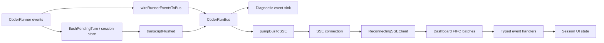
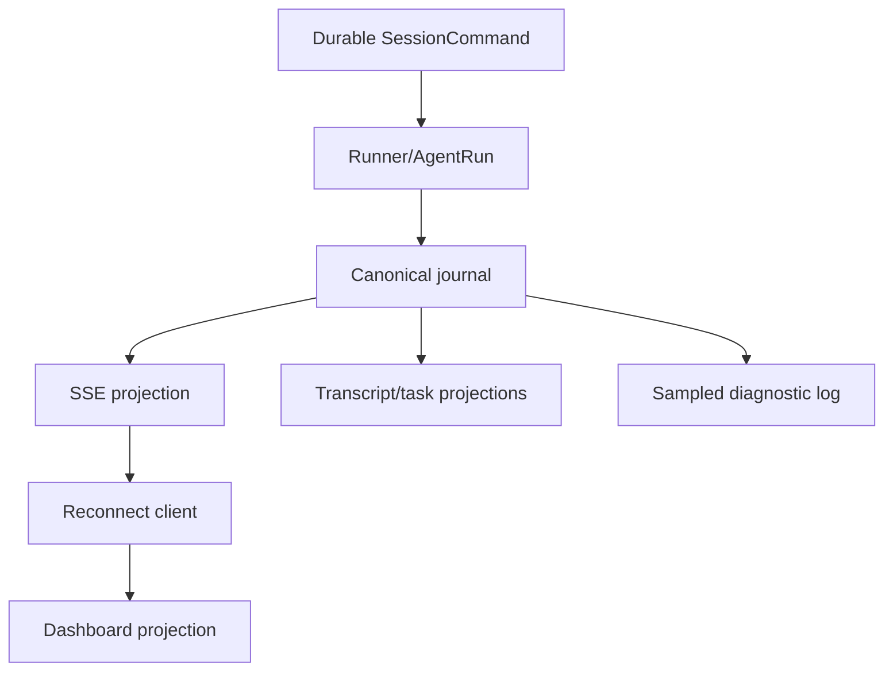

# 10 — CodeStudio: sessão, streaming e dashboard

## Pergunta respondida

Como eventos do runner chegam ao dashboard, quais garantias de ordenação, replay, backpressure, idempotência e persistência existem hoje, e quais limites ainda impedem tratar o transporte como um lifecycle durável completo?

## Resumo executivo

A hipótese inicial de “SSE ruim” não é sustentada genericamente pelo código atual. O caminho de streaming do CodeStudio já contém mecanismos importantes:

- bus por run com identidade `busId` e sequência monotônica;
- replay limitado por quantidade e bytes;
- escrita SSE serializada com backpressure;
- reconnect por `Last-Event-ID`;
- idempotency key estável para POST retries;
- fila FIFO e processamento em batches no renderer;
- terminal público atrasado até o transcript final estar persistido;
- detecção de worker crash e recuperação de interação pendente;
- vocabulário rico de tools, tasks, agents, workflows, compactação e estado.

As lacunas reais são outras:

1. o replay live continua process-scoped e limitado;
2. o `runtime-event-log` é diagnóstico amostrado/truncado, não journal canônico;
3. o idempotency store de POST é in-memory/TTL, não um command ledger durável;
4. o chat coder não projeta as fases de conexão que o client compartilhado e Company já suportam;
5. o dashboard ainda não explica claramente boundaries como provider complete, turn persisted, run terminal e post-terminal quality.

A convergência deve preservar SSE como projeção eficiente e introduzir journal/command contracts por baixo — não substituir transporte funcional por WebSocket sem uma necessidade mensurável.

## Baseline e confiança

- CodeStudio 3.15.1: `codestudio_mcp-codebase/package.json:1-18`.
- Arquivos do bus, replay e renderer foram relidos após mudanças concorrentes detectadas nesta sessão.
- Confiança alta para o live path; riscos de reconnect sob crash/restart precisam de E2E e chaos tests.

## 1. Topologia atual



O diagrama combina contratos `VERIFIED` descritos nas seções seguintes.

## 2. Bus por run

### Identidade e cursor

**VERIFIED.** Cada `CoderRunBus` possui:

- `busId` único;
- buffer de eventos;
- `nextSeq` reiniciado por bus;
- subscribers e sinks;
- estado terminal;
- `runnerReady`.

O próprio contrato exige parear `busId` e `seq`, pois sequência isolada não deduplica entre runs: `codestudio_mcp-codebase/apps/http-api/coder-bus.ts:29-65`.

### Replay bounded

**VERIFIED.** O buffer possui cap de 2.000 eventos e 8 MiB. O limite por bytes evita que tool results grandes mantenham centenas de MB: `codestudio_mcp-codebase/apps/http-api/coder-bus.ts:67-81`.

**VERIFIED.** `publish` calcula tamanho aproximado, remove prefixo excedente de forma linear, registra quantos eventos foram descartados e entrega o evento live a subscribers/sinks: `codestudio_mcp-codebase/apps/http-api/coder-bus.ts:175-210`.

A entrega live continua best-effort por subscriber; exceptions são ignoradas para não quebrar o runner.

### Término

**VERIFIED.** `markEnded` marca estado e razão, rejeita `runnerReady` se o run terminou antes de anexar o runner e desperta listeners: `codestudio_mcp-codebase/apps/http-api/coder-bus.ts:266-278`.

## 3. Vocabulário de eventos

**VERIFIED.** `wireRunnerEventsToBus` traduz eventos do runner para uma superfície comum, incluindo:

- `text`, `thinking`;
- `tool_call_start/result/progress`;
- `operation_started/progress/finished`;
- `message_complete`;
- plan/spec/question/decision e approvals;
- tasks/task runs/todos;
- provider/model changes;
- session drive, snapshots e diagrams;
- compaction;
- agent groups;
- workflow DAG;
- context/auto-continue;
- `run_started`, provider calls, blocked/quality/BT dwell.

Fontes: `codestudio_mcp-codebase/apps/http-api/sse/runnerWiring.ts:16-130`, `codestudio_mcp-codebase/apps/http-api/sse/runnerWiring.ts:127-178`.

Essa cobertura é uma força. A lacuna é ausência de schema registry/versioning e envelopes causais uniformes, não falta de sinais.

## 4. SSE server: ordenação e backpressure

### Escrita serializada

**VERIFIED.** `pumpBusToSSE` mantém `drainChain`; cada `writeSSE` espera a anterior, respeita backpressure e aborta quando a escrita falha: `codestudio_mcp-codebase/apps/http-api/sse/pumpBusToSSE.ts:38-61`.

Portanto, a crítica histórica “writes fire-and-forget sem backpressure” não se aplica a este baseline.

### `bus_info`

**VERIFIED.** A conexão começa com preâmbulo sem `id`, contendo `bus_id`, primeiro replay seq e contagem de drops; ele não entra no buffer nem no log JSONL: `codestudio_mcp-codebase/apps/http-api/sse/pumpBusToSSE.ts:63-87`.

### Replay e subscribe

**VERIFIED.** O pump enfileira replay e eventos live na mesma cadeia ordenada e só fecha depois de unsubscribe, heartbeat cleanup e drain: `codestudio_mcp-codebase/apps/http-api/sse/pumpBusToSSE.ts:89-107`.

### Cursor stale

**VERIFIED.** `effectiveSince` converte cursor maior/igual a `nextSeq` em full replay, pois provavelmente pertence a outro bus: `codestudio_mcp-codebase/apps/http-api/sse/pumpBusToSSE.ts:111-126`.

## 5. Reconnect client

### Fases e backoff

**VERIFIED.** O client compartilhado modela `connecting`, `replaying`, `live` e `disconnected`, usa backoff exponencial e distingue 4xx não retryable: `codestudio_mcp-codebase/packages/shared/src/sse/ReconnectingSSEClient.ts:53-126`.

### `Last-Event-ID`

**VERIFIED.** Em reconnect, envia o maior ID visto; a presença do cursor muda a fase para `replaying`: `codestudio_mcp-codebase/packages/shared/src/sse/ReconnectingSSEClient.ts:128-148`.

### Framing e terminal

**VERIFIED.** Chunks são acumulados pelo framer; pings são ignorados; o primeiro evento real marca `live`; um terminal cancela o reader e encerra: `codestudio_mcp-codebase/packages/shared/src/sse/ReconnectingSSEClient.ts:166-195`.

### Limite semântico

O client trata EOF limpo sem terminal como encerramento para evitar reconnect loop: `codestudio_mcp-codebase/packages/shared/src/sse/ReconnectingSSEClient.ts:90-95`.

**RISK:** EOF pode representar proxy/server closure sem terminal durable. O route/worker tenta reduzir isso marcando crashes e usando state reconciliation, mas o protocol contract deveria diferenciar `transport_eof` de `run_terminal` no journal/control plane.

## 6. Idempotência de POST

### Chave estável no dashboard

**VERIFIED.** Para POST, `openStream` grava `client_msg_id` no mesmo body reutilizado durante retries: `codestudio_mcp-codebase/apps/dashboard/hooks/agent-stream/openStream.ts:220-231`.

### Dedupe no servidor

**VERIFIED.** `RecentMessageKeys` mantém `(sessionId, key) → WeakRef<bus>` sob TTL/LRU e responde retry com replay do bus original; se o bus sumiu, retorna terminal sintético para o dashboard refazer o history: `codestudio_mcp-codebase/apps/http-api/server/routes/recent-message-keys.ts:5-34`, `codestudio_mcp-codebase/apps/http-api/server/routes/recent-message-keys.ts:46-104`, `codestudio_mcp-codebase/apps/http-api/server/routes/recent-message-keys.ts:116-128`.

**VERIFIED.** A rota verifica a chave dentro do lock, antes de efeitos duplicados, e reusa o bus quando ainda alcançável: `codestudio_mcp-codebase/apps/http-api/server/routes/coder/stream.ts:715-743`.

### Limite

**RISK:** o store é in-memory, com TTL default de cinco minutos. Ele protege reconnect normal, não retries após restart ou commands reentregues por outro host. Um `SessionCommand` durável com idempotency key é necessário para o objetivo de control plane.

## 7. Renderer: performance e ordenação

### Coalescing de React updates

**VERIFIED.** Deltas são flushados no máximo uma vez por animation frame, com fallback de 50 ms para tabs suspensas; boundaries usam `flushNow`: `codestudio_mcp-codebase/apps/dashboard/hooks/agent-stream/openStream.ts:159-199`.

### Caminho Electron direto

**VERIFIED.** O código evita o proxy Vite em Electron porque ele já engoliu SSE flushes, usando a URL Hono absoluta: `codestudio_mcp-codebase/apps/dashboard/hooks/agent-stream/openStream.ts:211-218`.

### FIFO único

**VERIFIED.** Todos os eventos entram numa fila única, drenada em batches com yield ao event loop; novas chegadas preservam ordem estrita: `codestudio_mcp-codebase/apps/dashboard/hooks/agent-stream/openStream.ts:295-328`.

Isso invalida a crítica de replay totalmente síncrono no baseline atual.

### Cursor só avança no processamento

**VERIFIED.** O cursor é atualizado em `processEvent`; antes de reconnect, o client aguarda `drainDone`, evitando replay de eventos ainda na fila: `codestudio_mcp-codebase/apps/dashboard/hooks/agent-stream/openStream.ts:234-264`, `codestudio_mcp-codebase/apps/dashboard/hooks/agent-stream/openStream.ts:330-347`.

### Terminal raw versus terminal processado

**VERIFIED.** Depois de o transporte ver terminal, `openStream` espera a fila terminar antes de teardown para garantir que done/error e flush final já atualizaram estado: `codestudio_mcp-codebase/apps/dashboard/hooks/agent-stream/openStream.ts:349-360`.

## 8. Attach replay

### Full replay default

`subscribe` reenvia todo evento retido com seq maior que o cursor e depois assina live: `codestudio_mcp-codebase/apps/http-api/coder-bus.ts:280-297`.

### Trim experimental

**VERIFIED.** Existe um replay reduzido que preserva tipos de estado cross-turn e o tail desde o último `message_complete`, com cap default de 600: `codestudio_mcp-codebase/apps/http-api/coder-bus.ts:299-347`, `codestudio_mcp-codebase/apps/http-api/coder-bus.ts:362-379`.

**VERIFIED.** A otimização permanece opt-in (`CODER_ATTACH_REPLAY_TRIM=1`) após um incidente em que o primeiro recorte perdeu history visível; exige E2E Electron antes de default: `codestudio_mcp-codebase/apps/http-api/coder-bus.ts:350-359`.

Esse é um exemplo correto de rollout reversível. O roadmap deve preservar a flag até o gate descrito em `16-evaluation-benchmark-plan.md`.

## 9. Persistência do turno

### Buffer e flush ordenado

**VERIFIED.** `flushPendingTurn` desanexa o buffer sincronicamente, preserva ordem via `flushChain`, aguarda telemetry ID e persiste assistant message, tool calls, nested calls e subagent usage: `codestudio_mcp-codebase/packages/code-agent/src/index.ts:2993-3077`.

### Degradação do writer

**VERIFIED.** Se o dbWriter falha, há fallback para write síncrona em vez de perder todos os turnos: `codestudio_mcp-codebase/packages/code-agent/src/index.ts:3050-3066`.

### Checkpoint de interação

**VERIFIED.** Antes de bloquear em uma tool interativa retomável, o run persiste a assistant message incompleta e reutiliza a row no flush final: `codestudio_mcp-codebase/packages/code-agent/src/index.ts:3080-3144`.

Isso é uma força importante para approve/ask após reopen.

### Boundary `transcriptFlushed`

**VERIFIED.** `runCoder` espera `flushPendingTurn`, atualiza status e resolve `transcriptFlushed` antes de terminal quality/checkpoint final: `codestudio_mcp-codebase/packages/code-agent/src/index.ts:3490-3546`.

**VERIFIED.** O coder worker publica `done` somente após `transcriptFlushed`; o `done` do runner é deferido para evitar refetch one-turn-behind: `codestudio_mcp-codebase/apps/http-api/workers/coder-worker.ts:877-907`, `codestudio_mcp-codebase/apps/http-api/sse/runnerWiring.ts:179-190`.

A crítica histórica de terminal antes da persistência não se aplica ao worker path atual.

## 10. Runtime event log

### Finalidade diagnóstica

**VERIFIED.** O log pula text/thinking deltas reconstruíveis por default: `codestudio_mcp-codebase/apps/http-api/sse/runtime-event-log.ts:23-48`.

**VERIFIED.** Heartbeats/progress idênticos são amostrados: `codestudio_mcp-codebase/apps/http-api/sse/runtime-event-log.ts:121-170`.

**VERIFIED.** Eventos grandes são truncados para metadata escalar + preview: `codestudio_mcp-codebase/apps/http-api/sse/runtime-event-log.ts:186-223`.

### Persistência best-effort

**VERIFIED.** JSONL é gravado por cadeia serial por arquivo, rotacionado por tamanho e erros são engolidos para nunca quebrar a sessão: `codestudio_mcp-codebase/apps/http-api/sse/runtime-event-log-storage.ts:36-75`.

**VERIFIED.** Linhas parciais/corruptas são ignoradas e retenção remove arquivos antigos/inativos sob cap total: `codestudio_mcp-codebase/apps/http-api/sse/runtime-event-log-storage.ts:77-95`, `codestudio_mcp-codebase/apps/http-api/sse/runtime-event-log-storage.ts:98-139`.

### Decisão

Esse log é uma projeção diagnóstica útil, **não** um event source lossless. Promovê-lo por nome quebraria suas escolhas deliberadas de sampling, truncation, rotation e best-effort.

## 11. Dashboard e estados visíveis

### Rich handlers

**VERIFIED.** O chat mantém handlers especializados e estado de processes; ele evita refetch a cada `message_complete` porque assistant/tool pair ainda pode não estar durável naquele boundary: `codestudio_mcp-codebase/apps/dashboard/hooks/agent-stream/handlers.ts:71-120`.

### Crash disambiguation

**VERIFIED.** Um attach 404 consulta `/state` para diferenciar run inexistente/completo de worker morto e mostra mensagem específica: `codestudio_mcp-codebase/apps/dashboard/hooks/agent-stream/openStream.ts:380-409`.

### Fases de conexão

**VERIFIED.** Company passa `onPhase` ao client e projeta connection phase: `codestudio_mcp-codebase/apps/dashboard/hooks/useCompanyStream.ts:535-547`.

**UX_GAP.** O `openStream` do coder constrói o mesmo client sem `onPhase`: `codestudio_mcp-codebase/apps/dashboard/hooks/agent-stream/openStream.ts:330-347`. Assim, reconnect/replay é tratado, mas não explicado ao usuário da sessão coder como em Company.

### Boundaries operacionais

**UX_GAP.** O runtime diferencia:

- provider/message complete;
- interactive checkpoint;
- transcript flushed;
- public stream terminal;
- checkpoint/terminal quality ainda em andamento;
- worker release.

A UI não apresenta essa taxonomia como estados explícitos. Isso contribui para a percepção de streaming “ruim” mesmo quando o transporte está correto.

## 12. Problemas reais e classificação

| Item | Classificação | Evidência/mitigação |
|---|---|---|
| Replay live some após processo/bus eviction | RISK | buffer é in-memory e bounded |
| POST dedupe some após TTL/restart | RISK | `RecentMessageKeys` in-memory |
| Runtime log não suporta replay canônico | VERIFIED design limit | sampling/truncation/best-effort |
| Coder não mostra connection phases | UX_GAP | client sem `onPhase` |
| EOF limpo pode não ser terminal durable | RISK | state reconciliation reduz impacto |
| Attach trim pode perder state | risco conhecido/flagged | default off + E2E gate |
| SSE sem backpressure | não se aplica ao baseline | `drainChain` serial |
| Renderer processa replay inteiro sem yield | não se aplica ao baseline | FIFO batched |
| Terminal sempre precede DB flush | não se aplica ao worker path | `transcriptFlushed` |
| Idempotência de reconnect POST ausente | não se aplica no processo atual | `client_msg_id` + replay |

## 13. Arquitetura-alvo



SSE continua sendo o transporte live. O journal fornece durability, global sequence, idempotency e replay; stores fornecem consultas de domínio; o log atual mantém diagnóstico barato.

## 14. Envelope canônico proposto

```ts
interface RuntimeEventEnvelopeV1<T = unknown> {
  schemaVersion: 1;
  eventId: string;
  globalSeq: number;
  sessionId: number;
  commandId?: string;
  runId?: string;
  agentRunId?: string;
  operationId?: string;
  toolUseId?: string;
  parentEventId?: string;
  causationId?: string;
  correlationId?: string;
  type: string;
  occurredAt: string;
  payload: T;
  redaction: { policyVersion: string; fields: string[] };
  idempotencyKey?: string;
}
```

Esse é um contrato proposto do CodeStudio, não um formato ClaudeOpen.

## 15. Decisões de transferência

| Mecanismo | Decisão | Ação/nota |
|---|---|---|
| SSE como live transport | preserve CodeStudio | continuar como projeção live |
| `busId + seq`, replay e backpressure | preserve CodeStudio | coexistir com cursor durável |
| Renderer FIFO/batching | preserve CodeStudio | medir latency/long tasks |
| POST idempotency process-local | preserve CodeStudio | manter fast path e adicionar ledger durável |
| Terminal após transcript flush | preserve CodeStudio | explicitar boundary na UI |
| Runtime log como journal | reject | manter projeção diagnóstica |
| Journal lossless + projections | merge | envolver bus/stores atuais em shadow mode |
| Event vocabulary/versioning | merge | combinar vocabulário atual com envelope canônico |
| Connection phase em coder | preserve CodeStudio | reutilizar o padrão Company |
| WebSocket replacement | reject | sem requisito bidirecional medido |
| Attach trim default-on | benchmark first | exigir Electron E2E |

## 16. Invariantes futuros

1. Command aceito possui resultado idempotente após restart.
2. Journal é append-only, versionado e lossless para lifecycle crítico.
3. SSE é descartável/reconectável e nunca autoridade durável.
4. Cada projection registra cursor e suporta rebuild.
5. `done` público significa transcript terminal legível.
6. Provider complete não significa run terminal.
7. Event IDs/correlation sobrevivem a worker e reconnect.
8. Projection/diagnostic failure não corrompe o journal.
9. Redaction ocorre antes de persistência/export.
10. Dashboard distingue connecting, replaying, live, persisting, terminal e interrupted.
11. Replay preserva ordem causal e não repete side effects.
12. Runtime log continua podendo amostrar/truncar sem afetar recovery.

## 17. Gates futuros

- Disconnect/reconnect em cada boundary sem perda/duplicação visual.
- Restart do HTTP API/worker entre command accept e terminal.
- Replay de journal reconstrói sessão/task/agent/tool state determinístico.
- Attach mid-run em Electron com trim on/off e comparação de state.
- 10.000 eventos burst sem long task acima do budget.
- Tool result oversized não excede memory cap.
- `client_msg_id` repetido após restart retorna command original.
- Worker crash fecha stream e dashboard mostra interrupted, não idle/completed.
- Terminal refetch sempre contém o último assistant/tool pair.
- Connection phases coder e Company têm semântica comum.
- Diagnostics podem falhar/rotacionar sem afetar run.

## Questões abertas

- Qual store deve manter o journal e qual retenção por event class?
- Quais eventos são reconstruíveis e quais precisam de payload lossless?
- Como migrar sessões antigas sem global sequence?
- O journal bloqueia o run quando append falha, e para quais classes?
- Como expor “persisting” sem piscar em turnos rápidos?
- Qual cursor o dashboard deve persistir entre dispositivos?
