# 13 — Traces ponta a ponta

## Objetivo

Este documento transforma mecanismos isolados em sequências operacionais. Cada trace separa:

- **baseline ClaudeOpen** — apenas o que o snapshot permite afirmar;
- **baseline CodeStudio** — fluxo atual verificado;
- **alvo de convergência** — contrato proposto, não implementação existente;
- **invariantes e falhas** — condições que os gates futuros devem provar.

Os diagramas são `INFERRED` quando compõem várias chamadas verificadas. As referências após cada trace identificam os contratos que sustentam a composição.

---

## Trace 1 — Turno local somente leitura

### ClaudeOpen

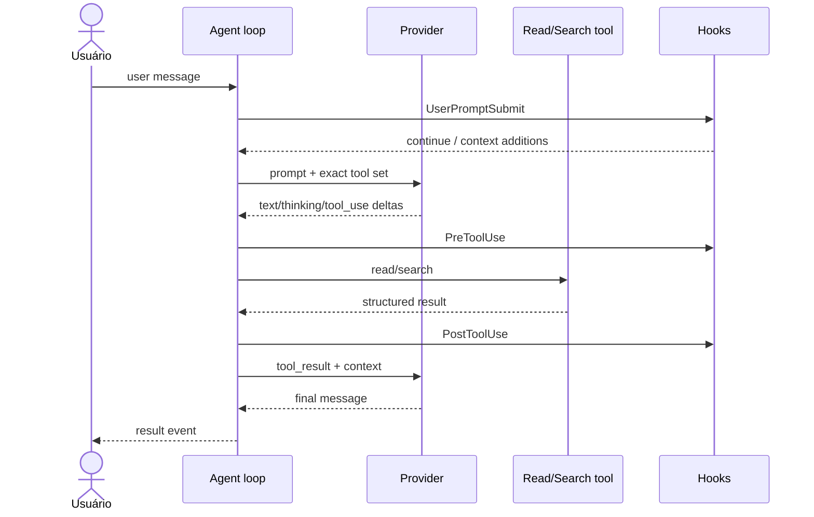

**Evidência:** event pump em `claudeopen/claude-code-src/agent/loop.js:4804-4863`; progress/tool events em `claudeopen/claude-code-src/agent/loop.js:5017-5158`; user-prompt hook em `claudeopen/claude-code-src/agent/loop.js:4302-4344`; stages de hooks em `claudeopen/claude-code-src/agent/hooks.js:194-218`.

### CodeStudio atual

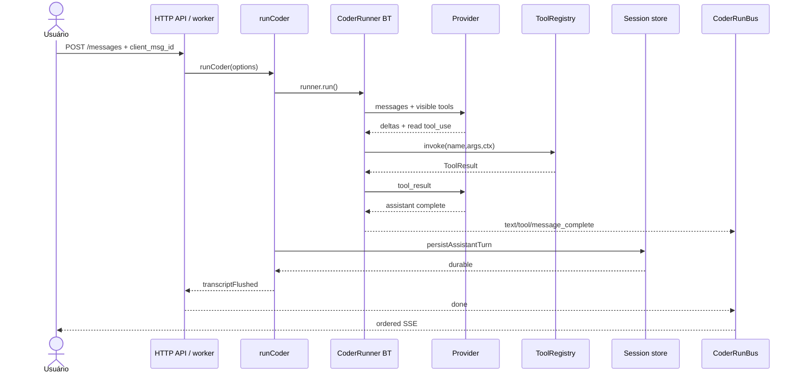

**Evidência:** runner assembly em `codestudio_mcp-codebase/packages/code-agent/src/index.ts:2459-2515`; BT em `codestudio_mcp-codebase/packages/code-agent/src/core/runner/orchestrator.ts:97-194`; registry em `codestudio_mcp-codebase/packages/code-agent/src/core/registry.ts:48-95`; persistência em `codestudio_mcp-codebase/packages/code-agent/src/index.ts:3006-3077`; terminal durável em `codestudio_mcp-codebase/apps/http-api/workers/coder-worker.ts:884-907`.

### Alvo

O fluxo local permanece. `SessionCommand`, `AgentRun` e journal envolvem o runner:

1. aceitar command de modo idempotente;
2. resolver capabilities/policy/environment;
3. criar AgentRun attempt;
4. executar BT;
5. anexar lifecycle events ao journal;
6. atualizar transcript/projeções;
7. emitir terminal somente após o boundary durable definido.

### Invariantes

- Reads não exigem approval salvo policy específica do recurso.
- Tool visível não implica autorização; tool oculta não implica proibição.
- O capability set usado pelo prompt e pelo provider possui o mesmo hash.
- Um retry do command não cria outra mensagem ou outro run.
- O último assistant turn está legível quando `done` público chega.

### Falhas a injetar

- tool desconhecida;
- handler lança exception;
- provider fecha stream sem terminal;
- store falha e usa fallback;
- cliente desconecta durante tool result.

---

## Trace 2 — Tool nativa mutante com aprovação

### ClaudeOpen

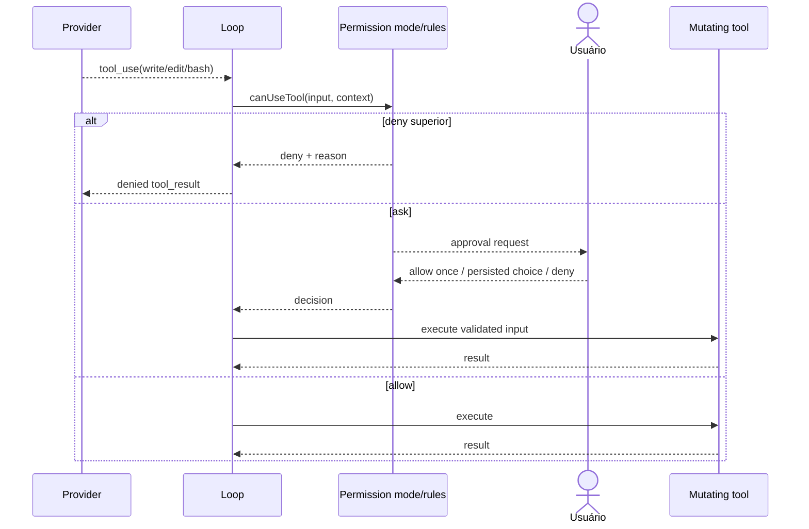

**Evidência:** modes e decisão em `claudeopen/claude-code-src/agent/permissions.js:790-873`; configuração de trust/allowed tools em `claudeopen/asar-src/mcp/index.chunk-CCzZqRut.js:489-498`.

### CodeStudio atual

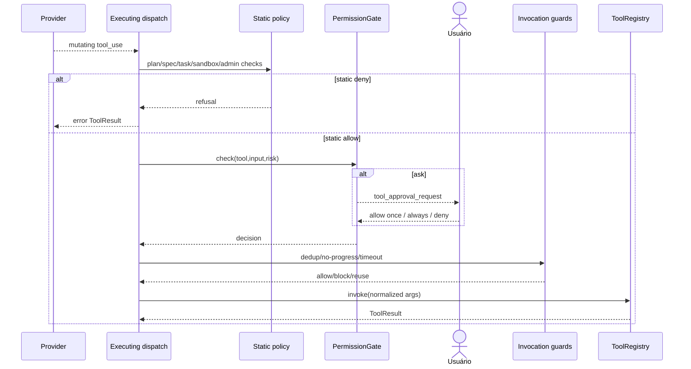

**Evidência:** policy context/decision em `codestudio_mcp-codebase/packages/code-agent/src/core/policy.ts:205-248`; plan/spec enforcement em `codestudio_mcp-codebase/packages/code-agent/src/core/policy.ts:426-470`; approval ordering em `codestudio_mcp-codebase/packages/code-agent/src/core/runner/nodes/executing-dispatch.ts:464-510`; approval payload/decisão em `codestudio_mcp-codebase/packages/code-agent/src/core/permission-gate.ts:199-270`.

### Alvo

Um único `PolicyDecision` agrega regras estáticas, grants e necessidade de interação:

```ts
type PolicyEffect = 'allow' | 'deny' | 'ask';
```

Antes da decisão, o Environment Broker canonicaliza o input efetivo e produz um `ResourceBinding` não mutante com environment/lease versions e fencing epoch. `inputPatch` é apenas uma proposta: aplicação, schema validation, novo hash/binding e nova policy decision ocorrem antes de qualquer allow/approval final. O dispatcher continua responsável por progress, timeout e guards; imediatamente antes do handler, revalida o binding, sela execution handles e consome um grant `once` por compare-and-set.

### Invariantes

- Deny superior nunca pode ser reduzido por hook, tier ou grant inferior.
- Approval mostra o recurso canônico exato, não apenas o nome da tool.
- Grant `once` vincula decision/tool-use/effective-input hash/capability-policy-environment-lease versions/fencing epoch/nonce/expiry e só um consumo atômico vence.
- Mudança de input, patch, symlink target, lease, version ou epoch exige novo binding e nova decisão.
- Grants mais longos mantêm scope e expiry/revocation; nunca viram set global por nome.
- Tempo humano não consome timeout da execução, mas a aprovação possui expiry própria.
- Denial não incrementa dedupe/failure streak.
- Direct e nested calls recebem a mesma decisão para o mesmo contexto.

### Falhas a injetar

- path traversal, symlink/junction e troca do target depois da decisão;
- command destrutivo disfarçado em shell;
- approval duplicado/replayed ou consumido concorrentemente;
- input/policy/capability/environment/lease version alterados depois da aprovação;
- binding expira entre approval e dispatch;
- abort durante wait;
- dashboard ausente em background.

---

## Trace 3 — Tool MCP com OAuth e reconnect

### ClaudeOpen

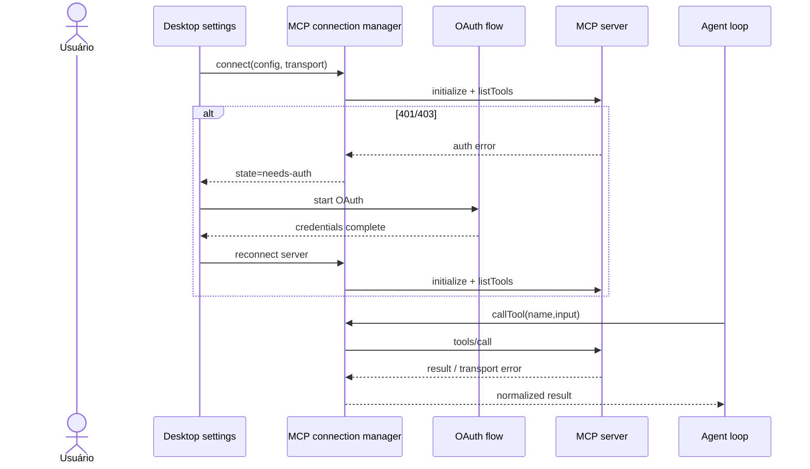

**Evidência:** connection contract em `claudeopen/claude-code-src/agent/mcp.js:7731-7767`; auth classification em `claudeopen/claude-code-src/agent/mcp.js:8236-8254`; Desktop reconnect após auth em `claudeopen/asar-src/config/settings/index.chunk-BAm06TaJ.js:48-69`.

### CodeStudio atual

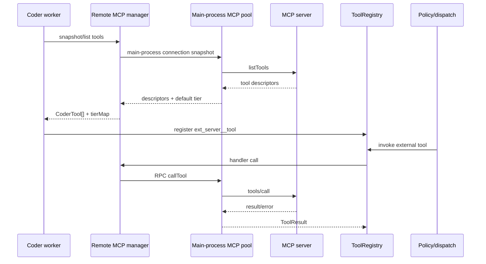

**Evidência:** external descriptor e namespace em `codestudio_mcp-codebase/packages/code-agent/src/tools/mcp-server-manager.ts:220-271`; worker/main pool bridge em `codestudio_mcp-codebase/apps/http-api/workers/coder-worker.ts:869-875`; conservative external risk em `codestudio_mcp-codebase/packages/code-agent/src/core/tool.ts:77-108`.

### Alvo

`McpServerDescriptor` e `CapabilityDescriptor` tornam first-class:

- connection/auth status;
- transport e endpoint;
- server capabilities/info/instructions;
- credential reference, nunca secret raw;
- health/retry/backoff;
- cleanup owner;
- capability version/tier/risk/output policy.

OAuth continua host-owned. O AgentRun recebe somente capabilities autorizadas e handles opacos.

### Invariantes

- `needs-auth` não é confundido com timeout/offline.
- Credenciais não entram em prompt, journal ou tool output.
- Reconnect atualiza capability projection de modo versionado.
- Tool removida/reautorizada não reaparece por cache stale.
- Retry de `callTool` mutante não é automático sem idempotency contract.
- Cleanup executa uma vez por connection owner.

### Falhas a injetar

- 401 inicial e após token expiry;
- transport drop durante result streaming;
- duplicate tool names entre servidores;
- schema incompatível depois de reconnect;
- server declara read mas executa write;
- pool ou worker reinicia isoladamente.

---

## Trace 4 — Tool nested via `code_exec`

### CodeStudio atual

ClaudeOpen equivalente não foi localizado no corpus; este trace preserva uma capacidade própria do CodeStudio.

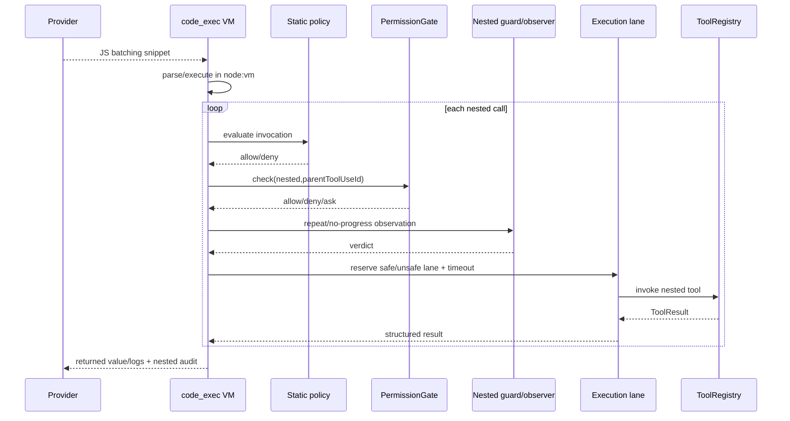

**Evidência:** public contract e VM limits em `codestudio_mcp-codebase/packages/code-agent/src/tools/code-exec.ts:90-108`; static/nested permission em `codestudio_mcp-codebase/packages/code-agent/src/tools/code-exec.ts:611-688`; guards e lanes em `codestudio_mcp-codebase/packages/code-agent/src/tools/code-exec.ts:690-830`.

### Alvo

`code_exec` continua sendo um caller de capabilities, não uma capability bypass. Cada nested call recebe o mesmo `InvocationContext` e journal envelope de uma call direta, acrescido de:

- `parentToolUseId`;
- nested sequence;
- batch ID;
- lane e queue wait;
- output reduction metadata.

### Invariantes

- Tier invisível pode ser descoberto internamente, mas policy continua obrigatória.
- Interactive/orchestration/task-lifecycle tools não executam nested.
- Mutating nested calls são serializadas.
- Timeout inclui queue wait segundo o contrato declarado.
- Parent abort cancela nested calls cooperativas.
- Audit associa nested result ao parent e ao turn telemetry ID.

### Falhas a injetar

- snippet com loop infinito;
- 51ª nested call;
- excessive output;
- nested write sem plan approval;
- duas mutations concorrentes;
- tool timeout enquanto aguarda lane;
- exception de handler.

---

## Trace 5 — Subagente foreground

### ClaudeOpen

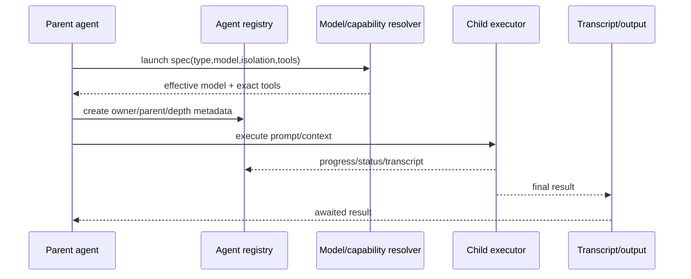

**Evidência:** launch/identity em `claudeopen/claude-code-src/agent/loop.js:688-823`; foreground wait em `claudeopen/claude-code-src/agent/loop.js:840-910`.

### CodeStudio atual

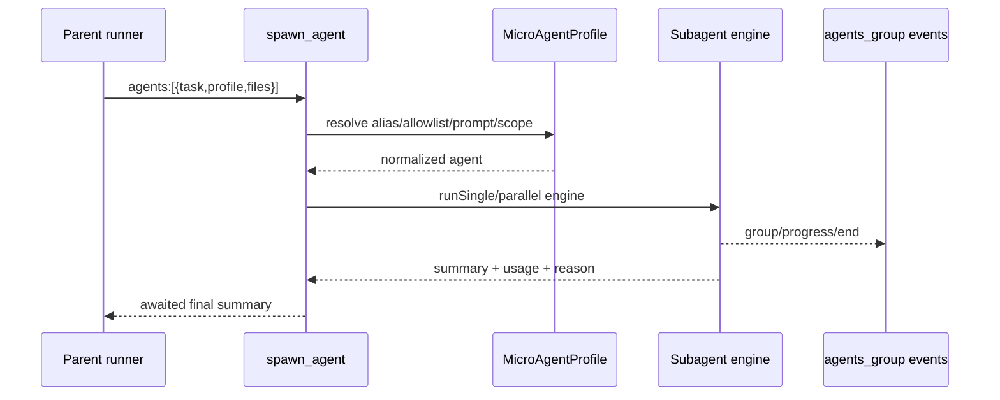

**Evidência:** normalization/profiles em `codestudio_mcp-codebase/packages/code-agent/src/tools/spawn-agent.ts:130-175`; dispatch em `codestudio_mcp-codebase/packages/code-agent/src/tools/spawn-agent.ts:789-830`; profile contract em `codestudio_mcp-codebase/packages/code-agent/src/tools/micro-agent-profiles.ts:59-118`.

### Alvo

Antes de executar, o host persiste `AgentRun` e `AgentRunAttempt`, resolve model/capabilities/environment e adquire lease quando necessário. Foreground significa apenas que o caller espera o terminal.

### Invariantes

- Parent/owner/depth são persistidos.
- Effective model/profile/capability hash ficam auditáveis.
- Child não recebe interaction/recursion capabilities não declaradas.
- Resultado intermediário não polui automaticamente o contexto do parent.
- Usage é atribuída ao child e agregada ao parent uma vez.
- Cancel do parent propaga segundo background policy explícita.

### Falhas a injetar

- child excede turns;
- provider fallback;
- profile desconhecido;
- capability removida entre resolve e start;
- parent abort;
- process crash antes do terminal persistence.

---

## Trace 6 — Subagente background + resume

### ClaudeOpen

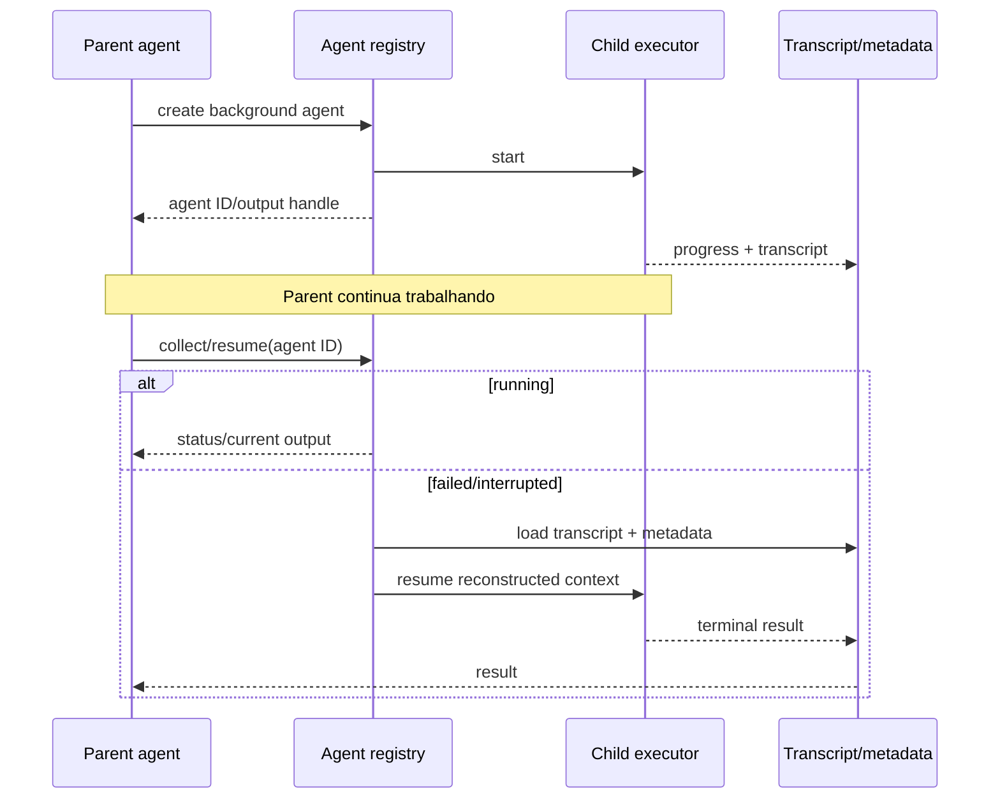

**Evidência:** same executor/background handle em `claudeopen/claude-code-src/agent/loop.js:840-910`; resume reconstruction/concurrency em `claudeopen/claude-code-src/agent/loop.js:580-809`.

### CodeStudio atual

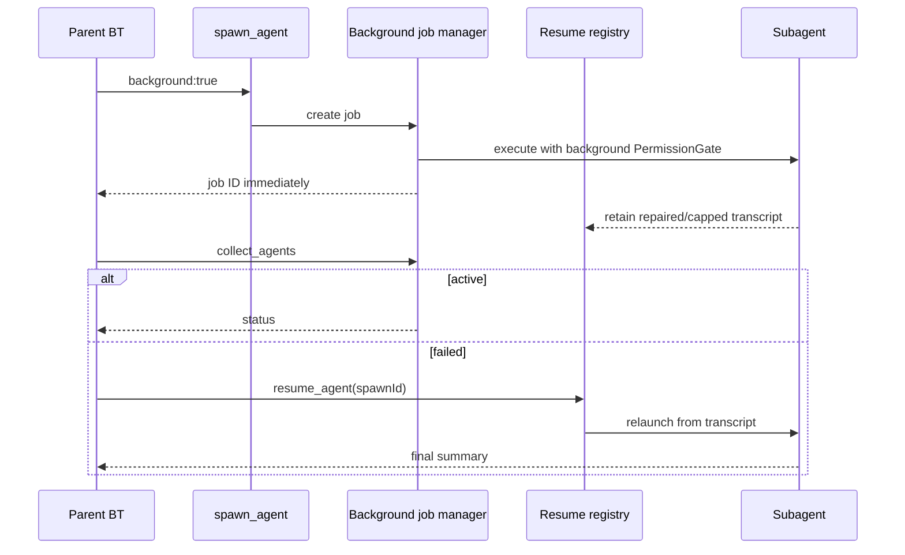

**Evidência:** background route em `codestudio_mcp-codebase/packages/code-agent/src/tools/spawn-agent.ts:809-817`; non-interactive gate em `codestudio_mcp-codebase/packages/code-agent/src/core/permission-gate.ts:178-197`; resume process-only e retained fields em `codestudio_mcp-codebase/packages/code-agent/src/tools/subagent-resume-registry.ts:1-64`.

### Alvo

Background e foreground compartilham o mesmo durable `AgentRun`; `waitMode` altera apenas como o caller recebe o lifecycle. Verifier seletivo, quando aplicável, roda dentro desse lifecycle antes do terminal persistido. `collect`, `attach`, `resume` e `stop` operam por command idempotente. Resume cria novo attempt com executor lease, heartbeat, expiry e fencing epoch monotônico, referenciando o checkpoint/transcript anterior; não reescreve o mesmo attempt.

### Invariantes

- Background nunca espera um approval invisível.
- Resume concorrente permite uma única executor lease vigente; provider call, tool side effect e terminal commit exigem o fencing epoch atual.
- Executor antigo que retorna após takeover falha fechado antes de qualquer novo efeito.
- Resultado terminal existente é retornado sem reexecutar.
- Efeito já despachado com ACK perdido usa outcome probe/reconciliation ou `outcome_unknown`, nunca retry por suposição.
- Transcript truncation/elision fica registrada.
- Stop do usuário é monotônico até resume explícito.
- Restart do worker não apaga identidade/status/result.
- Foreground/background produzem o mesmo verifier/result lifecycle.

### Falhas a injetar

- parent termina enquanto child trabalha;
- app restart durante child;
- duas chamadas de resume;
- partition expira heartbeat, novo owner assume e executor antigo retorna com epoch stale;
- crash depois de dispatch e antes do terminal/ACK;
- transcript parcial/corrupto;
- background tenta tool que produziria `ask`;
- result persistido e notification perdida.

---

## Trace 7 — Workflow fan-out/fan-in + verifier

### ClaudeOpen pattern

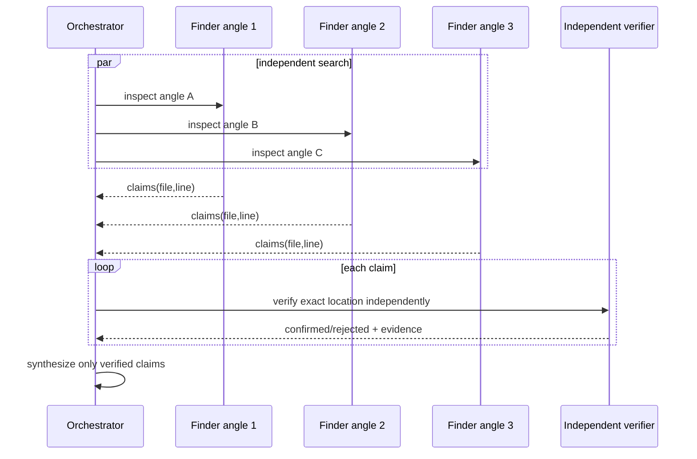

**Evidência:** padrão finder/verifier em `claudeopen/claude-code-src/agent/memory.js:4314-4315`.

### CodeStudio atual

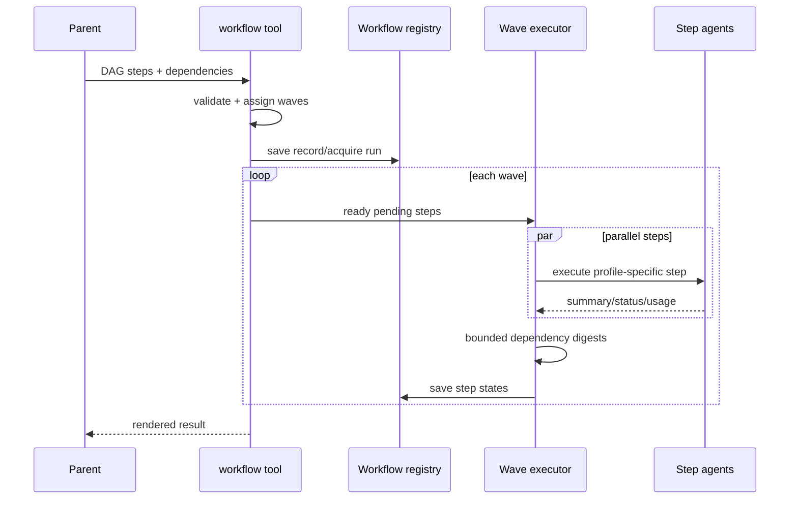

**Evidência:** workflow contract/process scope em `codestudio_mcp-codebase/packages/code-agent/src/tools/workflow/workflow-tool.ts:1-35`; bounded digests/readiness em `codestudio_mcp-codebase/packages/code-agent/src/tools/workflow/workflow-run.ts:26-125`; resume/locking/events em `codestudio_mcp-codebase/packages/code-agent/src/tools/workflow/workflow-tool.ts:153-243`.

### Alvo

O DAG atual é preservado. Cada step referencia um durable AgentRun. Claims de determinados task kinds podem criar verifier steps independentes automaticamente, mas somente por policy/preset medido.

### Invariantes

- Dependências falhas propagam `skipped` determinístico.
- Step completed não executa de novo após restart.
- Dependency context usa digests e refs, não transcripts ilimitados.
- Verifier não herda writes nem conclusão do finder como verdade.
- Fan-out respeita budget, depth, provider limits e workspace leases.
- Workflow terminal é derivado dos steps persistidos.

### Falhas a injetar

- crash entre duas waves;
- step terminal persistido, workflow record não atualizado;
- verifier discorda;
- dependency summary excede budget;
- cycle/unknown dependency;
- dois resume concorrentes.

---

## Trace 8 — Ultra suportado e não suportado

### ClaudeOpen

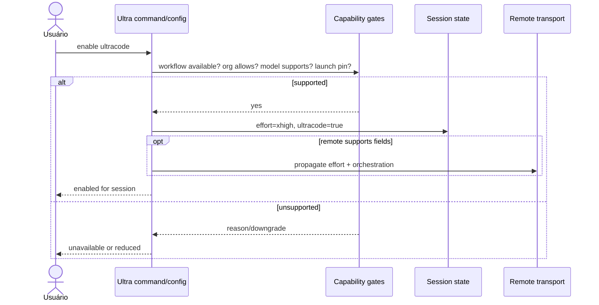

**Evidência:** definition em `claudeopen/claude-code-src/agent/workflow.js:8823-8858`; gates e persisted fields em `claudeopen/claude-code-src/agent/workflow.js:9005-9054`.

### CodeStudio atual

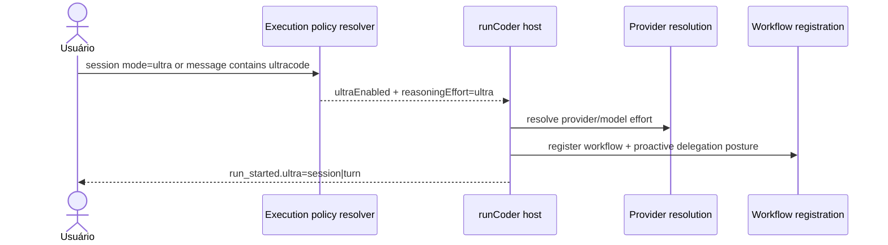

**Evidência:** mode/keyword em `codestudio_mcp-codebase/packages/code-agent/src/sessions/execution-mode.ts:15-45`; host assembly flag em `codestudio_mcp-codebase/packages/code-agent/src/index.ts:2459-2474`; workflow only in Ultra em `codestudio_mcp-codebase/packages/code-agent/src/tools/workflow/workflow-tool.ts:1-8`.

### Alvo

```ts
interface UltraPreset {
  reasoningEffort: 'high' | 'xhigh';
  orchestration: 'proactive-dag';
  maxParallelism: number;
  maxDepth: number;
  verifierPolicy: 'selective' | 'required-for-high-risk';
  backgroundPolicy: 'allowed';
  durability: 'checkpointed';
  isolation: 'lease-required-for-writes';
}
```

Cada AgentRun persiste requested e effective values, além de downgrade reasons.

### Invariantes

- Ultra nunca amplia autorização.
- Provider effort e orchestration são resolvidos separadamente.
- Unsupported capability resulta em deny ou downgrade explícito.
- Keyword por turno não muda sticky session state.
- Custo/latência adicionais ficam atribuíveis por dimensão.
- Workflow durability não depende do label Ultra.

### Falhas a injetar

- provider sem xhigh;
- workflow disabled por organização;
- max parallelism menor no ambiente;
- verifier model indisponível;
- keyword em mensagem que discute a feature;
- preset version muda durante sessão.

---

## Trace 9 — Disconnect/reconnect/replay SSE

### CodeStudio atual

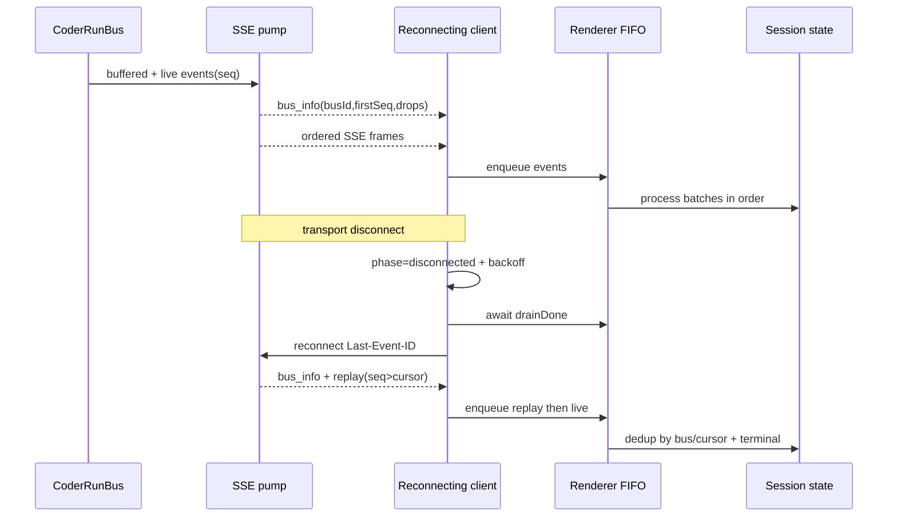

**Evidência:** bus identity/caps em `codestudio_mcp-codebase/apps/http-api/coder-bus.ts:29-73`; SSE write/replay em `codestudio_mcp-codebase/apps/http-api/sse/pumpBusToSSE.ts:38-118`; reconnect client em `codestudio_mcp-codebase/packages/shared/src/sse/ReconnectingSSEClient.ts:79-195`; FIFO/cursor drain em `codestudio_mcp-codebase/apps/dashboard/hooks/agent-stream/openStream.ts:234-360`.

### Alvo

O live trace permanece, mas replay longo pode vir do journal/projection quando o bus morreu. `busId + seq` continua um cursor de transporte; `eventId/globalSeq` vira cursor durável.

### Invariantes

- Frames mantêm ordem do bus.
- Reconnect não repete side effects; POST retry usa command ID.
- Cursor só avança após processing commit definido.
- Bus change zera cursor local stale.
- Buffer eviction é sinalizada, não silenciosa.
- UI distingue connecting, replaying, live e disconnected.
- Projection rebuild não depende do runtime diagnostic log.

### Falhas a injetar

- disconnect antes do primeiro frame;
- reconnect enquanto FIFO ainda drena;
- bus evicted;
- cursor de run anterior;
- replay maior que byte/event cap;
- terminal recebido e desconexão antes do refetch.

---

## Trace 10 — Crash entre provider complete e durable turn

### CodeStudio atual

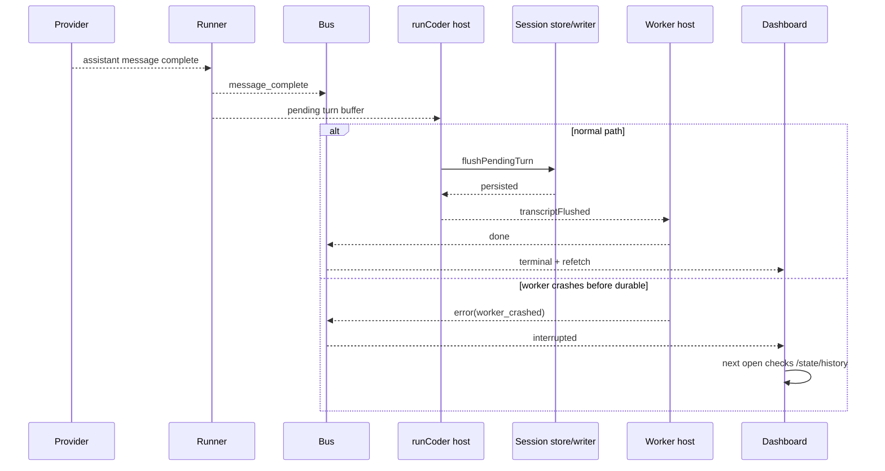

**Evidência:** pending turn/flush em `codestudio_mcp-codebase/packages/code-agent/src/index.ts:2993-3077`; public terminal after flush em `codestudio_mcp-codebase/packages/code-agent/src/index.ts:3490-3546` e `codestudio_mcp-codebase/apps/http-api/workers/coder-worker.ts:884-907`; crash UI reconciliation em `codestudio_mcp-codebase/apps/dashboard/hooks/agent-stream/openStream.ts:380-409`.

### Risco residual

Se o processo morre depois de o provider gerar output mas antes do DB/journal durable append, o bus/process pode desaparecer. O dashboard trata a sessão como interrupted, porém não há prova de recuperação lossless daquele output.

### Alvo

Eventos críticos e transcript checkpoint seguem um protocolo explícito:

1. provider message complete recebe event ID;
2. turn payload é persistido transacionalmente;
3. journal registra `turn_persisted`/terminal;
4. SSE projeta o terminal;
5. recovery sintetiza `run_interrupted` quando existe accepted run sem terminal.

Não é obrigatório persistir cada token; é obrigatório explicar a perda máxima possível e o boundary durable.

### Invariantes

- `done` público implica turn terminal legível.
- Accepted run sem terminal é recuperado como interrupted, nunca idle/completed.
- Retry do user command não duplica user message/tool effects.
- Provider-complete não é mostrado como durable-complete.
- Recovery não inventa assistant output ausente.
- Uma partial turn possui status/provenance explícitos.

### Falhas a injetar

- crash após `message_complete` e antes do flush;
- crash durante dbWriter write;
- write completa, ACK se perde;
- journal append falha após transcript commit;
- terminal SSE publicado, process morre antes de state update;
- worker restart com interaction checkpoint pendente.

---

## Trace 11 — Compactação + memory recall

### ClaudeOpen

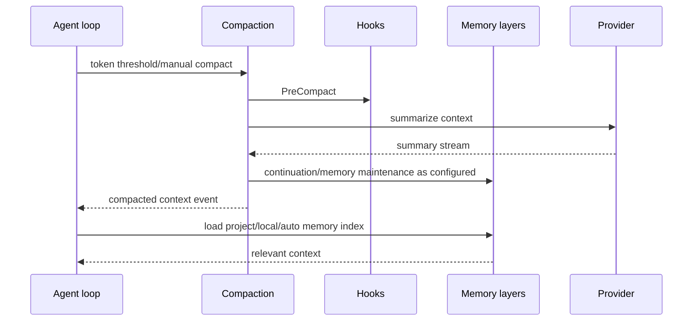

**Evidência:** compaction stream/event em `claudeopen/claude-code-src/agent/compaction.js:95-141`; memory layers/index em `claudeopen/claude-code-src/agent/memory.js:239-357`, `claudeopen/claude-code-src/agent/memory.js:3194`; continuation summary em `claudeopen/claude-code-src/agent/tools.js:262-283`.

### CodeStudio atual

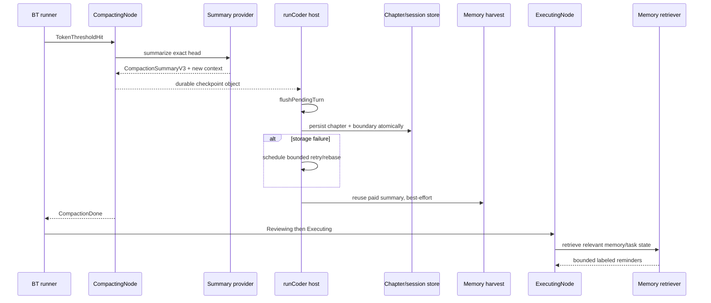

**Evidência:** transition em `codestudio_mcp-codebase/packages/code-agent/src/core/runner/machine/transitions.ts:39-47`; durable checkpoint host em `codestudio_mcp-codebase/packages/code-agent/src/index.ts:3312-3358`; retry/rebase em `codestudio_mcp-codebase/packages/code-agent/src/core/runner/compaction/checkpoint-retry.ts:30-122`; memory harvest em `codestudio_mcp-codebase/packages/code-agent/src/core/runner/compaction/memory-harvest.ts:1-135`; recall wiring em `codestudio_mcp-codebase/packages/code-agent/src/index.ts:2518-2555`.

### Alvo

O mecanismo atual é preservado e recebe IDs/eventos canônicos. Um `HandoffArtifact` opcional expõe goal, decisions, pending work, checkpoints e store references para outra instância/AgentRun.

### Invariantes

- Tool-use/tool-result pairing não é quebrado.
- Summary usada em memória e checkpoint é a mesma geração identificada.
- Chapter boundary alinha com prefixo persistido.
- Storage failure é retryable; alignment no-op não entra em loop.
- Recall respeita “ignore memory”.
- Memory stale é marcada e não apresentada como fato fresco.
- Handoff referencia source-of-truth, não duplica transcript inteiro.

### Falhas a injetar

- três compactações seguidas;
- crash depois da summary e antes do chapter commit;
- checkpoint commit falha duas vezes;
- arquivos referenciados mudam após memory write;
- user desliga memory no turno de retomada;
- global workspace possui um projeto com retriever falhando.

---

## Trace 12 — Agente mutante em worktree/lease

### ClaudeOpen baseline

O resume valida o diretório de worktree e pode cair no cwd do parent quando o worktree sumiu: `claudeopen/claude-code-src/agent/loop.js:688-697`. Esse fallback é útil para continuidade, mas não deve ser copiado para um AgentRun com lease obrigatória de escrita.

### CodeStudio atual

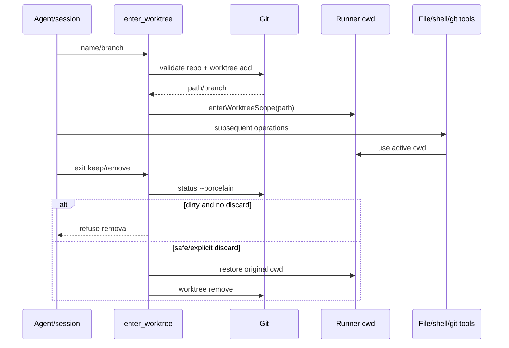

**Evidência:** creation em `codestudio_mcp-codebase/packages/code-agent/src/tools/worktree.ts:21-100`; enter em `codestudio_mcp-codebase/packages/code-agent/src/tools/worktree.ts:128-154`; guarded exit em `codestudio_mcp-codebase/packages/code-agent/src/tools/worktree.ts:160-238`.

### Risco atual de subagente

`files` bloqueia apenas write tools nativas. `run_command` permanece warning-only e pode escrever fora do scope: `codestudio_mcp-codebase/packages/code-agent/src/tools/implement-subagent.ts:1287-1345`.

### Alvo

```mermaid
sequenceDiagram
    participant CP as Control plane
    participant LM as Lease manager
    participant Env as ExecutionEnvironment
    participant AR as AgentRun
    participant Tools as All capability adapters

    CP->>LM: acquire exclusive-write(project,baseSHA)
    LM->>Env: create worktree/container/remote workspace
    Env-->>LM: environmentRef + root + branch
    LM-->>CP: WorkspaceLease
    CP->>AR: start with lease ID
    AR->>Tools: invoke under environment handle
    Tools->>LM: validate owner/resource/expiry
    alt valid
        Tools->>Env: fs/shell/git operation
    else missing/stale
        Tools-->>AR: fail closed
    end
    AR-->>CP: terminal + dirty/diff metadata
    CP->>LM: release/retain according to policy
```

### Invariantes

- Um mutating AgentRun possui lease exclusiva antes de executar.
- Filesystem, shell, Git, terminal e plugin tools resolvem o mesmo environment root.
- Lease ausente/stale falha fechado; nunca volta ao checkout principal.
- Symlink/junction não escapa da raiz autorizada.
- Dirty workspace é preservado ou removido somente por policy/ação explícita.
- Branch/base SHA/owner aparecem no dashboard e journal.
- Cleanup é idempotente e recuperável após crash.

### Falhas a injetar

- dois writers no mesmo projeto;
- worker morre com lease ativa;
- worktree removido externamente;
- shell usa path absoluto, PowerShell ou child process;
- symlink aponta para fora;
- cleanup perde ACK;
- remote environment fica offline.

---

## Invariantes transversais derivadas dos traces

### Identidade e causalidade

1. Todo command aceito possui `commandId` e idempotency key.
2. Todo run/attempt/operation/tool call possui ID estável.
3. Parent, owner, causation e correlation são persistidos.
4. Foreground/background não criam identidades incompatíveis.

### Policy e capability

5. Capability visibility, eligibility e authorization são estados diferentes.
6. Direct/nested/MCP/plugin calls passam pelo mesmo decision contract.
7. Hooks podem observar ou decidir apenas nos stages declarados.
8. Ultra não aumenta privilégios.

### Durabilidade

9. SSE e runtime log são projeções, não source of truth.
10. Accepted work converge para terminal durable ou interrupted recovery.
11. Retry/resume não repete side effect confirmado.
12. Workflow/AgentRun completed não é relançado por restart.

### Ambiente

13. Mutação depende de lease exclusiva e environment binding.
14. Cwd/root/branch são propriedades do environment, não variáveis soltas.
15. Fallback de isolamento ausente para host root é proibido.

### UX

16. O dashboard distingue connecting, replaying, live, waiting, persisting, terminal e interrupted.
17. Requested/effective model, effort, preset e downgrade são visíveis.
18. Approval mostra regra, recurso, duração e impacto.
19. Recovery informa o que foi preservado, perdido e reexecutado.

## Próxima leitura

Os tipos, bounded contexts e ordering necessários para implementar estes traces estão em [14-target-control-plane-contracts.md](./14-target-control-plane-contracts.md).
