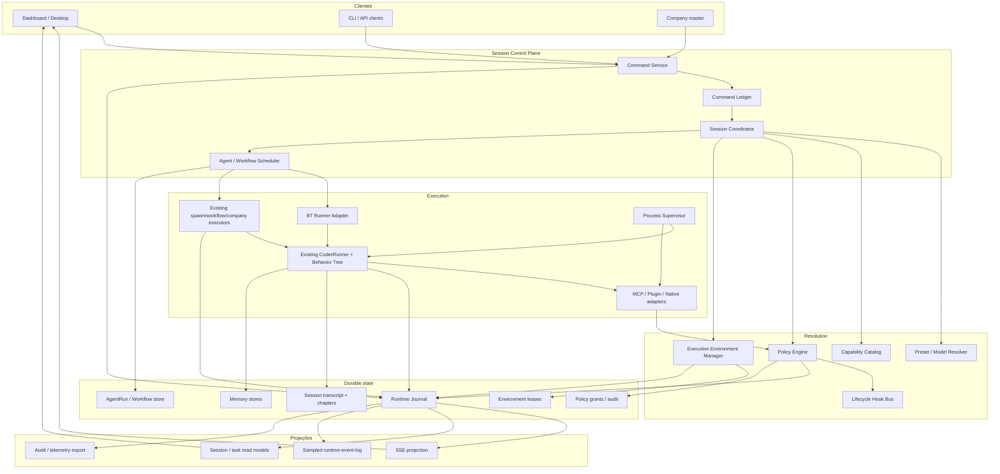

# 14 — Control plane e contratos-alvo

## Status deste documento

Tudo nesta página marcado como **PROPOSED** é arquitetura futura. Os mecanismos internos citados como **CURRENT** são pontos de adaptação, não APIs que já atendem ao contrato inteiro.

A direção vinculante é:

- envolver, não substituir, o BT runner;
- adotar contratos próprios do CodeStudio, não símbolos desminificados;
- separar command, run, environment, capability, policy, event e projection;
- introduzir journal em shadow mode antes de mudar comportamento;
- preservar Company Mode, indexer/RAG, skills/plugins, memória, workflow DAG e `code_exec`.

## 1. Princípios

1. **Um command é diferente de um run.** Retry de command pode retornar um run existente.
2. **Um run é diferente de um attempt.** Resume/fallback/recovery cria ou atualiza attempt conforme contrato explícito.
3. **Visibility é diferente de authorization.** Tiers controlam catálogo/contexto; policy controla execução.
4. **Foreground/background é comportamento do caller.** Ambos referenciam o mesmo `AgentRun`.
5. **Environment é uma entidade.** Cwd, branch, lease, runtime, network e secrets não são parâmetros soltos.
6. **Journal é diferente de transcript e diagnóstico.** Cada store possui finalidade própria.
7. **Hooks observam ou decidem em stages declarados.** Não existe callback genérico com autoridade implícita.
8. **Requested e effective são sempre separados.** Provider, model, effort, preset e isolation podem sofrer downgrade.
9. **Recovery é um protocolo, não um texto.** Checkpoints, IDs, versions e terminal reasons sustentam resume.
10. **Exactly-once não é presumido.** O sistema fornece at-least-once delivery + idempotency/dedup para efeitos declarados.

## 2. Arquitetura de referência



### Por que o BT permanece

**CURRENT.** O CodeStudio já possui nodes declarativos, validation de eventos, recovery, background parking, shutdown reconciliation e terminal único: `codestudio_mcp-codebase/packages/code-agent/src/core/runner/orchestrator.ts:73-87`, `codestudio_mcp-codebase/packages/code-agent/src/core/runner/orchestrator.ts:118-282`.

**PROPOSED.** O control plane normaliza identidade, policy, environment e durability antes/depois da execução. O BT continua decidindo a dinâmica interna de Bootstrap/Planning/Executing/Compacting/Reviewing/Recovering.

## 3. Bounded contexts e ownership

| Contexto | É dono de | Não é dono de | Adapters atuais |
|---|---|---|---|
| Command Service | validação, idempotency key, expected version, command outcome | provider loop, UI state | coder/company routes, `RecentMessageKeys` |
| Session Coordinator | lifecycle da sessão, active command/run refs, concurrency | transcript content, tool handlers | session store + worker pool |
| Agent Platform | AgentRun, attempts, parent/owner/depth, scheduler, workflow steps | provider implementation, filesystem | spawn/workflow/Company executors |
| Capability Catalog | descriptors, stable IDs, aliases, source, runtime status, projections | autorização final | `ToolRegistry`, tiers, MCP/plugin loaders |
| Policy Engine | rule precedence, grants, allow/deny/ask, constraints, audit | visibility ordering, tool execution | `core/policy.ts`, `PermissionGate`, scopes |
| Environment Manager | target, cwd/root, workspace lease, network/secrets handles, cleanup | task semantics | worktree/sandbox/remote drivers |
| Runner Adapter | tradução `AgentRunSpec ↔ RunnerOptions/events` | command idempotency, policy truth | `runCoder`, `CoderRunner` bridge |
| Runtime Journal | event envelope, append order, durable cursor, event version | query-specific UI shape | novo; runtime log não é promovido |
| Transcript/Chapter Store | user/assistant/tool history e compaction boundaries | lifecycle completo | session store, chapters/checkpoints |
| Memory Service | session notes, durable memory, retrieval, staleness, distillation | transcript/journal | memory stores/services |
| Hook Bus | registration, stage ordering, timeout, trust, observation/decision dispatch | policy precedence | runtime hook registry + project hooks |
| Process Supervisor | worker/process health, restart policy, heartbeat, crash terminalization | domain decisions | worker pools/hosts |
| Projection Layer | SSE/read models/diagnostics/audit export | source of truth | bus/pump/dashboard/runtime log |

### Regra de ownership

Um campo mutável possui um único owner. Outros contexts guardam IDs, snapshots imutáveis ou projections. Exemplos:

- `WorkspaceLease.status` pertence ao Environment Manager;
- `AgentRun.status` pertence à Agent Platform;
- `PolicyDecision` pertence ao Policy Engine;
- `SessionReadModel.activeRunId` é projeção, não autoridade;
- `runtime-event-log` não decide se um run terminou.

## 4. Identificadores

**PROPOSED.** IDs são opacos e únicos no domínio:

```ts
type SessionId = string;
type SessionCommandId = string;
type AgentRunId = string;
type AgentRunAttemptId = string;
type WorkflowId = string;
type WorkflowStepId = string;
type OperationId = string;
type ToolUseId = string;
type CapabilityId = string;
type EnvironmentId = string;
type WorkspaceLeaseId = string;
type RuntimeEventId = string;
type CorrelationId = string;
```

### Regras

- Não reutilizar `busId`, DB integer ou provider tool-use ID como identidade global.
- IDs legados permanecem em `legacyRefs` durante migração.
- `busId + seq` continua válido como cursor live.
- `globalSeq` pertence ao stream/journal partition, não é um ID de domínio.
- IDs enviados pelo cliente são validados e namespaceados; o servidor cria IDs ausentes.

## 5. `SessionCommand`

### Envelope

```ts
type SessionCommandKind =
  | 'start'
  | 'send_message'
  | 'attach'
  | 'resume'
  | 'fork'
  | 'handoff'
  | 'stop'
  | 'inject_message'
  | 'resolve_interaction'
  | 'resolve_tool_approval';

interface SessionCommand<T = unknown> {
  schemaVersion: 1;
  commandId: SessionCommandId;
  idempotencyKey: string;
  kind: SessionCommandKind;
  sessionId: SessionId;
  actor: {
    actorId: string;
    actorType: 'user' | 'agent' | 'system' | 'api' | 'organization';
    source: 'dashboard' | 'desktop' | 'cli' | 'http' | 'company' | 'recovery';
  };
  expectedSessionVersion?: number;
  requestedAt: string;
  deadlineAt?: string;
  correlationId: CorrelationId;
  payload: T;
}
```

### Outcome

```ts
type CommandStatus =
  | 'accepted'
  | 'running'
  | 'succeeded'
  | 'rejected'
  | 'cancelled'
  | 'failed';

interface SessionCommandResult {
  commandId: SessionCommandId;
  status: CommandStatus;
  sessionVersion: number;
  agentRunId?: AgentRunId;
  existingResult?: boolean;
  reasonCode?: string;
  errorRef?: string;
  completedAt?: string;
}
```

### Idempotency semantics

1. A mesma `(sessionId, idempotencyKey, kind)` retorna o command original.
2. O mesmo key com payload hash diferente é conflito, não retry.
3. `attach` é naturalmente read-like, mas ainda recebe correlation/cursor.
4. `send_message` não repete append ou spawn após restart.
5. `stop` é monotônico para o run target; resume exige outro command.
6. `resolve_interaction` e approval são idempotentes por interaction/tool-use ID.

**CURRENT fast path.** `client_msg_id` e `RecentMessageKeys` já evitam duplicação no reconnect enquanto o processo mantém a entrada: `codestudio_mcp-codebase/apps/http-api/server/routes/recent-message-keys.ts:5-34`, `codestudio_mcp-codebase/apps/http-api/server/routes/recent-message-keys.ts:46-104`.

**MIGRATION.** O ledger durável torna o fast path uma cache/projeção, não a autoridade.

## 6. `AgentRunSpec`, `AgentRun` e attempts

### Spec solicitada

```ts
interface AgentRunSpec {
  schemaVersion: 1;
  sessionId: SessionId;
  commandId: SessionCommandId;
  ownerAgentRunId?: AgentRunId;
  parentAgentRunId?: AgentRunId;
  spawnDepth: number;
  role: string;
  agentDefinitionId: string;
  task: { text: string; attachments?: string[] };
  requestedProvider?: string;
  requestedModel?: string;
  requestedReasoningEffort?: string;
  requestedPreset?: string;
  requestedCapabilityProfile: string;
  requestedEnvironment: ExecutionEnvironmentRequest;
  waitMode: 'foreground' | 'background';
  budget: AgentRunBudget;
  verifierPolicy?: VerifierPolicy;
  idempotencyKey: string;
}
```

### Run resolvido

```ts
interface AgentRun {
  agentRunId: AgentRunId;
  specVersion: number;
  sessionId: SessionId;
  commandId: SessionCommandId;
  ownerAgentRunId?: AgentRunId;
  parentAgentRunId?: AgentRunId;
  spawnDepth: number;
  role: string;
  status:
    | 'queued'
    | 'starting'
    | 'running'
    | 'waiting'
    | 'detached'
    | 'stopping'
    | 'completed'
    | 'failed'
    | 'aborted'
    | 'interrupted';
  effectiveProvider: string;
  effectiveModel: string;
  effectiveReasoningEffort?: string;
  effectivePreset?: string;
  downgradeReasons: ResolutionReason[];
  capabilitySetRef: string;
  environmentId: EnvironmentId;
  workspaceLeaseId?: WorkspaceLeaseId;
  activeAttemptId?: AgentRunAttemptId;
  presetResolutionRef: string;
  terminalReason?: string;
  transcriptRef?: string;
  checkpointRef?: string;
  resultRef?: string;
  policySnapshotRef: string;
  createdAt: string;
  startedAt?: string;
  finishedAt?: string;
  version: number;
}
```

### Attempt

```ts
interface ExecutorLease {
  ownerId: string;
  fencingEpoch: number;
  status: 'active' | 'expired' | 'released' | 'fenced';
  acquiredAt: string;
  heartbeatAt: string;
  expiresAt: string;
  releasedAt?: string;
}

interface AgentRunAttempt {
  attemptId: AgentRunAttemptId;
  agentRunId: AgentRunId;
  ordinal: number;
  trigger: 'initial' | 'resume' | 'provider_fallback' | 'worker_recovery';
  executorLease: ExecutorLease;
  status: 'starting' | 'running' | 'terminal';
  runnerRunId?: string;
  providerRequestRefs: string[];
  checkpointInputRef?: string;
  terminalReason?: string;
  errorRef?: string;
  startedAt: string;
  finishedAt?: string;
  version: number;
}
```

### Invariantes

- Um `AgentRun` possui no máximo um attempt executor ativo.
- Acquire/renew/release e toda transição do attempt usam compare-and-set sobre `AgentRun.version`, `AgentRunAttempt.version` e `fencingEpoch`.
- Recovery só inicia novo executor depois de expirar/fencear o anterior e incrementar monotonically o epoch.
- Antes de provider call, capability side effect ou terminal commit, o executor apresenta o epoch atual; owner stale falha fechado mesmo que volte após uma partition.
- Heartbeat perdido não prova que um efeito não ocorreu; após dispatch, recovery segue o `SideEffectContract` da capability.
- Foreground/background não altera o run; altera somente o wait do command/caller.
- Resume concluído retorna resultado existente.
- Attempt novo referencia checkpoint/transcript anterior e não apaga history.
- Owner/parent/depth não mudam silenciosamente no resume.
- Provider fallback registra requested/effective e trigger.

**CURRENT.** Profiles e executor já são compartilhados por foreground/background; resume efêmero guarda transcript/profile/limits, mas só no processo: `codestudio_mcp-codebase/packages/code-agent/src/tools/spawn-agent.ts:789-830`, `codestudio_mcp-codebase/packages/code-agent/src/tools/subagent-resume-registry.ts:1-64`.

## 7. Workflows

```ts
interface WorkflowDefinition {
  workflowId: WorkflowId;
  version: number;
  sessionId: SessionId;
  commandId: SessionCommandId;
  name: string;
  steps: WorkflowStepDefinition[];
  createdAt: string;
}

interface WorkflowStepDefinition {
  stepId: WorkflowStepId;
  title: string;
  prompt: string;
  dependsOn: WorkflowStepId[];
  agentRunSpecTemplate: Omit<AgentRunSpec, 'commandId' | 'idempotencyKey'>;
  outputContract?: string;
}

interface WorkflowStepState {
  stepId: WorkflowStepId;
  status: 'pending' | 'ready' | 'running' | 'partial' | 'completed' | 'failed' | 'skipped';
  activeAgentRunId?: AgentRunId;
  completedAgentRunId?: AgentRunId;
  resultRef?: string;
  errorRef?: string;
  version: number;
}
```

### Regras

- DAG é validada antes da aceitação.
- Step attempt é um AgentRun ou referencia um AgentRun.
- `completed/partial` satisfaz dependência conforme definição versionada.
- Dependency input usa result refs + bounded digests.
- Resume não reabre completed sem command explícito de rerun/fork.
- Idempotency key do step deriva de workflow/version/step/attempt intent.

**CURRENT strength.** O workflow já implementa waves, skip determinístico e digests de tamanho limitado: `codestudio_mcp-codebase/packages/code-agent/src/tools/workflow/workflow-run.ts:26-125`.

## 8. Capability Catalog

### Side-effect protocol

```ts
type SideEffectOutcome =
  | 'not_started'
  | 'in_progress'
  | 'succeeded'
  | 'failed'
  | 'outcome_unknown';

interface SideEffectContract {
  kind: 'none' | 'local' | 'external';
  idempotency: 'none' | 'caller_key' | 'provider_key';
  idempotencyKeyField?: string;
  safeRetryStages: Array<'before_dispatch' | 'rejected_before_accept' | 'confirmed_not_started'>;
  outcomeProbeCapabilityId?: CapabilityId;
  compensationCapabilityId?: CapabilityId;
  ambiguousOutcome: 'mark_outcome_unknown' | 'require_reconciliation';
}
```

`idempotencyKeyField` declara como o mesmo key é encaminhado ao efeito em toda tentativa. `outcomeProbeCapabilityId` consulta o resultado sem repetir a mutação; compensation é uma ação explícita e auditada, nunca rollback implícito.

### Descriptor

```ts
interface CapabilityDescriptor {
  capabilityId: CapabilityId;
  version: string;
  name: string;
  aliases: string[];
  displayName: string;
  description: string;
  source: {
    kind: 'native' | 'mcp_internal' | 'mcp_external' | 'plugin' | 'skill' | 'remote';
    providerId: string;
    serverId?: string;
    provenanceRef?: string;
    metadataTrust: 'local' | 'attested' | 'untrusted';
  };
  inputSchema: object;
  outputSchema?: object;
  visibility: {
    defaultTier: string;
    searchable: boolean;
    promptSummaryClass: 'always' | 'discoverable' | 'hidden';
  };
  execution: {
    class: 'read' | 'write' | 'execute' | 'control';
    mutates: boolean;
    parallelSafe: boolean;
    repeatPolicy: 'stable' | 'volatile' | 'pollable' | 'mutating';
    sideEffect: SideEffectContract;
    timeoutPolicy: string;
    cancellation: 'cooperative' | 'hard-kill' | 'unsupported';
  };
  requirements: {
    environmentKinds?: ExecutionEnvironmentKind[];
    sandboxRequired?: boolean;
    networkScopes?: string[];
    secretScopes?: string[];
    interactive?: boolean;
  };
  riskClassifierRef: string;
  outputPolicyRef: string;
  lifecycleRef?: string;
  enabled: boolean;
}
```

### Projection resolvida

```ts
interface ResolvedCapabilitySet {
  ref: string;
  hash: string;
  catalogVersion: string;
  agentRunId: AgentRunId;
  registered: CapabilityId[];
  visible: CapabilityId[];
  eligible: CapabilityId[];
  disabled: Array<{ capabilityId: CapabilityId; reason: string }>;
  providerDescriptorsRef: string;
  promptSummaryRef: string;
  resolvedAt: string;
}
```

### Relação com `CoderTool`

**CURRENT.** `CoderTool` já contém a maior parte de execution/risk/output metadata: `codestudio_mcp-codebase/packages/code-agent/src/core/tool.ts:59-180`.

**PROPOSED.** Um adapter cria `CapabilityDescriptor` a partir de `CoderTool` e metadata do loader. `ToolRegistry` continua invocando handlers e normalizando aliases: `codestudio_mcp-codebase/packages/code-agent/src/core/registry.ts:48-95`.

### Regras

- Stable ID não depende apenas do display name.
- Tier é `visibility.defaultTier`, nunca permission.
- Metadata de MCP/plugin/remote é declarativa e não confiável: nunca reduz classificação local de mutação, risco, network ou secret requirements.
- Capability externa é `mutating/high-risk`, `idempotency: none` e sem network/secret grant por default; somente override/attestation local versionada pode reduzir essa postura.
- Tool sem metadata obrigatória recebe descriptor conservador e warning/CI failure conforme source.
- Metadata externa presente, porém falsa ou otimista, é tratada como adversarial nos contract tests.
- Provider tools e prompt summary derivam do mesmo resolved set.
- Dynamic source changes incrementam version/hash.
- Após dispatch sem confirmação inequívoca, capability não idempotente entra em `outcome_unknown`; não há retry automático até probe/reconciliation.

## 9. MCP server lifecycle

```ts
interface McpServerDescriptor {
  serverId: string;
  version: number;
  displayName: string;
  transport: 'stdio' | 'sse' | 'http';
  endpointRef: string;
  status:
    | 'disconnected'
    | 'connecting'
    | 'connected'
    | 'needs_auth'
    | 'degraded'
    | 'error'
    | 'stopping';
  capabilities: object;
  serverInfo?: object;
  instructions?: string;
  authRef?: string;
  health: { lastOkAt?: string; lastErrorRef?: string; retryCount: number };
  cleanupOwner: string;
  capabilityIds: CapabilityId[];
}
```

### Regras

- 401/403 podem mapear para `needs_auth` conforme transport/provider.
- Secrets são handles host-owned.
- Reconnect revalida schema e atualiza catalog atomically.
- MCP mutating call sem idempotency contract não é automaticamente retried.
- Server instructions entram no prompt com provenance/cache class, não como system policy sem distinção.

O snapshot ClaudeOpen inspira o lifecycle completo: `claudeopen/claude-code-src/agent/mcp.js:7731-7767`, `claudeopen/claude-code-src/agent/mcp.js:8236-8254`.

## 10. Policy Engine

### Resource binding e request

Antes da decisão, o Environment Broker resolve o input efetivo sem executar o side effect. Paths são canonicalizados, symlinks/junctions e lease são validados, e recursos externos recebem handles opacos. O binding é uma fotografia curta e versionada; imediatamente antes do efeito ele deve ser revalidado e convertido em execution handle selado.

```ts
interface ResourceBinding {
  bindingId: string;
  effectiveInputHash: string;
  canonicalInputRef: string;
  canonicalResources: ResourceConstraint[];
  environmentId: EnvironmentId;
  environmentVersion: number;
  workspaceLeaseId?: WorkspaceLeaseId;
  workspaceLeaseVersion?: number;
  workspaceFencingEpoch?: number;
  resolvedAt: string;
  expiresAt: string;
}

interface InvocationApprovalBinding {
  decisionId: string;
  toolUseId: ToolUseId;
  capabilityId: CapabilityId;
  capabilityVersion: string;
  policyVersion: string;
  resourceBindingId: string;
  effectiveInputHash: string;
  environmentId: EnvironmentId;
  environmentVersion: number;
  workspaceLeaseId?: WorkspaceLeaseId;
  workspaceLeaseVersion?: number;
  workspaceFencingEpoch?: number;
  expiresAt: string;
  nonce: string;
}

interface PolicyRequest {
  schemaVersion: 1;
  actor: SessionCommand['actor'];
  sessionId: SessionId;
  commandId: SessionCommandId;
  agentRunId?: AgentRunId;
  capability: CapabilityDescriptor;
  invocation: {
    toolUseId: ToolUseId;
    parentToolUseId?: ToolUseId;
    input: unknown;
    effectiveInputHash: string;
    nested: boolean;
  };
  environment: ExecutionEnvironmentRef;
  workspaceLease?: WorkspaceLease;
  resourceBinding: ResourceBinding;
  planState?: { mode: 'none' | 'plan' | 'spec'; approved: boolean };
  taskScope?: { taskId: string; allowedResources: ResourceConstraint[] };
  organizationPolicyVersion?: string;
  sessionPolicyVersion: string;
}
```

### Decision

```ts
type PolicyEffect = 'allow' | 'deny' | 'ask';

interface PolicyDecision {
  decisionId: string;
  effect: PolicyEffect;
  reasonCode: string;
  explanation: string;
  precedence: number;
  sources: Array<{
    sourceType: 'system' | 'organization' | 'project' | 'user' | 'session' | 'grant' | 'hook';
    sourceRef: string;
    outcome: 'allow' | 'deny' | 'ask' | 'abstain';
  }>;
  constraints: ResourceConstraint[];
  inputPatch?: JsonPatch;
  approval?: {
    prompt: string;
    binding: InvocationApprovalBinding;
    allowedDurations: Array<'once' | 'session' | 'timeboxed' | 'persistent'>;
    recommendedDuration: 'once' | 'session' | 'timeboxed' | 'persistent';
  };
  requiresReevaluation: boolean;
  audit: {
    capabilityId: CapabilityId;
    capabilityVersion: string;
    policyVersion: string;
    decidedAt: string;
  };
}
```

### Resource constraints

```ts
type ResourceConstraint =
  | { kind: 'path'; root: string; access: 'read' | 'write'; followSymlinks: boolean }
  | { kind: 'command'; executable: string; argRules?: string[] }
  | { kind: 'network'; domains: string[]; methods?: string[] }
  | { kind: 'database'; databaseId: string; operations: string[] }
  | { kind: 'secret'; secretIds: string[]; exposure: 'handle-only' | 'environment' }
  | { kind: 'application'; appId: string; operations: string[] }
  | { kind: 'workspace_lease'; leaseId: WorkspaceLeaseId };
```

### Precedência proposta

1. hard system safety/unsupported environment;
2. managed organization deny;
3. session mode/plan/spec/task constraints;
4. workspace lease/resource constraints;
5. project policy;
6. explicit user grant;
7. decision hook;
8. default preset.

`deny` em nível superior não é reduzido. Qualquer `inputPatch` é apenas uma proposta: o caller aplica e valida o schema, recalcula `effectiveInputHash`, refaz o `ResourceBinding` e reexecuta a policy. Uma decisão que contém patch usa `requiresReevaluation: true` e não pode emitir approval/allow final no mesmo passo.

### Adapters atuais

- `core/policy.ts` fornece plan/spec/task/sandbox/admin facts: `codestudio_mcp-codebase/packages/code-agent/src/core/policy.ts:205-248`, `codestudio_mcp-codebase/packages/code-agent/src/core/policy.ts:426-470`.
- `PermissionGate` fornece presets, grants e wait interaction: `codestudio_mcp-codebase/packages/code-agent/src/core/permission-gate.ts:163-270`.
- Dispatcher preserva ordering de progress → approval → guard → invoke: `codestudio_mcp-codebase/packages/code-agent/src/core/runner/nodes/executing-dispatch.ts:464-510`.

## 11. Grants

```ts
interface PolicyGrantBase {
  grantId: string;
  subject: { actorId: string; projectId?: string; sessionId?: SessionId };
  capabilities: Array<{ capabilityId: CapabilityId; capabilityVersion: string }>;
  constraints: ResourceConstraint[];
  issuedBy: string;
  issuedFromDecisionId: string;
  policyVersion: string;
  revokedAt?: string;
}

type PolicyGrant =
  | (PolicyGrantBase & {
      duration: 'once';
      binding: InvocationApprovalBinding;
      expiresAt: string;
      consumption: {
        status: 'unconsumed' | 'consumed' | 'revoked';
        consumedByToolUseId?: ToolUseId;
        consumedAt?: string;
      };
    })
  | (PolicyGrantBase & {
      duration: 'session' | 'timeboxed' | 'persistent';
      expiresAt?: string;
      binding?: never;
    });
```

### Invariantes

- Grant não autoriza capability version incompatível sem revalidação.
- Grant `once` expira obrigatoriamente, é ligado a decision/tool-use/input/resource/environment/lease versions e é consumido por compare-and-set uma única vez.
- Reuso concorrente, replay depois de expiry ou alteração de input/binding retorna deny e exige nova decisão.
- Grants de maior duração ainda reavaliam capability, policy, canonical resources e environment/lease atuais; não carregam um binding stale.
- Path grant não vira command/network grant.
- Persistent grant exige UI/provenance explícita.
- Revogação invalida projections/cache.
- Background usa grants existentes, mas `ask` vira deny estruturado.

## 12. Hooks

### Definição

```ts
type HookKind = 'observation' | 'decision' | 'prompt_augmentation' | 'presentation';

type HookStage =
  | 'command_received'
  | 'run_resolving'
  | 'run_started'
  | 'user_prompt_received'
  | 'before_provider_call'
  | 'after_provider_call'
  | 'before_capability'
  | 'after_capability'
  | 'policy_decision'
  | 'agent_spawned'
  | 'agent_terminal'
  | 'before_compaction'
  | 'after_compaction'
  | 'run_terminal'
  | 'session_stopped';

interface HookDefinition {
  hookId: string;
  version: string;
  kind: HookKind;
  stage: HookStage;
  source: 'system' | 'organization' | 'project' | 'plugin';
  trustLevel: 'trusted_process' | 'isolated_worker' | 'sandboxed_remote';
  timeoutMs: number;
  priority: number;
  failurePolicy: 'open' | 'closed' | 'abstain';
  idempotency: 'none' | 'event_id';
  redactionPolicyRef: string;
}
```

### Decision hook result

```ts
interface DecisionHookResult {
  outcome: 'allow' | 'deny' | 'ask' | 'abstain';
  reasonCode?: string;
  inputPatch?: JsonPatch;
  constraints?: ResourceConstraint[];
}
```

### Ordering

- Hooks são ordenados por stage → source precedence → priority → hook ID.
- Observation hooks não participam do PolicyDecision.
- Decision hooks entram como uma source, sem reduzir deny superior.
- Prompt augmentation declara `static | dynamic | per_turn` cache class e size cap.
- Presentation hooks nunca escrevem no journal de domínio, apenas na projeção derivada.

**CURRENT.** Runtime hooks já têm timeout/containment; project hooks já retornam prompt/filter, porém os registries são separados e `node:vm` não é security boundary forte: `codestudio_mcp-codebase/packages/code-agent/src/core/hook-registry.ts:64-129`, `codestudio_mcp-codebase/packages/code-agent/src/core/hooks.ts:41-110`.

## 13. Execution Environment e Workspace Lease

### Environment request/ref

```ts
type ExecutionEnvironmentKind = 'host' | 'worktree' | 'container' | 'remote';

interface ExecutionEnvironmentRequest {
  kind: ExecutionEnvironmentKind | 'auto';
  projectId: string;
  baseRevision?: string;
  access: 'read_only' | 'exclusive_write';
  sandboxRequired?: boolean;
  networkProfile?: string;
  secretProfile?: string;
  retention: 'ephemeral' | 'retain_on_failure' | 'persistent';
}

interface ExecutionEnvironmentRef {
  environmentId: EnvironmentId;
  kind: ExecutionEnvironmentKind;
  status: 'provisioning' | 'ready' | 'degraded' | 'offline' | 'releasing' | 'released';
  projectId: string;
  rootRef: string;
  cwdRef: string;
  branch?: string;
  baseRevision?: string;
  runtimeRef?: string;
  networkBrokerRef?: string;
  secretBrokerRef?: string;
  version: number;
}
```

### Lease

```ts
interface WorkspaceLease {
  leaseId: WorkspaceLeaseId;
  environmentId: EnvironmentId;
  ownerAgentRunId: AgentRunId;
  access: 'read_only' | 'exclusive_write';
  status: 'acquiring' | 'active' | 'expired' | 'releasing' | 'released' | 'orphaned';
  rootRef: string;
  branch?: string;
  baseRevision?: string;
  acquiredAt: string;
  expiresAt?: string;
  heartbeatAt?: string;
  cleanupPolicy: 'retain' | 'remove_if_clean' | 'snapshot_then_remove';
  version: number;
}
```

### Regras

- Mutating AgentRun exige `exclusive_write` antes da primeira mutation.
- All filesystem/shell/Git/terminal/plugin adapters recebem `environmentId/leaseId`.
- Path validation ocorre no broker/port, não somente na tool wrapper.
- Lease ausente, expirada ou root desaparecida falha fechado.
- Não há fallback automático para parent cwd em run mutante.
- Symlinks/junctions são resolvidos contra raiz autorizada conforme policy.
- Secrets são handles; exposição como environment variable exige grant específico.
- Cleanup é idempotente e recoverable por supervisor.

**CURRENT.** Worktree creation/exit já protege dirty removal: `codestudio_mcp-codebase/packages/code-agent/src/tools/worktree.ts:51-100`, `codestudio_mcp-codebase/packages/code-agent/src/tools/worktree.ts:160-238`. O gap é transformar isso em lease por run e fechar shell escape de scope: `codestudio_mcp-codebase/packages/code-agent/src/tools/implement-subagent.ts:1287-1345`.

## 14. UltraPreset

```ts
interface UltraPresetDefinition {
  presetId: string;
  version: string;
  reasoningEffort: string;
  orchestrationPolicy: 'proactive_dag';
  maxParallelism: number;
  maxSpawnDepth: number;
  verifierPolicy: VerifierPolicy;
  backgroundPolicy: 'allowed' | 'prefer_for_independent';
  durabilityPolicy: 'checkpointed';
  isolationPolicy: 'exclusive_lease_for_writes';
  budgetPolicy: string;
  fallbackPolicy: 'explicit_downgrade' | 'deny_if_incompatible';
}

type VerifierPolicy =
  | { mode: 'off' }
  | { mode: 'selective'; riskThreshold: string; independentModel?: string }
  | { mode: 'required'; claimTypes: string[]; independentModel?: string };
```

### Resolution

```ts
interface PresetResolution {
  requestedPreset?: string;
  effectivePreset?: string;
  requestedDimensions: Record<string, unknown>;
  effectiveDimensions: Record<string, unknown>;
  downgradeReasons: ResolutionReason[];
}
```

### Regras

- `ultracode` keyword e sticky Ultra são input compatibility adapters.
- Preset resolution ocorre antes de capability/environment resolution final.
- Effort incompatível pode downgrader somente quando policy do preset permite.
- Verifier e fan-out são decisões separadas do effort.
- Ultra não modifica grants/policy precedence.
- Default behavior não muda na primeira introdução do contract.

A decomposição acompanha o mecanismo ClaudeOpen observado (`xhigh` + workflow flag) sem copiar sua implementação: `claudeopen/claude-code-src/agent/workflow.js:8823-8858`, `claudeopen/claude-code-src/agent/workflow.js:9005-9054`.

## 15. Journal canônico

### Envelope

```ts
interface RuntimeEventEnvelopeV1<T = unknown> {
  schemaVersion: 1;
  eventId: RuntimeEventId;
  partitionKey: string;
  globalSeq: number;
  sessionId: SessionId;
  commandId?: SessionCommandId;
  agentRunId?: AgentRunId;
  attemptId?: AgentRunAttemptId;
  workflowId?: WorkflowId;
  workflowStepId?: WorkflowStepId;
  operationId?: OperationId;
  toolUseId?: ToolUseId;
  parentEventId?: RuntimeEventId;
  causationId?: RuntimeEventId | SessionCommandId;
  correlationId: CorrelationId;
  type: string;
  occurredAt: string;
  recordedAt: string;
  actor: SessionCommand['actor'];
  payload: T;
  payloadHash: string;
  idempotencyKey?: string;
  redaction: {
    policyVersion: string;
    fields: string[];
    secretRefs: string[];
  };
}
```

### Classes de evento

| Classe | Exemplos | Durabilidade | Falha de append |
|---|---|---|---|
| A — command/control | command accepted/rejected, run created, stop, approval resolved | síncrona antes do efeito correspondente | fail closed antes do efeito; recovery se efeito já ocorreu |
| B — side-effect boundary | tool invocation accepted/result, lease acquired/released, step completed | durable e idempotente | não retry automático de efeito sem reconciliation |
| C — lifecycle/state | run/node/provider/agent/workflow/compaction transitions | durable, ordenada por partition | run pode degradar/park conforme evento |
| D — semantic progress | tool progress, operation progress, model status | durable ou sampled conforme schema declarado | pode degradar sem mudar truth |
| E — token deltas | text/thinking fragments | live projection; transcript final é durable | perda tolerada dentro do boundary declarado |
| F — diagnostic | worker logs, debug payloads | runtime log sampled/redacted | best-effort |

“Lossless journal” significa que as classes A–C definidas não são amostradas, truncadas ou descartadas. Não significa persistir cada token, prompt completo ou secret.

### Append semantics

- Append é idempotente por `eventId`/idempotency key.
- Partition order é monotônico; ordem global cross-partition não é inferida sem correlation.
- Payload schema é versionado por event type.
- Evento desconhecido é preservado no journal e pode ser ignorado por projection antiga.
- Redaction ocorre antes do append.
- Large payloads usam content-addressed refs com hash; preview diagnóstico é separado.

### Runtime log

**CURRENT.** O log atual pula deltas, amostra progresso, trunca eventos e persiste best-effort: `codestudio_mcp-codebase/apps/http-api/sse/runtime-event-log.ts:23-48`, `codestudio_mcp-codebase/apps/http-api/sse/runtime-event-log.ts:121-223`, `codestudio_mcp-codebase/apps/http-api/sse/runtime-event-log-storage.ts:36-139`.

**DECISION.** Ele permanece uma projeção diagnóstica.

## 16. Projections

### Projeções iniciais

1. `SessionProjection` — status, active command/run, interaction, version.
2. `TranscriptProjection` — messages, tool pairs, chapters/checkpoints.
3. `AgentRunProjection` — hierarchy, attempts, status, model/preset/environment.
4. `WorkflowProjection` — DAG, steps, attempts, terminal.
5. `CapabilityProjection` — registered/visible/eligible/authorized explanations.
6. `PolicyAuditProjection` — decisions, grants, denials, approval wait.
7. `RuntimeSseProjection` — frames live/replay por cursor.
8. `DiagnosticProjection` — runtime-event-log atual.
9. `EnvironmentProjection` — target, cwd, branch, lease, dirty/health.
10. `UsageProjection` — provider/subagent/tool usage e budgets.

### Cursor

```ts
interface ProjectionCursor {
  projectionId: string;
  partitionKey: string;
  lastGlobalSeq: number;
  projectionVersion: string;
  updatedAt: string;
}
```

### Rebuild

- Projection pode ser apagada/reconstruída do journal + stores declarados.
- Transcript não precisa ser reconstruído de token deltas; messages duráveis são input legítimo.
- Projection failure não modifica run result.
- Lag é medido e exibido quando ultrapassa threshold.

## 17. Handoff e checkpoint

```ts
interface HandoffArtifact {
  handoffId: string;
  schemaVersion: 1;
  sessionId: SessionId;
  fromAgentRunId?: AgentRunId;
  toAgentRunSpecRef?: string;
  goalRef: string;
  decisionsRef: string;
  pendingWorkRef: string;
  transcriptRef: string;
  checkpointRef?: string;
  memoryContextRef?: string;
  environmentRef?: EnvironmentId;
  workspaceLeaseTransfer?: {
    leaseId: WorkspaceLeaseId;
    mode: 'transfer' | 'read_only_reference' | 'none';
  };
  createdAt: string;
  contentHash: string;
}
```

### Regras

- Handoff referencia stores e inclui digest bounded.
- Não incorpora secrets ou prompt completo.
- Lease transfer exige owner change transacional ou nova lease.
- Receiver valida versions/capabilities/environment.
- Resume local pode usar checkpoint direto; handoff cross-instance usa artifact.

**CURRENT strength.** Session state e durable compaction chapters já evitam depender somente de summary textual: `codestudio_mcp-codebase/packages/code-agent/src/index.ts:2551-2555`, `codestudio_mcp-codebase/packages/code-agent/src/index.ts:3312-3358`.

## 18. Process Supervisor

```ts
interface SupervisedProcessSpec {
  processId: string;
  kind: 'coder_worker' | 'provider_host' | 'plugin_host' | 'mcp_host' | 'pty' | 'index_worker';
  ownerRef: string;
  restartPolicy: 'never' | 'on_failure' | 'bounded';
  maxRestarts: number;
  heartbeatMs: number;
  startupTimeoutMs: number;
  shutdownTimeoutMs: number;
  environmentId?: EnvironmentId;
  capabilityBoundaryRef: string;
}
```

### Invariantes

- Crash terminaliza ou recupera runs associados; não deixa spinner fantasma.
- Restart loop é bounded e observável.
- Process recebe somente handles/capabilities necessárias.
- Shutdown distingue user abort de worker eviction/parked interaction.
- O supervisor não “resume” side effects sem reconciliation.

**CURRENT.** O worker path já separa abort explícito de stop/eviction e espera flush bounded: `codestudio_mcp-codebase/apps/http-api/workers/coder-worker.ts:1045-1098`.

## 19. Ordering completo de uma invocação

```mermaid
sequenceDiagram
    participant A as Agent/provider
    participant C as Capability resolver
    participant H as Before hooks
    participant P as Policy engine
    participant U as Approval UI
    participant G as Guards/scheduler
    participant E as Environment broker
    participant R as Registry/adapter
    participant J as Journal

    A->>C: tool_use(name,input)
    C-->>A: stable capability + descriptor
    C->>H: before_capability observation/decision hooks
    H-->>C: observation + constrained patch proposal
    C->>C: validate schema + compute effectiveInputHash
    C->>E: resolve canonical resources + environment/lease binding
    E-->>C: ResourceBinding (non-mutating)
    C->>P: PolicyRequest + ResourceBinding
    opt policy proposes inputPatch
        P-->>C: requiresReevaluation
        C->>C: apply/validate patch + new input hash
        C->>E: recompute ResourceBinding
        C->>P: rerun PolicyRequest
    end
    P->>J: final policy_decision
    alt deny
        P-->>A: denied ToolResult
    else ask
        P-->>U: approval request bound to input/resource/versions
        U-->>P: resolution/grant
        P->>J: approval_resolved
    end
    P-->>G: final allow + constraints
    G->>G: task mode, dedup, no-progress, lane, timeout
    G->>E: revalidate binding; seal short-lived execution handle
    E-->>G: handle + current lease/fencing epoch
    G->>P: atomically consume once grant / revalidate longer grant
    P->>J: approval_consumed or grant_revalidated
    G->>J: tool_invocation_accepted
    G->>R: invoke effective input + sealed handles + fencing epoch
    R-->>G: ToolResult or outcome_unknown
    G->>J: tool_invocation_terminal
    G-->>A: reduced provider-facing result
```

### Ordering invariants

1. Descriptor, effective input hash e canonical `ResourceBinding` são conhecidos antes da decisão/approval.
2. Decision hook não executa depois do side effect.
3. Patch altera hash/binding e força nova decisão; approval anterior nunca sobrevive à mudança.
4. Approval ocorre antes do execution timeout, mas possui expiry própria.
5. Dedup/guard recebe o input efetivo após patch validation.
6. Environment/lease/resource são revalidados e selados imediatamente antes do handler; o handler usa handles/fencing epoch, não re-resolve path cru.
7. Grant `once` é consumido atomicamente uma vez e apenas para o binding aprovado.
8. Critical journal event precede ou transaciona com o boundary que consegue controlar; efeito externo ambíguo vira `outcome_unknown`.
9. Provider-facing reduction não substitui audit/result ref.

## 20. Compatibilidade e migração

### Adapters

| Atual | Adapter futuro |
|---|---|
| Numeric session ID | `legacyRefs.sessionDbId` ↔ `SessionId` |
| `client_msg_id` | `SessionCommand.idempotencyKey` |
| `runner.runId` | `AgentRunAttempt.runnerRunId` |
| `CoderTool` | `CapabilityDescriptor` |
| tier sets/overrides | `visibility.defaultTier` + resolved projection |
| `PolicyDecision` + `PermissionGate` | unified policy adapter |
| bus events | journal mirror adapter |
| workflow registry | durable workflow projection adapter |
| resume registry | checkpoint/result cache over AgentRun store |
| worktree scope | EnvironmentRef + WorkspaceLease |
| runtime hooks/project hooks | HookDefinition adapters |
| execution mode `ultra`/keyword | UltraPreset request adapter |

### Shadow flags propostos

Estes nomes são **PROPOSED**, não variáveis atuais:

- `CODER_CONTROL_PLANE_SHADOW`;
- `CODER_RUNTIME_JOURNAL_SHADOW`;
- `CODER_POLICY_ENGINE_SHADOW`;
- `CODER_CAPABILITY_CATALOG_SHADOW`;
- `CODER_AGENT_RUN_STORE_SHADOW`;
- `CODER_ENVIRONMENT_LEASES_SHADOW`;
- `CODER_SSE_FROM_JOURNAL`;
- `CODER_ULTRA_PRESET_V2`.

### Estratégia

1. Mirror write sem read/enforcement.
2. Comparar projections shadow versus estado atual.
3. Ativar read em cohorts internas, mantendo fallback.
4. Ativar enforcement somente após zero divergence crítica.
5. Migrar schema/read models por version adapters.
6. Remover paths antigos somente depois de janela de rollback e migrations verificadas.

## 21. Transações e consistência

### Command acceptance

**PROPOSED:** em uma unidade atômica lógica:

1. verificar/registrar idempotency key;
2. validar expected session version;
3. criar command row;
4. criar/ligar AgentRun quando aplicável;
5. append `command_accepted`/`run_created` via outbox transacional;
6. avançar session version.

Se DB e journal forem stores separados, usar transactional outbox e projection idempotente; não declarar atomicidade distribuída fictícia.

### Side effects

- Filesystem/shell/network/provider calls não podem ser revertidos por DB transaction.
- Registrar intent/accepted before, terminal/result after.
- O `SideEffectContract` declara forwarding da idempotency key, estágios seguros de retry, outcome probe e compensation opcional.
- Retry automático só ocorre em estágio explicitamente seguro ou quando a capability confirma `not_started`; mutação genérica usa `idempotency: none`.
- Se ACK/terminal se perde após dispatch e não há probe conclusivo, o status é `outcome_unknown`; recovery reconcilia ou pede ação, nunca reexecuta por suposição.
- Compensation é outro command/efeito auditado e não apaga o histórico do efeito original.

### Stop e abort

- User stop cria command durable e signaliza attempts/processes.
- Terminal é `aborted` quando confirmado; `interrupted` quando ownership/executor se perde.
- Background children seguem policy `cascade | detach | explicit` persistida.
- Interactive parked turn é preservado em eviction, como o worker atual já diferencia: `codestudio_mcp-codebase/apps/http-api/workers/coder-worker.ts:1062-1098`.

## 22. Segurança

### Trust boundaries

1. Client input é não confiável.
2. Model output/tool input é não confiável.
3. MCP/plugin metadata é não confiável até policy local.
4. Project hooks são código de projeto, não system code.
5. Remote worker é outra trust zone.
6. Secrets nunca são prompt context por default.
7. Diagnostic/audit export aplica redaction e entitlement.

### Fail-closed obrigatório

- missing required sandbox/lease;
- invalid/expired grant;
- capability schema/version mismatch;
- path escapes/junction/symlink violation;
- secret/network scope mismatch;
- decision hook failure quando uma managed policy define closed;
- plugin signature/provenance inválida em modo managed.

### Fail-open permitido

- observation/telemetry hook;
- diagnostic log write;
- optional memory retrieval;
- UI projection refresh;
- semantic progress event.

## 23. Invariantes de aceitação da arquitetura

### Lifecycle

1. Todo command aceito converge para resultado durable.
2. Todo AgentRun aceito converge para terminal ou interrupted recovery.
3. Um run possui um executor attempt ativo.
4. Retry não cria side effect duplicado por default.

### Capabilities/policy

5. Registered, visible, eligible e authorized são distinguíveis.
6. Direct/nested/MCP/plugin usam o mesmo PolicyDecision contract.
7. Background nunca espera approval invisível.
8. Ultra não amplia autorização.

### Environment

9. Mutating run possui exclusive lease.
10. All operation adapters usam o mesmo environment root.
11. Missing scope falha fechado.
12. Secret e network access são grants explícitos.

### Events/projections

13. Classes A–C do journal são lossless/versionadas.
14. SSE e runtime log podem falhar sem alterar truth.
15. Projection rebuild é determinístico para fixtures.
16. `done` público significa transcript terminal legível.

### Context/memory

17. Prompt capability summary e provider tool set compartilham hash.
18. Static prefix permanece estável.
19. Memory layer/provenance/freshness são preservadas.
20. Compaction checkpoint continua transacional/retryable.

## 24. Não objetivos iniciais

- Reescrever `CoderRunner` ou remover nodes.
- Persistir cada token/thinking delta.
- Transformar runtime-event-log em event source.
- Substituir SSE por WebSocket sem requisito medido.
- Criar um novo memory source of truth em Markdown.
- Ativar fan-out/verifier/Ultra v2 por default.
- Implementar remote/Cowork antes de policy, journal e environments.
- Prometer exactly-once para efeitos externos genéricos.
- Copiar names, offsets ou APIs minificadas do ClaudeOpen.

## 25. Gates antes de qualquer implementação ampla

1. Pseudotipos revisados por Runtime, Security, Agent Platform e Desktop.
2. Event class/redaction/retention decididos.
3. Command idempotency e session version semantics decididas.
4. Policy precedence e grant scopes aprovados.
5. Environment/lease threat model aprovado.
6. Migration e rollback por contract version demonstrados em fixtures.
7. Benchmark baseline congelado conforme [16-evaluation-benchmark-plan.md](./16-evaluation-benchmark-plan.md).

## Próxima leitura

A decomposição incremental desses contratos está em [15-roadmap-phases-gates.md](./15-roadmap-phases-gates.md).
