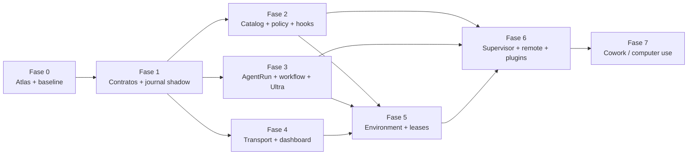
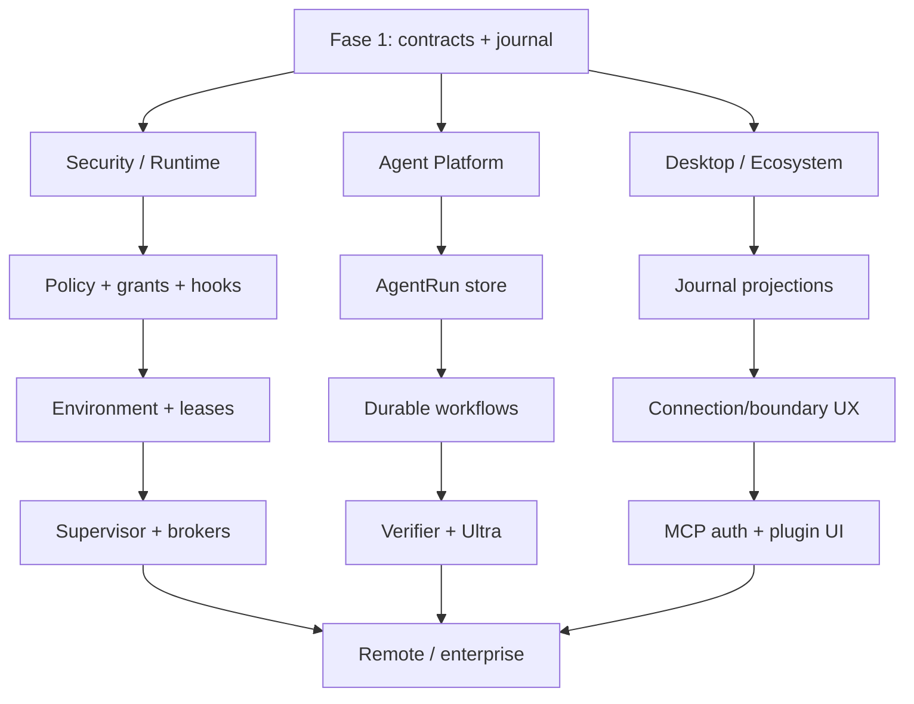

# 15 — Roadmap, fases e gates

## Objetivo

Este roadmap ordena a convergência sem transformar a arquitetura-alvo em uma reescrita única. Cada fase:

- preserva o caminho atual até os gates passarem;
- introduz contratos antes de enforcement;
- usa mirror/shadow/dual-read antes de cutover;
- possui rollback compatível com migrations;
- abre planos de implementação menores, com escopo e métricas próprios;
- não usa claims de eficácia como critério sem benchmark.

## 1. Estado inicial

### Ativos já presentes

- BT runner declarativo com recovery, compactação e reconciliation: `codestudio_mcp-codebase/packages/code-agent/src/core/runner/orchestrator.ts:73-87`, `codestudio_mcp-codebase/packages/code-agent/src/core/runner/orchestrator.ts:118-282`.
- Tool descriptor, registry, tiers, policy e nested dispatch: `codestudio_mcp-codebase/packages/code-agent/src/core/tool.ts:59-180`, `codestudio_mcp-codebase/packages/code-agent/src/core/registry.ts:48-95`, `codestudio_mcp-codebase/packages/code-agent/src/tools/code-exec.ts:611-830`.
- Subagentes especializados, background, workflow DAG e Company Mode: `codestudio_mcp-codebase/packages/code-agent/src/tools/spawn-agent.ts:106-175`, `codestudio_mcp-codebase/packages/code-agent/src/tools/workflow/workflow-run.ts:26-125`.
- SSE com backpressure, replay bounded e renderer FIFO: `codestudio_mcp-codebase/apps/http-api/sse/pumpBusToSSE.ts:38-118`, `codestudio_mcp-codebase/apps/dashboard/hooks/agent-stream/openStream.ts:295-360`.
- Memória estruturada e durable compaction checkpoint: `codestudio_mcp-codebase/docs/memory-system.md:1-45`, `codestudio_mcp-codebase/packages/code-agent/src/index.ts:3312-3358`.

### Gaps fundacionais

- command ledger idempotente após restart;
- journal canônico para lifecycle crítico;
- `PolicyDecision` unificado com `ask` e resource constraints;
- AgentRun/workflow resume durável;
- Environment/WorkspaceLease como autoridade;
- shell scope fail-closed;
- requested/effective preset/model/effort;
- supervisor e remote contracts comuns.

## 2. Sequência macro

### Dependências obrigatórias

- Fase 1 precede qualquer cutover: sem identidade/eventos duráveis, não há recovery auditável.
- Fase 2 precede execução remota/plugin hostil: autorização deve sobreviver ao boundary.
- Fase 3 precede background/workflow crash-resume: AgentRun é a unidade durável.
- Fase 5 precede default de implementer isolado: lease precisa ser enforceable em filesystem e shell.
- Fase 6 precede computer use: processos, credentials e remote trust precisam de supervisor/broker.

## 3. Estratégia de rollout

### Estágios padrão

1. **Contract-only** — tipos/adapters/tests, sem write ou behavior change.
2. **Mirror write** — caminho atual executa; novo store recebe cópia.
3. **Shadow compare** — nova decisão/projeção é calculada e comparada, mas não aplicada.
4. **Internal cohort** — leitura/enforcement novo para sessões internas, com fallback.
5. **Opt-in** — usuários/projetos escolhem o caminho novo.
6. **Default-on with escape hatch** — novo path por default, flag de rollback ativa.
7. **Retirement** — path antigo removido após janela de compatibilidade e migration audit.

### Regras de rollback

- Rollback nunca exige downgrade destrutivo de schema.
- Writers novos usam versões/colunas/tabelas aditivas até o cutover estabilizar.
- Readers antigos ignoram campos/eventos novos.
- Feature flag desliga read/enforcement novo; mirror data permanece para diagnóstico.
- Event schemas são append-compatible; evento desconhecido não quebra projection antiga.
- Um gate falho interrompe promoção, não exige apagar evidência shadow.

## 4. Fase 0 — Atlas, baseline e eval design

### Resultado

- Corpus documental versionado e auditável.
- Matriz com marcadores canônicos `preserve CodeStudio`, `adapt ClaudeOpen`, `merge`, `reject`, `benchmark first` e `unknown`.
- Traces, contratos-alvo, riscos e benchmark plan.
- Baseline sem mudanças funcionais.

### Entregas

- [00-scope-provenance-method.md](./00-scope-provenance-method.md) a [17-risk-register-open-questions.md](./17-risk-register-open-questions.md).
- [DECISIONS.md](./DECISIONS.md).
- [EVIDENCE_INDEX.md](./EVIDENCE_INDEX.md).

### Gate de saída

- Toda claim importante possui evidência ou `ABSENT_FROM_SNAPSHOT`.
- Toda hipótese possui métrica futura.
- Nenhuma alteração fora da pasta documental.
- Links/citações/escopo/diff passam na auditoria.

### Rollback

Remover a pasta nova; nenhum runtime/schema foi alterado.

---

## 5. Fase 1 — Contratos compartilhados e journal em shadow mode

### Objetivo

Introduzir identidade, idempotência e lifecycle durável sem mudar o resultado do runner atual.

### Escopo

#### 1A — Contract package

- `SessionCommand`, `SessionCommandResult`;
- `AgentRunSpec`, `AgentRun`, `AgentRunAttempt`;
- `RuntimeEventEnvelopeV1`;
- IDs opacos e `legacyRefs`;
- event type registry/schema versioning;
- redaction metadata;
- projection cursor.

#### 1B — Command ledger

- Persistir command ID, idempotency key, payload hash, actor, status e result ref.
- Adaptar `client_msg_id` para o contract sem remover o fast path atual.
- Rejeitar key reutilizada com payload diferente.
- Definir session version/optimistic concurrency.

O fast path atual é process-local, TTL/LRU e baseado em WeakRef: `codestudio_mcp-codebase/apps/http-api/server/routes/recent-message-keys.ts:5-34`, `codestudio_mcp-codebase/apps/http-api/server/routes/recent-message-keys.ts:46-104`.

#### 1C — Runtime journal shadow

- Append de classes A–C definidas em [14-target-control-plane-contracts.md](./14-target-control-plane-contracts.md).
- Mirror do vocabulário atual de runner/bus.
- Outbox quando command/session DB e journal não compartilham transação.
- Redaction antes do append.
- Payload refs para objetos grandes.
- Runtime log atual permanece separado.

#### 1D — Replay/projection harness

- Rebuild de fixtures para session/run/task/tool/workflow state.
- Cursor por projection/partition.
- Comparador estado atual versus projection shadow.
- Audit export para divergências.

### Não objetivos

- SSE ler do journal.
- Policy nova aplicar enforcement.
- Workflow retomar após restart.
- Persistir token deltas.
- Mudar schema de messages existente além de adapters aditivos.

### Flags propostas

- `CODER_CONTROL_PLANE_SHADOW`;
- `CODER_RUNTIME_JOURNAL_SHADOW`;
- `CODER_COMMAND_LEDGER_SHADOW`;
- `CODER_PROJECTION_COMPARE`.

Os nomes são propostos, não flags existentes.

### Métricas

- journal append latency p50/p95/p99;
- append error rate;
- duplicate event rate;
- command dedupe hit/conflict rate;
- projection lag;
- replay divergence count;
- redaction violations;
- storage bytes/run.

### Gate go/no-go

1. Replay de golden fixtures produz estado determinístico.
2. Evento duplicado é idempotente.
3. Command repetido após process restart retorna outcome existente.
4. Sessions antigas continuam legíveis.
5. Shadow append não aumenta first-token p95 além do budget definido em Fase 16.
6. Nenhum secret/prompt sensível aparece em fixtures do journal.
7. Runtime-event-log continua com sampling/rotation atuais.
8. Kill switch desliga journal write sem impedir run.

### Stop conditions

- divergência sem explicação em terminal/tool side-effect;
- payload impossível de redigir com segurança;
- lock/contention regressa writer/session path;
- migration impede reader antigo.

### Rollback

Desligar mirror/shadow flags. Tabelas/eventos novos permanecem inertes; readers atuais continuam autoridades.

---

## 6. Fase 2 — Capability Catalog, Policy Engine e hooks ordenados

### Objetivo

Unificar descrição, elegibilidade e autorização sem criar um gate paralelo.

### Escopo

#### 2A — Catalog adapter

- Mapear `CoderTool` para `CapabilityDescriptor`.
- Incluir MCP/plugin/server provenance, metadata trust, lifecycle refs e `SideEffectContract`.
- Tratar metadata externa como não confiável: ela nunca reduz classificação local de mutação, risco, network ou secrets.
- Usar postura externa conservadora até override/attestation local versionada.
- Tornar tier obrigatório por registration contract/CI.
- Produzir `ResolvedCapabilitySet` e hash.
- Derivar tool descriptors e prompt summary do mesmo set.

`CoderTool` já possui metadata rica: `codestudio_mcp-codebase/packages/code-agent/src/core/tool.ts:59-180`. Tiers já são visibility, não authority: `codestudio_mcp-codebase/packages/code-agent/src/tools/tiers.ts:627-633`.

#### 2B — Policy adapter shadow

- Agregar regras de `core/policy.ts`, `PermissionGate`, task scopes e environment facts.
- Introduzir `effect: allow | deny | ask`.
- Produzir reason codes, source precedence, constraints e audit.
- Calcular direct, nested, MCP e plugin decisions em shadow.
- Comparar com decisão atual por invocation.

#### 2C — Resource-scoped grants

- Canonicalizar input/resources e validar environment/lease antes da decisão, sem executar o efeito.
- Path/command/network/database/secret/application constraints.
- Vincular approval `once` a decision, tool-use, effective-input hash, capability/policy versions, environment/lease versions, fencing epoch, nonce e expiry.
- Consumir grant `once` atomicamente; replay, concorrência ou mudança de binding exige nova decisão.
- Grants session/timeboxed/persistent revalidam recursos e versões no momento do efeito.
- Duração once/session/timeboxed/persistent.
- Revogação e version compatibility.
- UI/API de approval recebe resource canônico exato.

#### 2D — Hook bus

- Adaptar runtime hooks e project hooks para definitions/stages.
- Separar observation, decision, prompt augmentation e presentation.
- Aplicar ordering e failure policy.
- Tratar `inputPatch` como proposta: validar schema, recalcular hash/binding e reexecutar policy antes de allow/approval final.
- Isolar project/plugin hooks conforme trust.

Runtime hooks atuais têm containment de 5 s: `codestudio_mcp-codebase/packages/code-agent/src/core/hook-registry.ts:64-129`; project hooks usam `node:vm`/200 ms: `codestudio_mcp-codebase/packages/code-agent/src/core/hooks.ts:41-110`.

### Não objetivos

- Remover `ToolRegistry`.
- Remover tiers.
- Ativar grants persistentes automaticamente.
- Executar plugins hostis no processo principal.
- Alterar defaults `ask/auto/unrestricted` antes do shadow gate.

### Flags propostas

- `CODER_CAPABILITY_CATALOG_SHADOW`;
- `CODER_POLICY_ENGINE_SHADOW`;
- `CODER_POLICY_ENGINE_ENFORCE`;
- `CODER_RESOURCE_GRANTS`;
- `CODER_HOOK_BUS_V1`.

### Métricas

- decision agreement rate atual versus shadow;
- critical divergence rate;
- permission prompt rate;
- approval/deny latency;
- grant reuse/revocation rate;
- unclassified capability count;
- prompt/tool capability hash mismatch;
- hook timeout/error rate;
- policy evaluation overhead.

### Gate go/no-go

1. Matriz direct/nested/MCP/plugin produz 100% de equivalência nas regras comuns.
2. Toda divergência crítica é explicada e aceita antes de enforcement.
3. `deny` superior prevalece em tests de precedence.
4. Background converte `ask` em deny estruturado.
5. `inputPatch` inválido não chega ao handler; patch válido muda hash/binding e força nova decisão.
6. Traversal/symlink/command/database/network/secret fixtures passam com binding canônico antes de approval e revalidação imediatamente antes do efeito.
7. Approval `once` alterado, expirado, repetido ou consumido concorrentemente não executa; somente um compare-and-set vence.
8. Nenhuma tool registrada fica sem descriptor/tier no build de release.
9. Servidor MCP/plugin que mente sobre mutabilidade, network, secrets ou idempotência permanece na postura conservadora local.
10. Observation hook falho não altera run; decision hook não contorna managed deny.
11. Policy + binding p95 permanece dentro do budget.

### Rollback

Desligar `ENFORCE`; manter shadow logging. Adapter chama os gates atuais diretamente. Grants novos ficam ignorados, não convertidos automaticamente em old `alwaysAllow` amplo.

---

## 7. Fase 3 — AgentRun durável, workflows e Ultra ortogonal

### Objetivo

Transformar agentes/background/workflows em unidades retomáveis e explicar o preset Ultra por dimensões.

### Escopo

#### 3A — AgentRun store

- Persistir hierarchy, role/profile, requested/effective provider/model/effort e `PresetResolution` versionada para todas as dimensões.
- Persistir capability set, environment/lease refs, status, terminal reason, usage e result refs.
- Attempts com executor lease, heartbeat, expiry, CAS e fencing epoch monotônico.
- Exigir o fencing epoch atual antes de provider call, capability side effect e terminal commit.
- Stop/resume/collect idempotentes.

O resume efêmero atual é explicitamente process-only: `codestudio_mcp-codebase/packages/code-agent/src/tools/subagent-resume-registry.ts:1-15`.

#### 3B — Foreground/background unification

- `waitMode` só controla o caller.
- Mesmo lifecycle, policy, events e result store.
- Background job manager vira executor adapter/cache.
- Parent parking continua funcional: `codestudio_mcp-codebase/packages/code-agent/src/core/runner/orchestrator.ts:210-230`.

#### 3C — Durable workflow

- Persistir DAG/version/steps/attempts/result refs.
- Derivar readiness/skip do store.
- Completed steps nunca relançados por restart.
- Bounded dependency digests preservados.
- Workflow events journaled/versioned.

#### 3D — Verifier policy

- Selective verifier por risk/claim type dentro do lifecycle comum do `AgentRun`, antes do terminal persistido.
- Foreground/background diferem apenas no wait/handle; ambos observam o mesmo verifier/result lifecycle.
- Modelo/capability set independente quando configurado.
- Read-only, sem inherited conclusions como facts.
- Resultado confirmed/rejected/uncertain.

#### 3E — UltraPreset v2

- Separar effort, scheduler, parallelism, depth, verifier, background, durability e isolation.
- Persistir requested/effective dimensions e downgrade reasons.
- Adaptar sticky Ultra e keyword `ultracode` como compatibilidade.
- Default behavior permanece igual inicialmente.

ClaudeOpen persiste `xhigh` e workflow flag separadamente: `claudeopen/claude-code-src/agent/workflow.js:9027-9054`. CodeStudio já separa execution mode/keyword de provider controls no host: `codestudio_mcp-codebase/packages/code-agent/src/sessions/execution-mode.ts:15-45`.

### Não objetivos

- Ativar fan-out geral por default.
- Tornar todo run verificável por segundo modelo.
- Introduzir remote execution.
- Resolver shell isolation antes da Fase 5.
- Migrar Company Mode para uma implementação menor; apenas compartilhar contracts.

### Flags propostas

- `CODER_AGENT_RUN_STORE_SHADOW`;
- `CODER_AGENT_RUN_STORE_READ`;
- `CODER_DURABLE_WORKFLOWS`;
- `CODER_AGENT_FOREGROUND_BACKGROUND_V1`;
- `CODER_VERIFIER_POLICY_V1`;
- `CODER_ULTRA_PRESET_V2`.

### Métricas

- resume success após restart;
- duplicate side-effect rate;
- AgentRun terminalization completeness;
- orphan attempt count;
- workflow step rerun count;
- useful-result rate por subagente;
- verifier precision/recall/uncertain rate;
- Ultra task success/latency/tokens/cost por dimensão;
- downgrade frequency/reason.

### Gate go/no-go

1. Crash/restart retoma AgentRun com uma única executor lease vigente; owner antigo que reaparece com epoch stale falha antes de provider/tool/terminal side effect.
2. Completed result retorna sem reexecutar; efeito com ACK perdido usa probe/reconciliation ou `outcome_unknown`, nunca retry por suposição.
3. Workflow restart não repete step completed.
4. Foreground/background fixture gera lifecycle e verifier equivalentes; muda apenas wait/detach.
5. Company subordinate continua funcional sob os IDs/adapters novos.
6. Unsupported dimension do preset gera downgrade ou deny explícito, e requested/effective resolution completa permanece auditável.
7. Fan-out só ocorre para steps independentes validados.
8. Verifier não recebe writes.
9. Benefit/cost de verifier e Ultra passa o benchmark definido.
10. Matriz de rollback cobre runs `queued/running/waiting/completed`; outputs novos continuam visíveis por dual-write/backprojection ou o novo reader permanece até drain.

### Rollback

Enquanto houver escape hatch, writers mantêm dual-write ou backprojection para stores/resultados legíveis pelo path anterior. Rollback planejado bloqueia novos launches no path novo, fenceia/draina runs ativos e só então troca readers; completed outputs são projetados antes do cutover. Se backprojection de um estado não for segura, mantém-se o novo reader somente para esses runs até terminal — não se declara rollback concluído. `spawn_agent`, workflow registry, Company e keyword/preset antigos continuam disponíveis por adapters; AgentRun rows permanecem como audit shadow após o drain.

---

## 8. Fase 4 — Session transport e dashboard observável

### Objetivo

Projetar estado durable no transporte e tornar boundaries operacionais compreensíveis, preservando o live path robusto.

### Escopo

#### 4A — SSE projection do journal

- Cursor durable `eventId/globalSeq` e cursor live `busId/seq` coexistem.
- Attach após restart lê projection/journal quando bus não existe.
- Replay loss/gap é explícito.
- Slow-consumer policy e queue cap observáveis.
- POST usa command ledger, não apenas WeakRef/TTL.

#### 4B — Coder connection phases

- Reusar `connecting/replaying/live/disconnected` já suportados pelo client/Company.
- Acrescentar `degraded/persisting/durable/interrupted/completed` como domain phases, não transport aliases.
- Não confundir EOF com terminal.

Company já projeta `onPhase`: `codestudio_mcp-codebase/apps/dashboard/hooks/useCompanyStream.ts:535-547`; coder `openStream` ainda não passa `onPhase`: `codestudio_mcp-codebase/apps/dashboard/hooks/agent-stream/openStream.ts:330-347`.

#### 4C — Operational metadata

- Mostrar target, cwd, branch, owner, parent, lease, requested/effective model/effort/preset.
- Explicar approval rule/resource/duration.
- Mostrar reconnect/replay/projection lag/drops.
- Diferenciar provider complete, transcript durable, run terminal e terminal-quality pending.

#### 4D — Replay optimization

- E2E Electron do attach trim atual.
- Comparar full versus trimmed versus journal-backed replay.
- Manter renderer FIFO/rAF batching.

Attach trim permanece opt-in após incidente: `codestudio_mcp-codebase/apps/http-api/coder-bus.ts:299-379`.

### Não objetivos

- Substituir SSE por WebSocket.
- Remover bus live.
- Mostrar raw prompts/secrets/hidden reasoning.
- Persistir every token.
- Ativar replay trim antes do E2E gate.

### Flags propostas

- `CODER_SSE_FROM_JOURNAL`;
- `CODER_CODER_CONNECTION_PHASES`;
- `CODER_RUNTIME_BOUNDARY_UI`;
- flag atual `CODER_ATTACH_REPLAY_TRIM` permanece;
- `CODER_DURABLE_CURSOR`.

### Métricas

- first-token latency;
- inter-token gap/jitter;
- reconnect recovery time;
- replay loss/duplicate rate;
- queue depth/long-task duration;
- projection lag;
- session open time;
- stale transcript refetch incidents;
- user-visible “stuck” reports;
- memory per live run.

### Gate go/no-go

1. Electron E2E: attach mid-run, continue, session switch e reconnect.
2. Disconnect em cada boundary sem duplicação de side effects.
3. Bus eviction/restart recupera state durable.
4. Slow consumer não aumenta memória sem bound.
5. Terminal refetch contém último assistant/tool pair.
6. UI mostra interrupted em worker crash, não completed.
7. Connection phases não piscam/regredem accessibility.
8. Attach trim ou journal replay não perde interactive/task/agent/workflow state.
9. Kill switch volta ao bus replay atual.

### Rollback

SSE volta a ler o bus atual. Connection UI nova pode ser escondida por flag. Journal/projections continuam shadow.

---

## 9. Fase 5 — Execution Environment, leases, sandbox, network e secrets

### Objetivo

Tornar host/worktree/container/remote destinos de um contrato comum e fechar escapes entre filesystem, shell, Git e tools.

### Escopo

#### 5A — Environment adapters

- Host, worktree e sandbox implementam `ExecutionEnvironmentRef`.
- Root/cwd/branch/base revision/runtime/network/secret refs.
- Health/provision/release/status.

#### 5B — Workspace Lease

- Read-only versus exclusive-write.
- Owner AgentRun, heartbeat, expiry e orphan recovery.
- Dirty state e cleanup policy.
- UI/journal projection.

#### 5C — Port enforcement

- Filesystem, shell, Git, terminal e plugin adapters usam environment/lease.
- Path canonicalization, symlink/junction policy e traversal tests.
- `run_command` deixa de ser warning-only para implement scopes.
- Missing required lease/sandbox fail closed.

O fence atual cobre apenas cinco write tools nativas; shell permanece warning-only: `codestudio_mcp-codebase/packages/code-agent/src/tools/implement-subagent.ts:1287-1345`.

#### 5D — Network/secret brokers

- Egress por domain/method profile.
- Secret handles, nunca valores em prompt/journal.
- Just-in-time injection por capability/environment.
- Revogação e audit.

#### 5E — Default isolation cohort

- Implement AgentRuns adquirem worktree lease por default em cohort.
- Read-only agents podem compartilhar read lease.
- Retention on failure preserva diff.

### Não objetivos

- Remote fleet geral antes da Fase 6.
- Computer use.
- Exigir container para toda read tool.
- Commit automático.
- Apagar worktree sujo sem ação explícita.

### Flags propostas

- `CODER_EXECUTION_ENVIRONMENTS_V1`;
- `CODER_WORKSPACE_LEASES_SHADOW`;
- `CODER_WORKSPACE_LEASES_ENFORCE`;
- `CODER_IMPLEMENT_WORKTREE_DEFAULT`;
- `CODER_SHELL_SCOPE_ENFORCE`;
- `CODER_NETWORK_BROKER`;
- `CODER_SECRET_BROKER`.

### Métricas

- lease acquisition p95;
- collision/refusal rate;
- orphan lease count/recovery time;
- shell/path escape attempts;
- environment provision/release failure;
- dirty worktree retention/removal rate;
- secret exposure findings;
- network deny/approval rate;
- task latency overhead.

### Gate go/no-go

1. Dois writers nunca usam o mesmo checkout/lease.
2. Shell, filesystem, Git e terminal veem o mesmo cwd/root.
3. Traversal, symlink, junction, absolute paths e child processes não escapam.
4. Missing lease/sandbox falha fechado.
5. Dirty worktree não é perdido sem explicit policy/action.
6. Crash recupera/expira lease idempotentemente.
7. Secrets não aparecem em prompt, journal, tool result ou process listing permitido.
8. Egress não autorizado é negado.
9. Latency overhead permanece dentro do budget.
10. Rollback funcional volta à seleção manual de worktree sem remover artifacts, mas nunca reabre mutação sem shell/path/lease fence.

### Rollback

Separar rollback funcional de rollback de segurança. É permitido desligar o default automático de worktree, mantendo enforcement de scope/lease. Se o próprio enforcement precisar ser desligado por incidente, o kill switch bloqueia novos `AgentRun` mutantes e faz shell/filesystem/Git fail closed até um fence seguro substituto estar ativo; não retorna ao baseline warning-only. Worktrees já criadas são preservadas conforme cleanup policy, nunca removidas por rollback automático.

---

## 10. Fase 6 — Supervisor, remote sessions, plugins e enterprise

### Objetivo

Estender os contratos para processes/hosts/remotes não confiáveis sem exportar autoridade ou credentials implícitas.

### Escopo

#### 6A — Process Supervisor

- Provider host, plugin host, MCP host, PTY, coder/index workers.
- Heartbeat, bounded restart/backoff, crash-loop quarantine.
- Ownership por session/run/environment.
- Crash terminalization/recovery pelo journal.

#### 6B — Remote session commands

- `start/attach/resume/fork/handoff/stop` usam `SessionCommand`.
- Remote executor recebe AgentRunSpec resolvido e handles mínimos.
- Command/event idempotency cross-host.
- Offline/reconnect/reconciliation.

#### 6C — Plugin contract

- Manifest assinado/provenance/version.
- Declara capabilities, hooks, network/secrets e environment requirements.
- Capability Catalog/Policy Engine controlam acesso.
- Isolated plugin host por trust.

#### 6D — Managed/enterprise policy

- Organization policy version/signature.
- Managed denies, approved catalogs, grant limits, audit export.
- Data residency/retention por event/memory class.

#### 6E — Updater seguro

- Pacote assinado.
- Checkpoint/drain antes do update.
- Rollback de binary independente de schema aditivo.
- Sessão interrupted/recoverable em forced restart.

### Não objetivos

- Expor DB/local filesystem ao remote host sem broker.
- Enviar API keys duráveis para AgentRun.
- Permitir plugin não declarado herdar registry completo.
- Computer use antes da Fase 7.

### Flags propostas

- `CODER_PROCESS_SUPERVISOR_V1`;
- `CODER_REMOTE_SESSION_COMMANDS`;
- `CODER_REMOTE_AGENT_RUNS`;
- `CODER_PLUGIN_HOST_V1`;
- `CODER_MANAGED_POLICY_V1`;
- `CODER_SIGNED_UPDATER_V1`.

### Métricas

- crash recovery success/time;
- restart-loop/quarantine count;
- remote command duplicate rate;
- event reconciliation divergence;
- credential exposure findings;
- plugin capability violation rate;
- remote first-token/round-trip latency;
- update success/rollback rate.

### Gate go/no-go

1. Crash de process não perde turn já persistido.
2. Accepted run sem executor reaparece como interrupted/recoverable.
3. Remote command retry é idempotente; efeito não idempotente ou com outcome ambíguo nunca é reexecutado automaticamente e converge para probe/reconciliation ou `outcome_unknown`.
4. Remote executor não recebe credential durável.
5. Plugin sem capability declarada é bloqueado.
6. Managed deny prevalece local/remoto/nested.
7. Crash loop é bounded/quarantined.
8. Offline/reconnect reconcilia cursors/result.
9. Signed update verifica pacote e preserva checkpoint.
10. Rollback binary lê schemas/events aditivos.

### Rollback

Rollback planejado bloqueia novos remote/plugin launches, drena ou fenceia attempts e então retorna ao local runner/worker-pool adapter. Emergency kill fenceia attempts por epoch e revoga grants, credentials e handles remotos imediatamente; preserva somente artifacts inertes e evidência para reconciliation posterior. Nenhuma autoridade remota continua ativa em nome de cleanup.

---

## 11. Fase 7 — Cowork / computer use

### Objetivo

Adicionar screenshot/click/type como capabilities host-owned somente após policy, environment, supervision e secrets estarem maduros.

### Escopo

- Broker de screenshot, mouse, keyboard e app focus.
- Grants por application/window/operation/duration.
- Foreground confirmation para ações de alto impacto.
- Window identity e invalidation quando foco muda.
- Clipboard e credential fields como capabilities separadas.
- Visual state hashing para evitar ações em janela stale.
- Redaction de screenshots e audit refs.
- Sandbox/remote desktop target explícito.

### Evidência e limite

O snapshot Desktop confirma presença de VM/Cowork dispatch, mas não inclui o backend remoto nem garantias completas: `claudeopen/asar-src/README.md:16-25`. Portanto, esta fase é produto/threat-model próprio, não “copiar ClaudeOpen”.

### Não objetivos

- Bypass geral de permissões.
- Clipboard/credentials implícitos.
- Controle de janela não identificada.
- Ações irreversíveis sem confirmation/policy.
- Lançar antes de red-team específico.

### Flags propostas

- `CODER_COMPUTER_USE_BROKER`;
- `CODER_COMPUTER_USE_SCREENSHOT`;
- `CODER_COMPUTER_USE_INPUT`;
- `CODER_COMPUTER_USE_CLIPBOARD`.

### Gate go/no-go

1. Sem grant não há captura/input.
2. Grant expira/é invalidado por troca de window/app.
3. Credential fields/clipboard não são lidos por default.
4. Screenshot redaction impede secrets definidos no threat model.
5. Ação usa visual/window version recente.
6. Broker process crash revoga handles.
7. Audit não armazena pixels sensíveis sem retention grant.
8. Red-team de focus-stealing, overlay, prompt injection visual e exfiltration passa.

### Rollback

Desligar broker; revogar grants/handles; nenhuma capability de input é exposta ao runner.

## 12. Trilhas paralelas após a Fase 1

### Trilha Security / Runtime

Owner sugerido: runtime/security platform.

- Policy Engine;
- resource grants;
- hook isolation;
- environment/leases;
- network/secrets;
- supervisor.

### Trilha Agent Platform

Owner sugerido: agent runtime/orchestration.

- AgentRun/attempt;
- foreground/background;
- durable workflow;
- verifier selection;
- UltraPreset;
- handoff.

### Trilha Desktop / Ecosystem

Owner sugerido: desktop/API/platform integration.

- SSE/journal projections;
- operational UX;
- MCP OAuth/status;
- plugin/skill catalog;
- remote controls.

### Coordenação

- Contracts e event schemas exigem revisão cruzada.
- Cada trilha mantém flags próprias, mas compartilha correlation IDs/benchmarks.
- Nenhuma trilha altera semantics de outra por projection side effect.

## 13. Primeiras quatro entregas funcionais recomendadas

Cada item deve receber um plano aprovado separado.

### Entrega 1 — Runtime journal shadow mínimo

**Escopo mínimo:** command/run/tool/terminal lifecycle para coder local; sem SSE read.

**Arquivos prováveis:** contract package, store migration, runner/bus mirror adapter, replay tests.

**Gate:** deterministic fixture replay + zero behavior delta.

**Por que primeiro:** dá causalidade e recovery evidence às fases seguintes.

### Entrega 2 — Capability + Policy shadow para file/shell

**Escopo mínimo:** `read_file`, write tools nativas e `run_command`; direct + `code_exec` nested.

**Gate:** 100% agreement ou divergências aprovadas; traversal/shell fixtures.

**Por que segundo:** ataca o gap mais concreto de policy/shell sem migrar todo catálogo.

### Entrega 3 — Durable AgentRun para background ephemeral

**Escopo mínimo:** um background microagente read-only; create/status/result/restart recovery.

**Gate:** restart + concurrent resume + no duplicate result.

**Por que terceiro:** prova a entidade comum com baixo risco de filesystem mutation.

### Entrega 4 — Coder connection/boundary UX

**Escopo mínimo:** conectar `onPhase`, mostrar replay/disconnected/interrupted e transcript durable boundary.

**Gate:** Electron attach/reconnect E2E; accessibility e no flicker.

**Por que quarto:** melhora percepção/diagnóstico usando mecanismos já existentes, sem esperar remote.

## 14. Critérios para abrir um plano de implementação

Um plano futuro só deve ser submetido quando:

1. o contract/version correspondente estiver decidido;
2. owner bounded context e files prováveis estiverem localizados;
3. migration/backfill/reader compatibility estiverem descritos;
4. flag de rollout e rollback estiver definida;
5. baseline benchmark/telemetry existir;
6. threat model existir quando tocar policy/environment/remote/secrets;
7. fixtures e acceptance gates estiverem escritos;
8. dependências de fase tiverem passado;
9. o escopo puder ser revertido sem reescrever a engine;
10. não houver fork de arquitetura pendente.

## 15. Gates globais de promoção

### Segurança

- zero bypass crítico conhecido;
- deny precedence coberta;
- secret/redaction scan limpo;
- background/non-interactive behavior correto;
- sandbox/lease fail-closed quando obrigatório.

### Durabilidade

- command/run/step terminalization completa;
- replay idempotente;
- crash/restart suite passa;
- duplicate side effects dentro do threshold zero para fixtures críticas.

### Eficácia

- task success não regride além da margem definida;
- tool-selection error não aumenta;
- verifier/fan-out/Ultra só promovidos com ganho causal/custo aceitável.

### Performance

- first-token, inter-token, policy e append overhead dentro dos budgets;
- memory/storage bounded;
- renderer long tasks/reconnect time dentro do alvo.

### Compatibilidade

- sessions antigas abrem;
- Company/indexer/RAG/skills/plugins permanecem funcionais;
- prompt cache não sofre regressão não explicada;
- kill switch comprovado em staging.

## 16. Critérios de pausa ou reversão

Pausar promoção quando ocorrer qualquer um:

- side effect duplicado;
- unauthorized capability execution;
- secret em journal/prompt/log;
- AgentRun/workflow terminal perdido;
- shell/path escape;
- projection mostra completed quando truth é interrupted;
- migration torna reader anterior incapaz de abrir sessão;
- prompt-cache hit ratio cai acima do budget;
- first-token p95 ou cost/task ultrapassa stop threshold;
- verifier aumenta falso positivo acima do limite;
- remote/plugin process recebe authority não declarada.

## 17. Definição de conclusão do programa

O programa não termina quando “parece Claude”. Ele termina quando:

1. os contratos de [14-target-control-plane-contracts.md](./14-target-control-plane-contracts.md) estão implementados/versionados ou explicitamente rejeitados;
2. os traces de [13-end-to-end-traces.md](./13-end-to-end-traces.md) passam localmente e nos targets suportados;
3. o benchmark de [16-evaluation-benchmark-plan.md](./16-evaluation-benchmark-plan.md) sustenta as claims promovidas;
4. os riscos P0/P1 de [17-risk-register-open-questions.md](./17-risk-register-open-questions.md) estão mitigados/aceitos;
5. as superioridades do CodeStudio listadas em [12-capability-parity-matrix.md](./12-capability-parity-matrix.md) não regrediram;
6. paths antigos foram removidos somente após janela de rollback e evidence de compatibilidade.
