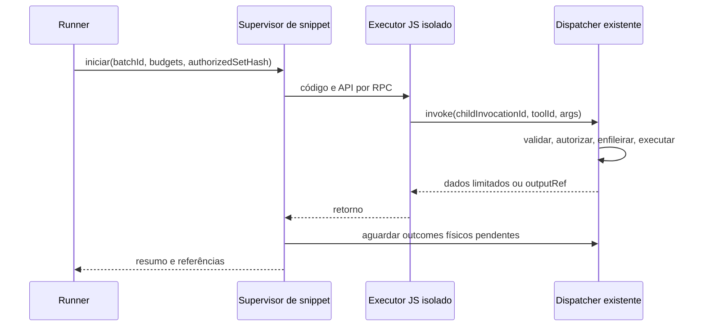

# 04 — code_exec, comandos e processos

## 1. Estado atual e evidências

Baseline e escopo: [README](./README.md). Caminhos abaixo são relativos a `D:\MCP`; linhas referem-se ao baseline.

| Evidência | Implementação atual | Consequência |
|---|---|---|
| `packages/code-agent/src/tools/code-exec.ts:58-65` | Orçamento JS de 10 s, máximo 30 s, teto de parede 35 min, 50 chamadas, quatro leituras concorrentes | Há limites reais; não propor simplesmente “adicionar timeout/paralelismo”. |
| `code-exec.ts:349-361,720,980-1048` | Snapshot do registry, política por chamada, autoridade nested, permit físico e bloqueio de efeito desconhecido | Preservar essas garantias durante extração do executor. |
| `code-exec-concurrency.ts:1-66` | Fila FIFO, batches de leitura, barreira exclusiva e permit até fim físico | Concorrência já é conservadora; comparar ganhos sem desativar barreiras. |
| `code-exec.ts:1007-1043` | `structuredData` vira JSON string; retorno ao script permanece string | Composição exige parse e pode perder distinção entre texto e dado. |
| `code-exec.ts:384,636,1410,1570` | Outcomes retêm conteúdo; JSON do retorno é serializado antes do finalizador central | O limite de console não é orçamento total do batch; medir cópias e limitar antes da materialização. |
| `code-exec.ts:1446-1450` | `runInNewContext` com timeout síncrono, sem isolamento próprio do snippet | Loops após `await` precisam de prova de interrupção externa. Não foi executado um hang contra o app. |
| `exec-command.ts:136-160,443-459,623` | TTL oportunista; exceder 16 sessões pode descartar processo rodando; dispose/abort local mata handle direto | Há risco de filhos sobreviverem e falta de confirmação física do término nessas rotas. Shutdown já usa tree kill em `:863-869`. |
| `exec-command.ts:325-348` | Buffer head/tail descarta meio e declara `recoverable:false` | O sistema é honesto, mas não permite recuperar logs completos quando necessário. |
| `exec-command.ts:546-578,585` | Handler lê `max_output_tokens`, ausente no schema, aplicando limite em caracteres | Contrato não corresponde ao consumidor e unidade é ambígua. |
| `exec-command.ts:394-410,479`; `ports/shell-port.ts:191-200` | Persistente usa cmd/sh; one-shot usa cmd/bash; persistente marca fim no evento `exit` | Mesma linha pode ter semânticas diferentes; testar drain até fechamento dos streams. |

Referências abreviadas da tabela pertencem a `packages/code-agent/src/tools/`, exceto `ports/shell-port.ts`, em `packages/code-agent/src/ports/`.

A documentação oficial explica que tarefas assíncronas podem escapar do timeout de `node:vm` e que `microtaskMode` altera a interação entre promises de contextos. Portanto, adicionar essa opção sem validar os proxies assíncronos não basta. `vm` tampouco constitui uma fronteira de segurança. A necessidade de um supervisor externo é uma decisão desta spec baseada nessas limitações e no código atual. [Node.js — VM](https://nodejs.org/api/vm.html#timeout-interactions-with-asynchronous-tasks-and-promises).

## 2. Requisitos obrigatórios

| ID | Requisito | Aceite observável |
|---|---|---|
| EXE-01 | Uma autoridade de dispatch para chamada direta e nested | Mesmos argumentos normalizados produzem mesma autorização, fence, classificação e política de timeout/outcome; deadline efetivo nested pode ser menor pelo saldo do pai. |
| EXE-02 | API estruturada opt-in para composição | Resultado JSON chega como objeto, sem parsing da prosa; chamadas legadas ainda retornam string. |
| EXE-03 | Interrupção física do snippet independente do event loop dele | Loop síncrono, loop após await e loop de microtasks encerram sob watchdog externo sem perder o agente inteiro. |
| EXE-04 | Budgets de aquisição e memória do batch | Resultado gigante, fan-out e retorno cíclico falham de forma tipada ou geram referência sem OOM do host. |
| EXE-05 | Scheduler compartilhado por domínio de recurso | Leituras compatíveis paralelizam; mutações conflitantes e efeitos desconhecidos mantêm bloqueio até reconciliação. |
| EXE-06 | Modelo explícito de comando: argv ou shell nomeado | Windows e POSIX passam espaços, Unicode e metacaracteres sem reinterpretação acidental. |
| EXE-07 | Processo pertence a sessão/run e tem ciclo de vida confirmado | Cancel, timeout, TTL e shutdown encerram somente árvore possuída e registram resultado do cleanup. |
| EXE-08 | Separar espera, input e término de processo | Poll vazio é leitura; enviar stdin é execução; parada tem operação própria e recibo. |
| EXE-09 | Saída incremental recuperável quando habilitada | Offset/cursor não duplica bytes; spool quota/expiração são explícitos; `recoverable` só é verdadeiro com artefato íntegro. |
| EXE-10 | Contrato e descrição refletem o runtime | Unidades de timeout/output, shell efetivo, estado e códigos são testados através do schema público. |
| EXE-11 | Recovery não revive comandos automaticamente | Após crash, reconciliar proprietário/árvore/resultado; não relançar comando de efeito desconhecido. |
| EXE-12 | Empacotamento e adapters têm paridade | Pipe/PTY/local/adapters passam o mesmo corpus compatível no executável distribuído. |

## 3. Arquitetura proposta para code_exec

Separar o interpretador de JS da autoridade das ferramentas. O processo que controla o agente mantém autorização, registry, ledger, fences, scheduler, output store e execução das ferramentas. Um executor descartável recebe somente código, descritores permitidos e handles limitados. Pedidos de tools atravessam um RPC versionado e validado.



Escolha inicial: **processo descartável supervisionado para o snippet**, com launcher compatível com o empacotamento Electron/Node. Reusar infraestrutura de lifecycle e shutdown; não introduzir outro agent runtime. O spike F0 mede custo de startup e valida o launcher dentro do ASAR. Um worker dedicado só substitui essa escolha mediante evidência de interrupção e contenção de memória equivalentes para os casos suportados. `resourceLimits` de heap, sozinho, não é prova de limite total de RSS.

O supervisor não fica no mesmo event loop do script. Encerrar o executor JS não encerra silenciosamente uma ferramenta que ele já disparou. O dispatcher mantém seu registro e reconcilia o efeito; nenhuma mutação pendente é repetida para “recuperar” o batch.

Não compartilhar objetos do host, funções privilegiadas, streams, DB handles ou tokens. O processo isolado não recebe credenciais de providers nem herda ambiente completo. Essa separação é para disponibilidade e delimitação de autoridade; sandbox de segurança para executar código arbitrário de terceiros exige decisão e testes próprios, fora da promessa atual.

### API compatível

Manter `tools.nome(args) -> Promise<string>`, aliases existentes, `attempt`, `stash`, `change` e `tool_schema` durante migração. Adicionar, por versão da API do snippet:

```ts
// Proposta; não é API implementada neste baseline.
invoke({ name, args, result: 'structured' }): Promise<{
  text: string;
  data?: unknown;
  effectOutcome?: 'unknown';
  outputRef?: string;
  completeness: 'complete' | 'partial';
}>;
```

Erros continuam lançando exceção tipada. `attempt` captura somente falhas esperadas de probe; não neutraliza recusa, cancelamento, timeout ou efeito desconhecido. `data` nunca depende de extrair JSON de `text`. Schema de saída inválido produz erro/referência diagnóstica conforme [06](./06-contratos-e-observabilidade.md), sem declarar sucesso de validação.

`list_tools` ganha filtros, paginação e retorno resumido. `tool_schema` permite inspeção pontual, com orçamento. Aumentar superfície descoberta não aumenta conjunto autorizado nem torna ferramentas interativas executáveis dentro do snippet.

### Budgets e fases

Separar `queueMs`, `scriptActiveMs`, `toolExecutionMs`, `batchWallMs` e `cleanupMs`. Budget ativo pausa somente quando o snippet está suspenso aguardando I/O; uma tool em voo sem await não suspende cobrança do JS que continua executando. Watchdog de parede permanece ativo. O deadline de cada tool é o menor entre seu teto autorizado e o restante do orçamento aplicável, sem reiniciar relógio em retries.

Manter inicialmente quatro leituras simultâneas e 50 invocações como teto compatível. O scheduler central também limita por servidor MCP, projeto, pool DB e sessão. Não multiplicar o teto por subagente sem orçamento agregado.

Proposta inicial para o spike: 128 MiB de heap do executor, 16 MiB de dados acumulados transferidos ao snippet por batch e inline limitado pelo orçamento atual do provider. São budgets experimentais, revisados em F0. Valores necessários a casos maiores são perfis limitados e explícitos, não `Infinity`. Memória total, buffers externos e overhead Electron entram na medição separadamente.

Outcomes retêm metadados, hashes e referências, não N cópias completas dos resultados. Serialização tem limites de profundidade, itens e bytes; ciclos e tipos não serializáveis produzem erro claro. Spool deve começar no produtor quando possível, pois reduzir após `JSON.stringify` não evita a alocação original.

## 4. Comandos e sessões

### Contrato de entrada

Evoluir o port de comandos existente e seus adapters, preservando os nomes públicos:

```ts
type CommandSpec =
  | { mode: 'argv'; executable: string; args: string[]; cwd: string }
  | { mode: 'shell'; shell: 'cmd' | 'powershell' | 'pwsh' | 'sh' | 'bash'; script: string; cwd: string };

type CommandBudgets = {
  yieldMs: number;
  wallTimeoutMs?: number;
  maxInlineBytes: number;
  maxSpoolBytes: number;
};
```

O default de chamadas legadas permanece documentado; a UI e o resultado informam shell/resolução efetivos. `argv` não passa por shell. Windows `.cmd/.bat` requer adapter explícito, não conversão silenciosa de argumentos para linha. Cwd usa resolução e permissões atuais, inclusive worktrees. Valores de env são allowlisted/redigidos; nunca devolver ambiente completo.

Corrigir `max_output_tokens`: alias legado recebe conversão documentada e depreciação; o contrato novo usa bytes para aquisição e caracteres/tokens somente para projeção final. Schema e handler devem concordar. Não apresentar um contador de caracteres como tokens exatos.

### Estados e operações

```text
created -> starting -> running -> exit_observed -> draining -> completed
                       |                      |
                       +-> cancelling --------+-> terminated
                       +-> lost/unknown (recovery necessário)
```

`exit` não significa que stdout/stderr foram drenados. Pipe conclui após `close` e drain limitado. PTY usa o sinal terminal disponível, com flush e teste equivalente. Resultado contém `executionId`, owner, `status`, `exitCode`, `signal`, tempos, `nextCursor`, truncamento e estado do cleanup. Comando que sai com código não zero não deve parecer sucesso da tarefa, embora o transporte tenha funcionado.

API de produto: start, poll, write, stop, list e inspect. `exec_command` adapta start; `write_stdin` com texto adapta write; vazio adapta poll. A operação stop pode ter nova tool ou ação explícita do contrato de sessões. Não usar envio de `Ctrl+C` em pipe como substituto universal de terminar árvore.

Cada registro inclui sessionId/runId/attemptId, cwd, PID, instante de criação, identidade do launcher e descendentes conhecidos. Validação de ownership precede ações destrutivas. PID reutilizado ou árvore sem dono confirmado não é encerrado por heurística de nome.

### Limites, cancelamento e limpeza

- Ao exceder limite de sessões, retornar `RESOURCE_EXHAUSTED` com sessões pertencentes ao caller; não matar silenciosamente o comando mais antigo.
- TTL é política explícita de inatividade com reaper periódico limitado. Atividade de output e atividade de controle são relógios separados. Serviço duradouro tem lease declarada, sem TTL acidental por falta de polling.
- Cancelamento usa término gracioso com deadline, depois término forçado da árvore possuída e verificação. Registrar árvore ainda viva como `cleanup_incomplete`.
- Remover listeners/timers em todos os caminhos. `awaitYield` deve cancelar seu timer e listener perdedores.
- Manter recibo terminal por retenção limitada; poll repetido pode obter resultado final idempotente sem relançar processo.
- Novo run não assume automaticamente processo de outro run. Handoff explícito transfere ownership quando o produto suportar.

## 5. Outputs e UX

Texto inline usa head/tail e resumo. Output completo opcional é escrito incrementalmente em arquivo do output store com quota por execução/sessão e retenção definida. Não guardar saída ilimitada: atingir a quota define `partial`, bytes descartados e motivo; não prometer refetch completo.

Manter stdout/stderr separados em pipe, com sequência de aquisição monotônica; UI pode mesclar visualmente. PTY é stream combinado e declara isso. Cursores representam offset no artefato exato, são vinculados ao owner e não permitem leitura de arquivos arbitrários.

A UI mostra comando, shell, cwd, duração, saída chegando, cancelamento solicitado e término confirmado. “Executando” não vira “concluído” apenas porque a janela de espera terminou. Tool result inclui mensagem curta para próximo passo e evita reimprimir toda a saída a cada poll.

## 6. Corpus e aceite

Reaproveitar `tools/__tests__/code-exec*.test.ts`, `exec-command.test.ts`, `shell-run-command.test.ts`, `ports/__tests__/shell-port.test.ts`, `core/runner/nodes/__tests__/dispatch-timeout.test.ts` e `executing-outcome-unknown.test.ts`; todos sob `packages/code-agent/src/`.

| Caso | Prova exigida |
|---|---|
| Leitura serial, Promise.all e barreira write/read | Ordem causal preservada e teto físico respeitado; ganho medido só nas leituras independentes. |
| Uma tool falha e irmãos terminam | Outcomes preservados; sem unhandled rejection nem perda de evidência. |
| Loop sync, após await e microtasks | Supervisor interrompe executor descartável; host responde; nenhuma mutação é repetida. |
| Resultado gigante, ciclo, Unicode em borda e log flood | Limites respeitados, referência íntegra ou truncamento explicitamente irrecuperável. |
| Spawn, neto de processo, cancel, TTL e crash | Ledger de PIDs prova limpeza própria, preserva processo de controle não pertencente ao teste. |
| Exit seguido de cauda stdout/stderr | Últimos bytes presentes após drain; resultado terminal recuperável. |
| Windows cmd/pwsh, POSIX sh/bash, argv, espaços, aspas | Mesma intenção e argumentos efetivos, sem expansão inesperada. |
| 17ª sessão com limite 16 | Rejeição de capacidade; 16 anteriores preservadas. |
| Poll vazio em modo leitura e stdin não vazio | Poll autorizado como leitura; stdin passa classificação/policy de execução. |
| Tool mutante ignora cancel | Resultado unknown e lane protegida até reconciliação; nenhum falso rollback. |
| Build empacotada, node-pty indisponível | Launcher funciona; erro acionável ou fallback explícito autorizado, sem execução duplicada. |

Todos os testes que criam processos registram identidade/PID e comprovam cleanup em `finally`. Nenhum teste usa encerramento por nome global. Testes de hang rodam exclusivamente em processo descartável com watchdog externo.

## 7. Implantação

Primeiro corrigir schema, drain/cleanup e paridade de resultados. Depois introduzir spool e dispatcher extraído com testes diferenciais. Por último promover executor isolado após medir startup e empacotamento. O rollback pode trocar o interpretador antes de uma nova execução; não pode executar novamente um batch já admitido para comparar resultados.
