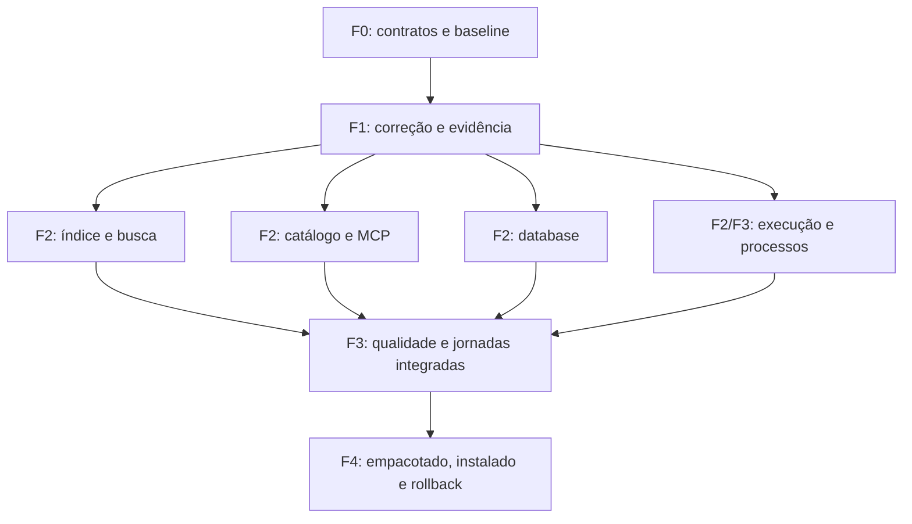

# 07 — Implementação, avaliação, migração e entrega

## 1. Estratégia

Implementar por comportamento verificável, com PRs pequenos que atravessem produtor, contrato e consumidor quando necessário. Não juntar reorganização de packages, mudança de runtime, troca de modelo e otimização de ranking no mesmo experimento.

Responsáveis abaixo são papéis técnicos propostos, não pessoas já designadas. Complexidade S/M/L é relativa: S altera contrato/fluxo localizado; M cruza camadas; L exige lifecycle, compatibilidade ou múltiplos drivers. Não é estimativa de prazo nem compromisso de calendário.

Todo PR referencia achado Fxx, requisito de domínio, teste e evidência. Antes da primeira mudança, confirmar HEAD e diferenças locais; as linhas desta spec são do baseline registrado no README.

## 2. Backlog com rastreabilidade

| Item | Pri. / porte / dono | Escopo e requisito | Dependências | Gate de saída |
|---|---|---|---|---|
| B00 | P0 / M / integração | Baseline, fixtures e traces; F27, CTR-01..07 | Nenhuma | Manifesto reproduzível, corpus separado de tuning, por camada e consumidor |
| B01 | P0 / M / database | Scanner SQL, classificação conservadora; F19, DB-01/14 | Nenhuma | Casos reproduzidos bloqueados antes do dispatch, regressão por dialeto |
| B02 | P0 / S-M / database | Outcome honesto de batch e capacidade de atomicidade; F22, DB-05/08 | B01 para novo dispatch | Zero falso rollback; falhas antes/durante/depois do commit diferenciadas |
| B03 | P0 / M / índice | Lease/ack por arquivo, erro parcial e recovery; F01, IDX-01/02 | CTR de revisão/outcome | Crash e erro transiente não perdem delta nem evento novo |
| B04 | P0 / M / índice | Revisão estrutural no commit/cache; F02, IDX-03 | B03 para watermark completo | Save/delete/rename/branch invalidam apenas revisão afetada |
| B05 | P0 / S-M / MCP | Paginação de catálogo e budgets; F11, MCP-01/02/08 | Contrato de catálogo | Todas as páginas válidas; loop/erro/cancel limitados |
| B06 | P0 / M / ferramentas | Preservar structuredData, blocos e truncamento; F13, CTR-05/07, IDX-09, MCP-05 | Contrato resultado | Paridade produtor→bridge→worker→direct/nested |
| B07 | P0 / M / descoberta | Receipt real, hard cap validado do provider; F09/F10, DSC-02/06/07 | Resolver/projeção existentes | Nunca prometer tool ausente; configuração impossível falha antes de provider |
| B08 | P0 / M / execução | Cleanup/drain/owner, schema output; F17/F18, EXE-07/08/10 | Fixtures processo B00 | Término físico/cauda provados; exceder quota preserva sessões anteriores |
| B09 | P0 / S / database | Reproduzir colisão multi-projeto e corrigir identidade composta; F25, DB-02 | Mapa store atual | Teste IDs iguais passa com split central e por projeto |
| B10 | P0 spike, P1 entrega / L / execução | Watchdog e isolamento snippet; F16, EXE-03/04/12 | B00; preservar EXE-01 | Loop pós-await contido; launcher empacotado; custo medido |
| B11 | P1 / M / busca | Contrato freshness/coverage; grep atual cancelável; F03/F04/F05, IDX-04/05/06/07/08/09, MCP-09 | B03/B04/B06 | Arquivo novo+hit antigo correto ou cobertura parcial explícita |
| B12 | P1 / M / busca/IDE | Recuperação de paths bounded, progresso e paridade modos; F04/F06, IDX-06/08/11 | B00/B11 | p95 e trabalho examinado melhoram; UI não recebe universo de arquivos |
| B13 | P1 / M / descoberta | Unificar serviço catálogo, ranking PT/EN, aliases e abstenção; F07/F08/F10, DSC-01/03/04/05/08/09/10 | B00/B07 | Exato top-1; ambiguidades não ativam; gold set passa |
| B14 | P1 / M / MCP | Refresh por fonte, deadline, cancel e concorrência limitada; F12/F14, MCP-02/03/04/06/07/08 | B05/B06 | Fonte B não derruba A; leitura atestada e mutação mantêm garantias |
| B15 | P1 / M / runtime | Dispatcher comum e API structured nested; F15, EXE-01/02/05 | B06/B07 | Testes diferenciais e mesmo outcome/policy |
| B16 | P1 / L / execução | CommandSpec argv/shell, poll/write/stop e spool; EXE-06..11 | B08/B15 | Windows/POSIX, Unicode, cursor, quota e recovery |
| B17 | P1 / L / database | Leases/revisão/scope/cancel; F23/F24, DB-02/04/06/11 | B01/B02/B09 | Saturação, rotação e schema homônimo corretos |
| B18 | P1 / L / database | Aquisição limitada e SQLite isolado; F20/F21, DB-03/12 | B17 | Memória proporcional à página; main responsivo |
| B19 | P1 / M / database/IDE | Catálogo progressivo, UX de query/partial/cancel; F26, DB-07/08/11/13 | B06/B17/B18 | 10 mil tabelas sem introspecção total para abrir uma |
| B20 | P1 / M / avaliação | Gold set código + tarefas agente, ablação semântica; IDX-10 | B04/B11/B13 | Ganho útil demonstrado e nenhuma regressão exata crítica |
| B21 | P2 / M-L / database | Conflito de edição e export/import jobs; DB-09/10 | B17/B18/B19 | Edição concorrente detectada; PK composta; consistência declarada |
| B22 | P1 / M / release | Upgrade, empacotamento, instalado, rollback; IDX-12, MCP-10, EXE-12 | Gates da fatia promovida | Evidência no mesmo build; não apagar dados/sessões |

As propostas DB-A..F do capítulo 05 detalham B01/B02/B09/B17..B22. Os capítulos 02/03 detalham os requisitos IDX/DSC/MCP associados aos respectivos itens. Um item só está concluído quando todos os requisitos aplicáveis de sua área têm evidência.

## 3. Fases e paralelismo de implementação



F0 não bloqueia correção pequena de F19/F22 nem adição de regressão determinística. F1 deve priorizar essas correções e deltas/cache antes de melhorar números de ranking. Índice, catálogo e database podem avançar em paralelo após acordar contratos. A extração do dispatcher não deve interromper correções locais independentes.

Cada fatia pode ser promovida quando seus gates passam; não é obrigatório aguardar todo B21 para entregar a correção SQL. A spec inteira permanece parcial até fechar todos os requisitos obrigatórios ou registrar formalmente uma mudança de escopo.

## 4. Baseline reproduzível

Registrar em cada execução: commit/build, estado git, SO, CPU/RAM/disco, Node/Electron e ABI, provider/modelo/configuração quando usado, corpus/hash, regras de ignore, parser/embedding/reranker e suas revisões, quantidade de arquivos/bytes, cold/warm, caches e concorrência.

Guardar artefatos em `.tmp/agent-ide-reliability/<run-id>/`: `manifest.json`, `metrics.jsonl`, `summary.md`, outputs de teste, traces e capturas das jornadas. Dados de perfil do usuário não são fixtures. Versionar corpus sintético e verificadores em local definido no primeiro PR de testes; artefatos volumosos e logs permanecem ignorados.

Metodologia:

1. Separar startup cold, caminho warm, reindexação e workload concorrente; não comparar um cold com outro warm.
2. Usar ao menos cinco repetições para tarefas de agente; registrar distribuição e falhas, não apenas a melhor execução.
3. Para microbench/p95, aquecer dez vezes e executar ao menos 200 amostras por classe; p99 só entra como gate com amostragem suficiente, por exemplo 2.000 eventos, ou fica descritivo.
4. Alternar ordem A/B e usar a mesma fixture, hardware e configuração. Calcular diferenças pareadas e intervalos, sem atribuir significância a diferenças menores que o ruído.
5. Separar tempo de queue, I/O, parsing, SQL, inferência, serialização, bridge, provider e renderização. RSS é agregado com todos os filhos pertencentes ao run.
6. Reutilizar harness existente quando ele provar o comportamento necessário. Teste com API mockada é controle de UI, não benchmark do backend.

## 5. Corpus de qualidade e utilidade

### Busca de código

No mínimo 200 consultas rotuladas, PT-BR e inglês, com conjuntos separados para ajuste e aceite. Incluir localização exata, path incompleto, símbolo/caller, regex/literal, intenção conceitual, configuração, fluxo entre pacotes, homônimos, consulta negativa e projeto errado.

Ground truth é arquivo/faixa/relação revisados, com múltiplos resultados válidos quando necessário; não gerar toda a verdade do próprio índice que está sendo avaliado. O gold set registra arquivos ignorados/unsupported e não exige resultado de recurso fora da cobertura declarada.

Perfis de 1 mil, 10 mil, 50 mil e 150 mil arquivos elegíveis ou escala equivalente em bytes/símbolos. Incluir TS/React, PHP/Angular, C#/Unity e repositório misto; assets ignorados, arquivos grandes, Windows paths, Unicode, worktrees, múltiplas raízes e mudanças de branch.

Ablações: paths/grep/FTS; híbrido sem reranker; híbrido com reranker; demais expansões já presentes. Registrar cold inference separado. Ativar componente apenas se seu ganho por classe justificar custo e não degradar consultas exatas.

### Descoberta de ferramentas

No mínimo 200 consultas com tools reais congeladas e catálogo sintético de 100/500/2.000/10.000 descritores. Incluir verbo PT/EN, alias exato, namespace, nome parecido, `path/id/query`, ausência, múltiplas candidatas legítimas, tool indisponível, bloqueada e schema grande.

Ground truth mede tool correta **e** estado correto. Uma ferramenta encontrada mas não autorizada/visível não conta como chamada executável bem-sucedida. Medir primeira chamada válida, correção de argumentos e descoberta até a primeira operação útil.

### Tarefas integradas do agente

Expandir `evals/agent-effectiveness` com pelo menos 30 jornadas verificáveis, cinco repetições por comparação relevante. Manter modelo/temperatura/provider fixos durante A/B; avaliar providers suportados em matriz separada de contrato. Registrar o orçamento máximo de custo e tempo da rodada antes de execução.

Exemplos: encontrar origem de bug e citar duas camadas; planejar correção sem editar; alterar fixture e validar; usar tool que começa oculta; procurar dado de DB read-only por schema; executar build longo e acompanhar; recuperar log truncado; lidar com MCP indisponível sem retry de mutação; cancelar query e continuar trabalhando.

O verificador confere artefatos/estado, escopo de mudanças e testes; texto final persuasivo não é oracle. Separar chamadas pedidas, físicas, coalescidas e evitadas. Uma ferramenta composta conta como uma rodada e como todas as operações físicas que executou.

## 6. Metas propostas e gates

Metas abaixo não foram medidas nesta análise. F0 registra baseline e confirma adequação ao hardware de referência. Mudança de meta exige justificativa registrada antes da comparação final; não baixar o critério depois de observar falha.

| Métrica | Meta de aceite inicial |
|---|---|
| Deltas sob falha/restart | Zero delta perdido; versão nova nunca sobrescrita por ack antigo |
| Cache após commit estrutural | Zero hit apresentado como atual usando revisão estrutural anterior |
| Busca exata/ausência | Casos críticos 100% corretos; ausência conclusiva somente com cobertura completa do escopo e da revisão observados |
| Frescor estrutural | Save-to-query p95 ≤2 s médio e ≤5 s grande no modo live warm; polling mostra intervalo e respeita orçamento próprio |
| Search Everywhere lexical | p95 ≤250 ms médio e ≤500 ms grande warm, medido tecla→resultado; debounce incluído |
| Híbrido conceitual | p95 warm ≤1,5 s médio de tecla→resultado conceitual útil, incluindo debounce; API/inferência e cold separados; ganho de nDCG@10/recall sobre lexical |
| Recuperação de código | Recall@10 ≥90% nas consultas positivas com até dez alvos de ground truth; sem regressão exata; demais consultas conforme regra abaixo |
| Descoberta | Nome/alias exato único 100% top-1; Recall@5 ≥95%; MRR@5 ≥0,85 |
| Autoativação | ≤1% errada no gold set; 100% das ambiguidades críticas rotuladas sem ativação automática |
| Ativação/projeção | 100% dos receipts confirmados correspondem ao conjunto enviado; zero excesso de hard cap |
| Descoberta local | p95 warm ≤50 ms em 2.000 capabilities, sem I/O de MCP no caminho crítico |
| Sucesso do agente | Sem falha nova em casos críticos; não inferior ao baseline no conjunto pareado, com análise de variabilidade |
| Custo por tarefa correta | Alvo de redução ≥20% de rodadas improdutivas ou tokens totais nas classes afetadas; nunca compensa falha de correção |
| UI e trabalho pesado | Nenhum trabalho novo pesado de índice/query JS síncrono no main; p95 event-loop lag <50 ms no workload definido |
| Cancelamento | UI acusa recebimento ≤100 ms; liberação p95 ≤2 s nas fixtures locais canceláveis; demais declaram suporte/pendência |
| DB grande | Fetch retém no máximo duas páginas mais buffers documentados, com bytes/célula limitados; sem materializar milhão de linhas |
| Cleanup | Zero árvore própria órfã após prazo de término; processos de controle externos preservados |
| Desconhecido | Zero replay automático de efeito unknown; nenhum falso commit/rollback/completed |
| Saída | Toda omissão declara unidade, motivo e recuperação verdadeira; cursores não duplicam/omitem bytes do snapshot |

O alvo de custo é objetivo de melhoria, não autorização para reduzir cobertura. Para recursos sem baseline válido, registrar “não medido” e manter gate aberto. Median melhor com p95 pior requer análise por classe e não promoção automática.

Recall usa o total real de relevantes no denominador, nunca `min(10, relevantes)`. Consultas com mais de dez alvos publicam Recall@10, precisão, cobertura e sucesso do alvo requerido separadamente; não recebem uma meta matematicamente impossível. Consultas negativas medem falso positivo e ausência correta. Publicar sempre por idioma, linguagem e classe, além do agregado.

## 7. Matriz mínima de testes e falhas

| Jornada | Camadas | Prova necessária |
|---|---|---|
| Save → reconsultar query aquecida | Watcher/dirty/worker/SQL/cache/IDE/MCP | Novo conteúdo e revision; sem stale replay |
| Crash depois de retirar lote | Queue/worker/SQLite/recovery | Lease retomada e arquivo converge |
| Arquivo novo com hit em arquivo antigo | Grep/overlay/disco/ignore | Ambos retornam ou partial explícito |
| Abrir projeto grande e digitar rápido | Renderer/API/paths/símbolos/semântica | Responsividade, supersession e cancel físico |
| Find em português e ambiguidade | Scorer/catálogo/assembly/provider | Ranking correto, abstinência e receipt fiel |
| MCP com três páginas, cursor repetido e tool inválida | SDK/listing/pool/catalog | Completude ou erro bounded; irmãos válidos preservados |
| Refresh servidor B durante chamada em A | Pool/runtime/attempt | A preservada; revisão atualizada em fronteira explícita |
| Resposta structured e multimodal | Produtor/bridge/RPC/nested/provider | Dados mantidos sem duplicar payload nem descartar bloco silenciosamente |
| Mutação aceita e conexão cai | MCP/DB/shell/ledger | Um envio; unknown; reconciliação exigida |
| code_exec loop após await | Supervisor/RPC/dispatcher | Host vivo, snippet interrompido, efeito filho conhecido/unknown |
| Processo com neto e saída final tardia | Shell/PTY/registry/output | Tree cleanup, drain e recibo terminal |
| Pool DB saturado e cancel | API/driver/pool/servidor | Pedido não fica atrás da fila que deve interromper |
| SQL adversarial/read-only | Scanner/policy/driver | Mutação bloqueada antes do envio e defesa nativa preservada |
| Batch DDL e falha de commit | Capabilities/tx/outcome/UI | Mensagem corresponde à garantia real |
| Projetos com mesmo connectionId/schema | Resolver/pool/cache/UI | Nenhum cruzamento |
| Editar linha alterada por outro cliente | Grid/DML/DB | Conflito e ação explícita, sem sobrescrita silenciosa |
| Export PK composta com writes concorrentes | Job/cursor/DB/output | Garantia de snapshot ou best-effort declarada; sem promessa falsa |

Fixtures de rede/DB são locais e descartáveis. Se engine real não estiver disponível, marcar `not_run`, separar contrato mockado de integração e não anunciar homologação completa. Testes com subprocessos guardam PID, criação e cleanup; nunca encerram por nome global.

## 8. Testes existentes e comandos

Começar pelos caminhos específicos citados em cada capítulo, incluindo `hybrid-cache-revision`, `project-index-service`, `find-tools`, `capability-catalog-tool`, MCP bridge/lost-ack, code-exec/outcome-unknown, exec-command, read-guard e drivers/handlers DB.

O repositório já tem `scripts/test-workspace.mjs` e `scripts/test-harness-tools.mjs`. O primeiro separa SQLite/Electron e fixtures que precisam de Node. Não executar indiscriminadamente todos os testes com um runtime incorreto e não reconstruir dependências nativas como tentativa de corrigir falso negativo de ambiente.

Após testes focados e somente para uma implementação candidata:

```powershell
pnpm typecheck
pnpm run check:boundaries
pnpm test:tools
pnpm run build:all
pnpm test:visual
# Fechamento amplo da candidata, após preparar dependências:
pnpm test:workspace
```

São comandos futuros, não execuções feitas para escrever esta spec. Testes visuais requerem servidor isolado conforme configuração existente. Evals com providers podem gerar custo e dados de rede; usar somente credenciais/ambiente autorizados para a rodada e budget registrado. Nunca usar bancos operacionais como fixture.

## 9. Migração e compatibilidade

1. Adicionar contratos/campos/revisões; adaptar consumidores antigos mantendo nomes públicos.
2. Corrigir invariantes sem mudar ranking quando possível; isso permite atribuir regressões.
3. Publicar nova geração de índice lado a lado; validar cobertura antes da troca atômica. Não apagar a geração ativa na primeira falha.
4. Reconciliar filas antigas por path/hash; invalidar a posse dos leases de owner aposentado, preservar suas pendências e reconciliar hash/revisão antes de retomá-las. Evitar tanto duplicação sem controle quanto perda silenciosa.
5. Introduzir catálogo único por adapters, com telemetry dos nomes legados. Retirada de alias exige ausência de callers ativos ou migração versionada de prompts/sessões.
6. Trocar pool/connection keys com drain de leases; manter configurações e histórico. Bancos do usuário não recebem migration automática.
7. Trocar executor por nova execução, nunca no meio de mutação admitida. Preservar ledgers e outputs para recovery.
8. Temporários de rollout têm owner, critério de desligamento e remoção até no máximo duas releases após promoção estável. Não reintroduzir switches de autoridade aposentados.

Shadow executa apenas comparação pura de decisões, projeção e leitura segura. Não rodar comandos/SQL/MCP mutantes duas vezes para comparar. Quando uma query de leitura tem custo alto, preferir replay gravado ou fixture em vez de duplicá-la no ambiente do usuário.

## 10. Gates de release e rollback

| Gate | Exigência |
|---|---|
| G0 — diagnóstico | Caso mínimo, baseline e escopo; hardware/config registrados |
| G1 — correção | Regressões determinísticas e testes de contrato da fatia passaram |
| G2 — integração | Produtor→adapter→consumer com cancel/falha/outcome e sem recursos órfãos |
| G3 — qualidade/performance | Corpus, orçamento, p95 e sucesso por tarefa atingem metas aplicáveis |
| G4 — produto | Build empacotada e instalada testada; jornadas IDE/agente com artefatos |
| G5 — recuperação | Upgrade/restart/crash/rollback preservam dados, sessões e autoridade |

Promover primeiro em fixture/dev, depois build empacotada, depois canário local explícito, depois default para novas execuções. Registrar o build anterior e validar o procedimento de retorno antes de trocar a aplicação ativa. Instalação não deve interromper sessões ativas sem o procedimento de drain.

Interromper promoção diante de acesso cruzado, delta perdido, falso sucesso, replay de mutação, corrupção, processo órfão persistente, erro de formato de sessão ou regressão material de sucesso/latência/memória. O rollback troca a versão/caminho para novas operações; operações incertas em curso continuam registradas para reconciliação.

Relatório final por item: implementado, validado por teste, medido, validado no app instalado, pendente e motivo. Anexar comando/resultado/commit e resumo das limitações. Não chamar o programa inteiro de concluído por um build verde.

## 11. Decisões técnicas a fechar em F0

Defaults já propostos: catálogo existente como fonte, contratos estruturados aditivos, dispatcher compartilhado, índice incremental com revisões, processos pertencentes ao run e capabilities DB reais. Estes não dependem de nova pergunta ao usuário para iniciar desenho/fixtures.

Precisam de evidência antes da escolha final: mecanismo de candidatos para paths; mecanismo packaged de grep; launcher do snippet isolado; streaming/cursor por driver; custos e budgets finais por hardware; versões de engines e providers que compõem a matriz suportada.

Para cada escolha, registrar opções, protótipo isolado, critério de rejeição, resultado e decisão. Não selecionar nova biblioteca apenas por popularidade nem transformar spike em dependência obrigatória antes de passar seus gates.
