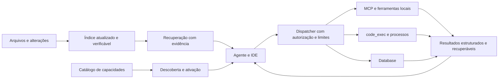

# Spec de correção da indexação, ferramentas, execução e database

**Estado:** implementação em validação. Nenhum requisito está entregue nos quatro eixos. Os quatro P0 da auditoria foram corrigidos com teste de regressão, ainda sem commit. Estado por requisito em [IMPLEMENTATION.md](./IMPLEMENTATION.md), achados em [AUDIT.md](./AUDIT.md) e narrativa original do implementador em [IMPLEMENTATION-LOG.md](./IMPLEMENTATION-LOG.md).

**Data:** 25/10/2026, America/Sao_Paulo.

**Repositório:** `D:\MCP`, CodeStudio Desktop 3.15.1.

**Baseline:** `448d526dd2e24247617938721c0d8cf18ce850cf`.

**Entrega:** spec e alterações de runtime nas cinco frentes, testes, benchmarks e recuperação em perfis descartáveis. O capítulo 01 descreve o baseline histórico. A promoção da candidata depende dos gates do relatório de implementação.

## 1. Resultado esperado

O usuário deve conseguir abrir um projeto grande, localizar a implementação relevante, permitir que o agente escolha a ferramenta correta, executar trabalho acompanhado e consultar bancos sem respostas incompletas silenciosas, estados enganosos ou consumo descontrolado de recursos.

A unidade de sucesso é a tarefa concluída corretamente. Menos chamadas, menos tokens e menor latência são ganhos somente quando a evidência recuperada, a correção do resultado e as garantias de execução são preservadas.

Os cinco problemas relatados formam um fluxo conectado:

## 2. Leitura da spec

| Documento | Decisões e conteúdo |
|---|---|
| [01 — Diagnóstico](./01-diagnostico.md) | Evidências do baseline, gravidade e limites do que foi verificado |
| [02 — Indexação e recuperação](./02-indexacao-e-recuperacao.md) | Índice incremental, consistência, qualidade de busca, IDE e agente |
| [03 — Descoberta e MCP](./03-descoberta-e-mcp.md) | `find_tools`, `expand_toolset`, catálogo, schemas e chamadas MCP |
| [04 — Execução](./04-execucao.md) | `code_exec`, comandos, sessões, cancelamento e saídas |
| [05 — Database](./05-database.md) | Classificação SQL, drivers, consulta, transação, schema e UI |
| [06 — Contratos e observabilidade](./06-contratos-e-observabilidade.md) | Contratos comuns, ownership, budgets, eventos e métricas |
| [07 — Implementação e validação](./07-implementacao-e-validacao.md) | Backlog ordenado, dependências, corpus, metas, rollout e rollback |
| [Estado da implementação](./IMPLEMENTATION.md) | Estado por requisito, gates, backlog, medições e reprodução |
| [Auditoria](./AUDIT.md) | Achados P0–P2, divergências, alterações fora do escopo e proposta de commits |
| [Registro cronológico](./IMPLEMENTATION-LOG.md) | Relatório original do implementador, preservado |

## 3. Escopo e limites

Inclui indexação estrutural e semântica, arquivos/path search, recuperação de contexto, uso da busca pelo agente, descoberta de ferramentas, MCP interno e externo, execução direta e aninhada, shell/PTY e funcionalidades database da IDE e do agente. Inclui o armazenamento SQLite interno quando participa de fila, cache, índice ou concorrência dessas funcionalidades.

Não inclui substituir o produto, trocar o modelo do agente para mascarar problemas, migrar bancos de clientes, reativar o runtime Rust, introduzir um serviço distribuído obrigatório, reconstruir todos os índices em cada abertura ou reescrever o editor inteiro. Mudanças no parser, no engine vetorial ou no isolamento JS devem ser justificadas por testes e perfil do caminho atual.

O runtime vigente é TypeScript. [O registro de remoção do Rust](../../architecture/runtime-retirement.md) prevalece sobre os planos históricos de `code-run-refactor`. Ideias úteis desses planos não são tratadas como infraestrutura entregue nem como autorização antiga para novas mudanças.

As orientações de [CONTRIBUTING.md](../../../CONTRIBUTING.md) continuam válidas: contratos e capacidades em `packages`, entrypoints em `apps`, sem ampliar módulos genéricos quando existir dono de domínio. O armazenamento de conversas em filesystem é preservado.

## 4. Diagnóstico executivo

Não falta infraestrutura básica. Já existem workers, dirty queue, FTS e busca híbrida, paginação em algumas superfícies, virtualização, catálogo de capabilities, políticas, fences, limites de saída e pools de database. O problema prioritário é fechar lacunas entre essas partes.

1. **Correção e confiança:** um delta de arquivo pode ser perdido após falha; caches e fallbacks não demonstram sempre a mesma revisão; o classificador SQL possui casos reproduzíveis de classificação incorreta.
2. **Contrato entre etapas:** o bridge MCP interno perde a estrutura da resposta; expansão de tier e projeção efetiva ao provider podem discordar; limites database nem sempre limitam aquisição.
3. **Ciclo de vida:** cancelamento, timeout, processo vivo, efeito desconhecido e resultado truncado precisam ter significados consistentes em todas as rotas.
4. **Qualidade mensurada:** ranking, frescor, tarefa concluída e custo por tarefa precisam de corpus e baseline. Contar arquivos indexados ou testes verdes não prova que a busca ajuda o usuário.

Cada afirmação detalhada recebe uma evidência em [01](./01-diagnostico.md). Impactos de desempenho sem medição são hipóteses de custo, não benchmarks apresentados como fatos.

## 5. Decisões propostas

| ID | Decisão |
|---|---|
| ADR-01 | Corrigir perda de trabalho, classificação incorreta e falsos estados antes de ajustar ranking ou throughput. |
| ADR-02 | Evoluir o catálogo de capabilities existente; `find_tools` e `expand_toolset` tornam-se fachadas compatíveis, sem um quarto catálogo. |
| ADR-03 | Separar existência, autorização, disponibilidade, seleção e visibilidade no provider. Descobrir não concede acesso. |
| ADR-04 | Compartilhar contrato de busca entre IDE/agente, com projeções de UI próprias. Mostrar revisão, cobertura e degradação. |
| ADR-05 | Preservar dados estruturados desde o produtor até `code_exec` e a UI; texto é apresentação. |
| ADR-06 | Limitar aquisição, filas, execução, memória e transmissão; cortar texto depois não limita o trabalho anterior. |
| ADR-07 | Usar um dispatcher de autoridade para chamadas diretas e aninhadas. Uma política comum deve ter testes diferenciais. |
| ADR-08 | Não repetir automaticamente uma mutação cujo efeito seja desconhecido. Cancelar a espera não significa desfazer o efeito. |
| ADR-09 | Database declara capacidades reais por driver/operação. Batch não promete atomicidade universal e preview não promete rollback universal. |
| ADR-10 | Entregar em fatias com comparação e rollback. APIs e sessões existentes recebem adaptação explícita, sem conversão silenciosa. |

## 6. Ordem recomendada

**F0 — Baseline e contratos:** reproduções isoladas, corpus, medição de ponta a ponta e invariantes. Correções P0 pequenas não precisam esperar um estudo de performance completo.

**F1 — Correção:** classificador SQL, confirmação dos deltas de indexação, cache/frescor, resultado MCP estruturado, catálogo paginado e ciclo de vida dos processos.

**F2 — Utilidade:** ranking PT/EN, ativação que corresponda ao provider, busca consistente entre IDE/agente, queries database com limites físicos.

**F3 — Eficiência e experiência:** scheduler, isolamento `code_exec`, recuperação de outputs, schema incremental, UX de progresso/cancelamento e avaliações integradas.

**F4 — Entrega:** build empacotada, jornadas reais, canário, upgrade/restart e rollback. O detalhe das dependências e gates está em [07](./07-implementacao-e-validacao.md).

## 7. Definição de pronto

- Todos os requisitos obrigatórios têm implementação, teste e evidência vinculados ao mesmo commit.
- Casos de perda de delta, classificação SQL incorreta, expansão falsa, resultado incompleto silencioso e duplicação de efeito têm regressão executável.
- A qualidade de recuperação e o sucesso do agente passam os gates do corpus, sem compensar regressão de correção com redução de tokens.
- IDE permanece utilizável durante indexação, consulta, descoberta MCP e comandos longos; consumo total é medido incluindo filhos e workers.
- Upgrade, cancelamento, crash, reconexão e rollback são exercitados em dados descartáveis.
- Build instalada é testada antes de declarar o problema resolvido no produto. Testes de código e build isoladamente não fecham a entrega.

## 8. Evidência desta entrega de planejamento

Foi realizada inspeção de código, contratos, testes existentes, lockfile e documentação do repositório, com pequenas reproduções de funções puras de ranking e classificação SQL. Documentação oficial foi consultada para os limites de `node:vm`, o contrato MCP e commits implícitos MySQL. Não foram executados SQL em bancos reais, chamadas a servidores MCP externos, reindexação de projetos, benchmarks com providers ou substituição da aplicação instalada.

Os números de desempenho em [07](./07-implementacao-e-validacao.md) são metas propostas para validação, não resultados obtidos nesta análise.
