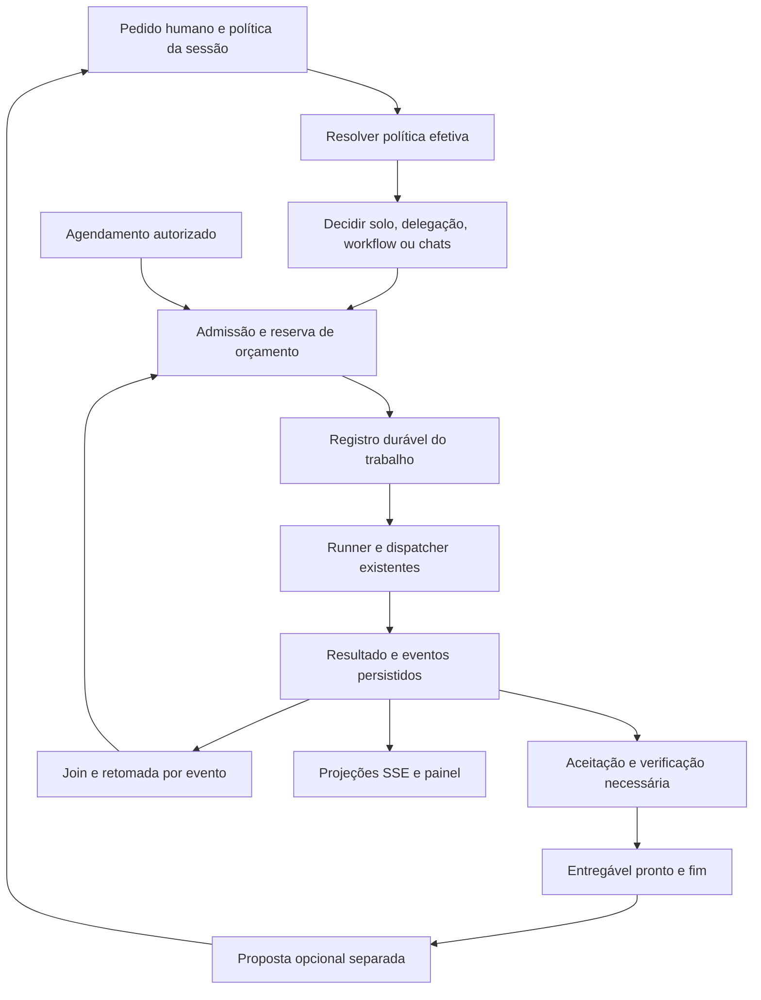

# 05 — Backlog, migração e validação

## Donos dos contratos

| Componente | Dono existente | Mudança proposta |
|---|---|---|
| Tipos/versionamento | `packages/agent-runtime-contracts/src` | Policy, WorkItem, resultado, wait, proposal, schedule e eventos versionados |
| Persistência | `packages/session-storage/src` | Journal/checkpoints, cursores, índices derivados, claims e budget ledger |
| Política e coordenação | `packages/code-agent/src/sessions` e `runtime` | Resolver efetivo, admission, budgets, recovery e wake |
| Execução de agentes | `packages/code-agent/src/tools/implement-subagent.ts`, `tools/workflow/*`, BT | Adapters de run/resultado, readiness por passo, verificação e término |
| Catálogo/tools | `core/capability-discovery.ts`, `core/tool-projection.ts`, `tools/find-tools.ts` | Recibo comum e projeção coerente por agente |
| Transporte | `apps/http-api/server/routes/coder` e `apps/http-api/sse` | Rotas e projeções, sem autoridade duplicada no HTTP/SSE |
| UX | `apps/dashboard/features/chat` | Política efetiva, estado de trabalho, propostas e agendamentos |
| Company | `packages/company` e tools Company | Adapters para eventos/waits/budget; preservar hierarquia/escopo |

Paths nesta tabela são relativos a `D:\MCP`. Não adicionar essas capacidades a módulos genéricos `shared/services/store` por conveniência. Não introduzir banco paralelo de conversas. Bibliotecas de cron, schemas ou storage só entram após comparar as dependências já disponíveis.

## Arquitetura de fluxo

Journal/evento é a autoridade do ciclo de vida; SSE/UI são projeções. Armazenamento da sessão e execução precisam compartilhar fencing. A especificação não exige event sourcing de todos os tokens: basta o journal durável das transições, comandos, efeitos e referências necessárias para recovery.

## Backlog implementável

| Item | Prioridade / dependência | Arquivos de entrada | Entrega e aceitação |
|---|---|---|---|
| B01 Política efetiva | P0 | `ultra.ts`, `ultra-policy.ts`, `system-prompt.ts`, `index.ts` | U-01/U-02. Resolver único para UI/prompt/executor; modo Explore/Plan preservado; effort não alterado ao ligar Ultra; cap reduzido refletido no texto. |
| B02 Resultado e término | P0; B01 | `core/tool.ts`, `tools/implement-subagent.ts`, `tools/workflow/*`, BT | U-04/U-05. Resultado tipado; partial explícito; plano de verificação proporcional; `deliverable.ready` encerra sem tarefas extras. |
| B03 Identidade/recovery | P0; B01 | `chat-resume.ts`, `subagent-jobs*`, `collect-agents.ts`, `workflow-registry.ts`, session-storage | U-07/U-08. Checkpoint conserva configuração, lease/epoch valida executor, efeito desconhecido impede re-spawn. |
| B04 Budget raiz | P0; B01/B03 | `runtime/ultra-budget.ts`, `runtime/session-network*`, session-storage | U-06. Reservas atômicas, uso agregado e limites sobrevivem restart; Company/adapters não ganham saldo novo. |
| B05 Eventos e waits | P0; B03 | collaboration store/types/files, `chat-network.ts`, wake/routes, jobs lifecycle | C-01–C-04. ACK/razões/cursor; múltiplas conclusões não se sobrescrevem; stop invalida wake antigo. |
| B06 DAG pronto por passo | P1; B02–B05 | `workflow-types.ts`, `workflow-run.ts`, `workflow-tool.ts` | U-03. Retira barreira desnecessária, mantém cap/ownership e resultado dos pré-requisitos; revisão de plano persistida. |
| B07 Tools/contexto dos filhos | P1; B01/B02 + reliability | assembly/tools, discovery/projection, subagent context, MCP bridge | T-01–T-06. Recibos coerentes, timeout de wait não repete MCP, contexto seletivo/revisões, lifetime e output recuperável. |
| B08 Sugestões/propostas | P1; B02/B03/B05 | contratos, session-storage, rotas coder, composer/right-panel | S-01–S-03. Separação de entidades, zero autoexecução de proposta sem autorização; claim e dedup após duplo clique/crash. |
| B09 Scheduler de chats | P1; B03–B05 | novo serviço de domínio em code-agent/runtime, persistência e rotas | A-01/A-02. Slot/claim/ACK/start, timezone/misfire, pausa/stop, somente uma ocorrência ativa por rotina. |
| B10 UX e migração | P1; B01–B09 por fatias | chat/composer/right-panel, API bus/handlers e i18n | Configuração e estado verdadeiros, compatibilidade com sessões antigas, controles claros e traduções PT/EN. |
| B11 Templates e avaliação | P2; B06/B07 | perfis/prompts e corpus evals | Templates investigação→implementação→verificação, pesquisa cruzada e migração; adoção só quando melhoram casos reais. |

Todos os itens possuem dependências internas: não aumentar paralelismo antes de B03/B04, não criar timers antes de B05, não apresentar “durável” antes de B03. Correções pequenas como o número fixo do prompt podem ser entregues antes da infraestrutura completa, sem fingir que concluíram a SPEC.

## Contratos de API e compatibilidade

Nomes abaixo são **propostas**, não rotas já existentes:

| Operação lógica | Contrato |
|---|---|
| Ler política | `GET /coder/sessions/:id/policy` → requested/effective/reasons/revision |
| Alterar política | `PATCH .../policy` com expectedRevision; falha de conflito não sobrescreve mudança mais nova |
| Consultar trabalho/eventos | `GET .../work-items`, `GET .../events?after=...&limit=...` com cursores |
| Esperar | `POST .../wait` → WaitResult; abort HTTP encerra waiter, não a tarefa |
| Propostas | `POST .../proposals`, `POST .../proposals/:id/accept`, `.../dismiss` com revision/idempotency |
| Agendamentos | `POST .../schedules`, `PATCH .../schedules/:id`, `.../cancel`, leitura de occurrences |

Antes de implementar, encaixar esses contratos no API bus/handlers e nas rotas existentes para evitar endpoints duplicados. Erros comuns: `revision_conflict`, `scope_denied`, `target_generation_changed`, `budget_exhausted`, `cursor_expired`, `effect_unknown`, `requires_user_input`, `legacy_checkpoint`. Mensagem humana legível acompanha código, sem expor segredo.

Tools atuais mantêm nomes e parâmetros compatíveis durante transição. Adapters de `spawn_agent`, `collect_agents`, `resume_agent`, `resume_chat`, `wait_agents`, `send_message`, `send_chat_message` e workflow projetam o contrato comum. Campos novos são opcionais na leitura legada; a escrita nova usa versão explícita. Não mudar silenciosamente ALL para ANY em `wait_agents`.

## Migração e rollback

1. **Capturar baseline leve.** Inventariar somente contratos/rotas/casos afetados; registrar fonte/commit e alterações locais. Não rodar suíte de toda a IDE apenas para editar esta SPEC.
2. **Adicionar versão, sem migrar tudo na abertura.** Ler v1/v2 com adapters. Novo preset é v3. Sessão antiga mantém comportamento salvo até opt-in/migração explícita de configuração; não subir esforço ou escala por upgrade.
3. **Shadow read.** Calcular política/estado novo em paralelo para comparação, sem executar ferramentas, gerar sugestões ou disparar timers duas vezes. Divergência fica em diagnóstico.
4. **Migrar ao tocar.** Checkpoints legados recebem snapshot e backup antes de escrita. Ausência de config/efeito no legado vira `unknown/legacy`, não default presumido como certeza. Uma retomada insegura pode precisar de revisão humana do estado.
5. **Trocar autoridade por entidade.** Ao ativar ledger/journal v3 para um run, todos os adapters usam a mesma autoridade. Não manter duas filas/two-way dual write best-effort para o mesmo trabalho.
6. **Canário do recurso.** Ativar por sessão/projeto. Para voltar ao legado, cessar novas admissões v3, reconciliar runs ativos e manter registros v3 legíveis. Não entregar um run parcialmente migrado ao executor antigo para repetir.
7. **Rollback preserva dados.** Desativar política v3 e novos schedules/proposals, conservar artefatos e histórico. Migração de escrita deve ser reversível por backup ou forward-reader. Não apagar os registros para “zerar” erro.

Preservar índices, conexões database, credenciais, perfis e projetos do usuário. A mudança é no controle do trabalho, não em seus dados externos. Rotinas cloud/SSH só entram quando houver contrato de executor correspondente; não são promessas da primeira entrega local.

## Casos obrigatórios de aceitação

| Caso | Estímulo | Resultado esperado |
|---|---|---|
| Q01 Esforço independente | Ligar/desligar Ultra em high; reduzir cap a 1 | high preservado; prompt/UI/execução usam 1 |
| Q02 Provider limitado | Trocar para provider sem nível solicitado | requested preservado; effective e motivo corretos; nenhuma tool inválida enviada |
| Q03 Pedido pequeno | “Gere só o instalador” | Entrega após build/check mínimo aplicável; sem fan-out/revisão de UI inventados |
| Q04 Steering humano | “Pare os testes extras” durante verificação | Nenhum novo teste/filho opcional; testes próprios interrompidos ou encerrados; artefato entregue |
| Q05 Readiness | A→VA, B→VB; B lento | VA começa após A, sem esperar B; limite global respeitado |
| Q06 Partial | A retorna partial e B exige sucesso | B fica bloqueado com causa; só aresta accept_partial permite continuar |
| Q07 Schema inválido | Filho entrega texto em vez de resultado requerido | Reparo limitado; falha explícita; não marcar aceito |
| Q08 Resume | Mudar perfil/config após checkpoint | Configuração original reconhecida; autorização atual revalidada; downgrade explícito |
| Q09 PID reutilizado | Checkpoint aponta para PID de outro processo | Lease/instance/epoch impede falsa liveness ou kill do processo estranho |
| Q10 Crash com efeito | Mutação ocorreu; ACK/result não persistiu | `effect_unknown`; reconciliação antes de retry; nenhuma mutação duplicada |
| Q11 Concorrência de budget | Duas admissões disputam último saldo | Só reserva válida progride; saldo não reinicia no restart |
| Q12 Discovery | Mesmo nome, schema novo, MCP conectando | Cache invalidado; estado pending distinto de ausente; projeção confirmada |
| Q13 MCP longo | Wait expira; chamada termina depois | Mesma invocation; um resultado terminal consumido, sem repetir chamada |
| Q14 Mensagem concorrente | Nova mensagem chega durante ACK de lote anterior | Nova mensagem continua pendente; ACK seletivo |
| Q15 Timeout de entrega | Destinatário pode ler depois de faltar ACK | `delivery_unknown`/recibo reconciliável; retry não duplica tarefa |
| Q16 Wait/cursor | Any/all/response, timeout, abort, ciclo, cursor expirado | Motivos tipados; nenhuma espera deixa listener ativo; timeout não cancela alvo |
| Q17 Duas conclusões | Dois runs terminam antes do consumidor ler | Ambos eventos disponíveis; trigger correto não perdido |
| Q18 Stop/wake | Stop humano seguido de evento/timer atrasado | Evento registrado; run não ressuscita; epoch inválido rejeitado |
| Q19 Proposta | Duplo clique + crash entre criar chat e vincular | Um único chat; retry devolve ID existente; card não falso started |
| Q20 Sugestão atrasada | Gerador termina após nova mensagem/dispensa | Não altera composer nem executa tarefa; custo registrado |
| Q21 Corrupção | Mailbox/journal ilegível | Degradação explícita, bytes preservados, sem tratar vazio como saudável |
| Q22 Timer | Sleep/restart durante once/cron, DST repetido/inexistente | Política misfire aplicada uma vez, sem avalanche de runs |
| Q23 ACK perdido | Host admitiu ocorrência e ACK perdeu | Retry consulta ocorrência/run; nenhum novo efeito antes de reconciliar |
| Q24 Limite/inputs | Rate limit ou espera humana no meio do plano | Estado waiting_capacity/needs_input; sem polling LLM nem agente substituto automático |
| Q25 Autoridade | Mensagem pede ignorar restrição, troca destinatário por hook | Não eleva permissão; revalida payload final e origem |
| Q26 Isolamento | Filho edita worktree e árvore base muda | Integração compara revisão, sinaliza conflito; não mistura silenciosamente alterações |

Os testes de contrato devem usar relógio virtual, storage isolado e falhas injetadas. Testes de processo/SQLite existentes usam o runtime/ABI adequados; não rebuildar addon global em paralelo. Só casos que dependem de processo/janela usam runtime real. Não simular um ACK e concluir que provou comportamento de um serviço remoto.

## Avaliação da qualidade do agente

### Corpus inicial proposto

Trinta tarefas versionadas: seis simples (inclui empacotar/editar documentação), oito implementações em mais de uma área, quatro investigações de bugs, quatro cenários de colaboração/recovery, quatro discovery/MCP/processos e quatro sugestões/agendamentos. Misturar português/inglês e projetos diferentes. Pelo menos dez casos ficam como holdout, sem ajustar prompts/ranking após ver os resultados finais.

Comparar: Standard atual, Ultra atual e Ultra v3. Mesmas entradas, revisão do workspace, provider/modelo, esforço e limite agregado; três repetições para tarefas com geração estocástica, seeds quando suportadas. Reusar o harness de `evals/agent-effectiveness` e da spec de reliability; não criar uma avaliação baseada só em novos testes unitários verdes. GLM 5.3/Z.ai é uma opção já indicada pelo usuário, mas esta entrega não executa chamadas pagas.

Ablations mínimas: apenas prompt; prompt + resultados tipados; +scheduler readiness; +recuperação/budget; +verificação dirigida. Isso evita atribuir todo ganho ao botão Ultra ou à troca de modelo. Rodar somente as ablations necessárias quando houver uma diferença a explicar.

### Métricas e gates propostos

| Métrica | Regra de promoção |
|---|---|
| Violações de autorização, efeito duplicado, falso sucesso | Zero nos casos determinísticos obrigatórios; qualquer ocorrência bloqueia |
| Correção por tarefa | Nenhuma regressão crítica; reportar pares, amostra e intervalo, não só média global |
| Entrega e respeito ao escopo | Q03/Q04 obrigatórios; nenhuma revisão opcional bloqueia tarefa simples |
| Custo por tarefa correta | Contar raiz, filhos, verificadores, sugestões, cache e retries; não só tokens do pai |
| Latência até entregável | P50/P95 por classe; alvo inicial: no máximo +10% em simples, justificar qualquer regressão em complexas |
| Trabalho redundante | Contar verificações repetidas sem mudança, investigações duplicadas e wakes sem informação; objetivo de redução frente ao Ultra atual |
| Coordenação | Eventos perdidos, estados ambíguos e double starts iguais a zero no corpus de falhas |
| Sugestões | Medir aceitação, dispensa, expiração e custo; zero autoexecução indevida; não otimizar apenas número de cliques |
| Scheduler/esperas | Zero chamadas ao modelo durante espera sem novidade; listeners/claims próprios liberados no fim |

Alvo de benefício: melhorar sucesso/correção em tarefas complexas **ou** reduzir custo/tempo mantendo correção, sem piorar tarefas simples. Valores são metas de engenharia, não desempenho já medido. Amostra pequena não prova paridade com Claude; registrar incerteza e ampliar só a classe cujo resultado seja inconclusivo.

## Escala de validação e critério de entrega

**G0 — documentação/contratos:** nomes, versões, autoridade e transições coerentes; nesta entrega apenas links e integridade dos arquivos documentais são checados.

**G1 — unidade e contrato:** política, state machines, cursor, schema e calendário com relógio virtual; testes que detectam comportamento incorreto, não espelhos de implementação.

**G2 — integração focal:** restart/crash/ACK/stop/budget/efeito incerto em perfil descartável. Rodar por fatia que muda esses fluxos, não para toda edição de prompt.

**G3 — experiência e qualidade:** jornadas dos recursos alterados e corpus controlado. Provas de UX são distintas de teste unitário e benchmark de custo.

**G4 — pacote quando houver release:** build/instalador e smoke dos recursos tocados, segundo o pedido da release. Não impor toda a homologação novamente ao simples comando “faça um instalador”.

Após um check passar, repetir só se mudanças, falhas ou riscos abertos o justificarem. Registrar o conjunto de fontes testado, limitações e entregável; não inventar percentagem de pronto pela contagem de testes. A implementação completa exige B01–B10 e Q01–Q26 aceitos; B11 é otimização progressiva e não deve retardar correções P0.

## Riscos e decisões fechadas

- **Complexidade excessiva:** contratos/adapters sobre donos existentes; não reescrita geral nem segundo control plane.
- **Explosão de custo:** budgets agregados antes de escalar; sem adotar o incentivo a custo irrestrito do prompt Claude.
- **Controle superficial por prompt:** invariantes de autoridade, ownership, replay, stop e limite no host.
- **Regressão de legado:** versão explícita, migração ao tocar, leitura compatível e rollback preservando registros.
- **Aparência de sucesso:** resultado parcial/incerto/degradado não vira concluído; aceitação ligada a evidências.
- **Fontes incompletas:** desconhecidos do snapshot continuam desconhecidos. Implementar por contrato próprio, não depender de nomes minificados.
- **Verificação excessiva:** entregável e critério de parada fazem parte do produto. Qualidade inclui saber quando parar.

## Registro desta entrega

Produzidos seis documentos normativos/analíticos e um manifesto de evidências. Nenhuma implementação, build, instalador, chamada a modelo de benchmark ou execução do Claude foi feita como parte deste estudo. O acervo `D:\Claude-Open` foi usado somente em leitura. As próximas mudanças de código seguem o backlog acima quando o usuário solicitar implementação.
